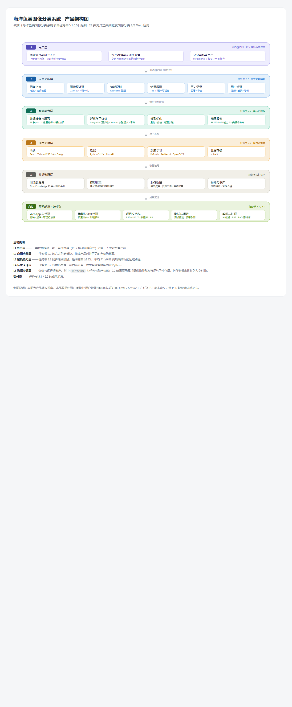

# 海瞳鱼鉴 SeaPupil — 基于 CNN 的海洋鱼类图像分类系统

<p align="center">
  
</p>

**上传一张水下鱼类照片，即刻得到物种识别结果** —— Top-1 物种（中文名/拉丁名）、置信度、Top-5 候选概率分布，以及物种知识卡片。前后端分离 B/S 架构，开箱即用。

基于 [Fish4Knowledge](https://homepages.inf.ed.ac.uk/rbf/FISH4KNOWLEDGE/) 公开数据集（23 类海洋鱼类 · 27,324 张水下图像），以 **ResNet18 迁移学习**构建分类模型，并工程化为完整 Web 应用。同时是一套完整的 **AI 共创开发教学案例**（含 10 份实训指导书 + 18 份 RAG 语料库）。

## ✨ 功能特性

| 模块 | 能力 |
|---|---|
| 🖼 图像上传 | 单图 ≤10 MB、批量 ≤9 张；游客免登录试用 3 次；**上传与识别分离，上传不消耗额度** |
| 🔍 智能识别 | 23 类物种 Top-1 + 置信度 + Top-5 候选；低置信（<0.60）自动兜底提示 |
| 📊 结果展示 | 物种知识卡片（中文名/拉丁名/介绍）+ Top-5 概率条形图 |
| 🕘 历史记录 | 搜索/筛选/详情/多次识别对比/CSV 导出（带 BOM，Excel 直接打开） |
| 👤 用户管理 | JWT 注册/登录；管理员后台（用户/物种/记录/系统配置）；操作审计日志 |
| 🛡 工程化 | 错误码分段 28 条；60 次/分钟限流；游客额度服务端计数；模型回滚开关 |

## 🎯 模型指标

| 指标 | 要求（任务书） | 实测 |
|---|---|---|
| 测试集 Accuracy | ≥ 85% | **99.63%** |
| 测试集 Macro F1 | ≥ 0.82 | **0.9678** |
| 网图 OOD Top-1 | — | **82.80%**（混合微调后，基线仅 32.26%） |
| 端到端时延 | ≤ 3 s | **p50 90.8 ms**（预算余量 22~33 倍） |
| 单次推理（GPU） | — | 纯前向 2.28 ms |

生产权重 `ml/models/M1_ood_tuned/best.pt` 已随仓库附带，**克隆即可推理，无需自行训练**。

## 🧱 技术栈

- **前端**：React 18.3 · TypeScript 5.6 · Vite 6 · Tailwind CSS 3.4 · Ant Design 5.22 · Zustand 5 · Axios 1.7
- **后端**：FastAPI · Python 3.12+ · SQLite（7 表 64 字段）· SQLAlchemy 2 · JWT
- **深度学习**：PyTorch · ResNet18 迁移学习（224×224）· WeightedRandomSampler 长尾采样 · 训练/推理预处理逐元素一致（容差 0）

## 🚀 快速开始

> 以下命令在 Windows 11 / Python 3.13 / Node 22 实测通过；Linux/macOS 将 `python` 换成对应解释器即可。

### 0. 环境准备

| 依赖 | 版本 | 说明 |
|---|---|---|
| Python | 3.12+ | 后端 |
| Node.js | 18+（实测 22.x） | 前端 |
| NVIDIA GPU | 可选 | 无 GPU 自动 CPU 推理，功能不受影响 |

```bash
# 1) 克隆本仓库
git clone https://github.com/lulubingking/seatong.git
cd seatong

# 2) 后端依赖（建议先建虚拟环境）
python -m venv .venv
.venv\Scripts\activate            # Windows；Linux/macOS: source .venv/bin/activate
pip install -r requirements.txt

# 【GPU 加速，可选】按你的 CUDA 版本安装 GPU 版 torch，例如 CUDA 12.6：
#   pip install torch torchvision --index-url https://download.pytorch.org/whl/cu126
# 未安装 GPU 版时自动走 CPU，识别功能正常，速度稍慢。
```

### 1. 初始化数据库（首次部署必做）

```bash
cd backend
python scripts/init_db.py     # 建库：7 表 / 10 显式索引 / 6 外键，自动体检
python scripts/seed_data.py   # 灌种子：23 个物种 + 系统配置 + 管理员账号
```

种子数据自带管理员：**`admin / Admin@12345`**（生产环境请第一时间改密）。

### 2. 启动后端

```bash
cd backend
uvicorn app.main:app --host 0.0.0.0 --port 8000
```

验证：浏览器打开 `http://127.0.0.1:8000/api/health`，返回 `"status": "ok"` 即成功（含模型加载状态）。

### 3. 启动前端

```bash
cd frontend
npm install
npm run dev
```

浏览器访问 **`http://localhost:5180`** —— 上传一张鱼图，完成第一次识别 🎉

> 无鱼图？克隆数据集后从 `fish_image23/fish_image/fish_1/` 随便拿一张即可。

## 📦 数据集准备（可选，仅训练/复现实验需要）

**运行已训练模型不需要数据集**。如需复现训练或评测：

- 数据集 `fish_image23`（27,324 张 PNG，约 501 MB）**不随仓库分发**，体积过大
- 来源：Fish4Knowledge 公开数据集（爱丁堡大学 R. B. Fisher 课题组），国内可经飞桨 AI Studio `datasetdetail/14492` 获取
- 放置位置：仓库根下 `fish_image23/fish_image/fish_1` ~ `fish_23`（`class_index = N - 1`）
- 或通过环境变量 `SEATONG_DATA_ROOT` 指向任意位置

目录放好后，训练与评测入口：

```bash
python ml/dataset/make_split.py          # 分层抽样划分 train/val/test（固定种子可复现）
python ml/training/train.py              # ResNet18 迁移学习训练
python ml/dataset/test_preprocess_parity.py   # 训练/推理预处理一致性校验（容差 0）
```

## 🧪 测试与自检

```bash
# 前端四合一直检：typecheck + 设计令牌 lint + 接口契约 118 项 + 路由冒烟 12 条
cd frontend && npm run selfcheck

# 后端端到端测试（需后端已启动）
cd backend && python -m pytest tests/test_e2e.py -v

# 接口契约三方对账（文档 ↔ 后端 ↔ 前端）
python tools/api_contract_verify.py
```

验收口径参考：7 套件 348 项断言 + 浏览器 E2E 22 项全绿（详见 `docs/海瞳鱼鉴-集成联调与验收记录.md`）。

## 📁 目录结构

```
seatong/
├── backend/            # FastAPI 后端（38 个端点，API 前缀 /api）
│   ├── app/            #   api/ core/ services/ schemas/ models/
│   ├── scripts/        #   init_db.py · seed_data.py（首次部署必跑）
│   └── tests/          #   E2E / NFR 审计 / 验收探针
├── frontend/           # React 前端（13 页面）
│   ├── src/            #   api/ pages/ components/ stores/ routes/
│   └── scripts/        #   selfcheck 四件套自检脚本
├── ml/                 # 深度学习全链路
│   ├── dataset/        #   预处理（训练/推理一致）· 划分 · 数据体检
│   ├── training/       #   train.py · 六组对照实验
│   ├── optimize/       #   量化/剪枝优化复测
│   ├── ood_web/        #   网图 OOD 评估 · 混合微调（含冻结基准图）
│   └── models/         #   生产权重 M1_ood_tuned · 回滚基线 M1_main_224
├── tools/              # 契约校验器 · 文档校验器
├── docs/               # 全套技术文档（PRD / API 契约 / 数据库设计 / UI-UX / 实验报告…）
├── tutorials/          # 10 份 AI 共创实训指导书
├── rag-corpus/         # 18 份 RAG 语料库 + 提示词
├── deploy/             # Nginx 生产部署配置
└── CASE_OVERVIEW.md    # 案例资源总览（12 学时教学设计）
```

## 📚 文档索引

| 文档 | 内容 |
|---|---|
| [docs/海瞳鱼鉴-PRD.md](docs/海瞳鱼鉴-PRD.md) | 产品需求文档 V1.3：41 FR / 15 NFR / 60 BR / 55 AC，11 张流程图 |
| [docs/海瞳鱼鉴-API接口契约.md](docs/海瞳鱼鉴-API接口契约.md) | 38 端点契约 + 约束 + 异常场景，与实现零漂移（校验器守护） |
| [docs/海瞳鱼鉴-数据库设计文档.md](docs/海瞳鱼鉴-数据库设计文档.md) | 7 表 64 字段 / 16 索引 / 6 外键策略 |
| [docs/海瞳鱼鉴-UIUX设计文档.md](docs/海瞳鱼鉴-UIUX设计文档.md) | 13 页面规格 + 26 组件 + 34 设计令牌 |
| [docs/海瞳鱼鉴-分布外网图评估报告.md](docs/海瞳鱼鉴-分布外网图评估报告.md) | OOD 32.26% → 82.80% 的完整实验记录 |
| [docs/海瞳鱼鉴-模型优化与复测报告.md](docs/海瞳鱼鉴-模型优化与复测报告.md) | 量化/剪枝收益实测与「不启用」的决策依据 |
| [docs/部署指南-生产.md](docs/部署指南-生产.md) | Nginx + HTTPS 生产部署（配置模板在 `deploy/`） |
| [tutorials/](tutorials/) | 从 PRD 到部署的 10 份 AI 共创实训指导书 |

## ⚙️ 环境变量

所有配置项支持 `SEATONG_` 前缀环境变量覆盖（模型路径、端口、JWT 密钥、游客额度等），完整清单见 [`backend/.env.example`](backend/.env.example)。最常用的一项：

```bash
# 回滚到微调前基线模型
SEATONG_MODEL_PATH=<仓库路径>/ml/models/M1_main_224/best.pt
```

## ❓ 常见问题

<details>
<summary><b>前端启动报端口 5180 占用</b></summary>

修改 `frontend/vite.config.ts` 的 `server.port`，并同步修改后端 `SEATONG_FRONTEND_ORIGIN`（CORS 白名单）。
</details>

<details>
<summary><b>识别接口返回 503 / 模型加载失败</b></summary>

确认 `ml/models/M1_ood_tuned/best.pt` 存在；或通过 `SEATONG_MODEL_PATH` 指定权重路径。`/api/health` 的 `model.ckpt_exists` 字段可快速定位。
</details>

<details>
<summary><b>上传报 413 / 415</b></summary>

单图 ≤10 MB、格式 PNG/JPEG/BMP、批量 ≤9 张。走 Nginx 时还需设置 `client_max_body_size`（见 `deploy/nginx.conf`）。
</details>

<details>
<summary><b>识别返回 42901 / 42902</b></summary>

`42901` = 游客 3 次试用额度用尽（注册登录后不限）；`42902` = 触发 60 次/分钟限流，稍后重试。均为设计内行为。
</details>

<details>
<summary><b>CPU 机器能跑吗？</b></summary>

能。GPU 优先、CPU 自动降级是 PRD 明文口径；CPU 单次推理约几十毫秒，远低于 3 秒预算。
</details>

## 📄 许可与声明

- 本项目为毕业设计/实训交付，代码与文档仅供学习交流
- 数据集版权归 Fish4Knowledge（爱丁堡大学）所有，请遵循其原始许可
- 识别结果仅作辅助参考，不构成权威物种鉴定依据；模型仅覆盖 23 个已知类别

---

<p align="center">海瞳鱼鉴 SeaPupil · AI 共创开发 · 2026</p>
