# 海瞳鱼鉴 · 产品需求文档（PRD）

| 项 | 内容 |
| --- | --- |
| 文档名称 | 海瞳鱼鉴产品需求文档 |
| 产品名称 | 海瞳鱼鉴 |
| 英文名 / 项目代号 | SeaPupil / seatong |
| 当前版本 | V1.3 |
| 编制日期 | 2026-09-17 首次编制；2026-09-20 定稿并更新至 V1.1；2026-09-21 依实现校准至 V1.2，修补悬空需求引用至 V1.3 |
| 文档状态 | **定稿** —— 全文 14 章（第 0 ～ 13 章）+ 附录 A ～ F；附录 A 物种清单已落实；**第 8 章已与实现对齐（V1.2）**；**V1.3 补入 FR-USER-10 修补悬空引用** |
| 编制依据 | 《海洋鱼类图像分类系统项目任务书 V1.0.0》 |

> **阅读提示**：本文档为**全篇定稿版**（V1.3，第 8 章已依实现校准）。**第 4 章（功能需求详述）与第 7 章（算法与模型需求）是功能与指标的核心**——前者定义全部功能行为与验收条件，后者承载准确率 ≥ 85%、宏观 F1 ≥ 0.82 两项硬指标的达成路径与门槛校验方法。**第 10 章（验收标准）与第 11 章（风险与对策）是评审时最应关注的两章**——前者给出可执行的系统级判定依据，后者第 11.2 节的 R-D-01（类别长尾）为本项目识别出的最高风险。**附录 A（23 类物种清单）已完成定名与编号锁定**，是 `classes.txt`、`species` 表与知识库文案的共同基准。
>
> 本文档为下游文档的权威基准，需求编号与口径以其为准。附录 E.3 为图表编号的唯一来源。

---

## 第 0 章　文档信息

### 0.1 编制说明与决策基线

本 PRD 依据《海洋鱼类图像分类系统项目任务书 V1.0.0》编制，将任务书中的目标、模块划分与技术要求转化为可开发、可测试的需求条目。

任务书未明确但在开发中必须确定的环节，本 PRD 采用下表所列的决策基线。**这些取值来自框架阶段的建议默认值，若与实际意图不符，可在评审时逐条调整，调整后将同步修订受影响章节。**

| 决策项 | 基线取值 | 影响范围 |
| --- | --- | --- |
| 英文名 / 项目代号 | SeaPupil / seatong | 全篇命名、仓库与包名 |
| 游客试用策略 | 支持免登录试用，限 3 次 | 第 2、4.6 章 |
| 管理员角色 | 设立，含用户与记录管理、系统配置维护 | 第 2、4.6、5 章 |
| 认证方案 | JWT + 短期令牌 | 第 8.2 章 |
| 物种介绍内容来源 | 预置物种知识库（23 类静态文案，人工校核） | 第 4.4、6.4 章 |
| 上传限制 | 单图 ≤ 10 MB；批量最多 9 张 | 第 4.1 章 |
| 平均 F1 口径 | 宏观 F1（macro-F1） | 第 7.4、10 章 |
| 模型关注区域可视化 | 不提供，限定在任务书范围内 | 第 4.4 章 |
| 部署与推理设备 | 单机部署，优先 GPU 推理、CPU 可降级 | 第 9.1 章 |
| 历史记录导出格式 | CSV | 第 4.5 章 |
| 密码找回 | 不提供，仅支持登录后修改密码 | 第 4.6 章 |
| 单图端到端耗时目标 | ≤ 3 秒 | 第 9.1 章 |
| 量化剪枝精度回退容忍度 | 回退不超过 1 个百分点，超出则放弃量化 | 第 7.5 章 |
| 响应式断点 | 768 / 1024 / 1440 三档 | 第 5.5 章 |

### 0.2 修订记录

本节为简表，完整修订明细见附录 F。

| 版本 | 日期 | 修订内容 | 修订人 | 状态 |
| --- | --- | --- | --- | --- |
| V0.1 | 2026-09-17 | 首次发布，含第 0 ～ 3 章 | —— | 已完成 |
| V0.2 | 2026-09-17 | 补充第 4 章功能需求详述，覆盖六大模块、40 条功能需求、60 条业务规则、54 条验收条件 | —— | 已完成 |
| V0.3 | 2026-09-17 | 补充第 5 ～ 8 章：页面与交互需求（13 个页面）、数据需求（7 张表的完整数据字典）、算法与模型需求、接口与集成需求（27 个接口端点、18 个错误码） | —— | 已完成 |
| V1.0 | 2026-09-20 | 补充第 9 ～ 13 章与附录 A ～ F，**全篇定稿** | —— | 定稿 |

### 0.3 文档目的与读者对象

本文档用于明确海瞳鱼鉴的功能边界、业务规则与验收标准，作为开发、测试与评审的共同依据。

| 读者 | 重点关注章节 | 用途 |
| --- | --- | --- |
| 产品与评审者 | 第 1 ～ 3 章 | 确认产品定位、需求范围与优先级 |
| 前端开发 | 第 4 章、第 5 章 | 理解功能逻辑与页面交互要求 |
| 后端开发 | 第 4 章、第 6 章、第 8 章 | 设计数据模型与接口 |
| 算法开发 | 第 6.3 节、第 7 章 | 明确数据集规格、模型方案与验收门槛 |
| 测试 | 第 10 章、各章验收标准 | 编写测试用例 |
| 未来维护者 | 全篇 | 理解设计决策的来由 |

### 0.4 术语与缩略语

| 术语 | 说明 |
| --- | --- |
| 细粒度图像分类 | 对同一大类下外形高度相似的子类别进行区分，如区分不同种鱼类 |
| 迁移学习 | 复用在大规模数据集上预训练的模型权重，替换输出层后在小数据集上继续训练 |
| ResNet18 | 18 层深度的残差网络，通过残差连接缓解深层网络梯度消失问题 |
| Top-5 | 模型输出的概率最高的 5 个候选类别及其概率值 |
| 置信度 | 模型对某一类别输出的概率值，取值范围 0 ～ 1 |
| 宏观 F1（macro-F1） | 分别计算各类别的 F1 分数后取算术平均，不按样本数量加权 |
| 拒识阈值 | 首位候选置信度低于该值时，提示结果可靠性不足 |
| B/S 架构 | 浏览器 / 服务器架构，业务逻辑集中于服务端，客户端仅需浏览器 |
| FR / NFR / BR / AC | 功能需求 / 非功能需求 / 业务规则 / 验收条件 的编号前缀 |

### 0.5 参考文档

| 编号 | 文档名称 | 用途 |
| --- | --- | --- |
| R1 | 《海洋鱼类图像分类系统项目任务书 V1.0.0》 | 本文档的上游依据 |
| R2 | `SKILL.md`（实训指导书生成器规范） | 技术栈默认约定、文档模板规范 |
| R3 | Fish4Knowledge 23 类鱼类数据集（飞桨 AI Studio） | 训练与评估数据来源 |
| R4 | 海瞳鱼鉴产品架构图 | 分层结构参考 |

### 0.6 需求编号规范

| 类型 | 格式 | 示例 |
| --- | --- | --- |
| 功能需求 | `FR-<模块>-<两位序号>` | `FR-UPLOAD-01` |
| 非功能需求 | `NFR-<类别>-<两位序号>` | `NFR-PERF-01` |
| 业务规则 | `BR-<模块>-<两位序号>` | `BR-RECOG-03` |
| 验收条件 | `AC-<FR 编号>-<序号>` | `AC-FR-UPLOAD-01-1` |

模块代号：`UPLOAD` 图像上传、`PREPROC` 预处理、`RECOG` 智能识别、`RESULT` 结果展示、`HISTORY` 历史记录、`USER` 用户管理。
非功能类别：`PERF` 性能、`SEC` 安全、`REL` 可靠性、`COMPAT` 兼容性、`MAINT` 可维护性。

### 0.7 任务书口径差异处理

任务书中存在前后表述不一致之处，本 PRD 按下表统一口径，避免正文出现依据冲突。

| 任务书原文 | 本文档采用口径 | 理由 |
| --- | --- | --- |
| 任务分解表第 6 项写「Flask/FastAPI」，第 7 项写「Vue.js/React」 | 统一为 FastAPI + React | 与任务书 3.2 核心技术表一致 |
| 技术表未列 ORM 与认证方案 | 补充 SQLAlchemy 作 ORM、JWT 作认证方案 | 前后端分离架构的必备组件，属补全非扩张 |
| 2.2 要求物种形态特征与习性介绍，5.1 / 5.2 未列物种知识库 | 第 6 章单列物种知识库并纳入交付物 | 消除隐含依赖，避免开发期无依据 |
| 准确率 ≥ 85% 与模型量化剪枝存在精度冲突 | 第 7.5 节增设精度回退控制线与复测要求 | 保证硬指标可验证 |

---

## 第 1 章　产品概述

### 1.1 产品定位

**海瞳鱼鉴是一款面向 23 类海洋鱼类的细粒度图像分类 Web 应用。** 用户在浏览器中上传水下拍摄的鱼类图像，系统基于卷积神经网络完成物种识别，返回物种名称、置信度分数与 Top-5 候选概率分布，并展示该物种的形态特征与习性介绍。

产品形态与技术特征：

| 维度 | 说明 |
| --- | --- |
| 产品形态 | B/S 架构 Web 应用，前后端分离 |
| 访问方式 | PC 与移动端浏览器，无需安装客户端 |
| 核心能力 | 23 类海洋鱼类细粒度分类，输出置信度与 Top-5 候选 |
| 数据闭环 | 识别结果自动沉淀为历史记录，支持筛选、回看与导出 |
| 关键指标 | 总体准确率 ≥ 85%，平均宏观 F1 ≥ 0.82 |

与既有方案的差异：

| 对比对象 | 局限 | 海瞳鱼鉴的差异点 |
| --- | --- | --- |
| 人工鉴定 | 依赖分类学专业知识，逐张标注耗时 | 无需专业知识，单图结果在秒级返回 |
| 通用图像识别工具 | 类别泛化，难以区分外形相近的鱼类 | 专为 23 类海洋鱼类训练，专注细粒度判别 |
| 本地桌面软件 | 需安装部署，跨平台性差 | 浏览器即可访问，调查现场可直接使用 |

### 1.2 目标用户与使用场景

#### 用户一：渔业调查与研究人员

- **特征**：具备基础生物学背景，但未必掌握鱼类分类学；工作场景多在调查船、实验室。
- **核心诉求**：快速处理批量采集的水下图像，获得可用于统计的物种清单。
- **典型场景**：调查船返航后，研究人员将水下摄像机采集的图像批量上传，逐张获得物种识别结果，据此统计各物种出现频次，形成资源量调查的原始数据。

#### 用户二：水产养殖与流通从业者

- **特征**：日常接触渔获，依赖经验判断物种；现场环境嘈杂、时间紧迫。
- **核心诉求**：在交易或分拣现场快速确认物种，减少经验误判带来的纠纷。
- **典型场景**：交易现场从业者用手机拍摄渔获照片，通过浏览器获取物种名称与置信度，作为定价与交涉的参考依据。

#### 用户三：公众与科普用户

- **特征**：无专业背景，兴趣驱动，多为移动端临时使用。
- **核心诉求**：知道自己拍的鱼是什么，并了解其习性。
- **典型场景**：用户在海边、水族馆或市场拍摄照片，上传后获得物种名称与形态特征、习性介绍，形成轻量的科普体验。

### 1.3 用户痛点与解决方案

| 痛点 | 现状描述 | 海瞳鱼鉴的解决方案 |
| --- | --- | --- |
| 鉴定门槛高 | 传统鉴定需要分类学专业知识，非专业人员难以判断 | CNN 自动提取鱼体轮廓、鳍形、体色纹理等判别特征，用户无需专业知识 |
| 处理效率低 | 水下摄像机产生图像数量庞大，人工逐张标注耗时费力 | 支持批量上传，单图端到端耗时 ≤ 3 秒 |
| 相近物种难区分 | 外形相近的物种在人工判读中容易混淆 | 细粒度分类模型输出 Top-5 候选与置信度，结果可复核 |
| 结果难追溯 | 鉴定结论散落于纸质记录或个人文件，难以复用 | 识别历史自动留存，支持按时间与物种筛选、导出 |
| 物种知识缺失 | 知道名称但不了解形态与习性 | 内建 23 类物种知识库，识别结果附带介绍 |

### 1.4 产品目标

**业务目标**

- 覆盖渔业调查、水产交易、科普教育三类应用场景。
- 单张图像的识别流程耗时从人工数分钟量级降至 ≤ 3 秒。
- 降低对分类专家的依赖，使非专业人员可独立完成常规物种识别。

**技术目标**

- 实现 23 类海洋鱼类的分类识别，测试集总体准确率 ≥ 85%。
- 测试集平均宏观 F1 ≥ 0.82，兼顾长尾类别的识别表现。
- 单图端到端耗时 ≤ 3 秒，支持批量识别任务顺序处理。
- 前后端分离架构落地，模型推理以独立服务形式对外提供。

**数据目标**

- 完成 Fish4Knowledge 23 类、两万余张图像的清洗与 8:1:1 分层划分。
- 沉淀 23 类物种知识库，每类包含学名、俗名、形态特征、习性、分布与配图。

### 1.5 产品边界

以下内容**不在**本产品的实现范围内，需在开发与评审中明确排除：

| 编号 | 不做的事 | 原因 |
| --- | --- | --- |
| 1 | 不覆盖 23 类之外的物种识别，不做开放集识别 | 模型仅针对训练集的 23 类训练，超出范围可能给出错误结果 |
| 2 | 不做实时视频流识别 | 任务书限定为图像上传识别，视频流识别涉及额外工程复杂度 |
| 3 | 不做多物种同框的实例分割与计数 | 任务书仅要求图像所属物种判定，不要求目标检测与计数 |
| 4 | 不提供鱼体尺寸、重量或年龄估计 | 超出任务书的功能范围 |
| 5 | 不替代专业机构的物种鉴定结论 | 任务书 6.1 明确本产品仅作辅助工具与科普参考 |
| 6 | 不做移动端原生 App 与桌面客户端 | 任务书限定为 B/S 架构 Web 应用 |

### 1.6 产品架构

产品由用户层、应用功能层、智能能力层、技术支撑层与数据资源层五层构成，自用户请求向下逐层依赖。

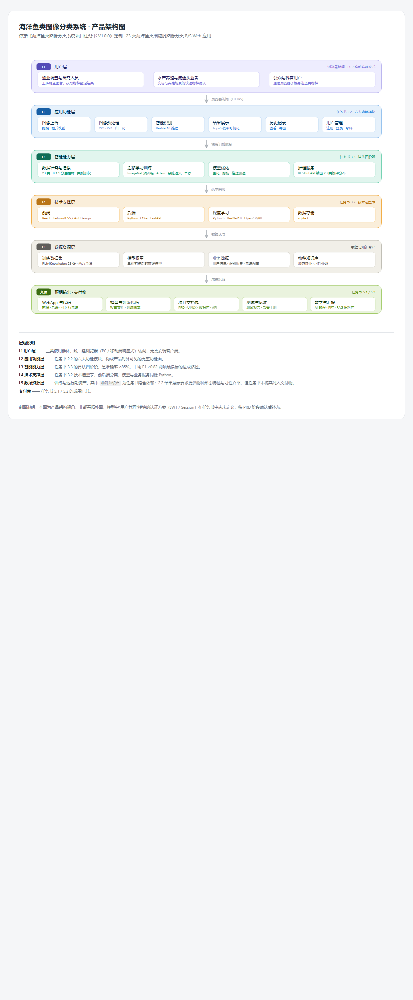

各层职责：用户层承载三类使用群体；应用功能层对应第 4 章的六大功能模块；智能能力层对应第 7 章的算法四阶段；技术支撑层为任务书 3.2 确定的技术选型；数据资源层存放训练与运行期资产。

---

## 第 2 章　用户与角色

### 2.1 角色定义

| 角色 | 定义 | 核心诉求 | 使用频率 |
| --- | --- | --- | --- |
| 游客 | 未注册或未登录的访问者 | 在无需注册的前提下体验识别能力 | 低频、一次性 |
| 注册用户 | 完成注册并登录的用户 | 完整使用识别、历史与导出功能 | 中频、重复使用 |
| 管理员 | 承担系统维护职责的用户 | 管理用户与识别记录、维护系统配置 | 低频、按需 |

角色设定说明：

- **游客角色**用于降低首次使用门槛。游客可试用识别功能，累计 3 次后需注册登录方可继续。
- **注册用户**是产品的主要服务对象，享有全部业务功能，数据范围限于本人。
- **管理员**为任务书未明确但在系统运维中必要的角色，承担用户管理、识别记录管理与系统配置维护职责。

### 2.2 用户旅程

产品包含三条主要用户旅程。

**旅程一：首次识别（游客）**

用户通过搜索引擎或分享链接进入首页，无需注册即可上传图像并查看识别结果。该旅程的目标是在最短路径内让用户感知产品价值。当试用次数耗尽时，系统引导用户注册。

**旅程二：日常识别（注册用户）**

登录用户在识别工作台批量上传图像，逐张获得识别结果，结果自动存入历史记录。该旅程是产品使用频次最高的路径。

**旅程三：历史回溯与导出（注册用户）**

用户进入历史记录页，按时间或物种筛选记录，查看详情或导出为 CSV 文件，用于后续统计与报告。

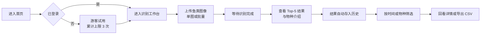

### 2.3 用例视图

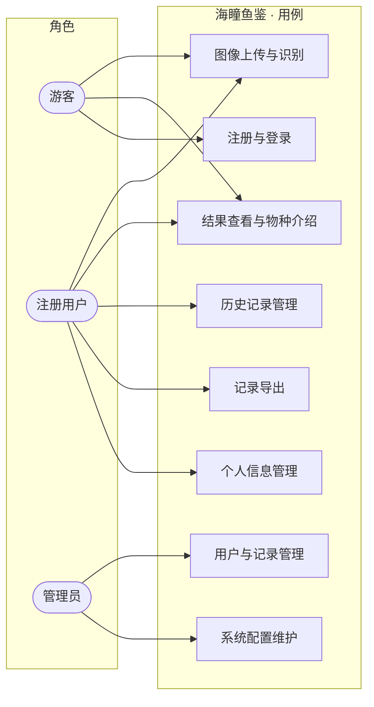

### 2.4 权限矩阵

| 功能 | 游客 | 注册用户 | 管理员 |
| --- | --- | --- | --- |
| 图像上传与识别 | 试用 3 次 | 不限 | 不限 |
| 结果查看与物种介绍 | 可用 | 可用 | 可用 |
| 历史记录查看 | 不可用 | 仅本人记录 | 全部记录 |
| 识别记录导出 | 不可用 | 仅本人记录 | 全部记录 |
| 识别记录删除 | 不可用 | 仅本人记录 | 全部记录 |
| 注册与登录 | 可用（注册入口） | 可用（登出） | 可用（登出） |
| 个人信息管理 | 不可用 | 仅本人 | 仅本人 |
| 用户管理 | 不可用 | 不可用 | 可用 |
| 系统配置维护 | 不可用 | 不可用 | 可用 |

---

## 第 3 章　功能需求总览

### 3.1 功能地图

产品划分为六个功能模块，各模块下的子功能清单如下。

| 模块 | 模块代号 | 子功能 |
| --- | --- | --- |
| 图像上传 | `UPLOAD` | 拖拽上传、点击上传、格式与大小校验、图像预览、批量上传、重选与清空 |
| 图像预处理 | `PREPROC` | 尺寸调整、像素归一化、水下色偏校正、色彩空间转换、参数固化 |
| 智能识别 | `RECOG` | 单图识别、23 类概率输出、Top-5 候选输出、置信度阈值判定、批量识别 |
| 结果展示 | `RESULT` | Top-5 概率条形图、首位物种高亮、物种介绍展示、原图对照、低置信度提示 |
| 历史记录 | `HISTORY` | 历史列表、筛选与检索、详情回看、图像对比、导出、删除 |
| 用户管理 | `USER` | 注册、登录、登出、个人信息管理、密码修改、游客试用限制、用户管理、记录管理、系统配置 |

功能模块与任务书的对应关系：前六个模块中的「图像上传、图像预处理、智能识别、结果展示、历史记录、用户管理」即任务书 2.2 的具体目标六项，未作扩张；其中「用户管理」在任务书基础上补充了管理员职能，属运维必要补全。

### 3.2 功能需求清单

**优先级定义**：P0 为必须实现，缺失则产品不成立；P1 为重要，影响体验完整度；P2 为增强项，资源允许时实现。

| 需求编号 | 需求名称 | 优先级 | 模块 | 任务书依据 |
| --- | --- | --- | --- | --- |
| FR-UPLOAD-01 | 支持拖拽方式上传图像 | P0 | 图像上传 | 2.2 目标 1 |
| FR-UPLOAD-02 | 支持点击选择方式上传图像 | P0 | 图像上传 | 2.2 目标 1 |
| FR-UPLOAD-03 | 校验文件格式（jpg / jpeg / png / bmp） | P0 | 图像上传 | 2.2 目标 1 |
| FR-UPLOAD-04 | 校验文件大小（单图 ≤ 10 MB） | P0 | 图像上传 | 2.2 目标 1 |
| FR-UPLOAD-05 | 上传前提供图像预览 | P1 | 图像上传 | 2.2 目标 1 |
| FR-UPLOAD-06 | 支持批量上传（最多 9 张） | P1 | 图像上传 | 派生自场景需求 |
| FR-UPLOAD-07 | 支持重选与清空已选图像 | P1 | 图像上传 | 派生自交互完整性 |
| FR-UPLOAD-08 | 展示上传进度并支持取消 | P2 | 图像上传 | 派生自交互完整性 |
| FR-PREPROC-01 | 将图像尺寸统一调整为 224×224 | P0 | 图像预处理 | 2.2 目标 2 |
| FR-PREPROC-02 | 对像素值执行归一化 | P0 | 图像预处理 | 2.2 目标 2 |
| FR-PREPROC-03 | 执行水下色偏校正 | P0 | 图像预处理 | 2.2 目标 2 |
| FR-PREPROC-04 | 执行色彩空间与格式转换 | P0 | 图像预处理 | 2.2 目标 2 |
| FR-PREPROC-05 | 预处理参数与训练期一致且可配置 | P0 | 图像预处理 | 派生自技术一致性要求 |
| FR-RECOG-01 | 对单张图像执行物种识别 | P0 | 智能识别 | 2.2 目标 3 |
| FR-RECOG-02 | 输出 23 类别的概率分布 | P0 | 智能识别 | 2.2 目标 3 |
| FR-RECOG-03 | 输出 Top-5 候选类别及概率 | P0 | 智能识别 | 2.2 目标 4 |
| FR-RECOG-04 | 依据置信度阈值判定结果可靠性 | P1 | 智能识别 | 派生自模型局限性 |
| FR-RECOG-05 | 对批量任务顺序执行识别 | P1 | 智能识别 | 派生自场景需求 |
| FR-RECOG-06 | 单图端到端耗时不超过 3 秒 | P0 | 智能识别 | 派生自性能目标 |
| FR-RESULT-01 | 以条形图展示 Top-5 概率分布 | P0 | 结果展示 | 2.2 目标 4 |
| FR-RESULT-02 | 高亮首位物种并展示其置信度 | P0 | 结果展示 | 2.2 目标 4 |
| FR-RESULT-03 | 展示物种形态特征与习性介绍 | P0 | 结果展示 | 2.2 目标 4 |
| FR-RESULT-04 | 提供原图与结果对照展示 | P1 | 结果展示 | 派生自体验完整性 |
| FR-RESULT-05 | 展示识别结果免责声明 | P0 | 结果展示 | 6.1 识别结果使用声明 |
| FR-RESULT-06 | 低置信度时给出可靠性提示 | P1 | 结果展示 | 派生自模型局限性 |
| FR-HISTORY-01 | 展示识别历史列表 | P0 | 历史记录 | 2.2 目标 5 |
| FR-HISTORY-02 | 支持按时间与物种筛选检索 | P1 | 历史记录 | 2.2 目标 5 |
| FR-HISTORY-03 | 支持查看历史记录详情 | P0 | 历史记录 | 2.2 目标 5 |
| FR-HISTORY-04 | 支持图像对比查看 | P1 | 历史记录 | 2.2 目标 5 |
| FR-HISTORY-05 | 支持导出识别记录为 CSV | P1 | 历史记录 | 2.2 目标 5 |
| FR-HISTORY-06 | 支持删除单条或批量删除记录 | P1 | 历史记录 | 2.2 目标 5 |
| FR-USER-01 | 用户注册 | P0 | 用户管理 | 2.2 目标 6 |
| FR-USER-02 | 用户登录 | P0 | 用户管理 | 2.2 目标 6 |
| FR-USER-03 | 用户登出 | P0 | 用户管理 | 2.2 目标 6 |
| FR-USER-04 | 个人信息查看与修改 | P1 | 用户管理 | 2.2 目标 6 |
| FR-USER-05 | 修改登录密码 | P1 | 用户管理 | 派生自账号安全 |
| FR-USER-06 | 游客试用次数限制与注册引导 | P1 | 用户管理 | 决策基线 |
| FR-USER-07 | 管理员管理用户账号 | P2 | 用户管理 | 决策基线 |
| FR-USER-08 | 管理员管理识别记录 | P2 | 用户管理 | 决策基线 |
| FR-USER-09 | 管理员维护系统配置 | P2 | 用户管理 | 决策基线 |

**非功能需求概览**（详述见第 9 章）

| 需求编号 | 需求名称 | 优先级 | 类别 | 任务书依据 |
| --- | --- | --- | --- | --- |
| NFR-PERF-01 | 首页首屏加载不超过 2 秒 | P1 | 性能 | 派生自体验要求 |
| NFR-PERF-02 | 单图端到端识别耗时不超过 3 秒 | P0 | 性能 | 决策基线 |
| NFR-PERF-03 | 支持不少于 20 个并发识别请求 | P1 | 性能 | 派生自容量要求 |
| NFR-SEC-01 | 全站强制 HTTPS 传输 | P0 | 安全 | 6.2 数据隐私保护 |
| NFR-SEC-02 | 密码采用加盐哈希存储 | P0 | 安全 | 6.2 数据隐私保护 |
| NFR-SEC-03 | 防止越权访问他人数据 | P0 | 安全 | 6.2 数据隐私保护 |
| NFR-SEC-04 | 上传文件类型与内容安全检查 | P0 | 安全 | 派生自上传场景 |
| NFR-SEC-05 | 日志脱敏，不记录密码与令牌 | P1 | 安全 | 6.2 数据隐私保护 |
| NFR-REL-01 | 模型加载失败时给出明确错误提示 | P1 | 可靠性 | 派生自可用性要求 |
| NFR-REL-02 | 提供健康检查接口 | P1 | 可靠性 | 派生自可运维性 |
| NFR-COMPAT-01 | 兼容主流浏览器最新两个版本 | P0 | 兼容性 | 6.4 浏览器兼容性 |
| NFR-COMPAT-02 | 响应式适配 PC 与移动端三档断点 | P0 | 兼容性 | 3.1 响应式设计 |
| NFR-MAINT-01 | 配置项外部化，不硬编码 | P1 | 可维护性 | 派生自工程规范 |
| NFR-MAINT-02 | 日志分级并落盘 | P1 | 可维护性 | 派生自可运维性 |
| NFR-MAINT-03 | 提供一键启动脚本 | P2 | 可维护性 | 派生自交付便利性 |

### 3.3 需求追溯矩阵

本矩阵用于确认任务书的每一项要求均有需求条目承接，且不存在无来源的需求扩张。

| 任务书条款 | 要求内容 | 承接需求编号 |
| --- | --- | --- |
| 2.1 总体目标 | 上传图像、识别物种、给出置信度与物种介绍 | FR-UPLOAD-01 ～ 05、FR-RECOG-01 ～ 03、FR-RESULT-01 ～ 04 |
| 2.2 目标 1 | 图像上传模块 | FR-UPLOAD-01 ～ 08 |
| 2.2 目标 2 | 图像预处理模块 | FR-PREPROC-01 ～ 05 |
| 2.2 目标 3 | 深度学习识别模块，准确率 ≥ 85%，F1 ≥ 0.82 | FR-RECOG-01 ～ 06、第 7 章 |
| 2.2 目标 4 | 结果展示与 Top-5 条形图 | FR-RESULT-01 ～ 06 |
| 2.2 目标 5 | 历史记录模块，含查看、对比、导出 | FR-HISTORY-01 ～ 06 |
| 2.2 目标 6 | 用户管理模块 | FR-USER-01 ～ 09 |
| 3.1 系统架构 | 前后端分离 B/S 架构、响应式设计 | NFR-COMPAT-02、第 8 章 |
| 3.2 核心技术 | 技术选型表 | 第 5、7、8 章 |
| 3.3 算法流程 | 数据准备、训练、优化、部署四阶段 | 第 7 章 |
| 5.1 预期输出 | WebApp 与模型 | 第 12 章 |
| 5.2 预期输出 | 各类文档 | 第 12 章 |
| 6.1 识别结果使用声明 | 免责与主管部门认定 | FR-RESULT-05 |
| 6.2 数据隐私保护 | 传输加密、存储加密、数据用途限制 | NFR-SEC-01 ～ 05、第 6.5 节 |
| 6.3 模型适用范围与局限性 | 23 类覆盖范围与判读限制 | FR-RECOG-04、FR-RESULT-06、第 7.7 节 |
| 6.4 浏览器兼容性 | 主流浏览器最新两个版本 | NFR-COMPAT-01 |

---

## 第 4 章　功能需求详述

### 4.0 本章说明与统一约定

本章按六个功能模块逐一展开，每个模块采用统一的七段式结构：**模块目标 → 功能清单 → 业务流程 → 交互与页面要点 → 业务规则 → 异常与边界 → 验收标准**。

编号衔接第 3 章：功能需求沿用 `FR-<模块>-<序号>`；业务规则新编为 `BR-<模块>-<两位序号>`；验收条件编为 `AC-<FR 编号>-<序号>`。三个编号体系一一对应，验收条件可直接用于测试用例编写。

全章适用的公共约定：

| 类别 | 约定 |
| --- | --- |
| 错误提示 | 统一为「定位 + 原因 + 下一步动作」三段式，不暴露堆栈、SQL 或内部文件路径 |
| 时间 | 存储采用 UTC 时间戳，展示统一为 UTC+8，格式 `YYYY-MM-DD HH:mm:ss` |
| 标识 | 图像标识与识别记录编号均为 UUID v4，对外展示时可截断显示 |
| 单位 | 体积用 MB（1 MB = 1024 KB）、耗时用毫秒、概率用百分比（保留 1 位小数） |
| 语言 | 界面全中文；物种名以中文名为准，同时展示拉丁学名 |
| 字符编码 | 全链路 UTF-8 |
| 加载反馈 | 异步操作超过 300 ms 必须显示加载指示；超过 3 秒需展示进度或预计剩余时间 |
| 二次确认 | 删除记录、登出（存在未提交内容时）必须二次确认 |

---

### 4.1 图像上传模块

**模块代号**　`UPLOAD`　**承接需求**　FR-UPLOAD-01 ～ FR-UPLOAD-08　**任务书依据**　2.2 目标 1

#### 4.1.1 模块目标

提供低摩擦的图像提交入口，并在上传阶段完成**格式、体积、数量**三重校验，确保只有合法图像进入预处理与推理链路，避免无效请求消耗模型资源。该模块是用户感知产品的第一触点，其容错表现直接决定首次使用体验。

#### 4.1.2 功能清单

| 需求编号 | 功能 | 优先级 | 行为说明 |
| --- | --- | --- | --- |
| FR-UPLOAD-01 | 拖拽上传 | P0 | 文件拖入上传区即触发校验并进入待上传队列 |
| FR-UPLOAD-02 | 点击上传 | P0 | 点击上传区打开系统文件选择器，支持多选 |
| FR-UPLOAD-03 | 格式校验 | P0 | 仅接受 jpg / jpeg / png / bmp，按文件内容与扩展名双重判定 |
| FR-UPLOAD-04 | 体积校验 | P0 | 单张图像不超过 10 MB |
| FR-UPLOAD-05 | 上传预览 | P1 | 入队后生成缩略图，支持逐张移除 |
| FR-UPLOAD-06 | 批量上传 | P1 | 单次最多 9 张，超出部分拒绝并提示 |
| FR-UPLOAD-07 | 重选与清空 | P1 | 支持整体清空与单张移除 |
| FR-UPLOAD-08 | 进度与取消 | P2 | 展示上传进度，支持中途取消 |

#### 4.1.3 业务流程

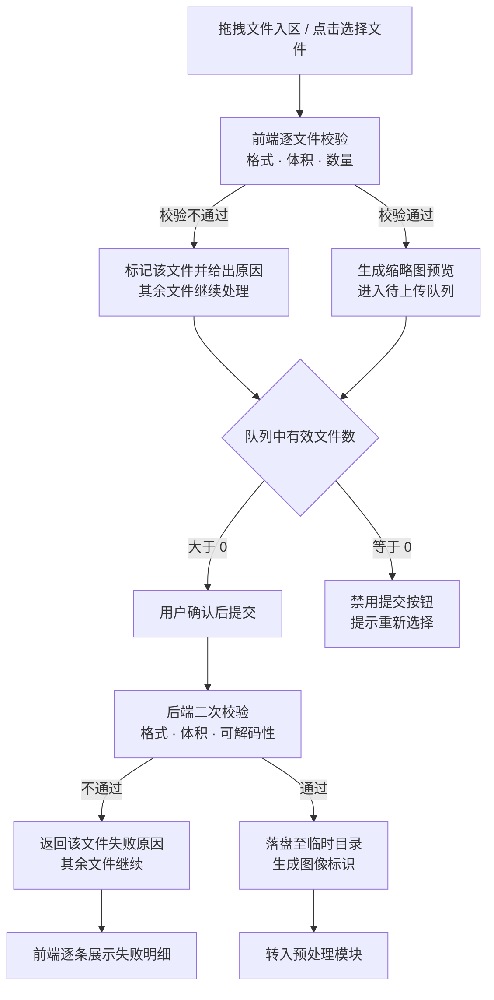

#### 4.1.4 交互与页面要点

| 元素 | 要求 |
| --- | --- |
| 上传区 | 大面积虚线边框容器，居中放置图标与文案「拖拽图像到此处，或点击选择文件」；拖拽悬停时边框高亮、文案变为「松开鼠标即可上传」 |
| 规则提示 | 上传区下方常驻说明：「支持 jpg / jpeg / png / bmp，单张不超过 10 MB，单次最多 9 张」 |
| 预览网格 | 3 列缩略图网格，每张右上角提供移除按钮；顶部展示「已选 n / 9」计数 |
| 错误提示 | 就地在对应缩略图位置标注失败原因，同时在容器顶部汇总「n 个文件未通过校验」 |
| 主操作按钮 | 「开始识别」，队列为空或全部校验失败时置灰不可点；批量时文案为「开始识别（n 张）」 |
| 进度反馈 | 批量提交后展示总体进度与当前处理序号（如「正在识别 3 / 7」） |

#### 4.1.5 业务规则

| 规则编号 | 规则内容 |
| --- | --- |
| BR-UPLOAD-01 | 格式白名单为 jpg / jpeg / png / bmp。以文件内容判定为主、扩展名为辅，二者不一致时以内容判定为准并拒绝 |
| BR-UPLOAD-02 | 单张体积上限 10 MB。前端先校验以提升响应速度，后端必须复校；**不得仅依赖前端校验** |
| BR-UPLOAD-03 | 单批次最多 9 张。超出部分整体拒绝并提示分批上传，不做静默截断 |
| BR-UPLOAD-04 | 部分成功原则：同一批次中单个文件失败不阻断其余文件，失败项单独提示 |
| BR-UPLOAD-05 | 存储层使用系统生成的 UUID 作为文件标识，原始文件名仅用于界面展示，避免重名覆盖与路径穿越 |
| BR-UPLOAD-06 | 临时文件在识别完成后清理；识别失败或超时则在 24 小时内清理 |
| BR-UPLOAD-07 | 按文件内容哈希去重，同批次内重复文件仅保留一份并提示 |
| BR-UPLOAD-08 | 上传接口须校验登录态：游客在试用额度内可上传，超出额度返回受限提示 |

#### 4.1.6 异常与边界

| 场景 | 处理方式 |
| --- | --- |
| 空文件（0 字节） | 校验失败，提示「文件内容为空，请重新选择」 |
| 改后缀伪装（如 .txt 改名为 .jpg） | 后端按文件头特征判定，不通过则拒绝并提示文件类型不合法 |
| 文件名含中文、特殊字符或超长 | 存储层使用系统标识不受影响；展示层对超过 40 字符的名称做中间省略 |
| 单张超过 10 MB | 拒绝该文件，提示实际大小与上限值 |
| 第 10 张及以上 | 拒绝超出部分，提示「单次最多 9 张，请分批上传」 |
| 重复选择同一文件 | 按内容哈希去重，提示「该图像已在队列中」 |
| 上传过程网络中断 | 单文件标记失败并提供「重试」；已成功文件不重复上传 |
| 分辨率过小（< 32×32）或过大（> 8000×8000） | 上传阶段放行，交由预处理阶段判定并给出可区分的失败原因 |

#### 4.1.7 验收标准

| 验收编号 | 验收条件 |
| --- | --- |
| AC-FR-UPLOAD-01-1 | 将 jpg 文件拖入上传区，缩略图在 2 秒内出现并计入已选数量 |
| AC-FR-UPLOAD-02-1 | 点击上传区能打开系统文件选择器，多选 3 个合法文件后队列显示 3 张 |
| AC-FR-UPLOAD-03-1 | 选择 .gif 文件，被拒绝且提示明确列出支持的格式 |
| AC-FR-UPLOAD-03-2 | 将 .txt 文件改名为 .jpg 后上传，后端拒绝并提示文件类型不合法 |
| AC-FR-UPLOAD-04-1 | 上传 11 MB 的 jpg，被拒绝且提示实际文件大小与上限值 |
| AC-FR-UPLOAD-05-1 | 上传 5 张合法图像，预览网格展示 5 个缩略图，可逐张移除 |
| AC-FR-UPLOAD-06-1 | 一次选择 12 张图像，仅前 9 张入队，第 10 张起提示超出上限 |
| AC-FR-UPLOAD-06-2 | 上传 4 张图像其中 1 张格式非法，其余 3 张正常进入识别流程 |
| AC-FR-UPLOAD-07-1 | 点击清空后队列归零，主操作按钮置为禁用态 |
| AC-FR-UPLOAD-08-1 | 上传过程中可取消，取消后该文件不出现在队列中且不产生记录 |
| AC-FR-UPLOAD-08-2 | 游客在第 4 次上传时被拦截并出现注册引导 |

---

### 4.2 图像预处理模块

**模块代号**　`PREPROC`　**承接需求**　FR-PREPROC-01 ～ FR-PREPROC-05　**任务书依据**　2.2 目标 2、3.3 算法流程

#### 4.2.1 模块目标

将任意合法输入图像转换为**与训练期完全一致**的标准化张量。水下图像普遍存在蓝绿偏色、对比度低、目标占比不定等问题，预处理既要完成尺寸与数值的标准化，也要缓解色偏对判别的影响。本模块的核心风险是**训练期与推理期参数偏移**——一旦两者不一致，模型精度会在部署后显著下降，因此参数必须固化并共用同一份配置。

#### 4.2.2 功能清单

| 需求编号 | 功能 | 优先级 | 行为说明 |
| --- | --- | --- | --- |
| FR-PREPROC-01 | 尺寸统一调整 | P0 | 输出恒为 224×224 |
| FR-PREPROC-02 | 像素归一化 | P0 | 按 ImageNet 统计量对像素值标准化 |
| FR-PREPROC-03 | 水下色偏校正 | P0 | 白平衡 + 对比度增强，可配置开关 |
| FR-PREPROC-04 | 色彩空间与格式转换 | P0 | BGR → RGB，uint8 → float32，HWC → CHW |
| FR-PREPROC-05 | 参数固化与可配置 | P0 | 参数写入配置文件，训练与推理共用 |

#### 4.2.3 预处理参数固化表

本表为**训练期与推理期必须一致**的参数基准。任何变更均需重新评估模型精度，并在第 7.5 节记录复测结果。

| 步骤 | 参数项 | 取值 | 说明 |
| --- | --- | --- | --- |
| 1 解码 | 支持格式 | jpg / jpeg / png / bmp | 与上传白名单一致 |
| 1 解码 | 透明通道处理 | 丢弃 alpha，按白底合成 | 避免透明区域被填充为黑色干扰判别 |
| 1 解码 | EXIF 方向 | 按 EXIF Orientation 自动旋转校正 | 手机拍摄图像常见问题 |
| 2 色偏校正 | 算法组合 | 灰度世界白平衡 + CLAHE | 缓解水下蓝绿偏色与低对比度 |
| 2 色偏校正 | CLAHE 参数 | `clipLimit = 2.0`，`tileGridSize = (8, 8)` | 可配置 |
| 2 色偏校正 | 开关 | 默认开启，可由管理员在系统配置中关闭 | 见 4.6.5 |
| 3 尺寸调整 | 目标尺寸 | 224 × 224 | 任务书 3.3 硬性要求 |
| 3 尺寸调整 | 缩放策略 | 短边等比缩放至 224 后中心裁剪 | 保持长宽比，避免鱼体形变导致判别失真 |
| 3 尺寸调整 | 插值方式 | 缩小用 `INTER_AREA`，放大用 `INTER_LINEAR` | 缩小场景更抗锯齿 |
| 4 色彩空间 | 通道顺序 | BGR → RGB | OpenCV 默认解码为 BGR，需显式转换 |
| 5 数值归一化 | 数值缩放 | uint8 除以 255 得 float32 | |
| 5 数值归一化 | 均值 | `[0.485, 0.456, 0.406]` | ImageNet 预训练统计量 |
| 5 数值归一化 | 标准差 | `[0.229, 0.224, 0.225]` | 同上 |
| 6 张量布局 | 维度顺序 | CHW（通道优先） | PyTorch 约定 |
| 6 张量布局 | 批次维度 | 单图推理补齐为 `1 × 3 × 224 × 224` | |
| 训练期增强 | 水平翻转 | 概率 0.5 | **仅训练期启用** |
| 训练期增强 | 随机旋转 | ± 15° | **仅训练期启用** |
| 训练期增强 | 颜色抖动 | 亮度 / 对比度 / 饱和度 ± 0.2 | **仅训练期启用** |
| 训练期增强 | 随机擦除 | 概率 0.25，面积占比 2% ～ 10% | 缓解遮挡场景 |
| 训练期增强 | 类别加权 | 权重与类别样本量成反比 | 应对长尾分布，详见第 6.3 节 |

#### 4.2.4 业务流程

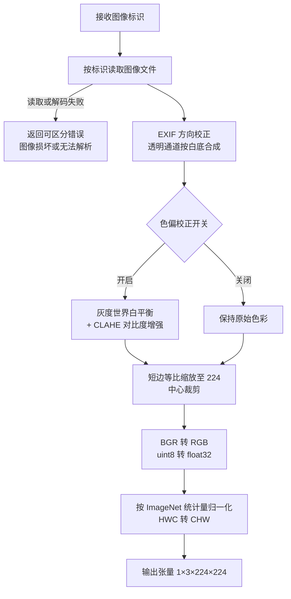

#### 4.2.5 交互与页面要点

本模块无独立用户界面，其可观测性体现在三处：

| 位置 | 表现 |
| --- | --- |
| 识别过程 | 前端展示「图像预处理中」阶段指示，批量时逐张推进 |
| 结果页 | 提供「查看预处理后图像」的次要入口（P2），便于用户理解模型实际输入 |
| 系统配置页 | 色偏校正开关可切换；参数以只读方式展示，避免误改 |

#### 4.2.6 业务规则

| 规则编号 | 规则内容 |
| --- | --- |
| BR-PREPROC-01 | **训练与推理必须共用同一份预处理实现与同一份参数配置**，禁止两处各自编写。此项为强制性约束，是防止训练—推理偏移的第一原则 |
| BR-PREPROC-02 | 推理期不得启用任何随机增强操作（翻转、旋转、颜色抖动、随机擦除） |
| BR-PREPROC-03 | 全部参数来自配置文件，代码中不得硬编码尺寸、均值、标准差等数值 |
| BR-PREPROC-04 | 色偏校正对同一图像幂等：重复处理同一输入，输出逐元素一致 |
| BR-PREPROC-05 | 预处理失败必须返回可区分的原因编码，区分「解码失败」「尺寸过小」「通道异常」三类 |
| BR-PREPROC-06 | 预处理耗时计入端到端指标，单图预处理耗时目标 ≤ 200 ms（派生自 NFR-PERF-02） |

#### 4.2.7 异常与边界

| 场景 | 处理方式 |
| --- | --- |
| 灰度图（单通道） | 复制为三通道后继续流程，并记录日志 |
| CMYK 色彩模式 | 转换为 RGB 后继续 |
| 带透明通道（PNG / BMP） | 按白底合成后丢弃 alpha 通道 |
| 极小图像（< 32×32） | 拒绝并提示「图像分辨率过低，无法识别」 |
| 超大图像（> 8000×8000） | 先等比降采样至长边 2000 像素，再进入标准流程，防止内存溢出 |
| 损坏或截断文件 | 解码失败，返回「图像文件损坏或无法解析」 |
| 动图（多帧） | 仅取第一帧参与识别 |
| 极端长宽比（如 1:20） | 中心裁剪后主体可能缺失，记录慢样本日志；不额外处理，由模型局限性说明覆盖 |

#### 4.2.8 验收标准

| 验收编号 | 验收条件 |
| --- | --- |
| AC-FR-PREPROC-01-1 | 输入 1920×1080 图像，输出张量形状为 `1×3×224×224` |
| AC-FR-PREPROC-01-2 | 输入 1000×2000 纵向图像，输出保持长宽比且为 `1×3×224×224` |
| AC-FR-PREPROC-02-1 | 同一图像连续预处理两次，输出张量逐元素差值最大值为 0 |
| AC-FR-PREPROC-03-1 | 对蓝绿偏色样本开启色偏校正后，白平衡偏差指标相比关闭时下降 |
| AC-FR-PREPROC-03-2 | 关闭色偏校正开关后，预处理输出与校正前基准一致 |
| AC-FR-PREPROC-04-1 | 灰度图与 CMYK 图像均能正常输出张量，过程中不抛异常 |
| AC-FR-PREPROC-05-1 | 训练脚本与推理服务加载同一配置文件，逐项参数比对完全一致 |
| AC-FR-PREPROC-05-2 | 修改配置文件中的目标尺寸后，训练与推理两侧输出同步变化 |

---

### 4.3 智能识别模块

**模块代号**　`RECOG`　**承接需求**　FR-RECOG-01 ～ FR-RECOG-06　**任务书依据**　2.2 目标 3

#### 4.3.1 模块目标

基于 ResNet18 迁移学习模型完成 23 类海洋鱼类的闭集分类，输出完整的类别概率分布与 Top-5 候选，并保证单图端到端耗时 ≤ 3 秒。本模块是产品的技术核心，其准确性由第 7 章的模型方案保障，本章侧重定义**服务侧的行为契约**：输入、输出、耗时、异常与降级策略。

#### 4.3.2 功能清单

| 需求编号 | 功能 | 优先级 | 行为说明 |
| --- | --- | --- | --- |
| FR-RECOG-01 | 单张图像识别 | P0 | 对单张图像返回一个首位物种判定 |
| FR-RECOG-02 | 23 类概率输出 | P0 | 返回全部 23 类的概率值，总和为 1 |
| FR-RECOG-03 | Top-5 候选输出 | P0 | 返回概率最高的 5 个候选类别及概率 |
| FR-RECOG-04 | 置信度阈值判定 | P1 | 首位置信度低于阈值时标记为低置信度 |
| FR-RECOG-05 | 批量顺序识别 | P1 | 批量任务按提交顺序逐张处理 |
| FR-RECOG-06 | 端到端耗时控制 | P0 | 单图从提交到结果返回不超过 3 秒 |

#### 4.3.3 业务流程（识别主流程，含异常分支）

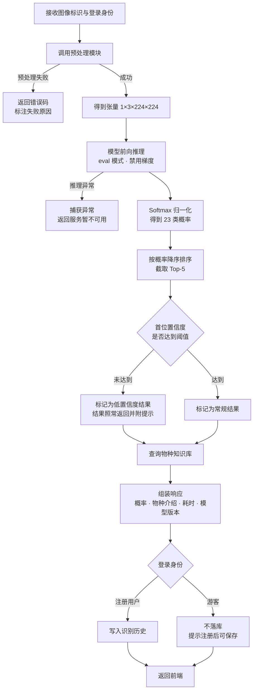

#### 4.3.4 交互与页面要点

| 元素 | 要求 |
| --- | --- |
| 识别中状态 | 上传区转为加载卡片，显示进度条与「正在识别」文案；批量时显示「正在识别 3 / 7」 |
| 阶段指示 | 可选展示「预处理 → 模型推理 → 结果整理」三阶段，减少长耗时焦虑 |
| 结果呈现 | 单张识别完成后直接跳转或就地展开结果区，不要求用户二次点击 |
| 批量呈现 | 逐张完成后依次填充结果卡片，不等待全部完成再统一渲染 |
| 失败呈现 | 失败的图像在卡片上标注原因并提供「重试」；不影响其余图像的结果 |
| 耗时展示 | 结果区角落展示本次识别耗时（毫秒），便于用户与开发排查性能 |

#### 4.3.5 业务规则

| 规则编号 | 规则内容 |
| --- | --- |
| BR-RECOG-01 | 闭集分类：模型输出维度固定为 23，**不提供「未知物种」类别**，该局限由第 7.7 节与免责声明共同覆盖 |
| BR-RECOG-02 | Top-5 恒为 5 项（类别总数 23 ≥ 5）；若模型输出异常导致不足 5 项，按实际项数返回并记录告警 |
| BR-RECOG-03 | 概率归一化：输出经 Softmax 处理，23 类概率之和为 1（浮点误差 < 1e-6） |
| BR-RECOG-04 | 置信度阈值：首位候选概率低于 **0.40** 判定为低置信度。该值为**可配置参数**，标定依据见第 7.4 节，管理员可在系统配置中调整 |
| BR-RECOG-05 | 模型常驻内存：服务启动时加载一次，全程单例复用；禁止每次请求重新加载模型文件 |
| BR-RECOG-06 | 推理模式：必须处于评估态且禁用梯度计算，避免显存占用与结果不确定性 |
| BR-RECOG-07 | 批量策略：批量任务在同一进程内顺序执行，不并发抢占显存；并发请求进入等待队列 |
| BR-RECOG-08 | 落库时机：识别成功后写入历史记录；低置信度结果同样落库并携带标记 |
| BR-RECOG-09 | 游客策略：游客在试用额度内可完成识别，但结果**不写入历史记录**，前端在结果区提示「注册后可保存记录」 |
| BR-RECOG-10 | 模型版本留存：每条历史记录保存识别时的模型版本号，便于后期追溯与精度归因 |

#### 4.3.6 异常与边界

| 场景 | 处理方式 |
| --- | --- |
| 模型文件缺失或损坏 | 服务启动阶段即失败并输出明确日志；运行期请求返回 503 与「识别服务暂不可用」 |
| 显存不足 | 捕获内存异常，降级为 CPU 单图推理并发出告警（对齐决策基线：GPU 优先、CPU 可降级） |
| 张量数值异常（NaN / Inf） | 判定为预处理输出异常，返回错误而非返回错误结果 |
| 单图耗时超出目标 | 记录慢请求日志供排查，不中断服务、不向用户暴露内部耗时细节 |
| 批量任务中途服务重启 | 未完成任务标记为「已中断」，不产生半成品记录 |
| 并发请求超出承载能力 | 进入等待队列；超出队列上限返回「当前请求较多，请稍后重试」 |
| 23 类全部低概率 | 仍返回 Top-5，同时强制触发低置信度提示 |
| 上传图像与 23 类均不匹配 | 模型仍会输出一个判定，由低置信度机制与免责声明共同覆盖，参见 BR-RECOG-01 |

#### 4.3.7 验收标准

| 验收编号 | 验收条件 |
| --- | --- |
| AC-FR-RECOG-01-1 | 上传单张合法图像，返回且仅返回一个首位物种判定 |
| AC-FR-RECOG-02-1 | 接口返回 23 个类别的概率值，总和为 1，浮点误差小于 1e-6 |
| AC-FR-RECOG-03-1 | 返回 5 个候选类别，按概率严格降序排列，每项包含类别名称与概率值 |
| AC-FR-RECOG-04-1 | 构造首位概率低于阈值的输入，结果为低置信度标记并触发前端可靠性提示 |
| AC-FR-RECOG-05-1 | 批量提交 9 张图像，全部返回结果，结果顺序与提交顺序一致 |
| AC-FR-RECOG-06-1 | GPU 环境下单图端到端耗时（自提交至结果返回）不超过 3 秒 |
| AC-FR-RECOG-06-2 | CPU 降级环境下单图仍能返回结果，耗时超出 3 秒时结果区标注性能说明 |

---

### 4.4 结果展示模块

**模块代号**　`RESULT`　**承接需求**　FR-RESULT-01 ～ FR-RESULT-06　**任务书依据**　2.2 目标 4、6.1 使用声明

#### 4.4.1 模块目标

将模型输出转化为用户可理解、可复核、可采信边界清晰的结论。核心任务有三个：**让首位结果一眼可见**、**用 Top-5 概率分布传达模型的不确定性**、**用物种介绍把识别结果转化为知识价值**。同时必须诚实标注结果的辅助性质，避免用户将模型输出当作权威鉴定。

#### 4.4.2 功能清单

| 需求编号 | 功能 | 优先级 | 行为说明 |
| --- | --- | --- | --- |
| FR-RESULT-01 | Top-5 概率条形图 | P0 | 横向条形图展示 5 个候选及其概率 |
| FR-RESULT-02 | 首位物种高亮 | P0 | 首位物种突出展示，并标注置信度 |
| FR-RESULT-03 | 物种介绍展示 | P0 | 展示形态特征、习性、分布等信息 |
| FR-RESULT-04 | 原图与结果对照 | P1 | 原图与识别结果同屏对照 |
| FR-RESULT-05 | 免责声明 | P0 | 常驻展示识别结果的辅助性质说明 |
| FR-RESULT-06 | 低置信度提示 | P1 | 结果可靠性不足时给出明确提示 |

#### 4.4.3 业务流程

本模块流程为线性渲染，无分支决策，其数据来源与流转关系如下表。

| 步骤 | 输入 | 处理 | 输出 |
| --- | --- | --- | --- |
| 1 | 识别响应体 | 校验响应完整性（Top-5、物种介绍、耗时字段） | 通过 / 降级标记 |
| 2 | Top-5 数组 | 按概率降序渲染条形图，首位使用主色高亮 | 概率分布图 |
| 3 | 首位类别标识 | 查询物种知识库 | 物种介绍内容 |
| 4 | 置信度与阈值 | 比较判定 | 低置信度提示条（条件渲染） |
| 5 | 原图标识 | 请求原图资源 | 对照展示区 |
| 6 | 固定文案 | 渲染免责声明 | 结果区底部常驻声明 |

#### 4.4.4 交互与页面要点

| 区域 | 要求 |
| --- | --- |
| 整体布局 | 左右分栏：左侧原图区（等比展示，最大高度 480 px），右侧结果区；窄屏（< 1024 px）改为上下堆叠 |
| 首位结果卡 | 中文名为一级标题，拉丁学名为斜体副标题，置信度以大字百分比呈现，视觉层级最高 |
| 概率条形图 | 每行由「类别名 + 条形 + 百分比」三段构成；条形长度按**绝对概率**线性映射（非相对最大值），使低置信度结果在视觉上自然显得不确定 |
| 首位高亮 | 首位条形使用产品主色填充，类别名加粗；其余 4 条使用中性灰蓝色 |
| 百分比精度 | 统一保留 1 位小数；四舍五入后为 0.0% 时显示为「< 0.1%」，避免出现全零误导 |
| 物种介绍 | 三个折叠面板：形态特征（默认展开）、习性、分布；面板内可滚动，不撑破布局 |
| 物种配图 | 展示知识库中的参考图片；图片缺失时展示占位图并保留文案 |
| 低置信度提示 | 结果区顶部展示警示色提示条，文案强调「结果可靠性不足，建议结合其他资料判断」 |
| 免责声明 | 固定展示于结果区底部，**不可折叠、不可隐藏**，字号不小于 12 px |
| 快捷操作 | 重新识别、查看历史详情；游客额外展示「注册后可保存记录」引导 |

#### 4.4.5 业务规则

| 规则编号 | 规则内容 |
| --- | --- |
| BR-RESULT-01 | 条形图恒为 5 条，按概率严格降序，不做类别合并或省略 |
| BR-RESULT-02 | 概率展示保留 1 位小数；禁止出现「0.0%」这类会被误读为不可能的表述 |
| BR-RESULT-03 | 首位视觉权重必须显著高于其余条目：主色实体填充 + 字号加大 + 加粗 |
| BR-RESULT-04 | 物种介绍取自预置知识库（见第 6.4 节）；字段缺失时展示「该物种介绍资料补充中」，**不阻断识别结果展示** |
| BR-RESULT-05 | 免责声明必须常驻可见，不得默认折叠，也不得仅在低置信度情况下出现 |
| BR-RESULT-06 | 不提供模型关注区域（如 Grad-CAM 热力图）可视化，此项为决策基线，用以守住任务书范围 |
| BR-RESULT-07 | 游客结果页展示完整识别信息，仅在「保存」相关动作处提示注册，不在结果内容上做降级 |
| BR-RESULT-08 | 结果页所有数值均来自识别响应或知识库读取，前端不得自行计算或修正概率值 |

#### 4.4.6 异常与边界

| 场景 | 处理方式 |
| --- | --- |
| 知识库条目缺失 | 展示降级文案与「资料补充中」提示，识别结果正常呈现 |
| 介绍文案超长 | 折叠面板内部滚动，面板高度固定，不挤压条形图区域 |
| 全部候选概率偏低（如首位 0.15） | 触发低置信度提示，文案中明确「结果仅供辅助参考」 |
| 原图加载失败 | 展示占位图并提示「原图加载失败」，结果数据不受影响 |
| 同一记录重复查看 | 从历史记录读取归档结果，**不重新推理**，确保同一记录结果恒定 |
| 响应字段缺失 | 按降级顺序处理：缺物种介绍 → 降级文案；缺 Top-5 → 展示错误提示并记录日志 |

#### 4.4.7 验收标准

| 验收编号 | 验收条件 |
| --- | --- |
| AC-FR-RESULT-01-1 | 结果页展示 5 条概率条形，按概率从高到低排列，无缺项 |
| AC-FR-RESULT-02-1 | 首位物种展示置信度百分比，数值与接口返回一致（保留 1 位小数） |
| AC-FR-RESULT-03-1 | 点击识别结果可查看该物种的形态特征与习性介绍 |
| AC-FR-RESULT-04-1 | 结果页同时展示原图与识别结果，可同屏对照查看 |
| AC-FR-RESULT-05-1 | 免责声明在结果页首屏可见，且无法通过交互折叠或隐藏 |
| AC-FR-RESULT-06-1 | 首位置信度低于阈值的样本，结果区顶部出现可靠性提示条 |
| AC-FR-RESULT-06-2 | 某物种知识库条目缺失时，结果页展示降级文案且识别结果正常显示 |

---

### 4.5 历史记录模块

**模块代号**　`HISTORY`　**承接需求**　FR-HISTORY-01 ～ FR-HISTORY-06　**任务书依据**　2.2 目标 5

#### 4.5.1 模块目标

让每一次识别沉淀为可复用的数据资产。调查场景下，用户需要按时间与物种回溯识别结果；交易场景下，用户需要留存凭证；两种需求都要求记录**可检索、可对比、可导出**，并且**结果恒定**——同一条历史记录无论何时打开，展示的都是当时的判定结论，而非重新推理的结果。

#### 4.5.2 功能清单

| 需求编号 | 功能 | 优先级 | 行为说明 |
| --- | --- | --- | --- |
| FR-HISTORY-01 | 历史列表展示 | P0 | 分页展示本人识别记录 |
| FR-HISTORY-02 | 筛选与检索 | P1 | 按时间范围、物种、关键词筛选 |
| FR-HISTORY-03 | 详情回看 | P0 | 查看单条记录的完整结果 |
| FR-HISTORY-04 | 图像对比查看 | P1 | 多条记录并排对比 |
| FR-HISTORY-05 | 导出 CSV | P1 | 将筛选结果导出为 CSV 文件 |
| FR-HISTORY-06 | 删除记录 | P1 | 单条或批量删除 |

#### 4.5.3 列表与字段规格

**列表字段**

| 列 | 内容 | 说明 |
| --- | --- | --- |
| 缩略图 | 原图缩略 | 原图已清理时展示占位图 |
| 识别物种 | Top-1 中文名 | 低置信度记录附标记图标 |
| 置信度 | 百分比，1 位小数 | |
| 图像文件名 | 原始文件名（截断展示） | 悬停显示完整名称 |
| 识别时间 | `YYYY-MM-DD HH:mm:ss` | 默认按此列倒序 |
| 耗时 | 毫秒 | |
| 操作 | 详情 / 删除 | |

**筛选条件**

| 筛选维度 | 选项 |
| --- | --- |
| 时间范围 | 快捷项：近 7 天 / 近 30 天 / 全部；自定义起止日期 |
| 物种 | 23 类下拉列表 + 「全部」；选项含中文名与学名 |
| 关键词 | 匹配原始文件名，支持模糊匹配 |
| 排序 | 识别时间倒序（默认）/ 正序 |
| 分页 | 服务端分页，每页 20 条 |

**CSV 导出字段（固定 8 列）**

| 列序 | 字段名 | 说明 |
| --- | --- | --- |
| 1 | 记录编号 | UUID |
| 2 | 原图文件名 | |
| 3 | 识别物种 | Top-1 中文名 |
| 4 | 拉丁学名 | |
| 5 | 置信度 | 百分比，1 位小数 |
| 6 | Top-5 摘要 | 形如 `A:62.1% \| B:18.3% \| C:9.7% \| D:5.2% \| E:3.1%` |
| 7 | 识别时间 | `YYYY-MM-DD HH:mm:ss` |
| 8 | 识别耗时 | 毫秒 |

#### 4.5.4 交互与页面要点

| 元素 | 要求 |
| --- | --- |
| 顶部筛选区 | 筛选条件横向排列，窄屏折叠为筛选抽屉；提供「重置筛选」 |
| 列表主体 | 表格形态，行内点击非操作区进入详情 |
| 批量选择 | 表头复选框支持全选当前页；选中后顶部浮出操作条，显示已选条数与「对比」「导出选中」「删除」 |
| 对比视图 | 勾选 2 ～ 4 条后进入对比视图，并排展示缩略图、物种名、置信度、识别时间 |
| 详情页 | 展示原图、完整 Top-5 条形图、物种介绍、模型版本、耗时；与识别结果页保持一致的视觉规范 |
| 空态 | 无记录时展示插画与「还没有识别记录」，并附「去识别」按钮 |
| 删除确认 | 删除前二次确认，明确提示删除后 30 天内不可恢复 |

#### 4.5.5 业务规则

| 规则编号 | 规则内容 |
| --- | --- |
| BR-HISTORY-01 | 数据范围：注册用户仅可见本人记录；管理员可见全部记录。**该过滤在服务端强制执行，不得依赖前端隐藏** |
| BR-HISTORY-02 | 游客识别结果不落库（与 BR-RECOG-09 一致） |
| BR-HISTORY-03 | 删除采用软删除，记录标记为已删除并立即从列表、筛选与导出结果中排除；30 天后物理清理 |
| BR-HISTORY-04 | 导出列固定为 8 列（见 4.5.3），不做字段可选 |
| BR-HISTORY-05 | 单次导出上限 5000 条，超出时提示缩小筛选范围，不执行部分导出 |
| BR-HISTORY-06 | 批量删除单次上限 100 条，超出时提示分批操作 |
| BR-HISTORY-07 | 导出文件名规则为 `seatong_history_YYYYMMDD_HHmmss.csv`，编码为 UTF-8 with BOM 以保证 Excel 打开不乱码 |
| BR-HISTORY-08 | 时间存储为 UTC 时间戳，展示统一转换为 UTC+8 |
| BR-HISTORY-09 | 历史详情读取归档结果，不触发重新推理（与 BR-RESULT-08 一致），保证结果可追溯 |
| BR-HISTORY-10 | 图像文件留存期默认 180 天（可在系统配置中调整）；超期清理原图，记录与结果永久保留 |

#### 4.5.6 异常与边界

| 场景 | 处理方式 |
| --- | --- |
| 无任何记录 | 展示空态插画与引导按钮 |
| 筛选无结果 | 提示「没有符合条件的记录」并提供「清除筛选条件」 |
| 原图已过留存期被清理 | 缩略图与结果数据仍在，原图位置展示「原图已清理」并保留占位 |
| 导出超过 5000 条 | 拒绝执行并提示当前匹配条数与上限值 |
| 删除他人记录 | 返回 403 且不泄露该记录是否存在 |
| 并发重复删除 | 幂等处理：首次成功，重复请求返回成功或「记录不存在」，均不报错 |
| 导出过程中数据被删除 | 以导出时刻的数据快照为准，不因中途删除而失败 |
| 大量记录导致分页性能下降 | 服务端按用户与时间建立索引，单页响应时间目标 ≤ 500 ms |

#### 4.5.7 验收标准

| 验收编号 | 验收条件 |
| --- | --- |
| AC-FR-HISTORY-01-1 | 完成一次识别后，历史列表出现该记录，各字段完整且数值正确 |
| AC-FR-HISTORY-02-1 | 按物种筛选后列表仅显示该物种记录；按时间范围筛选的结果均落在区间内 |
| AC-FR-HISTORY-02-2 | 按文件名关键词检索，返回结果的文件名均包含该关键词 |
| AC-FR-HISTORY-03-1 | 点击列表项进入详情，Top-5 结果与当时识别结果完全一致（未重新推理） |
| AC-FR-HISTORY-04-1 | 勾选 3 条记录进入对比视图，三条记录并排展示且信息完整 |
| AC-FR-HISTORY-05-1 | 导出的 CSV 用 Excel 打开中文不乱码，行数与筛选结果一致，列为 8 列 |
| AC-FR-HISTORY-06-1 | 删除单条后列表即时更新；批量删除 5 条后总条数减少 5 |
| AC-FR-HISTORY-06-2 | 使用 A 账号尝试访问 B 账号记录，接口返回无权限且不泄露记录内容 |

---

### 4.6 用户管理模块

**模块代号**　`USER`　**承接需求**　FR-USER-01 ～ FR-USER-10　**任务书依据**　2.2 目标 6、6.2 数据隐私保护

#### 4.6.1 模块目标

建立可信的身份体系，使「识别记录归属于谁」这一基本问题有确定答案。模块承担三项职责：**身份建立与验证**（注册、登录、登出）、**个人数据管理**（个人信息、密码）、**平台治理**（游客额度控制、管理员职能）。安全要求与任务书 6.2 一致：传输加密、密码不可逆存储、数据用途受限于识别服务本身。

#### 4.6.2 功能清单

| 需求编号 | 功能 | 优先级 | 行为说明 |
| --- | --- | --- | --- |
| FR-USER-01 | 用户注册 | P0 | 用户名 + 密码注册，成功即登录 |
| FR-USER-02 | 用户登录 | P0 | 账号密码登录并签发令牌 |
| FR-USER-03 | 用户登出 | P0 | 使当前令牌失效 |
| FR-USER-04 | 个人信息管理 | P1 | 查看与修改昵称、邮箱 |
| FR-USER-05 | 修改密码 | P1 | 验证原密码后修改，成功后令牌失效 |
| FR-USER-06 | 游客额度控制 | P1 | 限 3 次并在超出时引导注册 |
| FR-USER-07 | 管理员管理用户 | P2 | 用户列表、搜索、启停、重置密码 |
| FR-USER-08 | 管理员管理记录 | P2 | 查看与删除任意用户记录 |
| FR-USER-09 | 管理员维护配置 | P2 | 调整置信度阈值、批量上限、色偏校正开关、留存天数 |
| FR-USER-10 | 管理员查看统计概览 | P2 | 后台首页展示用户数、记录数、今日记录数、物种分布 Top-N 与平均识别耗时 |

#### 4.6.3 认证流程

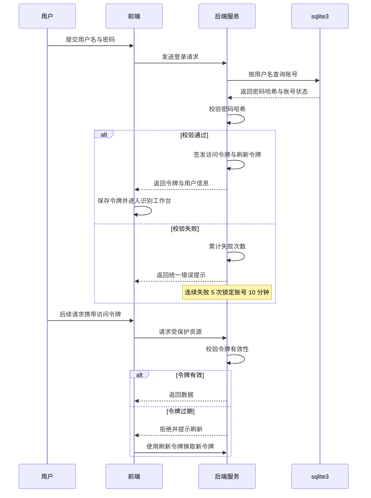

#### 4.6.4 交互与页面要点

| 页面 | 要求 |
| --- | --- |
| 注册页 | 用户名、密码、确认密码三项必填，邮箱选填；实时校验用户名可用性与密码强度，强度不足时给出具体原因而非笼统提示 |
| 登录页 | 用户名、密码、登录按钮；登录失败提示统一为「用户名或密码不正确」，不区分账号是否存在 |
| 个人中心 | 展示用户名（不可改）、昵称、邮箱、注册时间；提供「修改密码」入口；展示本人识别记录总数 |
| 修改密码 | 原密码、新密码、确认新密码；修改成功后提示「密码已更新，请重新登录」并跳转登录页 |
| 额度提示 | 游客第 4 次操作时以弹窗形式引导注册，弹窗内提供「稍后再说」与「立即注册」 |
| 管理员入口 | 仅管理员账号可见；入口位于用户菜单中，不占据主站主导航 |
| 管理员用户列表 | 表格形式，含用户名、昵称、状态、注册时间、记录数；操作列为启停与重置密码 |
| 管理员配置页 | 以表单形式编辑可配置项，每项附取值范围与默认值提示；保存前二次确认 |

#### 4.6.5 业务规则

| 规则编号 | 规则内容 |
| --- | --- |
| BR-USER-01 | 用户名长度 4 ～ 20 位，仅允许字母、数字与下划线，全局唯一；查重时不区分大小写 |
| BR-USER-02 | 密码长度 8 ～ 32 位，必须同时包含字母与数字；不允许与用户名相同 |
| BR-USER-03 | 密码使用**加盐哈希**存储（bcrypt，cost ≥ 10），严禁明文或可逆加密存储 |
| BR-USER-04 | 注册成功即自动登录，无需二次输入 |
| BR-USER-05 | 不提供邮箱验证码校验；邮箱为选填项，仅用于联系与找回信息展示 |
| BR-USER-06 | 采用 JWT 双令牌机制：访问令牌有效期 2 小时，刷新令牌有效期 7 天 |
| BR-USER-07 | 连续登录失败 5 次锁定账号 10 分钟，锁定期内即使密码正确亦拒绝登录 |
| BR-USER-08 | 登出操作使当前令牌立即失效，前端同时清除本地令牌 |
| BR-USER-09 | 被禁用账号的既有令牌立即失效，后续请求返回未授权 |
| BR-USER-10 | **所有数据接口按登录身份过滤，禁止仅依赖前端隐藏实现权限控制** |
| BR-USER-11 | 管理员不可禁用或删除自身账号，避免管理权限丢失 |
| BR-USER-12 | 游客试用额度为 3 次，计数在**服务端**按会话标识维护；清理本地存储无法重置额度 |
| BR-USER-13 | 额度耗尽提示不得在识别进行中弹出，须在当前任务完成后展示，避免打断用户 |
| BR-USER-14 | 昵称长度 2 ～ 20 字符；邮箱须通过格式校验，字段可为空 |
| BR-USER-15 | 修改密码需验证原密码；成功后该用户全部令牌失效，须重新登录 |
| BR-USER-16 | 管理员用户列表分页每页 20 条，支持按用户名或昵称搜索；重置密码生成一次性临时密码并要求首次登录后修改 |
| BR-USER-17 | 管理员删除记录同样采用软删除（与 BR-HISTORY-03 一致），操作须记入审计日志 |
| BR-USER-18 | 可配置项及取值范围：置信度阈值 0.10 ～ 0.90、单批上限 1 ～ 20、色偏校正开关、图像留存天数 30 ～ 365 |

#### 4.6.6 异常与边界

| 场景 | 处理方式 |
| --- | --- |
| 用户名已存在 | 注册页就地提示，不透露该用户名的其他信息 |
| 密码错误 | 统一提示「用户名或密码不正确」，防止账号枚举攻击 |
| 账号被锁定 | 提示剩余锁定时间，不提示可绕过方式 |
| 访问令牌过期 | 静默使用刷新令牌换取新令牌，用户无感；刷新令牌亦过期则跳转登录页并保留原访问路径 |
| 刷新令牌被伪造或篡改 | 拒绝并清除客户端令牌，记录安全日志 |
| 并发注册同名账号 | 数据库唯一约束兜底，后到者收到「用户名已存在」 |
| 管理员尝试禁用自己 | 拒绝并提示「不能对当前登录账号执行该操作」 |
| 管理员重置用户密码 | 该用户全部既有令牌立即失效 |
| 游客清空浏览器数据 | 服务端按会话标识计数，额度不受影响；会话过期后重新计数，属可接受的额度设计边界 |
| 密码含特殊字符或空格 | 允许特殊字符；首尾空格在提交时自动去除 |

#### 4.6.7 验收标准

| 验收编号 | 验收条件 |
| --- | --- |
| AC-FR-USER-01-1 | 使用合法用户名与密码注册成功并自动登录，跳转至识别工作台 |
| AC-FR-USER-01-2 | 注册已存在的用户名被拒绝，且提示不泄露账号归属信息 |
| AC-FR-USER-01-3 | 提交 7 位密码，被拒绝并提示密码长度与组成要求 |
| AC-FR-USER-02-1 | 正确账号密码登录成功；错误密码提示与账号不存在时完全一致 |
| AC-FR-USER-02-2 | 连续 5 次输入错误密码后，第 6 次提示账号已锁定及剩余时间 |
| AC-FR-USER-03-1 | 登出后访问需登录页面被重定向至登录页 |
| AC-FR-USER-04-1 | 修改昵称后刷新页面仍显示新昵称；修改为非法长度时被拒绝 |
| AC-FR-USER-05-1 | 修改密码后原令牌失效，使用新密码可正常登录 |
| AC-FR-USER-06-1 | 清空浏览器本地存储后游客仍受 3 次额度限制（服务端计数生效） |
| AC-FR-USER-07-1 | 管理员禁用某用户后，该用户立即无法登录，既有会话同步失效 |
| AC-FR-USER-07-2 | 管理员尝试禁用自身账号时被拒绝 |
| AC-FR-USER-08-1 | 管理员可查看并删除任意用户的识别记录，操作记入审计日志 |
| AC-FR-USER-09-1 | 管理员调整置信度阈值后，识别结果的低置信度判定随之改变 |
| AC-FR-USER-10-1 | 管理员后台首页正确展示用户总数、记录总数、今日记录数、物种分布 Top-N 与平均识别耗时；普通用户请求该数据被拒绝 |

---

### 4.7 跨模块公共规则

以下规则横跨多个模块，统一在此定义，各模块不再重复。

| 类别 | 规则 |
| --- | --- |
| 错误处理 | 后端返回结构化错误（错误码 + 用户可读文案）；前端按错误码映射展示，不直接展示后端原始文案 |
| 权限校验 | 一切权限判定在服务端完成，前端仅作展示层控制 |
| 状态一致性 | 同一记录在结果页与历史详情页的数值必须一致，均读取归档数据 |
| 图像留存 | 原图默认保留 180 天，之后清理；识别结果与元数据永久保留 |
| 可访问性 | 主要操作可通过键盘完成；表单控件有关联标签；颜色不作为唯一信息载体（条形图同时标注数值） |
| 文案规范 | 面向用户的文案使用完整句式，不使用「err」「fail」等开发用语；不使用感叹号堆砌 |
| 埋点与日志 | 关键动作（上传、识别、导出、删除、登录）写入操作日志；日志不含密码、令牌与图像内容 |

### 4.8 本章需求统计与交叉引用

**需求条目统计**

| 模块 | 功能需求 FR | 业务规则 BR | 验收条件 AC |
| --- | --- | --- | --- |
| 图像上传 | 8 | 8 | 11 |
| 图像预处理 | 5 | 6 | 8 |
| 智能识别 | 6 | 10 | 7 |
| 结果展示 | 6 | 8 | 7 |
| 历史记录 | 6 | 10 | 8 |
| 用户管理 | 10 | 18 | 14 |
| **合计** | **41** | **60** | **55** |

**与后续章节的交叉引用**

| 模块 | 本章小节 | 后续章节承接 |
| --- | --- | --- |
| 图像上传 | 4.1 | 第 5.2 节上传页元素、第 8.4 节上传接口约定 |
| 图像预处理 | 4.2 | 第 6.3 节数据集规格、第 7.1 节数据准备、第 7.6 节推理服务 |
| 智能识别 | 4.3 | 第 7.2 ～ 7.5 节模型与训练、第 8.1 节接口清单 |
| 结果展示 | 4.4 | 第 5.3 节结果页交互、第 6.4 节物种知识库规格 |
| 历史记录 | 4.5 | 第 6.1 节概念模型、第 6.2 节数据字典、第 8.1 节接口清单 |
| 用户管理 | 4.6 | 第 6.5 节隐私与留存、第 8.2 节认证与鉴权 |

## 第 5 章　页面与交互需求

### 5.1 信息架构

站点按访问权限划分为三个区域：公开访问区、登录后个人区、管理员区。识别工作台是核心页面，识别结果在页内展开而不单独成页，减少一次跳转；历史记录与个人中心需要登录；管理员区入口置于用户菜单内，不占据主导航。

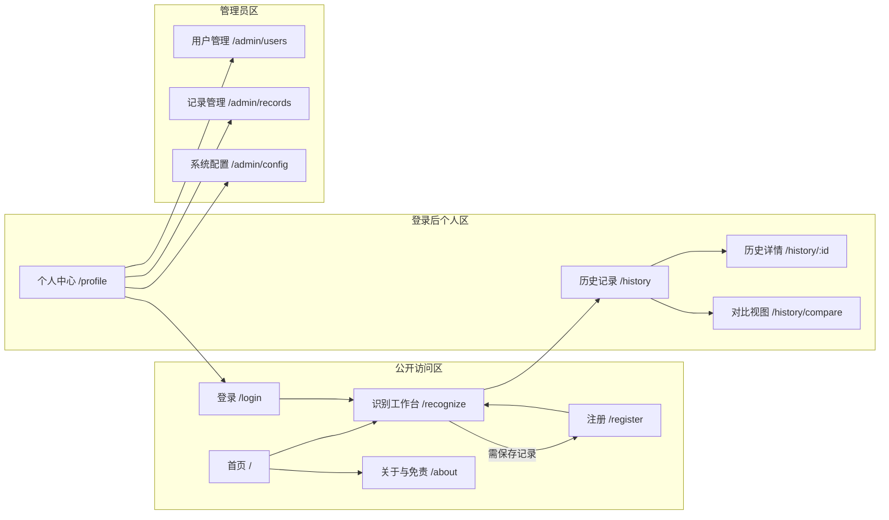

### 5.2 页面清单

| 页面 | 路由 | 访问权限 | 主要元素 | 关联需求 |
| --- | --- | --- | --- | --- |
| 首页 | `/` | 公开 | 产品一句话说明、识别入口按钮、能力说明、物种覆盖数、使用须知 | FR-UPLOAD-01 |
| 识别工作台 | `/recognize` | 公开（游客限 3 次） | 上传区、预览网格、开始识别按钮、结果区、额度提示 | FR-UPLOAD-01 ～ 08、FR-RECOG-01 ～ 06、FR-RESULT-01 ～ 06 |
| 关于与免责 | `/about` | 公开 | 模型能力边界、23 类覆盖范围、使用声明、数据隐私说明 | FR-RESULT-05、NFR-SEC-01 |
| 登录 | `/login` | 公开 | 用户名、密码、登录按钮、注册入口 | FR-USER-02 |
| 注册 | `/register` | 公开 | 用户名、密码、确认密码、邮箱（选填）、登录入口 | FR-USER-01 |
| 历史记录 | `/history` | 登录 | 筛选区、记录表格、批量操作条、分页、导出按钮 | FR-HISTORY-01 ～ 06 |
| 历史详情 | `/history/:id` | 登录 | 原图、Top-5 条形图、物种介绍、模型版本、耗时 | FR-HISTORY-03、FR-RESULT-01 ～ 05 |
| 对比视图 | `/history/compare` | 登录 | 2 ～ 4 条记录并排卡片 | FR-HISTORY-04 |
| 个人中心 | `/profile` | 登录 | 账号信息、昵称与邮箱编辑、修改密码、记录统计、退出登录 | FR-USER-03 ～ 05 |
| 用户管理 | `/admin/users` | 管理员 | 统计概览行、用户表格、搜索、启停、重置密码 | FR-USER-07、FR-USER-10 |
| 记录管理 | `/admin/records` | 管理员 | 全部用户记录表格、筛选、删除 | FR-USER-08 |
| 系统配置 | `/admin/config` | 管理员 | 置信度阈值、批量上限、色偏校正开关、图像留存天数 | FR-USER-09 |
| 404 | `*` | 公开 | 提示文案与返回首页入口 | —— |

### 5.3 关键页面交互

#### 5.3.1 识别工作台 `/recognize`

页面自上而下分为三个区域，识别过程与结果在同一页内完成，不做页面跳转。这是使用频次最高的页面，交互设计以「最少点击完成一次识别」为目标。

| 区域 | 交互要求 |
| --- | --- |
| 上传区 | 虚线边框容器，支持拖拽与点击两种方式；拖拽悬停时边框高亮并变更文案；区域底部常驻规则说明 |
| 预览与提交 | 缩略图网格（3 列）+ 「已选 n / 9」计数 + 「开始识别」按钮；空队列时按钮禁用 |
| 结果区 | 单张识别完成后就地展开，不要求二次点击；批量识别时逐张填充结果卡片 |
| 额度提示 | 游客剩余次数以次要文案显示在提交按钮附近；额度耗尽时以弹窗引导注册，且**不在识别过程中弹出** |
| 阶段反馈 | 识别中展示「预处理 → 模型推理 → 结果整理」三阶段指示；批量时显示「正在识别 3 / 7」 |

#### 5.3.2 识别结果区

结果区采用左右分栏（窄屏改为上下堆叠），左侧原图、右侧结论，符合「先看结论再看依据」的阅读顺序。

| 内部区块 | 位置与要求 |
| --- | --- |
| 低置信度提示条 | 结果区最顶部，仅在首位候选概率低于阈值时出现，使用警示色 |
| 首位结果卡 | 中文名（一级标题）+ 拉丁学名（斜体副标题）+ 置信度大字百分比 |
| Top-5 条形图 | 5 行「类别名 + 条形 + 百分比」；首位主色高亮且加粗，其余中性色；条形按绝对概率映射 |
| 物种介绍 | 三个折叠面板：形态特征（默认展开）、习性、分布；面板内滚动 |
| 快捷操作 | 重新识别、查看历史详情；游客额外展示「注册后可保存记录」 |
| 免责声明 | 结果区底部常驻，不可折叠 |

#### 5.3.3 历史记录 `/history`

| 元素 | 要求 |
| --- | --- |
| 筛选区 | 时间快捷项（近 7 天 / 近 30 天 / 全部）+ 自定义起止日期 + 物种下拉 + 文件名关键词 + 「重置筛选」 |
| 列表 | 表格形态，列为缩略图、识别物种、置信度、文件名、识别时间、耗时、操作；默认按识别时间倒序 |
| 批量操作 | 表头全选当前页；选中后顶部浮出操作条，显示已选条数与「对比」「导出选中」「删除」 |
| 分页 | 服务端分页，每页 20 条，展示总条数 |
| 空态 | 无记录时展示引导插画与「去识别」按钮；筛选无结果时提示「没有符合条件的记录」并附「清除筛选」 |
| 导出 | 点击后按当前筛选条件导出；命中条数超过 5000 时先行提示，不发起下载 |

#### 5.3.4 历史详情 `/history/:id`

展示归档结果，**不触发重新推理**（对齐 BR-HISTORY-09）。页面结构复用识别结果区的组件，额外增加元信息区：识别时间、模型版本、识别耗时、原图文件名、记录编号。原图已过留存期时，原图位置展示「原图已清理」占位，其余内容不受影响。

#### 5.3.5 登录与注册

| 页面 | 交互要求 |
| --- | --- |
| 注册 | 用户名实时校验可用性与规则符合性；密码强度不足时给出**具体原因**（如「需同时包含字母与数字」）而非笼统提示；提交成功后自动登录并进入识别工作台 |
| 登录 | 用户名与密码两个字段 + 登录按钮；失败提示统一为「用户名或密码不正确」，不区分账号是否存在；账号被锁定时提示剩余锁定时间 |
| 令牌过期 | 静默刷新令牌，用户无感；刷新令牌亦失效时跳转登录页并**保留原访问路径**，登录后返回原页面 |

#### 5.3.6 个人中心与管理员页

| 页面 | 交互要求 |
| --- | --- |
| 个人中心 | 展示用户名（不可修改）、昵称、邮箱、注册时间、本人记录总数；提供「修改昵称 / 邮箱」「修改密码」「退出登录」三个入口 |
| 修改密码 | 需输入原密码；成功后提示「密码已更新，请重新登录」并跳转登录页，同时使既有令牌失效 |
| 用户管理 | 表格展示用户名、昵称、状态、注册时间、记录数；操作列为启用 / 禁用与重置密码；每项操作均二次确认 |
| 系统配置 | 以表单呈现可配置项，每项标注取值范围与默认值；保存前二次确认并列出变更项；保存后立即生效 |

### 5.4 全局交互约定

#### 5.4.1 加载态分级

| 耗时区间 | 反馈方式 |
| --- | --- |
| < 300 ms | 不展示加载指示，避免闪烁 |
| 300 ms ～ 3 s | 按钮进入加载态或局部骨架屏，页面结构不跳动 |
| > 3 s | 展示进度指示或预计剩余时间；批量任务必须展示进度与当前序号 |

异步操作期间，触发操作的按钮须置为不可重复点击，避免重复提交。

#### 5.4.2 错误态分级

| 级别 | 适用场景 | 呈现方式 |
| --- | --- | --- |
| 字段级 | 表单校验失败 | 就地标红并在字段下方给出原因与修正建议 |
| 区块级 | 局部数据加载失败（如物种介绍缺失） | 该区块内展示降级文案，其余区块正常 |
| 页面级 | 页面主数据加载失败 | 整页错误状态 + 「重试」按钮 |
| 全局级 | 会话失效、服务不可用 | 顶部通栏提示；会话失效时引导重新登录 |

#### 5.4.3 空态清单

| 场景 | 空态文案与动作 |
| --- | --- |
| 历史记录为空 | 「还没有识别记录」+「去识别」按钮 |
| 筛选无结果 | 「没有符合条件的记录」+「清除筛选条件」 |
| 上传队列为空 | 提交按钮禁用，上传区保持初始引导文案 |
| 物种介绍缺失 | 「该物种介绍资料补充中」 |
| 管理员用户列表为空 | 理论上不出现（至少含管理员本人），仍须设计兜底文案 |

#### 5.4.4 提示文案规范

| 禁止使用 | 原因 | 替代表述 |
| --- | --- | --- |
| `error` / `fail` / `exception` 等英文术语 | 面向用户不应出现开发用语 | 使用完整中文句式说明发生了什么 |
| 「服务器内部错误」 | 无信息量，用户无法据此行动 | 「服务暂时不可用，请稍后重试」 |
| 「非法参数」 | 用词生硬且含指责意味 | 「提交的内容不符合要求」 |
| 「操作失败」 | 未说明原因与下一步 | 「图像上传失败，请检查网络后重试」 |
| 「错误代码 50301」单独出现 | 用户无法理解 | 用户可见文案为主，追踪编号以次要样式附于末尾 |

通用原则：错误提示遵循「**说清发生了什么 + 用户可以怎么做**」两句式，不使用感叹号，不出现技术名词。

#### 5.4.5 二次确认场景

| 场景 | 确认要求 |
| --- | --- |
| 删除单条记录 | 弹窗确认，说明删除后 30 天内可通过平台恢复、超期不可恢复 |
| 批量删除记录 | 弹窗确认，明确显示待删除条数 |
| 修改系统配置 | 弹窗确认，逐项列出变更前后取值 |
| 重置用户密码 | 弹窗确认，提示该用户既有会话将立即失效 |
| 禁用用户账号 | 弹窗确认，同样提示会话失效 |
| 登出（存在未提交内容） | 弹窗确认，避免误操作丢失上传队列 |

### 5.5 响应式与兼容性

#### 5.5.1 断点定义

采用三档断点（决策基线），各档布局差异如下。

| 档位 | 宽度范围 | 布局调整 |
| --- | --- | --- |
| 移动端 | < 768 px | 单列；导航折叠为抽屉；上传预览 2 列；结果区原图与结论上下堆叠；历史列表改为卡片式；条形图字号下调 |
| 平板 | 768 ～ 1023 px | 单列为主，保留顶部导航；上传预览 3 列；结果区上下堆叠；历史列表保持表格但隐藏耗时列 |
| 桌面 | ≥ 1024 px（上限 1440 px 居中） | 完整布局；结果区左右分栏；历史列表展示全部列；筛选区横向排列 |

补充规则：

- 页面内容区最大宽度 1440 px，超宽屏居中留白，避免行长过长影响阅读。
- 触摸目标（按钮、复选框、列表行）在移动端不小于 44 × 44 px。
- 表格在移动端不横向滚动，改为关键字段的卡片布局。

#### 5.5.2 浏览器兼容矩阵

| 浏览器 | 支持版本 | 说明 |
| --- | --- | --- |
| Chrome | 最新两个大版本 | 主要验证环境 |
| Edge | 最新两个大版本 | 与 Chrome 同内核，合并验证 |
| Firefox | 最新两个大版本 | 独立验证 |
| Safari（含移动端） | 最新两个大版本 | 重点验证文件上传与图表渲染 |

兼容性底线（对齐 NFR-COMPAT-01）：以上浏览器最新两个版本内，核心链路（上传 → 识别 → 结果 → 历史）必须无功能缺失，允许存在不影响使用的视觉差异。

---

## 第 6 章　数据需求

### 6.1 概念模型

系统包含七个实体。核心关系为：用户拥有多条图像资产与识别记录；每条识别记录关联一张图像、一个首位判定物种；识别记录的 Top-5 候选以结构化字段存储，不单独拆表（23 类固定、仅读不写、不需要跨记录聚合查询，拆表收益低于维护成本）。

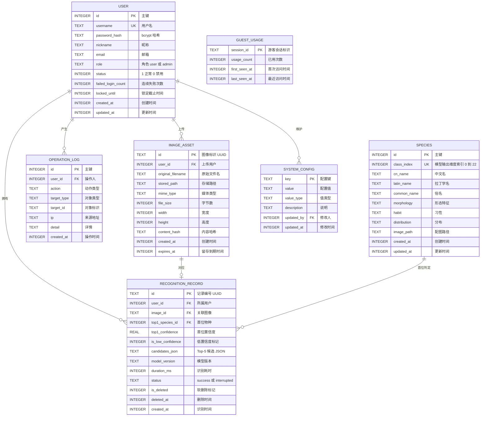

### 6.2 数据字典

数据类型遵循 sqlite3 的存储类别：`INTEGER`、`TEXT`、`REAL`、`BLOB`。时间统一以 **Unix 时间戳（UTC）** 存为 `INTEGER`。

#### 6.2.1 `user` 用户表

| 字段名 | 类型 | 约束 | 说明 |
| --- | --- | --- | --- |
| `id` | INTEGER | PK, AUTOINCREMENT | 主键 |
| `username` | TEXT(20) | NOT NULL, UNIQUE | 登录名，4 ～ 20 位字母、数字、下划线 |
| `password_hash` | TEXT(60) | NOT NULL | bcrypt 哈希，不可逆 |
| `nickname` | TEXT(20) | NOT NULL | 昵称，2 ～ 20 字符 |
| `email` | TEXT(120) | NULL | 选填 |
| `role` | TEXT(10) | NOT NULL, DEFAULT `user` | 取值 `user` / `admin` |
| `status` | INTEGER | NOT NULL, DEFAULT 1 | 1 正常、0 禁用 |
| `failed_login_count` | INTEGER | NOT NULL, DEFAULT 0 | 连续登录失败次数 |
| `locked_until` | INTEGER | NULL | 锁定截止时间戳 |
| `created_at` | INTEGER | NOT NULL | 创建时间 |
| `updated_at` | INTEGER | NOT NULL | 更新时间 |

索引与约束说明：

- `UNIQUE` 约束在 sqlite3 中大小写敏感，而业务要求用户名查重不区分大小写（BR-USER-01），因此需额外建立函数索引 `CREATE UNIQUE INDEX idx_user_username_lower ON user(LOWER(username))`。
- 系统初始化时创建默认管理员账号，首次登录强制修改密码。

#### 6.2.2 `image_asset` 图像资产表

| 字段名 | 类型 | 约束 | 说明 |
| --- | --- | --- | --- |
| `id` | TEXT(36) | PK | 图像标识，UUID v4 |
| `user_id` | INTEGER | FK → `user.id`, NULL | 上传用户；游客上传可为空 |
| `original_filename` | TEXT(255) | NOT NULL | 原始文件名，仅用于展示 |
| `stored_path` | TEXT(255) | NOT NULL | 相对存储路径，使用系统生成名称 |
| `mime_type` | TEXT(40) | NOT NULL | 取自文件内容判定结果 |
| `file_size` | INTEGER | NOT NULL | 字节数 |
| `width` | INTEGER | NULL | 图像宽度，解码后回填 |
| `height` | INTEGER | NULL | 图像高度，解码后回填 |
| `content_hash` | TEXT(64) | NULL | SHA-256，用于去重（BR-UPLOAD-07） |
| `created_at` | INTEGER | NOT NULL | 上传时间 |
| `expires_at` | INTEGER | NULL | 留存到期时间，用于原图清理（BR-HISTORY-10） |

#### 6.2.3 `recognition_record` 识别记录表

| 字段名 | 类型 | 约束 | 说明 |
| --- | --- | --- | --- |
| `id` | TEXT(36) | PK | 记录编号，UUID v4 |
| `user_id` | INTEGER | FK → `user.id`, NOT NULL | 所属用户；游客结果不落库，故实际非空 |
| `image_id` | TEXT(36) | FK → `image_asset.id`, NOT NULL | 关联图像 |
| `top1_species_id` | INTEGER | FK → `species.id`, NOT NULL | 首位物种，用于按物种筛选 |
| `top1_confidence` | REAL | NOT NULL | 首位置信度，取值 0 ～ 1 |
| `is_low_confidence` | INTEGER | NOT NULL, DEFAULT 0 | 低置信度标记，1 表示已触发阈值提示 |
| `candidates_json` | TEXT | NOT NULL | Top-5 候选数组，含类别标识与概率 |
| `model_version` | TEXT(32) | NOT NULL | 识别时的模型版本号（BR-RECOG-10） |
| `duration_ms` | INTEGER | NOT NULL | 端到端识别耗时 |
| `status` | TEXT(10) | NOT NULL, DEFAULT `success` | 取值 `success` / `interrupted` |
| `is_deleted` | INTEGER | NOT NULL, DEFAULT 0 | 软删除标记（BR-HISTORY-03） |
| `deleted_at` | INTEGER | NULL | 删除时间，用于 30 天后物理清理 |
| `created_at` | INTEGER | NOT NULL | 识别时间 |

`candidates_json` 结构示例：

```json
[
  { "class_index": 7,  "species_id": 7,  "cn_name": "某鱼中文名", "probability": 0.6213 },
  { "class_index": 12, "species_id": 12, "cn_name": "某鱼中文名", "probability": 0.1834 }
]
```

说明：`cn_name` 冗余存储是为保证历史记录的**结果恒定性**——即使物种知识库后续改名，历史记录仍展示当时的判定文本，符合 BR-HISTORY-09 的可追溯要求。

#### 6.2.4 `species` 物种表

| 字段名 | 类型 | 约束 | 说明 |
| --- | --- | --- | --- |
| `id` | INTEGER | PK, AUTOINCREMENT | 主键 |
| `class_index` | INTEGER | NOT NULL, UNIQUE | 模型输出维度索引，0 ～ 22 |
| `cn_name` | TEXT(50) | NOT NULL | 中文名 |
| `latin_name` | TEXT(80) | NOT NULL | 拉丁学名 |
| `common_name` | TEXT(80) | NULL | 俗名 |
| `morphology` | TEXT(2000) | NOT NULL | 形态特征 |
| `habit` | TEXT(2000) | NOT NULL | 习性 |
| `distribution` | TEXT(1000) | NULL | 分布 |
| `image_path` | TEXT(255) | NULL | 物种配图路径 |
| `created_at` | INTEGER | NOT NULL | 创建时间 |
| `updated_at` | INTEGER | NOT NULL | 更新时间 |

#### 6.2.5 `system_config` 系统配置表

| 字段名 | 类型 | 约束 | 说明 |
| --- | --- | --- | --- |
| `key` | TEXT(50) | PK | 配置键 |
| `value` | TEXT(200) | NOT NULL | 配置值，统一以字符串存储 |
| `value_type` | TEXT(10) | NOT NULL | 取值 `int` / `float` / `bool` / `string` |
| `description` | TEXT(200) | NULL | 配置说明 |
| `updated_by` | INTEGER | FK → `user.id`, NULL | 最后修改人 |
| `updated_at` | INTEGER | NULL | 最后修改时间 |

初始化配置项：

| 配置键 | 默认值 | 类型 | 说明 |
| --- | --- | --- | --- |
| `confidence_threshold` | 0.40 | float | 低置信度判定阈值，取值范围 0.10 ～ 0.90 |
| `batch_upload_limit` | 9 | int | 单批上传上限，取值范围 1 ～ 20 |
| `color_correction_enabled` | true | bool | 水下色偏校正开关 |
| `image_retention_days` | 180 | int | 原图留存天数，取值范围 30 ～ 365 |
| `guest_trial_limit` | 3 | int | 游客试用次数上限 |

#### 6.2.6 `operation_log` 操作日志表

| 字段名 | 类型 | 约束 | 说明 |
| --- | --- | --- | --- |
| `id` | INTEGER | PK, AUTOINCREMENT | 主键 |
| `user_id` | INTEGER | FK → `user.id`, NULL | 操作人；未登录动作可空 |
| `action` | TEXT(30) | NOT NULL | `login` / `logout` / `upload` / `recognize` / `export` / `delete` / `config_update` / `user_disable` / `password_reset` |
| `target_type` | TEXT(20) | NULL | 操作对象类型 |
| `target_id` | TEXT(64) | NULL | 操作对象标识 |
| `ip` | TEXT(45) | NULL | 来源地址，长度兼容 IPv6 |
| `detail` | TEXT(500) | NULL | 操作详情，**不得包含密码、令牌与图像内容** |
| `created_at` | INTEGER | NOT NULL | 操作时间 |

#### 6.2.7 `guest_usage` 游客额度表

| 字段名 | 类型 | 约束 | 说明 |
| --- | --- | --- | --- |
| `session_id` | TEXT(64) | PK | 服务端生成的会话标识 |
| `usage_count` | INTEGER | NOT NULL, DEFAULT 0 | 已使用次数 |
| `first_seen_at` | INTEGER | NOT NULL | 首次访问时间 |
| `last_seen_at` | INTEGER | NOT NULL | 最近访问时间 |

说明：该表承载 BR-USER-12 的服务端额度计数，确保清理浏览器本地存储无法绕过限制。会话超过 30 天未活跃即可清理。

### 6.3 训练数据集规格

#### 6.3.1 数据来源与规模

| 项 | 规格 |
| --- | --- |
| 数据来源 | Fish4Knowledge 23 类海洋鱼类公开数据集（飞桨 AI Studio 数据集 14492） |
| 类别数 | 23 类，与模型输出维度严格对应 |
| 样本规模 | 两万余张 |
| 图像特征 | 真实水下拍摄，普遍存在蓝绿偏色、照度不均、目标占比不定、部分遮挡 |

#### 6.3.2 划分方案

| 项 | 规格 |
| --- | --- |
| 划分比例 | 训练集 : 验证集 : 测试集 = 8 : 1 : 1 |
| 划分方式 | **分层抽样**，保证各集合的类别分布一致 |
| 随机种子 | 固定为 42，保证划分可复现 |
| 划分清单 | 落盘为 `train.txt` / `val.txt` / `test.txt`，每行一条「相对路径 + 类别索引」 |
| 测试集纪律 | 测试集仅用于最终一次性评估，**不得用于调参、阈值标定或模型选择** |

#### 6.3.3 清洗规则

按以下顺序执行，每一步的剔除数量须记录并写入数据准备报告。

| 步骤 | 规则 | 目的 |
| --- | --- | --- |
| 1 | 剔除无法解码或截断的文件 | 避免训练期异常中断 |
| 2 | 剔除分辨率过低（任一边 < 64 px）的图像 | 上采样后无有效信息 |
| 3 | 基于感知哈希剔除重复与近重复图像 | **防止测试集与训练集内容泄漏**，这是划分有效性的前提 |
| 4 | 剔除明显不含目标主体的图像（人工抽检） | 减少标签噪声 |

其中第 3 步是关键：先做全量去重再执行划分。若先去重后划分与先划分后去重顺序颠倒，会造成同一图像同时出现在训练集与测试集，使准确率虚高。

#### 6.3.4 增强与长尾处理

数据增强策略见第 4.2.3 节参数固化表中的「训练期增强」部分（水平翻转、随机旋转、颜色抖动、随机擦除），推理期不启用。

长尾处理采用两级策略：

- **类别加权**：交叉熵损失中按类别样本量的反比设置权重，抑制多数类主导。
- **判定口径**：将样本量低于全体中位数 30% 的类别识别为长尾类，在评估报告中单独列出其召回率，作为第 7.4 节门槛校验的依据。

### 6.4 物种知识库规格

#### 6.4.1 条目字段要求

每个物种条目对应 `species` 表一行，内容要求如下。

| 字段 | 内容要求 | 质量底线 |
| --- | --- | --- |
| `class_index` | 与模型输出维度索引严格一致 | **训练前锁定一次，此后不得变更**；变更会导致历史记录与新结果错位 |
| `cn_name` | 规范中文名 | 以权威物种名录为准 |
| `latin_name` | 拉丁学名 | 含命名人可省略，需保证拼写正确 |
| `common_name` | 常用俗名 | 可为空 |
| `morphology` | 形态特征描述 | 不少于 100 字，需包含可辨识的外部特征（体型、鳍式、体色与斑纹） |
| `habit` | 生活习性与食性 | 不少于 80 字 |
| `distribution` | 地理分布与栖息水层 | 可为空，若填写不少于 50 字 |
| `image_path` | 参考配图 | 每类 1 张，分辨率不低于 400 × 300，版权可用 |

#### 6.4.2 内容来源与校核

物种介绍文本须经**人工校核**后录入（决策基线）。校核要点：避免与相邻类别混淆描述；不使用未经证实的表述；形态特征描述应与该物种在数据集中的典型影像一致。校核记录随知识库一并归档。

#### 6.4.3 与识别结果的耦合约束

`class_index` 是模型输出、`species` 表与知识库文案三者之间的唯一对齐键。三者的顺序必须一次性地来自同一份类别清单文件（`classes.txt`），训练脚本与推理服务均从该文件读取类别顺序，禁止任何一方自行排序。

### 6.5 数据隐私与留存

| 维度 | 要求 |
| --- | --- |
| 传输安全 | 全站强制 HTTPS，明文 HTTP 请求重定向至 HTTPS（NFR-SEC-01） |
| 密码存储 | bcrypt 加盐哈希，cost ≥ 10；日志中不得出现密码或令牌（NFR-SEC-02、NFR-SEC-05） |
| 图像存储 | 图像文件与数据库分离存放；文件名使用系统生成标识，不使用用户原始文件名 |
| 数据用途 | 上传图像**仅用于本次识别**；不得用于模型训练、不得用于对外展示，除非获得用户显式授权 |
| 原图留存 | 默认 180 天，到期自动清理；可在系统配置中调整（BR-HISTORY-10） |
| 结果留存 | 识别结果与元数据长期保留，用于用户自身的历史回溯 |
| 账号注销 | 注销后 30 天内完成个人数据清理（图像文件、识别记录、操作日志），清理完成前账号不可恢复 |
| 导出范围 | 用户仅能导出本人数据；管理员导出全部数据须记入操作日志 |
| 越权防护 | 一切数据查询在服务端按登录身份过滤（NFR-SEC-03） |

## 第 7 章　算法与模型需求

### 7.1 数据准备规范

数据准备的流程、切分与清洗规则见第 6.3 节，本章不重复。此处仅明确算法侧的三条纪律：

| 纪律 | 具体要求 |
| --- | --- |
| 划分先于一切调参 | 划分清单（`train.txt` / `val.txt` / `test.txt`）一经生成即冻结，后续任何调整均需记录理由与影响 |
| 测试集一次性使用 | 测试集在模型与阈值全部确定后，仅评估一次；评估后不得据此再调整模型 |
| 类别顺序唯一 | 类别顺序来自 `classes.txt`，训练脚本与推理服务共同读取，禁止任一方自行排序（对齐第 6.4.3 节） |

### 7.2 模型方案

| 项 | 规格 |
| --- | --- |
| 主干网络 | ResNet18 |
| 权重初始化 | ImageNet 预训练权重（迁移学习） |
| 改造方式 | 替换末端全连接层，输出维度由 1000 改为 23 |
| 输入规格 | 3 × 224 × 224（对齐第 4.2.3 节参数固化表） |
| 输出规格 | 23 维概率向量，经 Softmax 归一化 |
| 参数规模 | 约 11.2 M |
| 选择理由 | 任务书 3.2 指定；参数量小、训练与推理成本低，适合单机部署；残差连接缓解深层网络的梯度消失问题，在中小规模数据集上表现稳定 |
| 已知取舍 | 相比 ResNet50 等更深网络，表征能力有限；若 23 类细粒度区分不达标，可考虑升级主干或引入注意力机制，但需评估训练成本与交付周期 |

### 7.3 训练策略

| 项 | 取值 | 说明 |
| --- | --- | --- |
| 损失函数 | 交叉熵，含类别权重 | 权重与类别样本量成反比，应对长尾分布（第 6.3.4 节） |
| 优化器 | Adam | |
| 分层学习率 | 主干 1e-4，全连接层 1e-3 | 避免预训练特征被大学习率破坏 |
| 学习率调度 | 余弦退火 | 平滑衰减至接近 0 |
| 批大小 | 32 | 显存不足时可下调至 16，需同步调整学习率 |
| 训练轮数上限 | 50 | 受早停约束，通常不会跑满 |
| 骨干冻结 | 前 5 轮冻结主干 | 先让随机初始化的全连接层收敛，再整体微调 |
| 早停条件 | 验证集准确率连续 5 轮无提升 | 保存最优权重而非最后一轮权重 |
| 随机种子 | 固定 42 | 保证训练与划分可复现 |
| 训练期增强 | 见第 4.2.3 节 | 推理期必须全部关闭 |

### 7.4 评估方案与验收门槛

#### 7.4.1 硬性门槛

| 指标 | 门槛 | 评估对象 | 口径说明 |
| --- | --- | --- | --- |
| 总体准确率 | ≥ 85% | 测试集 | 全部样本中判定正确的比例 |
| 平均 F1 | ≥ 0.82 | 测试集 | **宏观 F1**：先分别计算 23 个类别的 F1，再取算术平均，不按样本量加权（决策基线）。该口径对小样本类别更严格，能暴露长尾问题 |
| 各类召回率 | ≥ 0.60 | 测试集，逐类 | 派生约束，用于防止个别类别被完全忽略；未达标须在评估报告中说明原因 |

三项门槛为**并列关系**，任一项未达即视为模型未通过验收。

#### 7.4.2 评估产出物

| 产出物 | 内容 |
| --- | --- |
| 总体指标报告 | 准确率、宏观 F1、加权 F1（仅作参考对比，不作为门槛）、各类精确率 / 召回率 / F1 |
| 混淆矩阵 | 23 × 23 矩阵，附可视化图 |
| 长尾类别专项表 | 第 6.3.4 节判定的长尾类别的逐类表现 |
| 典型错误样本分析 | 至少 20 例错分样本，标注错分方向与可能原因（形近、遮挡、光照） |
| 阈值标定报告 | 见下节 |

#### 7.4.3 置信度阈值标定方法

第 4.3 节使用的阈值 0.40 由**验证集**标定得出，方法如下（不使用测试集，遵守第 7.1 节纪律）：

1. 在验证集上获取全部样本的首位候选概率与判定正误标签。
2. 将首位概率按区间分桶，统计每个区间内错分样本的占比。
3. 选取使**不低于 90% 的错分样本落入低置信度区间**的最小阈值，作为建议阈值。
4. 结合业务体验做上下限约束，限定取值落在 0.10 ～ 0.90 的可配置范围内。
5. 标定结果写入阈值标定报告，并回填至 `system_config.confidence_threshold`。

说明：该阈值随模型版本变化需重新标定。模型升级后若未重新标定，历史记录中的低置信度标记将失去可比性。

### 7.5 模型优化与精度回退控制

优化手段**仅在推理耗时或模型体积未达目标时启用**，不得为优化而优化。

| 手段 | 方案 | 启用条件 |
| --- | --- | --- |
| 动态量化 | 对全连接层执行 int8 动态量化 | GPU 环境单图耗时超过目标，或需在 CPU 环境部署 |
| 结构化剪枝 | 按通道重要性剪枝，稀疏度不超过 30% | 模型体积或加载时间成为瓶颈 |

**精度回退控制线**（对齐任务书 2.2 的硬指标约束）：

| 约束项 | 控制线 | 处置 |
| --- | --- | --- |
| 总体准确率回退 | ≤ 1 个百分点 | 超标即放弃该优化手段，保留未优化的基线模型 |
| 宏观 F1 回退 | ≤ 1 个百分点 | 同上 |
| 复测要求 | 优化后必须在**同一测试集**上完整复测 | 复测结果并入评估报告，形成「优化前 / 优化后」对照 |

决策基线已明确：**任何优化导致精度回退超过 1 个百分点，即放弃该优化**。宁可接受较慢的推理，也不接受精度跌破 85% 的验收门槛。

### 7.6 推理服务需求

#### 7.6.1 服务规格

| 项 | 规格 |
| --- | --- |
| 输入 | 图像文件（通过上传接口获取的图像标识） |
| 输出 | 首位物种、23 类概率、Top-5 候选、是否低置信度、识别耗时、模型版本 |
| 单图端到端耗时 | ≤ 3 秒（GPU 环境，自提交至结果返回） |
| 并发承载 | 不少于 20 个并发识别请求（NFR-PERF-03） |
| 模型加载 | 服务启动时加载一次，全程单例复用（BR-RECOG-05） |
| 批量策略 | 同进程内顺序执行，不并发抢占显存（BR-RECOG-07） |
| 设备策略 | GPU 优先；显存不足时降级为 CPU 单图推理并告警 |
| 健康检查 | 提供健康检查接口，返回模型加载状态与设备类型（NFR-REL-02） |

#### 7.6.2 推理时序

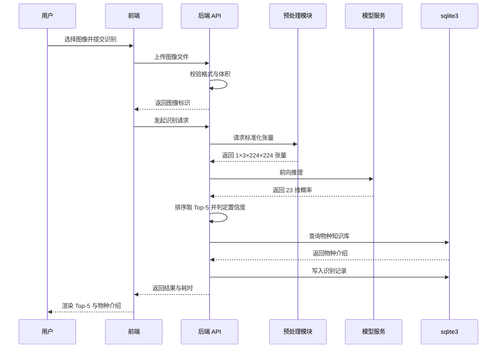

### 7.7 模型适用范围与局限性

#### 7.7.1 能力边界

| 边界 | 说明 |
| --- | --- |
| 覆盖范围 | 仅 23 个训练类别，不提供开放集识别与「未知物种」输出 |
| 判读能力受限场景 | 图像模糊、目标严重遮挡、极端光照、水族箱布景干扰、目标占比过小 |
| 生物学差异 | 同种鱼类的幼体与成体、雌雄二态个体形态差异显著，模型未针对性训练 |
| 拍摄角度 | 训练数据以侧面影像为主，正背面与俯视角度表现可能下降 |
| 结果性质 | 输出为概率判定，不构成物种鉴定的权威结论 |

#### 7.7.2 免责声明文案

以下文案需在结果区常驻展示（FR-RESULT-05），并在「关于与免责」页面完整呈现：

> 本系统基于深度学习模型对 23 类海洋鱼类进行识别，识别结果仅供参考，不构成物种鉴定的权威结论。当图像模糊、目标遮挡、光照异常，或拍摄对象不属于本系统覆盖的 23 个类别时，识别结果可能出现偏差。涉及渔业管理、贸易结算、科学研究等场景，请以主管部门或专业机构的鉴定结论为准。

---

## 第 8 章　接口与集成需求

### 8.1 接口清单

本章定义接口的职责边界与调用约定，**详细的字段级契约交由《API 接口文档》**（任务书 5.2 交付物之一），本文档不与其重复。

#### 8.1.1 认证与账号

| 方法 | 路径 | 用途 | 权限 | 关联需求 |
| --- | --- | --- | --- | --- |
| POST | `/api/auth/register` | 注册并自动登录 | 公开 | FR-USER-01 |
| POST | `/api/auth/login` | 登录并签发令牌 | 公开 | FR-USER-02 |
| POST | `/api/auth/logout` | 登出并使当前令牌失效 | 登录 | FR-USER-03 |
| POST | `/api/auth/refresh` | 用刷新令牌换取新访问令牌 | 携带刷新令牌 | FR-USER-02 |
| GET | `/api/users/me` | 获取当前用户信息 | 登录 | FR-USER-04 |
| PATCH | `/api/users/me` | 修改昵称、邮箱 | 登录 | FR-USER-04 |
| PUT | `/api/users/me/password` | 修改密码 | 登录 | FR-USER-05 |
| GET | `/api/guest/quota` | 查询游客剩余试用次数 | 公开 | FR-USER-06 |

#### 8.1.2 识别链路

| 方法 | 路径 | 用途 | 权限 | 关联需求 |
| --- | --- | --- | --- | --- |
| POST | `/api/images` | 上传单张或多张图像 | 公开（游客限次） | FR-UPLOAD-01 ～ 08 |
| POST | `/api/recognize` | 对单张图像执行识别 | 公开（游客限次） | FR-RECOG-01 ～ 06 |
| POST | `/api/recognize/batch` | 批量识别（顺序执行） | 公开（游客限次） | FR-RECOG-05 |
| GET | `/api/images/{image_id}/content` | 获取原图内容 | 登录且归属校验 | FR-RESULT-04 |
| GET | `/api/images/{image_id}/thumb` | 获取缩略图（`size` 控长边） | 登录且归属校验 | FR-RESULT-02、FR-HISTORY-02 |
| DELETE | `/api/images/{image_id}` | 删除尚未识别的图像 | 登录且归属校验 | FR-UPLOAD-08 |

说明：原图**不通过静态目录直接暴露**，一律经带鉴权的接口读取，避免未授权访问他人图像。

说明：**缩略图接口为列表页专用**。历史列表与结果页需展示预览，若复用原图接口会一次拉取多张最大 10 MB 的图像，弱网下不可用；缩略图将单张传输量压至数十 KB。

说明：**删除图像接口只允许删除尚未产生识别记录的图像**。已识别图像若被删除，会因 `CASCADE` 外键连带删除历史记录 —— 那属于数据丢失。历史记录的删除须走 `/api/records/{record_id}`。

#### 8.1.3 历史记录

| 方法 | 路径 | 用途 | 权限 | 关联需求 |
| --- | --- | --- | --- | --- |
| GET | `/api/records` | 历史列表（筛选 + 分页） | 登录 | FR-HISTORY-01、02 |
| GET | `/api/records/{record_id}` | 记录详情 | 登录 | FR-HISTORY-03 |
| DELETE | `/api/records/{record_id}` | 删除单条记录 | 登录 | FR-HISTORY-06 |
| DELETE | `/api/records` | 批量删除记录 | 登录 | FR-HISTORY-06 |
| GET | `/api/records/export` | 按筛选条件导出 CSV | 登录 | FR-HISTORY-05 |
| GET | `/api/results/{record_id}/candidates` | 获取该记录的 Top-5 候选 | 登录且归属校验 | FR-RESULT-03 |

说明：**Top-5 候选由独立端点提供**，数据取自记录写入时的 `candidates_json` 字段，不重新推理，故为纯读取操作。候选固定 5 条，排序为降序，`rank` 从 1 起。

说明：**`/api/history*` 为兼容别名**（`/api/history`、`/api/history/{record_id}`、`/api/history/export` 分别等价于上表前三条的 `records` 版本）。早期联调沿用该命名，现以 `/api/records*` 为唯一主路径；别名与主路径响应完全等价，**新代码不得使用**，后续版本将移除。删除操作**没有别名**。

#### 8.1.4 物种与系统

| 方法 | 路径 | 用途 | 权限 | 关联需求 |
| --- | --- | --- | --- | --- |
| GET | `/api/species` | 获取 23 类物种清单 | 公开 | FR-RESULT-03、FR-HISTORY-02 |
| GET | `/api/species/{species_id}` | 获取物种介绍详情 | 公开 | FR-RESULT-03 |
| GET | `/api/health` | 健康检查，返回模型加载状态与设备类型 | 公开 | NFR-REL-02 |
| GET | `/api/model-info` | 获取模型版本与训练指标 | 公开 | FR-RESULT-05 |

说明：**`species_id` 恒等于 `class_index`**（0 基，`0`～`22`），两者是同一数值在不同层的称呼 —— 数据库字段名为 `class_index`，接口参数名为 `species_id`。

说明：**`/api/health` 与 `/api/model-info` 定位不同**。前者面向运维监控，含数据库 PRAGMA、权重路径等全量诊断信息；后者面向前端展示，只含模型本身的版本与指标，且字段扁平、便于直接使用。

#### 8.1.5 管理员

| 方法 | 路径 | 用途 | 权限 | 关联需求 |
| --- | --- | --- | --- | --- |
| GET | `/api/admin/users` | 用户列表（搜索 + 分页） | 管理员 | FR-USER-07 |
| POST | `/api/admin/users` | 创建用户（可指定角色） | 管理员 | FR-USER-07 |
| PATCH | `/api/admin/users/{user_id}` | 启用 / 禁用用户 | 管理员 | FR-USER-07 |
| DELETE | `/api/admin/users/{user_id}` | 删除用户 | 管理员 | FR-USER-07 |
| POST | `/api/admin/users/{user_id}/reset-password` | 重置用户密码 | 管理员 | FR-USER-07 |
| GET | `/api/admin/records` | 全部用户记录 | 管理员 | FR-USER-08 |
| DELETE | `/api/admin/records/{record_id}` | 删除任意记录 | 管理员 | FR-USER-08 |
| GET | `/api/admin/stats` | 统计概览（用户数、记录数、物种分布） | 管理员 | FR-USER-10 |
| GET | `/api/admin/logs` | 操作日志查询（分页 + 筛选） | 管理员 | NFR-SEC-03 |
| GET | `/api/admin/config` | 读取系统配置 | 管理员 | FR-USER-09 |
| PUT | `/api/admin/config` | 更新系统配置 | 管理员 | FR-USER-09 |

说明：**`POST /api/admin/users` 是唯一的提权入口**。公开注册一律产生 `user` 角色，无法指定 `admin`；只有本接口可指定角色，且需管理员身份调用。

说明：**`DELETE /api/admin/users/{user_id}` 有三重保护**：不允许删除自己（`40301`）；不允许删除最后一个管理员（`40903`）；删除会级联清除该用户的全部识别记录（`CASCADE`），但保留其图像资产（`SET NULL`）与审计日志（`SET NULL`）。界面确认文案须明确提示将删除的记录条数。

说明：**`GET /api/admin/logs` 填补了审计闭环**。此前系统各写操作持续写入 `operation_log` 表，但无任何读取入口，审计数据实际不可用 —— 本接口使 `NFR-SEC-03` 的"可追溯"要求真正落地。日志只增不改不删，系统不提供日志删除接口。

> **本节端点计数的版本差异**：V1.1 之前的本节共 27 个端点，V1.1 起为 **38 个**（35 条主路径 + 3 条别名）。新增的 8 条主路径均是实现阶段发现的工程必要项，`/api/history*` 3 条为兼容别名。**详细的字段级契约见《API 接口契约》V1.2 第 11.1、11.2 节**。

### 8.2 认证与鉴权

| 项 | 方案 |
| --- | --- |
| 认证方案 | JWT 双令牌：访问令牌 + 刷新令牌（决策基线） |
| 访问令牌有效期 | 2 小时 |
| 刷新令牌有效期 | 7 天 |
| 令牌传递 | 请求头 `Authorization: Bearer <token>` |
| 令牌载荷 | 用户标识、角色、签发时间、过期时间；**不得包含密码、邮箱等敏感信息** |
| 令牌刷新 | 访问令牌过期时前端静默调用刷新接口；刷新令牌亦失效则跳转登录页并保留原路径 |
| 登出 | 服务端将当前令牌加入失效集合，前端同步清除本地存储 |
| 权限模型 | 两种角色 `user` / `admin`；管理员专属接口在服务端做角色校验，前端隐藏入口不作为安全手段 |
| 越权防护 | 所有资源接口按登录身份过滤；**访问他人资源统一返回 404，不返回 403**，使「不存在」与「无权访问」不可区分，防止 ID 枚举。`403` 仅用于角色不足（非管理员访问管理端点）与语义性拒绝（如管理员删除自己） |
| 失败锁定 | 连续登录失败 5 次锁定账号 10 分钟 |
| 传输要求 | 令牌仅通过 HTTPS 传输；禁止置于 URL 查询参数中 |

### 8.3 统一响应与错误码

#### 8.3.1 响应体结构

所有接口返回统一结构，便于前端集中处理：

```json
{
  "code": 0,
  "message": "ok",
  "data": {},
  "request_id": "7f3a1c9e-2b4d-4e88-9a01-5c6d7e8f9a0b"
}
```

| 字段 | 说明 |
| --- | --- |
| `code` | 0 表示成功；非 0 为错误码（见 8.3.2） |
| `message` | 用户可读的错误说明；成功时为 `ok` |
| `data` | 业务数据；失败时为 `null` |
| `request_id` | 请求追踪标识，用于日志关联与问题排查 |

#### 8.3.2 错误码分段与明细

| 错误码 | 含义 | 对应 HTTP 状态 | 前端处置 |
| --- | --- | --- | --- |
| 40001 | 请求参数缺失或格式错误 | 400 | 字段级提示，标出具体字段 |
| 40101 | 未登录或令牌无效 | 401 | 引导登录 |
| 40102 | 访问令牌已过期 | 401 | 静默刷新令牌后重试 |
| 40103 | 用户名或密码不正确 | 401 | 就地提示，不区分账号是否存在 |
| 40104 | 账号已被禁用 | 401 | 提示联系管理员 |
| 40105 | 账号已锁定 | 401 | 提示剩余锁定时间 |
| 40301 | 无权访问该资源 | 403 | 提示无权限。**仅用于角色不足或语义性拒绝**（非管理员访问管理端点、管理员删除自己、重置其他管理员密码）；**不用于"资源属他人"** |
| 40401 | 资源不存在 | 404 | 展示对应空态或错误页。**资源存在但属他人时亦返回本码**（防 ID 枚举） |
| 40901 | 用户名已存在 | 409 | 注册表单就地提示 |
| 40902 | 不允许禁用自身账号 | 409 | 提示不可禁用自身 |
| 40903 | 不允许禁用或删除最后一个管理员 | 409 | 提示须先启用其他管理员 |
| 40904 | 不允许重置其他管理员密码 | 403 | 提示须由该账号本人操作 |
| 41301 | 文件体积超过上限 | 413 | 提示实际大小与上限值 |
| 41501 | 文件类型不支持 | 415 | 提示支持的格式清单 |
| 42201 | 图像无法解码 | 422 | 提示文件损坏或格式异常 |
| 42202 | 图像分辨率过低 | 422 | 提示分辨率要求 |
| 42901 | 游客试用额度已用尽 | 429 | 引导注册 |
| 42902 | 请求过于频繁 | 429 | 提示稍后重试 |
| 50001 | 服务端内部错误 | 500 | 提示「服务暂时不可用」，附追踪编号 |
| 50301 | 识别服务暂不可用（模型未加载） | 503 | 提示稍后重试 |
| 50302 | 请求队列已满 | 503 | 提示当前请求较多 |

设计原则：错误码**只增不改**。已发布的码值语义不得变更，新增场景使用新码值。

### 8.4 文件上传约定

| 项 | 约定 |
| --- | --- |
| 请求方式 | `POST`，`multipart/form-data` |
| 字段名 | 单图 `file`；批量 `files`（可重复） |
| 单批上限 | 9 个文件（与 `system_config.batch_upload_limit` 联动） |
| 单文件上限 | 10 MB |
| 允许类型 | `image/jpeg`、`image/png`、`image/bmp` |
| 类型校验 | 以文件内容判定为准，扩展名仅作辅助（BR-UPLOAD-01） |
| 存储路径 | 由配置项 `SEATONG_UPLOAD_DIR` 指定，按日期二级目录分片存放 |
| 文件命名 | 使用 UUID，保留原扩展名；原始文件名仅存于数据库 |
| 访问方式 | 经 `/api/images/{image_id}/content` 带鉴权读取，不直接暴露存储目录 |
| 响应内容 | 每个文件返回图像标识、原始文件名、体积、校验结果 |
| 部分失败 | 返回逐文件结果，成功项与失败项分别列出（BR-UPLOAD-04） |

### 8.5 联调与环境约定

| 项 | 约定 |
| --- | --- |
| 前端开发服务端口 | **5180**（非 Vite 默认 5173 —— 5173 被同机并行的另一项目长期占用，本机实测确认，见下方说明） |
| 后端服务端口 | 8000 |
| 接口前缀 | `/api` |
| 跨域配置 | 后端按配置项允许来源列表放行；开发环境允许 `http://localhost:5180` 与 `http://127.0.0.1:5180` |
| 配置文件 | 后端使用 `.env` 管理环境变量，**不提交至版本库**；提供 `.env.example` 作为模板 |
| 关键配置项 | `SEATONG_ENV`、`SEATONG_DB_PATH`、`SEATONG_MODEL_PATH`、`SEATONG_UPLOAD_DIR`、`SEATONG_JWT_SECRET`、`SEATONG_JWT_ACCESS_TTL`、`SEATONG_JWT_REFRESH_TTL`、`SEATONG_CORS_ORIGINS`、`SEATONG_LOG_LEVEL`、`SEATONG_MAX_UPLOAD_MB` |
| 配置外部化 | 全部可配置项通过环境变量或 `system_config` 表提供，代码中不得硬编码（NFR-MAINT-01） |
| 日志 | 分级输出（DEBUG / INFO / WARNING / ERROR）并落盘；日志中不得出现密码、令牌与图像内容（NFR-SEC-05、NFR-MAINT-02） |
| 接口文档 | 后端基于代码注释生成交互式接口文档，与本清单保持同步；接口新增或变更须同步更新《API 接口文档》 |

---

## 第 9 章　非功能需求

本章将第 3.2 节列出的 15 条非功能需求逐条展开为**可测量、可验收**的指标。每条需求给出指标定义、目标值与验证方式三项，缺一不可——只有目标值而无验证方式的条款无法验收，等同于未定义。

### 9.1 性能需求

#### 9.1.1 端到端耗时分解

NFR-PERF-02 规定单图端到端耗时 ≤ 3 秒。为避免该指标成为一句不可定位的口号，此处将其**分解到各环节并留出余量**，各环节耗时之和须严格小于总预算。

| 环节 | 分段目标 | 说明 | 对应需求 |
| --- | --- | --- | --- |
| 上传接收与校验 | ≤ 200 ms | 含格式 / 体积校验与落盘 | FR-UPLOAD-03、04 |
| 预处理 | ≤ 200 ms | 解码、尺寸调整、归一化、色偏校正 | FR-PREPROC-01 ～ 04 |
| 模型推理 | ≤ 2000 ms | GPU 环境单图前向 | FR-RECOG-01 |
| 结果整理与落库 | ≤ 300 ms | Top-5 排序、知识库查询、写库 | FR-RECOG-03、FR-HISTORY-01 |
| 网络往返与渲染 | ≤ 300 ms | 局域网环境 | —— |
| **合计** | **≤ 3000 ms** | 与 NFR-PERF-02 一致 | —— |

分解口径说明：推理环节占用总预算约 67%，是唯一必须依赖硬件保障的环节；其余四个环节合计约 1000 ms，均为工程可实现范围。**若推理环节超过 2000 ms，应优先启用第 7.5 节的量化手段，而非压缩其他环节**——压缩校验或预处理环节会直接损害数据正确性。

#### 9.1.2 性能指标清单

| 需求编号 | 指标定义 | 目标值 | 验证方式 |
| --- | --- | --- | --- |
| NFR-PERF-01 | 首页从发起请求到首屏可交互的耗时 | ≤ 2 s | 局域网环境，Chrome DevTools 冷加载三次取中位数 |
| NFR-PERF-02 | 单图自提交至结果渲染完成的耗时 | ≤ 3 s | 20 张测试图像分别计时，取 P95 值 ≤ 3 s |
| NFR-PERF-03 | 同时处理识别请求而不出现失败或超时的数量 | ≥ 20 并发 | 以 20 并发持续提交测试图像，统计成功率 100% 且无请求超时 |

**并发口径说明**：NFR-PERF-03 的「20 并发」指**并发请求数**，不对应 20 路并行推理。受 BR-RECOG-07 约束，批量任务在同一进程内顺序执行以避免显存竞争；20 并发场景下的耗时允许延长至单图耗时的 20 倍以内，但**不得出现请求失败**。

### 9.2 安全与隐私需求

| 需求编号 | 指标定义 | 目标值 | 验证方式 |
| --- | --- | --- | --- |
| NFR-SEC-01 | 全站传输协议 | 强制 HTTPS；明文 HTTP 请求 301 重定向至 HTTPS | 以 `http://` 访问任一页面与接口，确认均被重定向 |
| NFR-SEC-02 | 密码存储形态 | bcrypt 加盐哈希，cost ≥ 10 | 直接查询 `user.password_hash` 字段，确认不含明文且前缀为 `$2b$` |
| NFR-SEC-03 | 越权访问防护 | 访问他人资源返回 403；响应中不含该资源是否存在的任何信息 | 用 A 账号令牌请求 B 账号的记录编号，断言返回 403 且与请求不存在编号时的响应体**完全一致** |
| NFR-SEC-04 | 上传文件安全检查 | 按文件头特征判定类型；拒绝伪装扩展名、拒绝含可执行内容的文件 | 上传改名为 `.jpg` 的 `.txt` 文件，断言被拒（对齐 BR-UPLOAD-01） |
| NFR-SEC-05 | 日志脱敏 | 日志中不出现密码、令牌、图像二进制内容 | 全量扫描日志文件，检索 `password`、`token`、`Bearer` 等关键词，命中数为 0 |

**NFR-SEC-03 的口径需特别强调**：仅返回 403 是不够的。若「访问他人存在的记录」与「访问不存在的记录」返回不同响应（前者 403、后者 404），攻击者可据此枚举出有效记录编号。必须使两者响应**不可区分**。

### 9.3 可靠性与容错需求

| 需求编号 | 指标定义 | 目标值 | 验证方式 |
| --- | --- | --- | --- |
| NFR-REL-01 | 模型加载失败时的行为 | 服务不崩溃；`/api/health` 返回未就绪状态与原因；识别接口返回 50301 | 将模型文件改名为不存在后启动服务，断言健康检查可访问且识别接口返回 50301 |
| NFR-REL-02 | 健康检查接口 | 返回服务状态、模型加载状态、推理设备类型；响应时间 ≤ 100 ms | 调用 `/api/health`，确认三个字段齐备 |

**容错设计原则**：模型不可用时，**服务降级但不宕机**。用户信息查询、历史记录浏览、物种知识库等不依赖模型的接口应保持可用，仅识别类接口返回 50301。这一区分需在实现中体现，否则模型故障会导致整个服务不可用。

### 9.4 兼容性需求

| 需求编号 | 指标定义 | 目标值 | 验证方式 |
| --- | --- | --- | --- |
| NFR-COMPAT-01 | 浏览器支持范围 | Chrome / Firefox / Safari / Edge 各自最新两个版本 | 在四款浏览器最新两个版本上执行第 10 章的端到端验收场景 |
| NFR-COMPAT-02 | 响应式适配 | 三档断点下布局无横向溢出、无元素重叠、主要操作可达 | 在 375 / 768 / 1440 三种视口宽度下逐一核对第 5.5.1 节的断点要求 |

浏览器矩阵与断点的具体取值见第 5.5 节，此处不重复。需注意 NFR-COMPAT-01 的验证必须使用**真实浏览器**，而非仅检查 CSS 特性支持——任务书 6.4 要求的是「正常运行」，属行为层面要求。

### 9.5 可维护性需求

| 需求编号 | 指标定义 | 目标值 | 验证方式 |
| --- | --- | --- | --- |
| NFR-MAINT-01 | 配置外部化 | 代码中不出现硬编码的路径、密钥、端口、阈值 | 全文检索代码中的绝对路径、密钥字面量与魔法数字，命中数为 0 |
| NFR-MAINT-02 | 日志分级与落盘 | DEBUG / INFO / WARNING / ERROR 四级；按级别输出并持久化 | 触发四级日志各一条，确认文件内容与级别标记正确 |
| NFR-MAINT-03 | 一键启动 | 提供脚本可同时启动后端服务与前端开发服务 | 执行脚本后两个服务均可访问，无需手工分步操作 |

`SEATONG_LOG_LEVEL` 控制输出级别，取值与第 8.5 节的配置项清单一致。

---

## 第 10 章　验收标准与测试要点

本章定义项目通过验收的判定依据。**第 4 章的 54 条验收条件（AC）是单元级判定，本章是系统级判定**——两者是包含关系，系统级通过的前提是全部 AC 通过。

### 10.1 验收范围与判定原则

#### 10.1.1 验收构成

| 类别 | 内容 | 判定依据 |
| --- | --- | --- |
| 功能验收 | 41 条功能需求（FR） | 第 4 章 55 条 AC 全部通过，且本章 10.2 节端到端场景通过 |
| 模型验收 | 23 类识别能力 | 第 7.4.1 节三项硬性门槛并列通过 |
| 非功能验收 | 15 条非功能需求（NFR） | 第 9 章各条验证方式全部通过 |
| 兼容性验收 | 浏览器与响应式 | 第 9.4 节两项 NFR 通过 |
| 交付物验收 | 任务书 5.1 / 5.2 清单 | 第 12.3 节交付物清单逐项签收 |

#### 10.1.2 判定原则

| 原则 | 说明 |
| --- | --- |
| 并列关系 | 四类验收为并列关系，任一类未通过即整体未通过 |
| 真实环境 | 模型门槛必须在**真实测试集**上评估，不接受训练集或验证集结果替代 |
| 一次性 | 测试集评估仅执行一次（第 7.1 节纪律），评估后不得据结果调整模型 |
| 可复现 | 划分、训练、评估均固定随机种子 42，结论须可重跑复现 |

### 10.2 端到端验收场景

以下三条场景串联核心链路，用于系统级验收。每条场景给出前置条件、操作步骤与通过判据。

#### 场景一：游客首次识别（公开链路）

| 项 | 内容 |
| --- | --- |
| **前置条件** | 未登录状态；游客剩余额度 ≥ 1 次；准备一张 23 类范围内的清晰鱼类图像 |
| **操作步骤** | 1. 访问首页 → 2. 进入识别工作台 → 3. 拖拽图像入上传区 → 4. 确认缩略图出现 → 5. 点击「开始识别」→ 6. 等待结果 |
| **通过判据** | ① 上传区高亮反馈正常；② 缩略图 2 秒内出现（AC-FR-UPLOAD-01-1）；③ 结果区展示中文名、拉丁学名与置信度；④ Top-5 条形图渲染 5 行且首位高亮；⑤ 物种介绍三个折叠面板可展开；⑥ 结果区底部展示免责声明；⑦ 端到端耗时 ≤ 3 s |
| **覆盖需求** | FR-UPLOAD-01、05、FR-RECOG-01 ～ 03、FR-RESULT-01 ～ 05 |

#### 场景二：注册用户批量识别并导出（登录链路）

| 项 | 内容 |
| --- | --- |
| **前置条件** | 已注册并登录；准备 9 张合法图像 |
| **操作步骤** | 1. 登录后进入识别工作台 → 2. 点击选择 9 张图像 → 3. 提交批量识别 → 4. 等待全部完成 → 5. 进入历史记录 → 6. 按物种筛选 → 7. 全选当前页 → 8. 导出 CSV |
| **通过判据** | ① 队列显示「已选 9 / 9」；② 进度显示「正在识别 n / 9」且递增；③ 9 条结果全部生成；④ 历史列表出现 9 条新记录且按时间倒序；⑤ 筛选后仅展示与筛选条件匹配的记录，「重置筛选」后全部恢复；⑥ 导出文件为 CSV，含表头且行数与选中数一致；⑦ 导出内容中的物种名与列表一致 |
| **覆盖需求** | FR-UPLOAD-06、FR-RECOG-05、FR-HISTORY-01、02、05 |

#### 场景三：越权与额度边界（安全链路）

| 项 | 内容 |
| --- | --- |
| **前置条件** | 账号 A 与账号 B 各有识别记录；准备一个未使用的游客会话 |
| **操作步骤** | 1. 用 A 的令牌请求 B 的记录编号 → 2. 用 A 的令牌请求一个不存在的记录编号 → 3. 以游客身份连续识别 4 次 |
| **通过判据** | ① 步骤 1 返回 403；② 步骤 1 与步骤 2 的响应体**完全一致**（NFR-SEC-03）；③ 步骤 3 中前 3 次成功，第 4 次返回 42901 并引导注册；④ 清除浏览器本地存储后重新访问，剩余额度**不变**（BR-USER-12 服务端计数） |
| **覆盖需求** | NFR-SEC-03、FR-USER-06 |

### 10.3 功能验收汇总

第 4 章各模块的验收条件数量如下，逐条明细见对应小节。

| 模块 | 验收条件数 | 明细位置 |
| --- | --- | --- |
| 图像上传 | 11 | 第 4.1.7 节 |
| 图像预处理 | 8 | 第 4.2.8 节 |
| 智能识别 | 7 | 第 4.3.7 节 |
| 结果展示 | 7 | 第 4.4.7 节 |
| 历史记录 | 8 | 第 4.5.7 节 |
| 用户管理 | 13 | 第 4.6.7 节 |
| **合计** | **54** | —— |

### 10.4 模型验收

#### 10.4.1 硬性门槛验收

| 指标 | 门槛 | 判定 |
| --- | --- | --- |
| 测试集总体准确率 | ≥ 85% | 达标 / 不达标 |
| 测试集平均宏观 F1 | ≥ 0.82 | 达标 / 不达标 |
| 测试集各类召回率 | ≥ 0.60 | 达标 / 不达标（需附原因说明） |

#### 10.4.2 预处理一致性专项

**这是本项目最易被忽视、也最容易导致线上掉点的验收项。**训练期与推理期若各自实现一份预处理，两处参数会随时间漂移，模型在训练时「见过」的图像分布与推理时「看到」的不一致，表现为测试集指标正常但实际使用准确率明显偏低，且**不会产生任何报错**。

| 检查项 | 检查方法 | 通过判据 |
| --- | --- | --- |
| 实现唯一 | 检索预处理代码，确认训练与推理调用同一函数 | 仅存在一份实现 |
| 参数唯一 | 确认尺寸、均值、标准差、色偏校正开关均从同一配置读取 | 无重复定义的常量 |
| 数值一致 | 取同一张图像，分别经训练管线与推理管线处理，比对输出张量 | 逐元素完全相等（容差 0） |

第三项的判定要求**容差为 0**。这是有意为之的严格口径：浮点缩放顺序差异会引入微小偏差，虽不影响单次推理，但说明两条链路未复用同一份实现——这正是该检查要拦截的隐患。

#### 10.4.3 模型验收产出物

验收时须提交第 7.4.2 节列出的五项产出物：总体指标报告、混淆矩阵、长尾类别专项表、典型错误样本分析（≥ 20 例）、阈值标定报告。

### 10.5 非功能验收清单

| 类别 | 验收项 | 判定依据 | 对应需求 |
| --- | --- | --- | --- |
| 性能 | 首屏加载 ≤ 2 s | 三次取中位数 | NFR-PERF-01 |
| 性能 | 单图端到端 P95 ≤ 3 s | 20 张计时 | NFR-PERF-02 |
| 性能 | 20 并发无失败 | 压测成功率 100% | NFR-PERF-03 |
| 安全 | HTTPS 强制 | HTTP 被重定向 | NFR-SEC-01 |
| 安全 | 密码哈希存储 | 字段形态检查 | NFR-SEC-02 |
| 安全 | 越权不可区分 | 响应体一致性比对 | NFR-SEC-03 |
| 安全 | 上传类型校验 | 伪装文件被拒 | NFR-SEC-04 |
| 安全 | 日志脱敏 | 关键词命中数为 0 | NFR-SEC-05 |
| 可靠性 | 模型故障不宕机 | 改名模型后验证 | NFR-REL-01 |
| 可靠性 | 健康检查可用 | 字段齐备、响应 ≤ 100 ms | NFR-REL-02 |
| 兼容性 | 四浏览器 × 最新两版 | 端到端场景通过 | NFR-COMPAT-01 |
| 兼容性 | 三档断点无溢出 | 视口切换核对 | NFR-COMPAT-02 |
| 可维护性 | 无硬编码 | 全文检索零命中 | NFR-MAINT-01 |
| 可维护性 | 日志分级落盘 | 四级各一条 | NFR-MAINT-02 |
| 可维护性 | 一键启动 | 脚本执行后双服务可用 | NFR-MAINT-03 |

### 10.6 异常用例要点

异常路径的验收权重不低于正常路径。以下为必须覆盖的异常场景，其判定依据详见第 8.3.2 节的错误码表。

| 异常场景 | 预期响应 | 错误码 |
| --- | --- | --- |
| 提交缺字段的请求 | 字段级提示，标出具体字段 | 40001 |
| 使用过期访问令牌 | 静默刷新后重试成功，用户无感 | 40102 |
| 连续 5 次密码错误 | 第 6 次提示账号已锁定及剩余时间 | 40105 |
| 访问他人记录 | 404，与访问不存在记录的响应完全一致（不可区分） | 40401 |
| 上传 11 MB 文件 | 提示实际大小与上限值 | 41301 |
| 上传 `.gif` | 列出支持的格式清单 | 41501 |
| 上传损坏图像 | 提示文件损坏或格式异常 | 42201 |
| 游客第 4 次识别 | 引导注册 | 42901 |
| 模型未加载时识别 | 提示稍后重试 | 50301 |

### 10.7 缺陷分级

| 级别 | 定义 | 示例 | 处置 |
| --- | --- | --- | --- |
| 致命 | 导致验收门槛不通过或数据错误 | 准确率 < 85%；越权可读到他人数据；预处理两链路不一致 | 必须修复，阻塞验收 |
| 严重 | 核心链路可正常使用但存在明显缺陷 | 单图耗时 > 3 s；导出内容与列表不一致；模型故障导致服务不可用 | 必须修复 |
| 一般 | 影响体验但不阻塞使用 | 空态文案不准确；筛选重置后需手动刷新 | 计划修复 |
| 轻微 | 视觉或文案瑕疵 | 间距不统一；提示语措辞欠佳 | 可延后 |

**缺陷统计口径**：致命与严重级缺陷**必须为 0** 方可通过验收；一般与轻微级缺陷须列入遗留清单并在部署运维手册中记录。

---

## 第 11 章　风险与对策

风险按技术、数据、进度、外部依赖四类归集，共 22 条。每条给出影响、发生概率、应对措施与监控方式，形成可跟踪的清单。

### 11.1 技术风险

| 编号 | 风险项 | 影响 | 概率 | 应对措施 |
| --- | --- | --- | --- | --- |
| R-T-01 | 23 类细粒度区分不达标，准确率低于 85% | 验收不通过 | 中 | 优先保证数据质量；启用类别加权与增强；必要时升级主干网络（第 7.5 节已留路径） |
| R-T-02 | 宏观 F1 低于 0.82，长尾类别拖累明显 | 验收不通过 | **高** | 见 11.2 节 R-D-01；评估报告须单列长尾类别召回率以便定位 |
| R-T-03 | 预处理两链路参数漂移 | 线上准确率明显低于测试集，且无报错 | 中 | 第 10.4.2 节专项验收，要求张量逐元素相等 |
| R-T-04 | 量化 / 剪枝导致精度回退超限 | 无法启用优化，耗时指标承压 | 中 | 第 7.5 节精度回退控制线 ≤ 1 个百分点，超标即放弃该手段 |
| R-T-05 | 推理耗时超过 3 秒 | NFR-PERF-02 不通过 | 中 | 按 9.1.1 节分解定位瓶颈；GPU 优先，必要时启用量化 |
| R-T-06 | 显存不足导致推理失败 | 识别链路不可用 | 中 | 批量任务顺序执行（BR-RECOG-07）；显存不足降级 CPU 并告警 |
| R-T-07 | 低估了长尾类别对该类指标的影响 | 生成 23 类识别能力严重不均 | **高** | 见 R-D-01；评估报告必须逐类列出召回率，不接受仅报总数 |
| R-T-08 | 模型文件体积过大，加载缓慢 | 服务启动慢，部署体验差 | 低 | 启动时单例加载（BR-RECOG-05）；必要时启用剪枝 |
| R-T-09 | 越权防护实现不一致 | 数据泄露 | 中 | NFR-SEC-03 要求「存在的他人资源」与「不存在资源」响应一致 |

### 11.2 数据风险

| 编号 | 风险项 | 影响 | 概率 | 应对措施 |
| --- | --- | --- | --- | --- |
| R-D-01 | **类别分布极端长尾** —— 若数据集头部类别占比过高，最频繁类基线本身即可达到较高准确率，而尾部类别近乎无法学习 | 宏观 F1 严重不达标；准确率指标虚高但无实际价值 | **高** | **本项目首要数据风险。已实测确认：清洗前 27 324 张中头部 4 类占 82.1%，最小类仅 14 张（详见第 13 章附录 D 的 T-06）。** 应对：① 分层划分保证各集合类别分布一致；② 交叉熵类别加权（第 7.3 节）；③ 头部类别下采样 + 尾部类别过采样；④ 评估报告单列长尾类别召回率并设 ≥ 0.60 门槛；⑤ 若仍不达标，需在评估报告中如实说明并给出后续改进方案，**不得以调整口径的方式掩盖** |
| R-D-02 | 数据集中存在重复或近重复图像，造成内容泄漏 | 准确率虚高，实际泛化能力差 | 中 | 第 6.3.3 节第 3 步：**先全量感知哈希去重，再执行划分**，顺序不得颠倒 |
| R-D-03 | 数据集下载或授权失败 | 训练无法启动 | 低 | 提前确认下载渠道可用性；保留原始压缩包；记录数据集版本与获取日期 |
| R-D-04 | 标签噪声（标注错误、图像不含目标主体） | 训练收敛差，指标偏低 | 中 | 第 6.3.3 节第 4 步人工抽检；必要时剔除异常样本并记录数量 |
| R-D-05 | 水下色偏严重，预处理反而降准 | 准确率下降 | 中 | 色偏校正设为可配置开关（`system_config`）；用验证集对比开启与关闭的效果后定默认值 |

### 11.3 进度风险

| 编号 | 风险项 | 影响 | 概率 | 应对措施 |
| --- | --- | --- | --- | --- |
| R-S-01 | 文档工作量被低估（任务书 5.2 要求 7 类文档） | 交付延期 | **高** | 文档线与代码线并行推进，不等到开发完成才启动；本 PRD 即为该策略的产物 |
| R-S-02 | 模型训练与前端开发争夺同一台机器资源 | 两线均受阻 | 中 | 明确时间片划分；训练任务安排在非开发时段 |
| R-S-03 | 训练反复调参耗时超预期 | 挤占联调与文档时间 | 中 | 先冻结划分清单（第 7.1 节），避免因改划分而重跑全部实验；设定训练轮数上限 50 并强约束早停 |
| R-S-04 | 物种知识库撰写（23 类 × 多字段）被低估 | 结果展示模块无内容可展示 | 中 | 可与模型训练并行，不依赖训练结果；先完成字段模板与 2 ～ 3 类样板再批量推进 |
| R-S-05 | 交付物清单遗漏（如 RAG 语料库、参数文档） | 验收时发现缺件 | 中 | 第 12.3 节交付物清单逐项签收，与任务书 5.1 / 5.2 交叉核对 |

### 11.4 外部依赖风险

| 编号 | 风险项 | 影响 | 概率 | 应对措施 |
| --- | --- | --- | --- | --- |
| R-E-01 | 任务书部分条款表述不一致（见第 0.7 节） | 开发与评审依据冲突 | 中 | 已于第 0.7 节统一口径；开发中如遇新歧义，**须书面确认后再实现**，不得默认可行解读 |
| R-E-02 | 无 GPU 环境，仅 CPU 可运行 | 推理耗时无法满足 3 秒 | 中 | 按第 9.1.1 节分解评估；可降级为 CPU 单图推理并接受耗时放宽，但须在部署文档中明示 |
| R-E-03 | 浏览器兼容问题在非 Chromium 内核上暴露 | NFR-COMPAT-01 不通过 | 中 | 开发早期即在 Firefox 与 Safari 上抽查关键页面，不等到验收前才测 |

### 11.5 风险跟踪机制

| 项 | 要求 |
| --- | --- |
| 登记 | 风险在识别当日登记入清单，不积压到阶段末 |
| 定级 | 按「影响 × 概率」定级，高风险项须指定责任人与应对截止时间 |
| 更新 | 每个里程碑节点复核一次，更新概率与状态 |
| 关闭 | 风险消除或转换为遗留问题后关闭，关闭理由须记录 |
| 升级 | 高概率且高影响的风险，须在阶段评审中专项汇报，不以「已列入清单」代替处置 |

---

## 第 12 章　里程碑与交付物

本章将任务书第四章的 10 项任务重组为 6 个可交付阶段。重组理由是：任务书的排列偏**任务视角**（按工作类型分组），而里程碑需按**依赖视角**排列，即以「上一阶段的产出是下一阶段的输入」为准。两种视角的对应关系在 12.2 节明确给出，确保任务书条款无遗漏。

### 12.1 里程碑划分

| 阶段 | 名称 | 主要工作 | 完成标志（准出条件） |
| --- | --- | --- | --- |
| M1 | 需求与设计定型 | 需求分析、架构设计、数据库设计、UI/UX 设计 | 本 PRD 通过评审；数据库设计与 API 契约定稿；23 类物种清单确定 |
| M2 | 数据准备 | 数据下载、清洗、去重、划分、增强 | 划分清单冻结；数据准备报告（含各步剔除数量）产出 |
| M3 | 模型训练与评估 | 迁移学习训练、阈值标定、混淆矩阵分析、优化复测 | 三项硬性门槛并列达标；五项评估产出物齐备 |
| M4 | 后端服务开发 | 数据模型落地、认证鉴权、上传与识别链路、历史与管理员接口 | 接口契约全部实现；错误码表逐条可用；健康检查通过 |
| M5 | 前端界面开发 | 13 个页面、设计系统、状态与空态、响应式适配 | 页面清单逐项可用；三档断点无溢出 |
| M6 | 集成联调与交付 | 端到端联调、系统测试、性能验证、文档定稿与答辩准备 | 第 10 章全部验收项通过；第 12.3 节交付物逐项签收 |

### 12.2 与任务书任务分解的对照

| 任务书任务 | 序号 | 归入阶段 |
| --- | --- | --- |
| 需求分析与系统设计 | 1 | M1 |
| 数据预处理与数据集构建 | 2 | M2 |
| 深度学习模型开发与训练 | 3 | M3 |
| 模型部署与推理服务接口 | 4 | M3（训练产出）→ M4（服务化） |
| 应用侧需求分析与系统设计 | 5 | M1 |
| 后端 API 服务开发 | 6 | M4 |
| 前端 Web 界面开发 | 7 | M5 |
| 系统集成与联调 | 8 | M6 |
| 系统测试与优化 | 9 | M6 |
| 文档编写与项目答辩 | 10 | 贯穿 M1 ～ M6 |

说明：文档编写贯穿全周期而非集中在末期（对齐 R-S-01 对策），本 PRD 属任务 10 的产出物之一，已在 M1 阶段交付。

### 12.3 交付物清单

#### 12.3.1 成果类交付物（任务书 5.1）

| 编号 | 交付物 | 内容要求 | 产出阶段 |
| --- | --- | --- | --- |
| D1 | WebApp 系统 | 可在 Chrome / Firefox / Safari / Edge 运行的前后端分离应用 | M6 |
| D2 | 深度学习模型文件 | 训练后最优权重，附模型版本说明与输入规格 | M3 |
| D3 | 训练代码 | 数据加载、训练、评估、阈值标定脚本，随机种子固定 | M3 |
| D4 | 推理服务代码 | 预处理与模型推理封装，与训练期共用预处理实现 | M4 |

#### 12.3.2 文档类交付物（任务书 5.2）

| 编号 | 交付物 | 上游依据 | 状态 |
| --- | --- | --- | --- |
| D5 | PRD 文档 | 任务书 V1.0.0 | **本文档** |
| D6 | UI/UX 设计文档 | 本文档第 4、5 章 | 待产出 |
| D7 | 数据库设计文档 | 本文档第 6 章 | 待产出 |
| D8 | API 接口文档 | 本文档第 8 章 | 待产出 |
| D9 | 测试报告 | 本文档第 10 章 | 待产出 |
| D10 | 部署运维手册 | 本文档第 8.5、9 章 | 待产出 |
| D11 | AI 协作教程 | 全项目过程记录 | 待产出 |
| D12 | 项目汇报 PPT | 本 PRD 与架构图 | 待产出 |
| D13 | RAG 语料库 | 依据工作区 `SKILL.md` 生成，附 RAG 助手提示词 | 待产出 |
| D14 | 项目说明（参数文档） | 按模板输出，描述项目整体内容 | 待产出 |

**关于 D13 的说明**：任务书 5.2 表述为「根据提供的 skill.md 生成语料库」。经核，工作区根目录存在 `SKILL.md`（实训指导书生成器规范，含六段式模板与 PowerShell 验证规范），语料生成有明确依据。该文件同时是本文档的参考文档 R2。

### 12.4 交付依赖关系

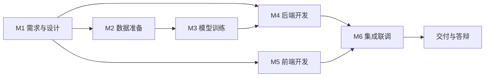

关键路径为 **M1 → M2 → M3 → M4 → M6**。M5 前端开发可与 M3 训练并行启动，是压缩总工期的唯一可用手段——前端所依赖的接口契约在 M1 阶段即已定稿（第 8 章），无需等待后端实现完成。

### 12.5 里程碑排期

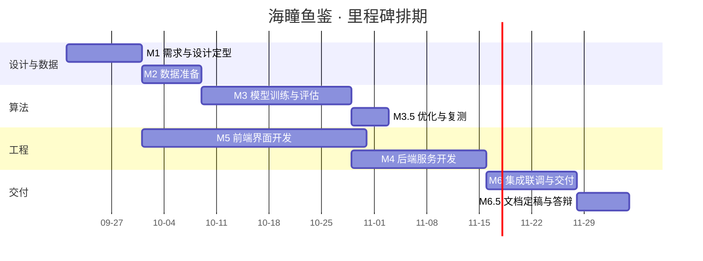

排期说明：图中日期为相对规划的示意区间，实际起止以立项时间为准；M5 起点紧随 M1，体现上述并行策略。

---

## 第 13 章　附录

### 附录 A　23 类物种清单

本清单是模型输出、`species` 表与知识库文案三者的共同基准（第 6.4.3 节）。`class_index` 训练前锁定一次，此后不得变更。

**编号规则（已锁定）**：数据集目录 `fish_N` 与 `class_index` 采用**等值对应**，即 `class_index = N - 1`（0 基）。该规则已通过官方数据交叉验证，**不得变更**。`classes.txt` 按此规则生成。

**数据来源**：物种定名取自 Fish4Knowledge 官方 groundtruth 页面（爱丁堡大学 R. B. Fisher 课题组），非人工推测。官方页面地址见附录 B 的 R6。

| class_index | 数据集目录 | 拉丁学名 | 建议中文名 | 官方检测数 | 本地实有数 |
| --- | --- | --- | --- | --- | --- |
| 0 | `fish_1` | *Dascyllus reticulatus* | 网纹宅泥鱼 | 12 112 | 12 110 |
| 1 | `fish_2` | *Plectroglyphidodon dickii* | 迪克氏固曲齿鲷 | 2 683 | 2 681 |
| 2 | `fish_3` | *Chromis chrysura* | 长棘光鳃鱼 | 3 593 | 3 591 |
| 3 | `fish_4` | *Amphiprion clarkii* | 克氏双锯鱼（双带小丑鱼） | 4 049 | 4 047 |
| 4 | `fish_5` | *Chaetodon lunulatus* | 弓月蝴蝶鱼 | 2 534 | 2 532 |
| 5 | `fish_6` | *Chaetodon trifascialis* | 川纹蝴蝶鱼 | 190 | 188 |
| 6 | `fish_7` | *Myripristis kuntee* | 康德锯鳞鱼 | 450 | 448 |
| 7 | `fish_8` | *Acanthurus nigrofuscus* | 双斑刺尾鱼 | 218 | 216 |
| 8 | `fish_9` | *Hemigymnus fasciatus* | 横带粗唇鱼 | 241 | 239 |
| 9 | `fish_10` | *Neoniphon sammara* | 莎姆金鳞鱼 | 299 | 297 |
| 10 | `fish_11` | *Abudefduf vaigiensis* | 五带豆娘鱼 | 98 | 96 |
| 11 | `fish_12` | *Canthigaster valentini* | 黑马鞍鲀 | 147 | 145 |
| 12 | `fish_13` | *Pomacentrus moluccensis* | 摩鹿加雀鲷 | 181 | 179 |
| 13 | `fish_14` | *Zebrasoma scopas* | 黑三角倒吊鱼 | 90 | 88 |
| 14 | `fish_15` | *Hemigymnus melapterus* | 黑鳍粗唇鱼 | 42 | 40 |
| 15 | `fish_16` | *Lutjanus fulvus* | 黄足笛鲷 | 206 | 204 |
| 16 | `fish_17` | *Scolopsis bilineata* | 双线眶棘鲈 | 49 | 47 |
| 17 | `fish_18` | *Scaridae* | 鹦嘴鱼科（未定种） | 56 | 54 |
| 18 | `fish_19` | *Pempheris vanicolensis* | 黑缘单鳍鱼 | 29 | 27 |
| 19 | `fish_20` | *Zanclus cornutus* | 镰鱼 | 21 | 19 |
| 20 | `fish_21` | *Neoglyphidodon nigroris* | 黑嘴雀鲷 | 16 | 14 |
| 21 | `fish_22` | *Balistapus undulatus* | 黄纹炮弹鱼 | 41 | 39 |
| 22 | `fish_23` | *Siganus fuscescens* | 褐蓝子鱼 | 25 | 23 |

**校验说明（已完成，结论：对应关系无错位）**

取官方 23 类的检测数与本地实有数逐类比对，结果 **23 个类别全部恰好相差 2 张**，合计 27 370 → 27 324（-46）。该**恒定偏差**是比对通过的关键证据：若目录编号与官方编号存在任何偏移，偏差应呈随机或错位分布，不可能为恒定值；恒定 -2 亦排除了"某类目录被误换"的可能。据此确认 `fish_N ↔ class_index N-1` 的映射成立。恒定 -2 的成因应为每类被抽出一张作代表性示例图，属正常现象，不影响训练。

**尚需人工补充的内容**

| 待补项 | 说明 |
| --- | --- |
| 俗称 | 上表「建议中文名」为按学名规范译名，非数据集给定；如需保留民间俗称（如 `fish_4` 通称"小丑鱼"），请在知识库文案中追加 |
| 科属与形态特征 | 第 6.4.3 节要求的知识库正文字段，须逐类撰写 |
| 习性描述 | 同上 |
| `fish_18` 定名精度 | 官方仅给出科级 *Scaridae*，未定种。**知识库文案须按科级描述，不得杜撰种名**；页面展示时同理 |

样本量一列取清洗前实测值，供对照；正式样本量以第 6.3.3 节清洗后的 T-06 统计为准。

**映射关系已锁定，T-01 待办据此关闭。** 剩余待补项属知识库文案撰写范畴（M1～M2 阶段完成），不再阻塞训练启动。

### 附录 B　参考资料

| 编号 | 名称 | 位置 / 来源 | 用途 |
| --- | --- | --- | --- |
| R1 | 《海洋鱼类图像分类系统项目任务书 V1.0.0》 | 工作区根目录 | 本文档上游依据 |
| R2 | `SKILL.md`（实训指导书生成器规范） | 工作区根目录 | 技术栈默认约定；RAG 语料库来源 |
| R3 | Fish4Knowledge 23 类鱼类数据集 | 飞桨 AI Studio 数据集 14492 | 训练与评估数据 |
| R4 | 海瞳鱼鉴产品架构图 | `docs/` | 分层结构参考 |
| R5 | 本文档第 8 章接口清单 | 本文档 | 下游 API 契约文档的输入 |
| R6 | **Fish4Knowledge 官方 groundtruth 页面** | `https://homepages.inf.ed.ac.uk/rbf/Fish4Knowledge/GROUNDTRUTH/RECOG/` | **附录 A 物种定名的权威来源**；同时提供 `class_id.csv`（文件名↔簇号反查表）与各类检测数 |
| R7 | Boom 等，*Long-term underwater camera surveillance for monitoring and analysis of fish populations*，VAIB/ICPR 2012 | 论文 | 数据集采集与标注方法依据 |
| R8 | Boom 等，*Supporting Ground-Truth annotation of image datasets using clustering*，ICPR 2012 | 论文 | 标注由海洋生物学家指导完成，支撑本项目对标签可信度的判断 |

### 附录 C　术语表补充

第 0.4 节已定义核心术语，此处补充开发过程中出现的专业词汇。

| 术语 | 说明 |
| --- | --- |
| 类别加权 | 在损失函数中按类别样本量的反比设置权重，缓解多数类主导 |
| 分层抽样 | 按类别分层后在各层内按比例抽样，保证子集类别分布与总体一致 |
| 感知哈希 | 将图像压缩为固定长度指纹的算法，用于检测重复与近重复图像 |
| 早停 | 验证集指标连续若干轮无提升即终止训练，防止过拟合 |
| 余弦退火 | 学习率按余弦曲线从初始值平滑衰减至接近零的调度策略 |
| 动态量化 | 推理时将权重从浮点转为定点以降低内存与加速计算 |
| 结构化剪枝 | 按通道重要性移除网络结构单元，可同时减少参数量与计算量 |
| 混淆矩阵 | 以真实类别为行、预测类别为列的计数矩阵，用于定位易混类别 |
| 拒识阈值 | 同「置信度阈值」，首位候选概率低于该值时提示结果可靠性不足 |
| 内容泄漏 | 同一图像同时出现在训练集与测试集，导致指标虚高 |
| 长尾类别 | 样本量显著低于其他类别的类别，本项目中按低于全体中位数 30% 判定 |
| 一次性评估 | 测试集在模型与阈值全部确定后仅评估一次，结果不得用于反向调参 |

### 附录 D　待确认事项跟踪表

本表汇总 PRD 撰写过程中识别、需在推进中确认的事项。框架阶段列出的 14 项决策已全部按建议默认值落地（见第 0.1 节），下表为执行期新识别的事项。

| 编号 | 事项 | 优先级 | 需确认时点 | 状态 | 影响范围 |
| --- | --- | --- | --- | --- | --- |
| T-01 | 23 类物种的正式中文名与拉丁学名；目录序号与 `class_index` 的映射 | **最高** | M2 启动前 | **已闭环** | 附录 A、第 6.4 节、`classes.txt` |
| T-02 | 置信度阈值最终取值 | 高 | M3 标定后 | 待标定（暂用 0.40） | 第 4.3、7.4.3 节 |
| T-03 | 色偏校正默认开关状态 | 中 | M3 验证集对比后 | 未闭环 | 第 4.2.3、6.3 节 |
| T-04 | 部署环境是否具备 GPU | 中 | M4 前 | 未闭环 | 第 9.1 节耗时目标 |
| T-05 | 数据集版权与引用方式 | 中 | M2 前 | 未闭环 | 第 6.3 节、D13 |
| T-06 | 数据集各类别实际样本量 | 高 | M2 清洗后 | 待统计 | 附录 A、第 6.3.4 节长尾判定 |

**T-01 的说明（已闭环，2026-09-20）**：物种清单原计划由人工校核填写，实际通过**官方数据交叉验证**完成，未依赖主观推测。来源为 Fish4Knowledge 官方 groundtruth 页面（附录 B 的 R6），取官方 23 类检测数与本地实有数逐类比对，**全部类别恒定相差 2 张**，据此确认 `fish_N ↔ class_index N-1` 映射成立、编号无错位。完整清单与校验过程见附录 A。**该结论不构成对数据集标签质量的独立复核**——标签由原作者团队在海洋生物学家指导下完成（R8），本项目沿用其定名，仅验证了编号对齐关系。

**T-06 的说明**：第 6.3.4 节的长尾判定规则（低于全体中位数 30%）是依赖实际分布的计算规则，无法在样本量统计前给出具体类别清单。该统计须在 M2 阶段清洗完成后立即执行，其结果直接决定类别权重的取值与 R-D-01 风险的应对强度。

> **实测参考（2026-09-20，清洗前原始目录清点）**：`fish_image23/fish_image/fish_1 ～ fish_23` 共 **27 324** 张 PNG；头部 4 类（`fish_1` 12 110、`fish_4` 4 047、`fish_3` 3 591、`fish_2` 2 681）合计 22 429 张，占 **82.1%**；最小类 `fish_21` 仅 **14** 张。由此推算，**最频繁类基线准确率约 44.3%**，远低于 85% 的验收门槛，说明准确率指标本身具有区分度；但头部与尾部相差近三个数量级，**宏观 F1 ≥ 0.82 的达成难度显著高于准确率 ≥ 85%**。该组数据为清洗前实测值，清洗去重后数量会小幅下降，故正式判定仍以 T-06 的清洗后统计为准。

### 附录 E　编号与规模总览

#### E.1 需求编号体系

| 类型 | 格式 | 数量 | 分布 |
| --- | --- | --- | --- |
| 功能需求 FR | `FR-<模块>-<序号>` | 41 | UPLOAD 8 / PREPROC 5 / RECOG 6 / RESULT 6 / HISTORY 6 / USER 10 |
| 非功能需求 NFR | `NFR-<类别>-<序号>` | 15 | PERF 3 / SEC 5 / REL 2 / COMPAT 2 / MAINT 3 |
| 业务规则 BR | `BR-<模块>-<序号>` | 60 | UPLOAD 8 / PREPROC 6 / RECOG 10 / RESULT 8 / HISTORY 10 / USER 18 |
| 验收条件 AC | `AC-<FR 编号>-<序号>` | 55 | UPLOAD 11 / PREPROC 8 / RECOG 7 / RESULT 7 / HISTORY 8 / USER 14 |

#### E.2 接口与数据规模

| 类型 | 数量 | 说明 |
| --- | --- | --- |
| 接口端点 | **38**（35 主路径 + 3 别名） | 认证账号 8 / 识别链路 6 / 历史 9（含 3 别名）/ 物种系统 4 / 管理员 11。**V1.0 为 27**，V1.1 补入实现期新增 8 条与兼容别名 3 条 |
| 错误码 | **21** | 40001 ～ 50302，五位单段。**V1.0 为 18**，V1.1 补入 40902 / 40903 / 40904 三个管理端约束码 |
| 数据表 | 7 | `user`、`image_asset`、`recognition_record`、`species`、`system_config`、`operation_log`、`guest_usage` |
| 页面 | 13 | 公开区 5 / 登录区 4 / 管理员区 3 / 404 |

#### E.3 图表清单

本表为**图表编号的唯一权威来源**。文档撰写过程中若发生模块拆分或合并，可能导致原规划与实际位置错位，下游文档引用本 PRD 图表时**一律以本表编号为准**。

| 编号 | 图表名 | 类型 | 所在位置 |
| --- | --- | --- | --- |
| G1 | 产品架构图 | 分层架构（外链 PNG） | 第 1.6 节 |
| G2 | 用户旅程图 | 流程图 | 第 2.2 节 |
| G3 | 用例图 | 流程图 | 第 2.3 节 |
| G4 | 图像上传流程图 | 流程图 | 第 4.1.3 节 |
| G5 | 图像预处理流程图 | 流程图 | 第 4.2.4 节 |
| G6 | 识别主流程图（含异常分支） | 流程图 | 第 4.3.3 节 |
| G7 | 认证流程时序图 | 时序图 | 第 4.6.3 节 |
| G8 | 站点地图 | 结构图 | 第 5.1 节 |
| G9 | ER 图 | 实体关系图 | 第 6.1 节 |
| G10 | 推理服务时序图 | 时序图 | 第 7.6.2 节 |
| G11 | 交付依赖关系图 | 流程图 | 第 12.4 节 |
| G12 | 里程碑甘特图 | 甘特图 | 第 12.5 节 |

外链图另有 1 张（G1 产品架构图 PNG），不计入 Mermaid 图数量。

#### E.4 文档规模

| 项 | 数量 |
| --- | --- |
| 正文章节 | 14（第 0 ～ 13 章） |
| 附录 | 5（A ～ E） |
| 表格 | 见各章 |
| Mermaid 图 | 11 |
| 外链图 | 1 |

### 附录 F　修订记录

| 版本 | 日期 | 修订内容 | 状态 |
| --- | --- | --- | --- |
| V0.1 | 2026-09-17 | 首次发布，含第 0 ～ 3 章 | 已完成 |
| V0.2 | 2026-09-17 | 补充第 4 章功能需求详述，覆盖六大模块、40 条功能需求、60 条业务规则、54 条验收条件 | 已完成 |
| V0.3 | 2026-09-17 | 补充第 5 ～ 8 章：页面与交互需求（13 个页面）、数据需求（7 张表的完整数据字典）、算法与模型需求、接口与集成需求（27 个接口端点、18 个错误码） | 已完成 |
| V1.0 | 2026-09-20 | 补充第 9 ～ 13 章与附录：非功能需求（15 条逐条可验证化，含端到端耗时分解）、验收标准（三条端到端场景、预处理一致性专项、缺陷分级）、风险与对策（22 条）、里程碑与交付物（6 阶段、14 项交付物、甘特图）、附录 A ～ F。**全篇定稿** | 定稿 |
| V1.1 | 2026-09-20 | **附录 A 由占位模板落为正式清单**：依据 Fish4Knowledge 官方 groundtruth 完成 23 类物种定名与 `class_index` 映射锁定，并经逐类样本数交叉验证确认编号无错位；补充官方来源 R6 ～ R8；关闭 T-01。其余章节未变更 | 历史 |
| V1.2 | 2026-09-21 | **第 8 章依实现校准**。① 8.1 端点 27 → **38**（35 主路径 + 3 别名）：补入缩略图、图像删除、Top-5 候选、模型信息、创建用户、删除用户、统计概览、操作日志 8 条，并说明 `/api/history*` 为兼容别名；② **修正 8.2 越权防护口径** —— 原写「访问他人资源返回 403」，与实现及防枚举本意相反，已改为**统一返回 404**；③ 8.3.2 补入 40902 / 40903 / 40904，错误码 18 → **21**；④ 附录 E.2 同步端点与错误码计数；⑤ 新增 8.1.4 中 `species_id` 恒等于 `class_index`、8.1.5 中删除用户三重保护、8.1.2 中缩略图与图像删除的边界说明 | 现行 |

#### F.1 本版修订明细

| 类别 | 说明 |
| --- | --- |
| 完整性补全 | 补入第 9 ～ 13 章与附录 A ～ F，此前 V0.3 仅覆盖第 0 ～ 8 章 |
| 指标可验证化 | 第 9 章为 15 条 NFR 逐条补充「指标定义 / 目标值 / 验证方式」三项，原文仅有概览表 |
| 耗时分解 | 第 9.1.1 节将 3 秒端到端预算分解至五个环节，此前仅有总量指标 |
| 验收补强 | 第 10.4.2 节新增预处理一致性专项验收，要求训练与推理管线输出张量**逐元素相等（容差 0）** |
| 风险量化 | 第 11 章 22 条风险逐条给出影响、概率、应对与监控，其中 R-D-01（类别长尾）定级为最高风险 |
| 新增附录 | 附录 A 物种清单模板、附录 C 术语补充 12 条、附录 D 待确认跟踪 6 项、附录 E 编号与规模总览 |
| 图表重编号 | 依实际位置重新编排为 G1 ～ G12，并在附录 E.3 声明「以本表为准」 |

#### F.2 未变更声明

本版为**追加与补全**，未修改 V0.3 已交付的第 0 ～ 8 章的任何需求编号、指标数值与业务规则。第 0.1 节的 14 项决策基线、第 4 章的 40 / 60 / 54 条编号、第 7 章的准确率 ≥ 85% 与宏观 F1 ≥ 0.82 门槛**均保持原值**，不因本版补入非功能与验收章节而发生任何放宽或收紧。

#### F.3 遗留待办

| 编号 | 事项 | 归属 | 说明 |
| --- | --- | --- | --- |
| T-01 | 23 类物种清单校核 | M2 前 | **已完成（2026-09-20）**：经官方数据交叉验证，映射关系已锁定，见附录 A 与附录 D |
| T-02 | 置信度阈值标定 | M3 | 暂用 0.40，标定后回填 |
| T-06 | 各类别样本量统计 | M2 | 决定长尾判定与类别权重 |
| D6 ～ D14 | 9 份下游文档 | M1 ～ M6 | 见第 12.3.2 节，其中 D6 ～ D8 可直接由本文档第 4、5、6、8 章展开 |

---

*PRD 全篇定稿，版本 V1.0。*

*本文档为海瞳鱼鉴项目的权威需求基准，下游文档（UI/UX 设计、数据库设计、API 接口、测试报告、部署运维手册）须以本版编号与口径为准。*
