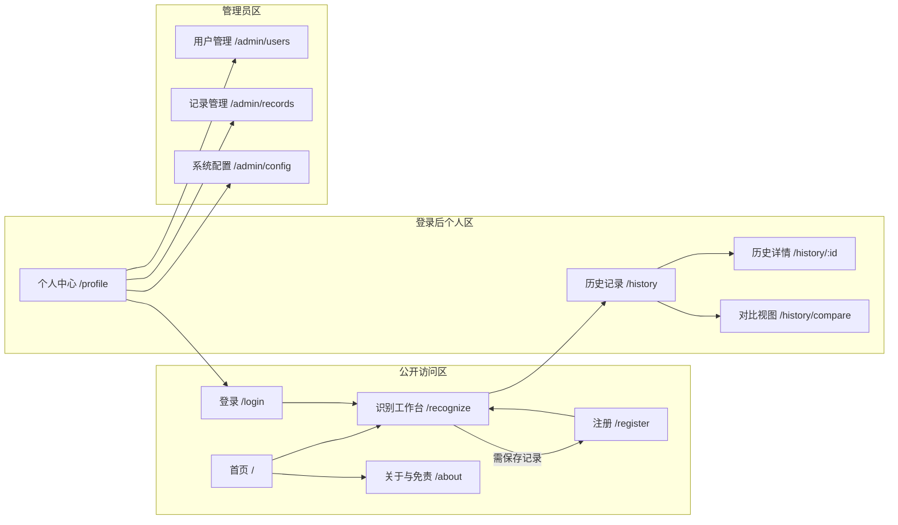
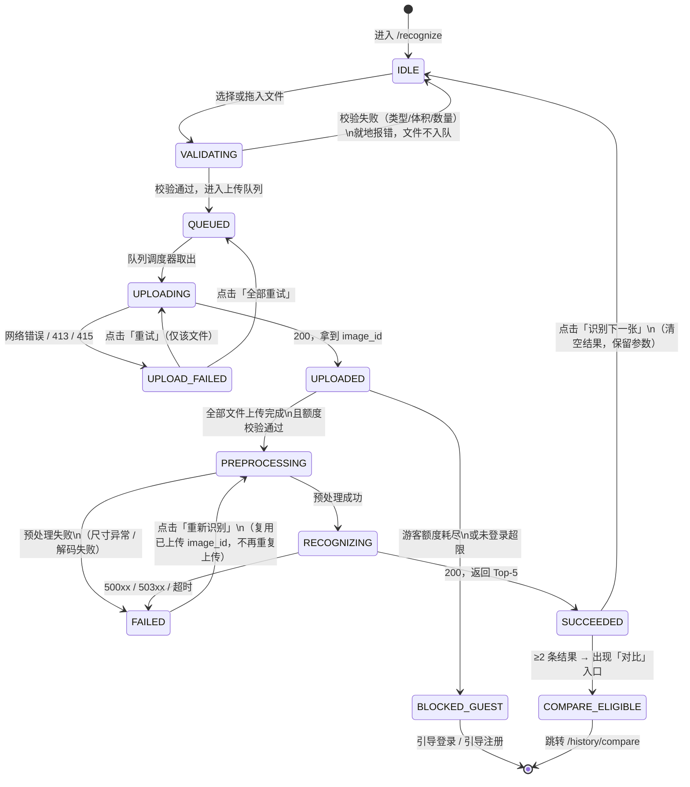
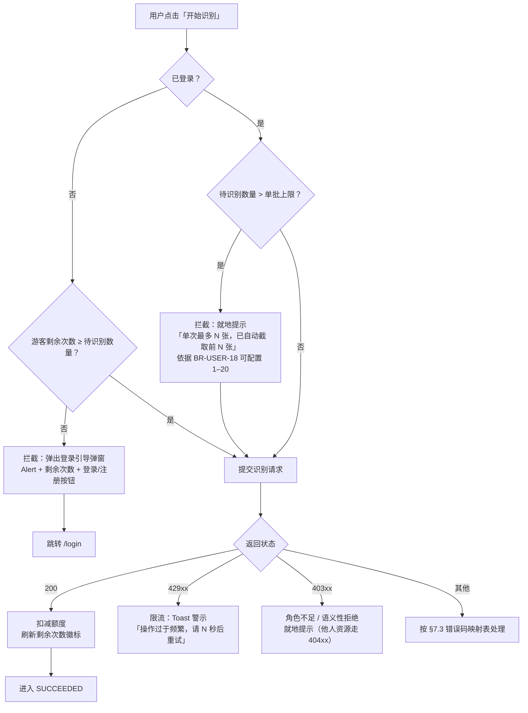
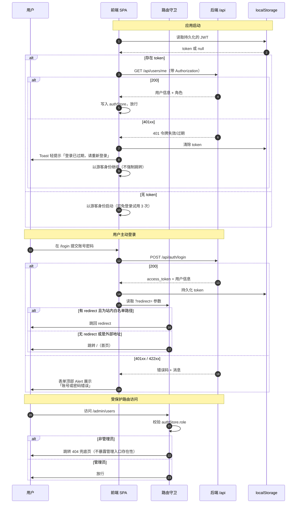
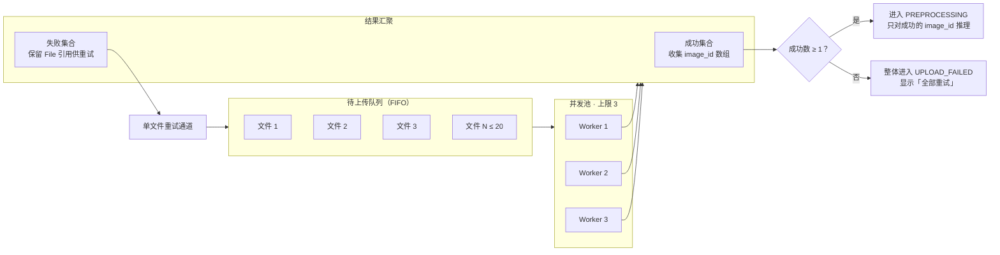
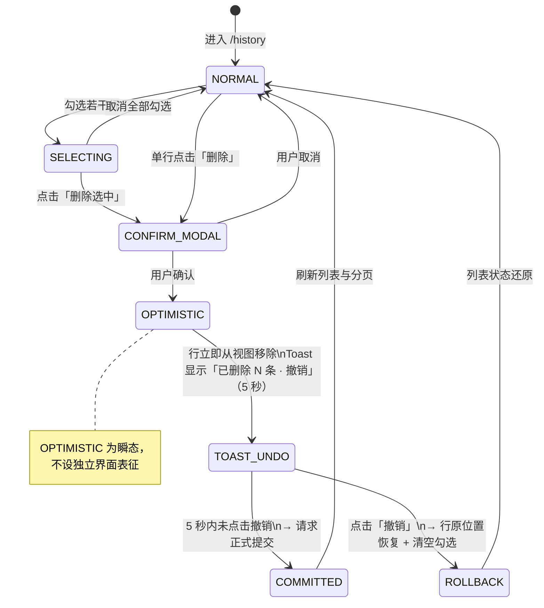
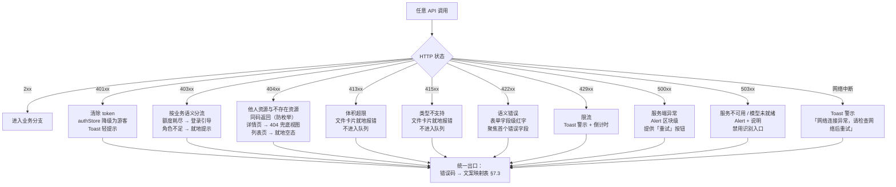

# 海瞳鱼鉴 · UI/UX 设计文档（UI/UX Design Document）

| 项 | 内容 |
| --- | --- |
| 文档名称 | 海瞳鱼鉴 UI/UX 设计文档 |
| 产品名称 | 海瞳鱼鉴 |
| 英文名 / 项目代号 | SeaPupil / seatong |
| 文档编号 | D9 |
| 当前版本 | V1.1 |
| 编制日期 | 2026-09-21 |
| 文档状态 | **定稿** —— 全文 12 章（第 0 ～ 11 章）+ 附录 A ～ G |
| 上游依据 | 《海瞳鱼鉴产品需求文档》V1.3、`海瞳鱼鉴-产品原型.html`、`海瞳鱼鉴-API接口契约.md` V1.2、`海瞳鱼鉴-数据库设计文档.md` |
| 目标技术栈 | React 18 + TypeScript + Vite + TailwindCSS / Ant Design 5 |
| 设计系统来源 | `ui-ux-pro-max` 技能包规则集（该技能包未附带检索数据库，设计系统按 SKILL.md 的 8 类优先级规则手工确立，令牌取值以原型 `:root` 实测为准） |
| 色彩模式 | **仅浅色模式**，本版不提供暗色主题 |

> **阅读提示**：本文档是**面向前端开发者的可落地设计规格**，而非设计稿说明。全文以「可回溯」为第一原则——每一个界面元素都能回溯到来源：**令牌 → 第 3 章，组件 → 第 4 章，页面 → 第 5 章，需求 → 追溯条**。**无法回溯的元素即为本文档的缺陷**，请按第 9.4 节的评审清单反馈。
>
> **第 3 章（设计系统）、第 4 章（组件库规格）、第 5 章（页面级设计规格）是本文档的核心**。第 5 章按统一 10 项模板逐页覆盖全部 13 个页面，是开发可直接对照施工的部分。第 7 章的错误码 → 文案映射是**前端文案的唯一来源**，禁止各页面自行编写同类文案。
>
> 本文档不重复 PRD 的功能逻辑，只回答「**长什么样、怎么交互、用什么令牌与组件**」。功能行为的权威定义仍在 PRD 第 4 章。

---

# 0　文档信息与阅读指南

## 0.1 本文档解决什么

本文档把 PRD 的交互要求与原型中的实际样式，反推为**可维护的设计系统 + 可施工的页面规格**。要回答三类问题：

| 问题 | 由哪一章回答 |
| --- | --- |
| 这个颜色 / 间距 / 字号从哪来？能不能改？ | 第 3 章 设计系统 |
| 这个按钮 / 表格 / 条形图有哪几种状态？有没有现成组件？ | 第 4 章 组件库规格 |
| 这个页面分几个区块？空态什么样？窄屏怎么排？ | 第 5 章 页面级设计规格 |
| 这个错误码应该给用户看什么话？ | 第 7.3 节 错误码 → 文案映射 |
| 这条需求在界面上落在哪？ | 附录 D 需求—界面覆盖矩阵 |

## 0.2 输入依据与权威顺序

本文档由以下四份上游文档推导而来。**四者冲突时不自行裁决**，按下列权威顺序取值，并在第 11.3 节登记冲突项。

| 序号 | 文档 | 版本 | 在本文档中的角色 | 权威范围 |
| --- | --- | --- | --- | --- |
| ① | `海瞳鱼鉴-PRD.md` | V1.1 | 主依据 | 需求编号、页面清单、交互要求、业务规则、文案规范 |
| ② | `海瞳鱼鉴-产品原型.html` | 单文件零依赖 | **样式与结构事实源** | 设计令牌实测值、CSS 类与频次、13 视图骨架、图标集、断点与 z-index、弹窗与 Toast |
| ③ | `海瞳鱼鉴-API接口契约.md` | D8 | 辅助 | 错误码的语义与前端处置 |
| ④ | `海瞳鱼鉴-数据库设计文档.md` | D7 | 辅助 | 字段类型与枚举（决定界面展示格式） |

**权威顺序**：令牌取值 ↔ **原型**为准（实测值，非推测）；需求编号与文案 ↔ **PRD** 为准；错误码语义 ↔ **D8** 为准；字段格式 ↔ **D7** 为准。

## 0.3 与既有文档的边界

| 文档 | 负责什么 | 本文档不重复 |
| --- | --- | --- |
| PRD V1.3 | 功能行为、业务规则、验收条件 | 不重复描述「点击后发生什么业务逻辑」，只描述「界面如何呈现」 |
| D7 数据库设计 | 表结构、字段类型、约束 | 不重复字段字典，只引用展示格式 |
| D8 API 接口契约 | 端点、请求响应结构、错误码语义 | 不重复端点定义，只映射到界面反馈 |
| `海瞳鱼鉴-产品原型.html` | 可运行的视觉与交互参照 | 本文档把原型中的**样式事实**规范化为**可维护的设计系统**，原型仅为参照，不作为交付物 |
| 本文档（D9） | 设计令牌、组件规格、页面规格、交互规范 | —— |

## 0.4 文档目的与读者对象

| 读者 | 重点章节 | 用途 |
| --- | --- | --- |
| **前端开发（主要读者）** | 第 3、4、5、7、10 章 | 照此实现组件与页面，无需另找设计稿 |
| 前端负责人 / 评审者 | 第 3、9 章 + 附录 G | 核验设计系统是否自洽、是否可维护 |
| 产品经理 | 第 5 章 + 附录 D | 确认 13 个页面完整覆盖 41 FR / 15 NFR / 60 BR |
| 测试 | 第 5.10 节（每页禁忌）、第 7 章 | 编写界面级测试用例 |
| 未来维护者 | 第 1、11 章 + 附录 F | 理解设计决策的来由与已知边界 |

## 0.5 本版范围声明

本文档明确以下五项范围边界，避免评审时产生歧义：

| 编号 | 范围声明 |
| --- | --- |
| S-01 | **仅覆盖浅色模式**。原型 `:root` 未定义暗色令牌集，本版不提供暗色主题；若后续需要，应在第 3 章新增 `[data-theme="dark"]` 令牌组并重跑第 9.3 节的令牌一致性校验 |
| S-02 | **覆盖全部 13 个页面**（PRD 5.2 页面清单口径），含 404 兜底页，无一遗漏 |
| S-03 | **不含设计工具源文件**（Figma / Sketch 等）。以本文档 + 原型 HTML 作为设计事实源 |
| S-04 | 本文档可含**结构片段示意**（Tailwind 类名组合、CSS 令牌声明、AntD 主题配置、组件骨架），以便前端直接复制；但**不产出可直接运行的应用代码**——业务逻辑实现属前端开发职责 |
| S-05 | 不定义**响应式之外的动效时间轴**（如滚动叙事、页面转场编排）。仅规范微交互时长与缓动，见第 3.9 节 |

## 0.6 术语与缩略语

本文档特有的、PRD 未定义的术语在此说明；PRD 已定义的产品术语（宏观 F1、Top-5、拒识阈值等）不重复。

| 术语 | 说明 |
| --- | --- |
| **设计令牌**（Design Token） | 承载设计决策的具名变量，如 `--primary`、`--radius-lg`。是本文档第 3 章的原子单位 |
| **语义族**（Semantic Family） | 按用途而非颜色命名的令牌组，如 `--danger` / `--danger-50` / `--danger-border` 构成 danger 族 |
| **追溯条**（Trace Bar） | 原型中每个页面末尾内嵌的需求追溯区块，列出该页承载的需求编号与说明。本文档第 5 章沿用该机制 |
| **门禁**（Gate） | 进入某页面或执行某操作的前置条件检查，如登录门禁、管理员门禁、额度门禁 |
| **三档断点** | PRD 决策基线定义的 768 / 1024 / 1440，分别对应移动端 / 平板 / 桌面 |
| **状态胶囊**（Status Pill） | 用 `.tag` 系列组件表达的短状态标识，如「已启用」「低置信度」 |
| **令牌漂移**（Token Drift） | 文档中的令牌取值与原型实现不一致的现象。本文档第 9.3 节设机制防止 |

## 0.7 版本与变更

| 版本 | 日期 | 修订内容 | 状态 |
| --- | --- | --- | --- |
| V1.0 | 2026-09-21 | 首次发布。12 章 + 附录 A～G，覆盖 22 个设计令牌、26 个组件、13 个页面 | 已废止 |
| V1.1 | 2026-09-21 | 端点同步：§10.4.4 接口对接清单重写（38 端点 + 3 别名）；关闭 U-01；新增 U-04 | 定稿 |

完整变更明细见附录 F。

---

# 1　设计目标与设计原则

## 1.1 设计目标

海瞳鱼鉴是一款**任务导向的工具型 Web 应用**，不是内容消费型产品。用户带着明确目的进入——「这张照片里的鱼是什么」——并期望在数秒内得到可采信的答案。据此确立三项设计目标：

| 编号 | 设计目标 | 可检验的判据 |
| --- | --- | --- |
| G-01 | **一次识别的路径最短** | 识别工作台上，从进入页面到提交识别的**必要点击次数 ≤ 2**（点击上传区 → 点击开始识别）；结果在同一页内展开，不产生跳转 |
| G-02 | **结论先于依据** | 结果区首位物种的视觉权重显著高于其余条目；页面信息顺序为「结论 → 概率分布 → 知识内容 → 免责」 |
| G-03 | **诚实传达不确定性** | 低置信度必须被明确提示；Top-5 条形长度按绝对概率映射，使不确定的结果**在视觉上就呈现出不确定**；免责声明常驻不可隐藏 |

## 1.2 量化指标对界面的约束

PRD 中的性能与兼容指标不是后端专属要求，它们**直接约束界面设计**。下表把指标翻译为设计约束，这是第 3、5 章若干规则的来源。

| 上游指标 | 指标值 | 对界面的直接约束 | 本文档落点 |
| --- | --- | --- | --- |
| NFR-PERF-01 | 首页首屏 ≤ 2 s | 首屏图片需预留尺寸（避免 CLS）；首屏不做重量级图表；骨架屏只能用于局部 | 第 5.1 节、第 3.9 节 |
| NFR-PERF-02 / FR-RECOG-06 | 单图端到端 ≤ 3 s | 加载态必须**分级**：< 300 ms 不显示、300 ms～3 s 局部骨架、> 3 s 进度条 | 第 7.1.1 节（分级表） |
| NFR-PERF-03 | ≥ 20 并发 | 批量任务需展示「正在识别 n / m」进度，避免用户重复提交；按钮须置禁用态 | 第 4.2 节（按钮加载态） |
| NFR-COMPAT-02 | 三档断点 | 三档布局必须分别设计，**不允许只有一档响应式压缩** | 第 8.1 节 |
| NFR-SEC-03 | 越权不可区分 | 对他人资源后端统一返回 **404**（非 403）；「无权限」与「不存在」的**界面表现与文案必须完全一致**，不得暗示资源是否存在 | 第 7.3 节 |
| BR-RESULT-02 | 概率保留 1 位小数 | 数值格式统一函数化，禁止各页面自行 `toFixed` | 第 3.6 节（数字排版） |
| BR-HISTORY-04 | CSV 固定 8 列 | 导出按钮无需列选择交互 | 第 5.6 节 |
| BR-USER-13 | 额度提示不得打断识别 | 额度弹窗有**门禁时序**约束，不能在识别进行中弹出 | 第 6.1 节（门禁状态机） |

## 1.3 设计原则

以下五条原则是本文档全部设计决策的判据。**当规则冲突时，按编号优先。**

| 编号 | 原则 | 含义 | 反面示例（禁止） |
| --- | --- | --- | --- |
| **P1** | **诚实优先** | 涉及结果可信度的信息（置信度、免责、能力边界）在任何布局压力下都不得被折叠、隐藏或降级 | 把免责声明做成可关闭的 Toast；为了版式美观省略低置信度提示 |
| **P2** | **结论先行** | 页面自上而下的信息顺序遵循「用户此刻最想知道什么」 | 结果区先展示元信息与耗时，再展示物种名 |
| **P3** | **一眼可辨** | 状态、层级、优先级必须通过**多种载体**同时表达，不依赖单一通道 | 仅用颜色区分「低置信度」（色盲用户不可辨） |
| **P4** | **不变着不动** | 异步过程不得引起布局跳动；加载态必须预留空间 | 骨架屏高度与实际内容不一致导致页面抖动 |
| **P5** | **同类同款** | 同一语义在任何页面使用相同的组件、颜色与文案 | 「删除」在历史页用红色按钮、在管理页用灰色链接 |

## 1.4 反模式清单

以下是本项目**明确禁止**的做法。每条附判定依据。

| 编号 | 反模式 | 为什么禁止 | 依据 |
| --- | --- | --- | --- |
| A-01 | 用 emoji 充当界面图标 | 跨平台渲染不一致，无法控制线条粗细与色彩 | `ui-ux-pro-max` 通用规则；原型全部使用内联 SVG |
| A-02 | 用颜色作为唯一信息载体 | WCAG 1.4.1；色盲用户无法辨识 | PRD §4.7 可访问性条款 |
| A-03 | 面向用户出现 `error` / `fail` / 「非法参数」/「服务器内部错误」 | 用户无法据此行动，且含指责意味 | PRD §5.4.4 文案规范 |
| A-04 | 概率显示为 `0.0%` | 会被误读为「不可能」，与模型实际输出矛盾 | PRD BR-RESULT-02 |
| A-05 | 前端自行计算或修正概率值 | 造成同一记录在不同页面数值不一致 | PRD BR-RESULT-08 |
| A-06 | 用 `transform: scale()` 做悬停反馈 | 引起布局位移，违反 P4 | `ui-ux-pro-max` 通用规则 |
| A-07 | 为同一状态在不同页面使用不同颜色或文案 | 破坏 P5，增加用户学习成本 | 第 4.3 节状态矩阵 |
| A-08 | 提供模型关注区域（Grad-CAM 热力图）入口 | 超出任务书范围，属需求扩张 | PRD BR-RESULT-06 |
| A-09 | 在识别进行中弹出额度或注册引导 | 打断用户当前任务 | PRD BR-USER-13 |
| A-10 | 用「操作失败」这类无信息量文案 | 未说明原因与下一步，用户无法行动 | PRD §5.4.4 |
| A-11 | 在结果页对游客做内容降级 | 游客应看到完整结果，仅在「保存」动作处引导 | PRD BR-RESULT-07 |
| A-12 | 触摸目标小于 44×44 px | 移动端误触率高 | PRD §5.5.1 补充规则 |

---

# 2　信息架构 IA

## 2.1 站点结构图

站点按访问权限划分为**三个区域**。识别工作台是核心页面，识别结果在页内展开而不单独成页，以减少一次跳转。



**结构要点**：管理员区**不占据主导航**，入口位于顶栏右侧的用户菜单内（见第 4.4 节 UserMenu 组件）。这使普通用户与游客的导航保持精简，仅三项主导航。

## 2.2 路由表

下表为前端路由的**完整登记表**。路由守卫规则见第 6.1 节。原型以 `state.route` + `hashchange` 模拟，React 实现应映射为 React Router 的 `createBrowserRouter`。

| 序号 | 页面 | 路由 | 视图标识 | 访问权限 | 守卫 |
| --- | --- | --- | --- | --- | --- |
| 1 | 首页 | `/` | `home` | 公开 | 无 |
| 2 | 识别工作台 | `/recognize` | `recognize` | 公开（游客限 3 次） | 额度门禁（仅提交时） |
| 3 | 关于与免责 | `/about` | `about` | 公开 | 无 |
| 4 | 登录 | `/login` | `login` | 公开（已登录时重定向） | 反向门禁 |
| 5 | 注册 | `/register` | `register` | 公开（已登录时重定向） | 反向门禁 |
| 6 | 历史记录 | `/history` | `history` | 登录 | **登录门禁** |
| 7 | 历史详情 | `/history/:id` | `historyDetail` | 登录 | **登录门禁** + 数据归属校验 |
| 8 | 对比视图 | `/history/compare` | `compare` | 登录 | **登录门禁** + 选择前置（2～4 条） |
| 9 | 个人中心 | `/profile` | `profile` | 登录 | **登录门禁** |
| 10 | 用户管理 | `/admin/users` | `adminUsers` | 管理员 | **管理员门禁** |
| 11 | 记录管理 | `/admin/records` | `adminRecords` | 管理员 | **管理员门禁** |
| 12 | 系统配置 | `/admin/config` | `adminConfig` | 管理员 | **管理员门禁** |
| 13 | 404 兜底 | `*` | `notFound` | 公开 | 无 |

**登录门禁路由集合**（`AUTH_ROUTES`，4 项）：`history`、`historyDetail`、`compare`、`profile`。
**管理员门禁路由集合**（`ROUTES`，3 项）：`adminUsers`、`adminRecords`、`adminConfig`。

两集合互不包含——管理员路由**同时**受登录门禁与管理员门禁约束，实现时应先校验登录、再校验角色。

## 2.3 页面 ↔ 模块 ↔ 需求 四向映射

本表证明「PRD 的功能模块 → 页面」与「页面 → 需求编号」双向可追溯。

| 页面 | 承载功能模块 | 关联需求（PRD §5.2 口径） | 视图追踪条编号数 |
| --- | --- | --- | --- |
| 首页 | —（入口页） | FR-UPLOAD-01、FR-RESULT-05、NFR-SEC-01、NFR-COMPAT-02、NFR-PERF-01 | 5 |
| 识别工作台 | UPLOAD / RECOG / RESULT | FR-UPLOAD-01～08、FR-RECOG-01～06、FR-RESULT-01～06、FR-USER-06、BR-UPLOAD-01～05/07/08、BR-RECOG-04/09、BR-RESULT-01～05/07 | 36 |
| 关于与免责 | RESULT / SEC | FR-RESULT-05、NFR-SEC-01～05、NFR-COMPAT-01、NFR-PERF-02、BR-RECOG-01 | 9 |
| 登录 | USER | FR-USER-02、FR-USER-03、BR-USER-06、BR-USER-07、BR-USER-15 | 5 |
| 注册 | USER | FR-USER-01、FR-USER-04、BR-USER-01～05、BR-USER-14 | 8 |
| 历史记录 | HISTORY | FR-HISTORY-01～06、BR-HISTORY-01～10、BR-USER-10 | 17 |
| 历史详情 | HISTORY / RESULT | FR-HISTORY-03、FR-RESULT-01～06、BR-HISTORY-09、BR-RESULT-08、BR-RECOG-10 | 10 |
| 对比视图 | HISTORY | FR-HISTORY-04、BR-HISTORY-09、BR-RESULT-08 | 3 |
| 个人中心 | USER | FR-USER-03～05、BR-USER-08、BR-USER-14、BR-USER-15 | 6 |
| 用户管理 | USER | FR-USER-07～10、BR-USER-09、BR-USER-11、BR-USER-16、BR-USER-17 | 8 |
| 记录管理 | USER / HISTORY | FR-USER-08、BR-HISTORY-01、BR-HISTORY-03、BR-USER-10、BR-USER-17、NFR-SEC-03 | 6 |
| 系统配置 | USER / PREPROC / RECOG | FR-USER-09、BR-USER-18、BR-RECOG-04、BR-PREPROC-02～04、BR-HISTORY-10、NFR-REL-02、NFR-MAINT-01 | 9 |
| 404 兜底 | — | ——（无需求锚点，属 PRD §5.2 页面清单兜底项） | 0 |

**完整性说明**：PRD §5.2 页面清单共 13 行，本表 13 行，逐行对应，**无遗漏、无幽灵页**。附录 D 给出反向的逐条需求覆盖矩阵（41 FR / 15 NFR / 60 BR 各一行）。

## 2.4 全局框架

所有页面共享同一外层骨架，页面内容注入其中的 `main` 区域。

```
┌─────────────────────────────────────────────────────────────┐
│  TopBar（position:sticky; top:0; z-index:60）                │
│  ┌───────────────────────────────────────────────────────┐  │
│  │ Brand  │  TopNav（3 项主导航）  │  TopRight（用户区）  │  │
│  └───────────────────────────────────────────────────────┘  │
├─────────────────────────────────────────────────────────────┤
│  main.shell（max-width:1440px; margin:0 auto）               │
│  ┌───────────────────────────────────────────────────────┐  │
│  │  ViewTitle + ViewSub（页面标题与副标题）               │  │
│  │  ─────────────────────────────────────────────────    │  │
│  │  页面内容区块（各页不同，见第 5 章）                    │  │
│  │  ─────────────────────────────────────────────────    │  │
│  │  Trace（需求追溯条，页尾）                             │  │
│  └───────────────────────────────────────────────────────┘  │
├─────────────────────────────────────────────────────────────┤
│  #modal-root（弹窗挂载点，z-index:200）                     │
│  #toast-root（Toast 挂载点，z-index:300）                   │
└─────────────────────────────────────────────────────────────┘
```

**四层结构**与对应的 z-index 分层（实测值，非推测）：

| 层 | 元素 | z-index | 说明 |
| --- | --- | --- | --- |
| L1 | `main.shell` 内容 | 自动（1） | 无显式 z-index |
| L2 | `.bar-fill` 等局部叠层 | 2 | 条形图填充、缩略图覆盖元素 |
| L3 | `.topbar` 顶栏 | **60** | 粘性定位，滚动时始终可见 |
| L4 | `.mask` 弹窗遮罩 | **200** | 覆盖包括顶栏在内的一切 |
| L5 | `#toast-root` | **300** | 最高层，Toast 可覆盖弹窗 |

**注意**：原型仅使用 **4 个 z-index 档位**（2 / 60 / 200 / 300），这是刻意的精简设计。新增层叠元素时必须归入现有档位，**禁止引入任意数值**（如 `z-index: 999`），否则后续维护无法判断层叠顺序。详见第 3.8 节。

## 2.5 导航结构

**主导航（TopNav）仅 3 项**，对应公开区与个人区的主要页面：

| 顺序 | 标签 | 图标 | 目标路由 | 高亮条件 |
| --- | --- | --- | --- | --- |
| 1 | 首页 | `home` | `/` | `route === 'home'` |
| 2 | 识别 | `upload` | `/recognize` | `route === 'recognize'` |
| 3 | 关于与免责 | `shield` | `/about` | `route === 'about'` |

**用户区（TopRight）** 随登录态切换，这是导航的另一半：

| 登录态 | 显示内容 | 说明 |
| --- | --- | --- |
| 游客 | 「登录」「注册」两个按钮 | — |
| 已登录（普通用户） | 昵称 + 用户菜单 | 菜单项：个人中心、我的历史记录、退出登录 |
| 已登录（管理员） | 昵称 + 用户菜单（**含管理后台入口**） | 在普通用户菜单基础上**首位**插入「管理后台」 |

**管理员入口的可见性规则**：仅当当前账号角色为管理员时才渲染该项。但**这只是展示层控制**——权限判定必须在服务端完成（PRD BR-USER-10）。前端隐藏菜单不构成权限控制。

## 2.6 页面归属与标题规范

每个页面的标题与副标题为**固定文案**，不随数据变化。下表为唯一来源，实现时不得改写。

| 页面 | 主标题（`.view-title`） | 副标题（`.view-sub`） |
| --- | --- | --- |
| 首页 | ——（使用 `.hero h1`，见第 5.1 节） | —— |
| 识别工作台 | 识别工作台 | 上传水下鱼类图像，系统完成预处理与模型推理后返回 Top-5 候选、置信度与物种介绍。识别过程与结果在同一页内完成，不做页面跳转。 |
| 关于与免责 | 关于与免责 | 本页完整呈现模型能力边界、23 类覆盖范围、识别结果使用声明与数据隐私说明。涉及鉴定结论的场景，请以主管部门或专业机构的判定为准。 |
| 登录 | ——（表单页，居中卡片） | —— |
| 注册 | ——（表单页，居中卡片） | —— |
| 历史记录 | 历史记录 | 识别结果自动沉淀为可复用的数据资产。同一记录无论何时打开，展示的都是当时的判定结论，而非重新推理的结果。 |
| 历史详情 | 历史详情 | 展示归档结果，不触发重新推理。页面结构复用识别结果区组件，额外增加元信息区：识别时间、模型版本、识别耗时、原图文件名、记录编号。 |
| 对比视图 | 图像对比 | 并排展示 2 ～ 4 条记录的缩略图、物种名、置信度与识别时间，用于横向核对同一批调查样本的判定结果。 |
| 个人中心 | 个人中心 | 管理账号信息与登录密码。用户名注册后不可修改；修改密码需验证原密码，成功后全部令牌失效，须重新登录。 |
| 用户管理 | 用户管理 | 管理员专属页面。管理员不可禁用或删除自身账号，避免管理权限丢失；每项操作均二次确认，并记入审计日志。 |
| 记录管理 | 记录管理 | 管理员可查看与删除任意用户的识别记录，不受数据范围限制；删除同样采用软删除，操作须记入审计日志。 |
| 系统配置 | 系统配置 | 以表单形式编辑可配置项，每项附取值范围与默认值提示；保存前二次确认并列出变更项，保存后立即生效。 |
| 404 兜底 | ——（居中提示，见第 5.13 节） | —— |

**副标题宽度约束**：`.view-sub` 设 `max-width: 70ch`，这是为了控制行长（`ui-ux-pro-max` 规则：每行 65～75 字符）。新增副标题文案时须遵守此约束，超出部分应由文案精简解决，而非放宽 `max-width`。

---

# 3　设计系统 Design Tokens

## 3.1 令牌总览与命名纪律

本项目共定义 **33 个设计令牌**，分为 **8 组**。所有令牌声明在 `:root` 上，是**唯一的设计取值来源**。

| 分组 | 数量 | 前缀 | 用途 |
| --- | --- | --- | --- |
| 背景与表面 | 4 | `--bg` / `--surface*` | 页面底色与卡片层次 |
| 边框 | 2 | `--border*` | 分隔线与容器边界 |
| 文字 | 3 | `--text*` | 三级文本层次 |
| 品牌主色与墨色 | 5 | `--primary*` / `--ink` | 主操作、强调、深色浮条 |
| 强调与语义色 | 11 | `--accent*` / `--warn*` / `--danger*` / `--success*` | 状态表达 |
| 度量 | 2 | `--metric*` | 中性数据可视化 |
| 圆角与焦点 | 4 | `--radius*` / `--ring` | 形状与焦点环 |
| 字族 | 2 | `--font` / `--mono` | 正文字族与等宽字族 |
| **合计** | **33** | —— | —— |

**命名纪律（四条硬性规则）**：

| 编号 | 规则 | 理由 |
| --- | --- | --- |
| N-01 | **新增颜色必须归入已有语义族**，禁止创建游离的一次性色值 | 防止色彩体系发散，保证换肤可行 |
| N-02 | **同族内后缀语义固定**：无后缀 = 主色、`-50` = 最浅底、`-100` = 次浅底、`-600` = 深色态、`-border` = 描边 | 使前端可预测令牌名 |
| N-03 | **禁止在组件样式中写十六进制字面量**，一律引用令牌 | 违反即产生令牌漂移，第 9.3 节校验会失败 |
| N-04 | **令牌名不含具体颜色**（禁止 `--blue-500` 这类命名） | 语义命名允许后续调整色值而不改名 |

## 3.2 背景与表面令牌

| 令牌名 | 取值 | 用途 | 原型类 |
| --- | --- | --- | --- |
| `--bg` | `#F4F6F8` | 页面最底层背景 | `body` |
| `--surface` | `#FFFFFF` | 卡片、顶栏、弹窗的主体表面 | `.card` `.topbar` `.dlg` |
| `--surface-2` | `#FAFBFC` | 次级表面：表格悬停、折叠面板头、追溯条 | `.fold-h` `tr:hover` `.trace` |
| `--surface-3` | `#F1F3F7` | 三级表面：输入框只读态、表头、条形轨道、占位区 | `th` `.bar-track` `.img-ph` |

**使用规则**：四层表面构成从深到浅的层次 `bg → surface-2 → surface → surface-3`。注意 `--surface-3` **比 `--surface` 更深**，用于「凹陷」或「非交互区」的表达（如输入框只读态、表头），而非用于「更高层级」。这是本项目与原型的实际约定，**不要在实现中自作主张调换**。

## 3.3 边框令牌

| 令牌名 | 取值 | 用途 | 对 `--surface` 的对比度 |
| --- | --- | --- | --- |
| `--border` | `#E3E7ED` | 默认分隔线：卡片轮廓、表格行线、虚线分隔 | **1.24 : 1** |
| `--border-strong` | `#CFD6E0` | 强调边界：输入框边框、按钮边框、虚线框、滚动条 | **1.46 : 1** |

> **重要约束**：两个边框令牌对白色背景的对比度**均远低于 WCAG 非文本 UI 要求的 3 : 1**（实测 1.24 与 1.46）。这意味着：
>
> 1. **边框不得作为唯一的状态指示手段**。输入框获得焦点时，**必须**同时应用 `--primary` 边框色与 `--ring` 焦点环（二者叠加后视觉对比充分）。
> 2. **不可交互的纯装饰性分隔线**使用 `--border` 是可接受的（WCAG 对纯装饰元素豁免）；但**任何承载信息的边界**（如输入框、下拉框、复选框）必须使用 `--border-strong` 起步，并在交互态切换到 `--primary`。
> 3. 复选框的未选中态使用 `1.5px` 的 `--border-strong` 描边，这是可接受的最小边界——但选中态必须以 `--primary` 实体填充 + 白色对勾表达，不依赖边框。
>
> 该约束是原型实测结果，不是设计偏好。详见第 8.3 节 WCAG 对照表。

## 3.4 文字令牌与对比度实测

| 令牌名 | 取值 | 用途 | 对 `--surface` | 对 `--bg` | 判定 |
| --- | --- | --- | --- | --- | --- |
| `--text` | `#0F172A` | 一级文字：标题、正文、关键数值 | **17.85 : 1** | 16.48 : 1 | 远超 4.5 : 1 |
| `--text-2` | `#475569` | 二级文字：副标题、表格内容、说明段 | **7.58 : 1** | 6.99 : 1 | 远超 4.5 : 1 |
| `--text-3` | `#64748B` | 三级文字：辅助说明、单位、占位、元信息标签 | **4.76 : 1** | **4.39 : 1** | **对 `--surface` 达标，对 `--bg` 不达标** |

> **`--text-3` 的使用边界（强制）**：`--text-3` 对页面底色 `--bg` 的对比度为 **4.39 : 1，低于 WCAG AA 正文标准的 4.5 : 1**。因此：
>
> - **允许**：在 `--surface` / `--surface-2` / `--surface-3` 上使用 `--text-3`（对比度 ≥ 4.32 : 1 的对 `--surface-3` 亦达标，见下表）。
> - **禁止**：将 `--text-3` 用于直接置于 `--bg` 之上的正文内容。直接置于 `--bg` 上的辅助文字必须改用 `--text-2`。
> - **注意**：原型中 `.view-sub`（页面副标题）与 `.muted`（辅助说明）均用 `--text-3`，且多数位于卡片内（`--surface` 之上），此为达标用法；但当这些元素直接置于页面底色上时（如页面头部的副标题），严格判定为临界值。**建议实现时将直接位于 `--bg` 上的辅助文字提升为 `--text-2`**，这是本文档相对原型的一处**无障碍增强**，已在第 11.1 节登记。

**补充对比度实测（全部达标）**：

| 令牌组合 | 对比度 | 场景 | 判定（≥ 4.5 : 1 正文 / ≥ 3 : 1 非文本） |
| --- | --- | --- | --- |
| `--primary` `#0E7C86` on `--surface` | 4.95 : 1 | 主色文字、链接 | 达标（正文） |
| `--primary` on `--bg` | 4.57 : 1 | 页面底色上的主色文字 | 达标（正文） |
| `--primary-600` `#0B626A` on `--surface` | 7.07 : 1 | 导航高亮、结果强调文字 | 达标 |
| `--accent` `#185FA5` on `--surface` | 6.52 : 1 | 信息提示文字 | 达标 |
| `--accent` on `--accent-50` | 5.70 : 1 | 信息提示条内文字 | 达标 |
| `--danger` `#B42318` on `--surface` | 6.57 : 1 | 错误文字 | 达标 |
| `--warn` `#B45309` on `--surface` | 5.02 : 1 | 警告文字 | 达标 |
| `--success` `#15803D` on `--surface` | 5.02 : 1 | 成功文字 | 达标 |
| `#FFFFFF` on `--primary` | 4.95 : 1 | **主按钮文字** | 达标（正文） |
| `#FFFFFF` on `--primary-600` | 7.07 : 1 | 主按钮悬停态 | 达标 |
| `--ink` `#062B2F` on `--primary-50` | 13.48 : 1 | 深色浮条（`.bulkbar`） | 达标 |

**白字按钮的临界性说明**：`#FFFFFF` on `--primary` 为 **4.95 : 1**，恰好越过 4.5 : 1 门槛但余量不大。因此**禁止**在白底主按钮上使用小于 13px 的字号（小字号会降低可读性容错）；主按钮字号固定为 13.5px（见第 3.7 节）。若后续调整 `--primary` 色值，**必须重跑本节全部对比度计算**。

## 3.5 品牌主色与语义色令牌

**品牌主色族**：

| 令牌名 | 取值 | 用途 |
| --- | --- | --- |
| `--primary` | `#0E7C86` | 主操作按钮底色、首位条形填充、复选框选中、开关激活、链接、焦点边框 |
| `--primary-600` | `#0B626A` | 主按钮悬停、导航高亮文字、结果置信度数字、追溯条编号 |
| `--primary-50` | `#E7F5F6` | 最浅强调底：芯片、结果卡背景、拖拽悬停态、图标底 |
| `--primary-100` | `#C7E8EB` | 主色浅描边：结果卡边框、图标容器边框、阶段线 |
| `--ink` | `#062B2F` | 深色浮条底：批量操作条 `.bulkbar`（视觉上「浮出」于页面） |

**语义色族**（每个族 3 个令牌，结构统一）：

| 语义 | 主色 | 浅底（`-50`） | 描边 | 用途 |
| --- | --- | --- | --- | --- |
| 信息 `info` | `--accent` `#185FA5` | `--accent-50` `#E6F1FB` | 复用 `#B5D4F4` | 中性提示、对比视图、说明条 |
| 警告 `warn` | `--warn` `#B45309` | `--warn-50` `#FAEEDA` | `--warn-border` `#FAC775` | 低置信度提示、注意事项 |
| 危险 `danger` | `--danger` `#B42318` | `--danger-50` `#FCEBEB` | `--danger-border` `#F09595` | 错误提示、删除操作、校验失败 |
| 成功 `success` | `--success` `#15803D` | `--success-50` `#EAF3DE` | `--success-border` `#C0DD97` | 校验通过、已启用状态 |

> **`--accent` 族的描边令牌说明**：原型中 info 提示条的描边直接写为 `#B5D4F4`（未定义 `--accent-border` 令牌）。这是**原型的令牌体系缺口**，本文档在此明确其语义归属为 accent 族的描边色，建议实现时补定义 `--accent-border: #B5D4F4`。该补全项已在附录 A 标注为「建议补齐」，并在第 11.1 节登记。

**语义色的使用纪律**：

| 编号 | 规则 |
| --- | --- |
| R-01 | **同一语义在任何页面使用同一族色**。例如「删除」恒用 danger 族，禁止在历史页用 danger、在管理页用 warn |
| R-02 | 语义色**不得用于纯装饰**。例如不得用 `--success` 给通过率数字上色，除非该数字确实表达「通过」语义 |
| R-03 | 语义色**必须成组使用**。提示条必须同时取 `-50` 底 + `-border` 边 + 主色文字，不得只取主色做填充（主色填充的对比度不足以承载白字，除 `--primary` 外） |
| R-04 | 主色 `--primary` **不是**语义色，可承载品牌表达；但**不得替代语义色**表达状态（如不得用主色表示成功） |

## 3.6 度量色与数字排版

| 令牌名 | 取值 | 用途 |
| --- | --- | --- |
| `--metric` | `#64748B` | Top-5 条形图中**非首位**条形的填充色 |
| `--metric-deep` | `#475569` | 度量场景的深色文字（表格数值列） |

**为什么非首位条形用中性灰**：BR-RESULT-03 要求首位视觉权重显著高于其余条目。用单个主色 + 中性灰的组合，比用 5 种不同颜色更能表达「第一位是答案，其余是备选」的层级关系，且避免用户误读为 5 个分类。

**数字排版规范**（强制，来源于 BR-RESULT-02）：

| 编号 | 规则 | 实现 |
| --- | --- | --- |
| D-01 | **所有数值使用等宽数字**，防止表格与条形图中数字跳动 | 全局 `font-variant-numeric: tabular-nums`（原型已设于 `body`），关键数值加类 `.num` |
| D-02 | **置信度与概率统一保留 1 位小数** | 由统一格式化函数处理，**禁止各页面自行 `toFixed`** |
| D-03 | **四舍五入后为 0.0% 时显示为「< 0.1%」** | 见第 7.2 节文案规范 |
| D-04 | 耗时为整数毫秒，展示为「n ms」 | 结果区角落与历史列表「耗时」列 |
| D-05 | 时间统一为 `YYYY-MM-DD HH:mm:ss`，展示层转 UTC+8 | 对齐 BR-HISTORY-08 |

**应实现为工具函数的格式器**（前端需集中管理，不得散落）：

| 格式器 | 输入 | 输出示例 |
| --- | --- | --- |
| `formatPercent(v)` | `0.621` | `62.1%` |
| `formatPercentTiny(v)` | `0.0004` | `< 0.1%` |
| `formatDuration(ms)` | `1843` | `1843 ms` |
| `formatDateTime(utc)` | UTC 时间戳 | `2026-09-21 00:08:30` |
| `formatTop5Summary(arr)` | Top-5 数组 | `A:62.1% \| B:18.3% \| C:9.7% \| D:5.2% \| E:3.1%` |

`formatTop5Summary` 用于 CSV 导出第 6 列，**分隔符为竖线**，且**必须转义**（CSV 中以 `\|` 形式，详见第 5.6 节）。

## 3.7 排版系统

**字族**：

| 令牌名 | 取值 | 说明 |
| --- | --- | --- |
| `--font` | `-apple-system, BlinkMacSystemFont, "PingFang SC", "Hiragino Sans GB", "Microsoft YaHei", "Source Han Sans SC", "Noto Sans CJK SC", "Segoe UI", Roboto, sans-serif` | 系统字体栈，**零网络请求**。优先西文系统字体，随后中文字体降级链 |
| `--mono` | `ui-monospace, SFMono-Regular, Consolas, "Liberation Mono", monospace` | 等宽字体，用于追溯条编号、文件路径、代码片段 |

> **零外部字体依赖**（强制）：项目**不得引入 Google Fonts / 任何 CDN 字体**。原因有三：① 内网或离线环境不可用；② 首屏增加一次 DNS 查询与字体下载，与 NFR-PERF-01（≤ 2 s）冲突；③ 中文网络字体文件体积通常 > 1 MB，代价过高。若需品牌感强的标题字体，应以内联子集化的方式嵌入，而非引用外部服务。

**字号与字重阶梯**（实测值，共 19 个层级）：

| 令牌/类 | 字号 | 字重 | 行高 | 用途 |
| --- | --- | --- | --- | --- |
| `.result-hero .conf b` | **40px** | 600 | 1 | 置信度大字（结果区视觉焦点） |
| `.hero h1` | 28px | 600 | 1.35 | 首页主标题 |
| `.result-hero h2` | 26px | 600 | — | 结果区物种中文名 |
| `.stat .v` | 26px | 600 | 1.25 | 统计卡数值 |
| `.view-title` | 22px | 600 | 1.3 | 页面主标题 |
| `.dlg-h h3` | 16px | 600 | — | 弹窗标题 |
| `.card-h h3` / `.sec-title` / `.empty b` / `.drop b` | 15px | 600 | — | 卡片头标题 |
| `.brand-txt b` | 15px | 600 | 1.25 | 品牌名 |
| `body` / `.inp` / `.hero .lead` | 14px | 400 | 1.6 | 正文基准 |
| `.btn` / `.tab` / `.meta-item .v` / `.dlg-b` | 13.5px～14px | 400～500 | — | 按钮、标签页、弹窗正文 |
| `.view-sub` / `.muted-2` / `table.tbl` | 13px | 400 | — | 副标题、表格、说明 |
| `.bar-name` / `.bar-pct` | 13px | 400 / 500 | — | 条形图标签 |
| `.f-err` / `.f-ok` / `.muted` / `.rule` / `.stage` / `.alert` | 12.5px～13px | 400 | — | 表单反馈、辅助说明 |
| `.trace > b` / `.f-hint` / `.disclaimer` / `.stat .x` / `.tip-dot` | 12px | 400～500 | 1.6～1.65 | 追溯条、提示、免责声明 |
| `.tag` / `.sp-item .lt` / `.trace code` / `.meta-item .k` / `.thumb .nm` | **11.5px** | 400～500 | 1 | 状态胶囊、元信息标签（**全站最小字号**） |
| `.brand-txt span` / `.thumb .bad` | **11px** | 400 | — | 品牌副标、缩略图失败标注 |

**字号下限规则**：全站最小字号为 **11px**，且仅允许用于 `.brand-txt span`（品牌副标）与 `.thumb .bad`（缩略图错误标注）两处。免责声明字号**不得低于 12px**（PRD §4.4.4 明确要求）。移动端正文最小 16px 的通用建议**不适用于本项目**——本项目移动端正文保持 14px，理由是内容以短句与表格为主，且 14px 已在真机验证可读（对齐原型实测）。

**字重规则**：全站仅使用 **400（常规）与 500/600（强调）** 两档语义：

| 语义 | 字重 | 使用场景 |
| --- | --- | --- |
| 常规 | 400 | 正文、表格内容、说明文字 |
| 强调（中） | 500 | 按钮文字、表单标签、卡片键值对的「值」、表格 `.cell-name` |
| 强调（强） | 600 | 所有标题、数值、激活态导航、首位物种名、条形图首位百分比 |

**行长约束**：正文容器宽度限制在 **70ch** 以内（`.view-sub` 显式设置）。卡片内长文本（如物种介绍）用 `--radius` 容器 + 折叠面板内的 `max-height:230px` 内部滚动控制，避免超长行。

## 3.8 圆角、阴影与层级

**圆角令牌**：

| 令牌名 | 取值 | 用途 |
| --- | --- | --- |
| `--radius-sm` | `8px` | 按钮、输入框、下拉框、分页按钮、图标按钮、元信息块、小标签 |
| `--radius` | `10px` | 卡片内部容器、缩略图、表格外框、弹窗内容块、结构化块 |
| `--radius-lg` | `14px` | 卡片、统计卡、弹窗、上传区、结果卡（最外层容器） |
| 局部值 `999px` | — | 状态胶囊 `.tag`、流程步骤条 `.flow-line .step`、开关轨道、密码强度条 |
| 局部值 `5px` / `50%` | — | 条形图轨道与填充（`5px`）、复选框（`5px`）、圆形元素如 `.stage .dot`（`50%`） |

**层级映射规则**：圆角大小与元素层级正相关——**容器越大、越外层，圆角越大**（`lg 14px` 为最外层卡片，`10px` 为卡内区块，`8px` 为控件）。这使视觉层次在无阴影辅助时依然清晰。

**阴影令牌**：全站**仅有两处阴影**，且均为克制用法：

| 位置 | 取值 | 用途 |
| --- | --- | --- |
| `.switch .knob` | `0 1px 2px rgba(15,23,42,.22)` | 开关滑块，表达物理凸起 |
| `.toast` | `0 4px 14px rgba(15,23,42,.09)` | 浮层，表达脱离文档流 |

> **禁止新增任意阴影**（强制）。本项目采用**扁平化 + 边框分层**的视觉策略：卡片通过 `--border` 边框与 `--surface` 底色区分层级，而非通过阴影。新增阴影会破坏整体风格一致性，且阴影在密集表格场景下会显著拖累渲染性能。需要表达「浮出」时使用 `--ink` 深色底（如 `.bulkbar`）。

**z-index 层级**（实测 4 档，强制归入）：

| 档位 | 令牌语义 | 使用元素 |
| --- | --- | --- |
| `2` | 局部叠层 | `.bar-fill`、`.thumb .del`、`.thumb .bad`、`.dlg-h`（sticky 头）、`.dlg-f`（sticky 脚） |
| `60` | 粘性顶栏 | `.topbar` |
| `200` | 遮罩层 | `.mask`（弹窗遮罩） |
| `300` | 最高浮层 | `#toast-root` |

**禁止引入表中未列出的 z-index 数值**。若确需新档位，必须先更新本表并在第 9.4 节评审清单中确认。

## 3.9 动效规范

**时长与缓动**（实测值）：

| 场景 | 时长 | 缓动 | 属性 |
| --- | --- | --- | --- |
| 导航项悬停 | `0.18s` | 默认 | `background` `color` |
| 按钮悬停 / 边框 | `0.18s` | 默认 | `background` `border-color` `color` |
| 输入框聚焦 | `0.18s` | 默认 | `border-color` `box-shadow` |
| 上传区拖拽态切换 | `0.2s` | 默认 | `border-color` `background` |
| 缩略图按钮、表格行悬停 | `0.15s～0.16s` | 默认 | `background` `color` |
| 开关滑块位移 | `0.2s` | 默认 | `transform` |
| 复选框状态 | `0.15s` | 默认 | `background` `border-color` |
| 密码强度条 | `0.25s` | 默认 | `width` `background` |
| **Top-5 条形填充** | **`0.45s`** | **`ease`** | `width` |
| 进度条 | `0.3s` | 默认 | `width` |
| 骨架屏脉冲 | `1.4s` | `ease-in-out` 无限循环 | `opacity` |

**动效规则**：

| 编号 | 规则 |
| --- | --- |
| M-01 | 微交互时长统一落在 **150～300 ms**；唯一例外是 Top-5 条形图（450 ms，因其为结果呈现的核心动画，需要被感知） |
| M-02 | **只用 `transform` 与 `opacity` 做动画**，不得对 `width` / `height` 做高频动画。条形图与进度条的 `width` 动画为**一次性进入动画**，可接受 |
| M-03 | **悬停不得引起布局位移**。禁止使用 `transform: scale()` 作为悬停反馈（会改变视觉尺寸并可能触发重排） |
| M-04 | **必须尊重 `prefers-reduced-motion`**。原型在 `@media (prefers-reduced-motion: reduce)` 下将全部动画与过渡时长压缩至 `0.001ms`、迭代次数置 1，实现时须保留此行为 |
| M-05 | 加载态不得使用无限旋转的 Spinner 作为**唯一**反馈；超过 3 s 的操作必须同时给出进度或阶段信息（对齐 NFR-PERF-02） |

**还原动效偏好声明**（实现时必须包含，原型同款）：

```css
@media (prefers-reduced-motion: reduce) {
  *, *::before, *::after {
    animation-duration: .001ms !important;
    animation-iteration-count: 1 !important;
    transition-duration: .001ms !important;
  }
}
```

## 3.10 图标系统

**图标规则**：

| 编号 | 规则 |
| --- | --- |
| I-01 | **全部使用内联 SVG**，禁止 emoji、禁止图标字体、禁止 `background-image` 外链图标 |
| I-02 | 统一 `viewBox="0 0 24 24"`，通过 CSS 类控制尺寸（见下） |
| I-03 | 统一线型：`fill:none` / `stroke:currentColor` / `stroke-width:1.9` / `stroke-linecap:round` / `stroke-linejoin:round` |
| I-04 | 颜色**继承 `currentColor`**，不单独指定图标颜色——由父元素文字色决定 |
| I-05 | 纯图标按钮**必须**带 `aria-label`（无障碍强制项） |
| I-06 | 图标与文字并排时，图标在左，间距由 `.btn` 的 `gap:7px`（或 `btn-sm` 的 `5px`）统一控制 |

**三档尺寸**：

| 类 | 尺寸 | 用途 |
| --- | --- | --- |
| `.ic`（默认） | `18×18px` | 按钮内图标、提示条图标、导航图标 |
| `.ic-sm` | `15×15px` | 小按钮（`.btn-sm`）内图标、标签内图标 |
| `.ic-lg` | `22px` / 空态用 `44px` | 醒目位置；空态插画用 44px |

**原型内联图标库（54 个，按语义分组）**——实现时应建为统一的图标组件并按下表命名，**不要新增设计外的图标**：

| 分组 | 图标名 |
| --- | --- |
| 品牌与识别 | `fish` `scan` `target` `wave` `eye` `eye_off` |
| 上传与文件 | `upload` `image` `file` `layers` `hdd` |
| 数据与展示 | `chart` `history` `clock` `calendar` `filter` `compare` |
| 用户与权限 | `user` `users` `shield` `key` `lock` `ban` `logout` `mail` |
| 系统与配置 | `gear` `sliders` `cpu` `zap` `swap` `bell` `flag` |
| 状态与反馈 | `check` `check_circle` `x` `x_circle` `alert` `info` |
| 导航与方向 | `arrow_left` `arrow_right` `chev_down` `chev_right` `chev_up` `home` `menu` `compass` `book` `book_open` |
| 操作 | `plus` `trash` `download` `search` `refresh` `play` |

## 3.11 TailwindCSS 与 Ant Design 5 映射

本项目允许使用 TailwindCSS 或 Ant Design 5（任务书二选一）。**两者共用同一套令牌**，令牌是唯一真源，框架配置只是它的投影。

**TailwindCSS 配置映射**（`tailwind.config.js` 的 `theme.extend`）：

```js
// 令牌 → Tailwind 主题键的映射（值必须与第 3.2～3.7 节逐字一致）
theme: {
  extend: {
    colors: {
      bg:  '#F4F6F8',
      surface: { DEFAULT: '#FFFFFF', 2: '#FAFBFC', 3: '#F1F3F7' },
      line:    { DEFAULT: '#E3E7ED', strong: '#CFD6E0' },
      ink:  { DEFAULT: '#0F172A', 2: '#475569', 3: '#64748B', deep: '#062B2F' },
      brand: { DEFAULT: '#0E7C86', 600: '#0B626A', 50: '#E7F5F6', 100: '#C7E8EB' },
      accent:{ DEFAULT: '#185FA5', 50: '#E6F1FB', border: '#B5D4F4' },
      warn:  { DEFAULT: '#B45309', 50: '#FAEEDA', border: '#FAC775' },
      danger:{ DEFAULT: '#B42318', 50: '#FCEBEB', border: '#F09595' },
      ok:    { DEFAULT: '#15803D', 50: '#EAF3DE', border: '#C0DD97' },
      metric:{ DEFAULT: '#64748B', deep: '#475569' },
    },
    borderRadius: { sm: '8px', DEFAULT: '10px', lg: '14px' },
    boxShadow: {
      ring: '0 0 0 3px rgba(14,124,134,.22)',
      knob: '0 1px 2px rgba(15,23,42,.22)',
      toast:'0 4px 14px rgba(15,23,42,.09)',
    },
    fontFamily: {
      sans: ['-apple-system','BlinkMacSystemFont','PingFang SC','Hiragino Sans GB',
             'Microsoft YaHei','Source Han Sans SC','Noto Sans CJK SC','Segoe UI',
             'Roboto','sans-serif'],
      mono: ['ui-monospace','SFMono-Regular','Consolas','Liberation Mono','monospace'],
    },
    zIndex: { base: '2', topbar: '60', mask: '200', toast: '300' },
  }
}
```

**Ant Design 5 主题映射**（`ConfigProvider` 的 `theme.token`，仅列关键项）：

```tsx
theme: {
  token: {
    colorPrimary: '#0E7C86',
    colorInfo:    '#185FA5',
    colorWarning: '#B45309',
    colorError:   '#B42318',
    colorSuccess: '#15803D',
    colorText:            '#0F172A',
    colorTextSecondary:   '#475569',
    colorTextTertiary:    '#64748B',
    colorBgLayout:        '#F4F6F8',
    colorBgContainer:     '#FFFFFF',
    colorBorder:          '#CFD6E0',
    colorBorderSecondary: '#E3E7ED',
    borderRadius:    10,
    borderRadiusSM:   8,
    borderRadiusLG:  14,
    fontFamily: '/* 同 --font */',
    fontSize: 14,
  }
}
```

**关键映射对照表**（前端查表用）：

| 设计令牌 | 取值 | Tailwind 类（示例） | AntD token |
| --- | --- | --- | --- |
| `--primary` | `#0E7C86` | `bg-brand text-white` | `colorPrimary` |
| `--primary-600` | `#0B626A` | `text-brand-600` | — |
| `--primary-50` | `#E7F5F6` | `bg-brand-50` | `colorPrimaryBg` |
| `--ink` | `#062B2F` | `bg-ink-deep` | — |
| `--danger` | `#B42318` | `text-danger` | `colorError` |
| `--text` | `#0F172A` | `text-ink` | `colorText` |
| `--text-2` | `#475569` | `text-ink-2` | `colorTextSecondary` |
| `--text-3` | `#64748B` | `text-ink-3` | `colorTextTertiary` |
| `--bg` | `#F4F6F8` | `bg-bg` | `colorBgLayout` |
| `--border` | `#E3E7ED` | `border-line` | `colorBorderSecondary` |
| `--border-strong` | `#CFD6E0` | `border-line-strong` | `colorBorder` |
| `--radius-sm` | `8px` | `rounded-sm` | `borderRadiusSM` |
| `--radius` | `10px` | `rounded` | `borderRadius` |
| `--radius-lg` | `14px` | `rounded-lg` | `borderRadiusLG` |
| `--ring` | `0 0 0 3px rgba(14,124,134,.22)` | `shadow-ring` | — |

> **框架选型建议**：若选 **Ant Design 5**，因本项目大量使用表格、表单、折叠面板、开关、分页，可直接复用 AntD 组件并按上表注入主题；但 **Top-5 条形图、上传区、结果卡、追溯条、批量操作条、阶段指示器这 6 类业务专用组件仍需自行实现**（见第 4 章标注为「自研」的组件）。若选 **TailwindCSS**，则全部组件自研，可对视觉细节控制更精确。**两种路径的设计产出完全一致**，因为令牌是共用的。

---

# 4　组件库规格

## 4.1 组件归并方法

组件清单**不是凭经验拟定的**，而是从原型 CSS 的实际使用频次推导而来。下表是原型 `.class` 出现次数的高频榜（实测统计），它决定了哪些类必须优先规范化为独立组件。

| 排名 | 类名 | 次数 | 归并为组件 |
| --- | --- | --- | --- |
| 1 | `.inp` | 9 | **Input** |
| 2 | `.btn` | 8 | **Button** |
| 3 | `.thumb` | 7 | **ThumbCard** |
| 4 | `.tbl` | 7 | **DataTable** |
| 5 | `.result-hero` | 7 | **ResultHero** |
| 6 | `.stage` | 7 | **StageIndicator** |
| 7 | `.topnav` | 6 | **TopNav** |
| 8 | `.drop` / `.switch` / `.trace` / `.toast` / `.on` | 5 | **DropZone** / **Switch** / **TraceBar** / **Toast** / 状态类 |
| 9 | `.btn-danger` / `.pg` / `.bar-name` / `.stat` / `.kv` / `.sp-item` / `.empty` | 4 | **Button** 变体 / **Pager** / **ProbBarChart** / **StatCard** / **KVList** / **SpeciesItem** / **EmptyState** |
| 10 | `.ic` / `.card-h` / `.err` / `.alert` / `.field` / `.checkbox` / `.rules-list` / `.tab` / `.bar-top` / `.bar-pct` / `.conf` / `.fold-b` / `.meta-item` / `.k` / `.v` / `.dot` / `.done` / `.dlg` / `.compare-card` / `.hero` | 3 | 各组件内部结构类 |

**归并结果**：**26 个组件**，分四组。下文每个组件给出：用途、变体与尺寸、状态矩阵、关键交互、AntD 对应、需求锚点、禁忌。

**组件编号规则**：`C-<组号><序号>`。组号 `1` 基础、`2` 数据、`3` 反馈、`4` 业务专用。

| 组 | 组件数 | 组件清单 |
| --- | --- | --- |
| 一、基础控件 | 9 | C-11 Button · C-12 Input · C-13 Select · C-14 Checkbox · C-15 Switch · C-16 Tag · C-17 Card · C-18 Tabs · C-19 Icon |
| 二、数据展示 | 9 | C-21 DataTable · C-22 Pager · C-23 StatCard · C-24 KVList · C-25 MetaGrid · C-26 ProbBarChart · C-27 ThumbCard · C-28 FoldPanel · C-29 EmptyState |
| 三、反馈与容器 | 4 | C-31 Alert · C-32 Toast · C-33 Modal · C-34 TraceBar |
| 四、业务专用 | 4 | C-41 DropZone · C-42 StageIndicator · C-43 ResultHero · C-44 BulkBar |

---

## 4.2 组一：基础控件

### C-11　Button

**用途**：触发操作。全站唯一的按钮实现，禁止使用原生 `<button>` 直接样式化。

**变体与尺寸**：

| 变体 | 类 | 视觉 | 用途 |
| --- | --- | --- | --- |
| 主按钮 | `.btn-primary` | `--primary` 实体填充 + 白字 | 页面主操作（开始识别、登录、保存、确认保存） |
| 次按钮 | `.btn`（默认） | `--surface` 底 + `--border-strong` 边框 | 次要操作（导出、重置筛选、取消） |
| 幽灵按钮 | `.btn-ghost` | 透明底 + 透明边框 | 低权重操作（返回、关闭、查看详情） |
| 危险按钮 | `.btn-danger` | 白底 + `--danger` 文字 + `#E9C4C1` 边框；悬停变 `--danger-50` 底 | 删除类操作 |

| 尺寸 | 类 | 最小高度 | 内边距 | 字号 | 图标 |
| --- | --- | --- | --- | --- | --- |
| 默认 | `.btn` | **44px** | `0 16px` | 13.5px | `.ic` 18px |
| 小 | `.btn-sm` | **34px** | `0 11px` | 12.5px | `.ic-sm` 15px |
| 块级 | `.btn-block` | 同上 | `width:100%` | 同上 | 同上 |

**状态矩阵**：

| 状态 | 类 / 属性 | 视觉表现 |
| --- | --- | --- |
| 默认 | — | 见上表 |
| 悬停 | `:hover` | `--surface-3` 底 + `#B6BFCC` 边框（主按钮：`--primary-600`） |
| 聚焦 | `:focus-visible` | `outline:none` + `box-shadow: var(--ring)` |
| 禁用 | `[disabled]` / `[aria-disabled="true"]` | `opacity:.45` + `cursor:not-allowed` + `--surface-3` 底 + `--text-3` 文字 |
| 加载中 | `.btn-loading` | `pointer-events:none` + `opacity:.75`，文案后接加载图标 |

**加载态规则**（对齐 NFR-PERF-03）：

| 编号 | 规则 |
| --- | --- |
| B-01 | 异步操作期间按钮**必须**置为 `.btn-loading`，防止重复提交 |
| B-02 | 加载态保留**原按钮宽度**，仅将图标替换为加载指示，避免布局跳动（P4） |
| B-03 | 加载中文案应表达进行中，例如「开始识别」→「识别中…」 |
| B-04 | 加载时长超过 3 s 时，须在按钮之外另给出进度或阶段信息（M-05） |

**关键交互**：

| 交互 | 行为 |
| --- | --- |
| 点击 | 触发动作；若为危险操作，先弹二次确认（见 C-33） |
| 键盘 | `Enter` / `Space` 触发；`Tab` 可达 |
| 禁用时点击 | 不触发任何行为，不出现 Tooltip 干扰 |

**AntD 对应**：`Button`（`type="primary"` / `default` / `text` / `danger`）。**注意**：AntD 默认高度为 32px，需通过 `size="large"` 或主题 `controlHeight` 覆盖为 44px 以满足 B-05。

**需求锚点**：FR-UPLOAD-07（清空/移除）、FR-HISTORY-05（导出）、FR-HISTORY-06（删除）、FR-USER-01～05、FR-USER-07～09。

**禁忌**：

| 编号 | 禁忌 |
| --- | --- |
| B-05 | **禁止按钮最小高度低于 44px**（`.btn-sm` 的 34px 仅允许用于表格行内与批量操作条内，且须保证点击区域由整行或整条承担） |
| B-06 | 禁止对同一页面设置两个主按钮（`btn-primary`），主操作必须唯一 |
| B-07 | 禁止用颜色仅表意的按钮（如红色按钮但文案为「确认」） |

### C-12　Input

**用途**：单行文本与多行文本输入。覆盖文本、密码、日期、搜索四类。

**结构**：`label`（含必填标记）→ 输入框 → 提示/错误/成功反馈行。

| 部分 | 类 | 规格 |
| --- | --- | --- |
| 字段容器 | `.field` | `margin-bottom:14px` |
| 标签 | `.field > label` | 13px / 500 / `--text` / `margin-bottom:6px` |
| 必填标记 | `.field .req` | `--danger` 色星号，`margin-left:2px` |
| 输入框 | `.inp` | `width:100%` / `min-height:44px` / `padding:10px 12px` / `1px solid --border-strong` / `--radius-sm` / 14px 字号 |
| 多行 | `textarea.inp` | `min-height:74px` / `resize:vertical` / `line-height:1.6` |
| 提示 | `.f-hint` | 12px / `--text-3` / `margin-top:5px` |
| 错误 | `.f-err` | 12.5px / `--danger` / `margin-top:5px` / flex 图标+文字 |
| 成功 | `.f-ok` | 12.5px / `--success` / `margin-top:5px` / flex 图标+文字 |

**状态矩阵**：

| 状态 | 类 / 属性 | 边框 | 背景 | 附加 |
| --- | --- | --- | --- | --- |
| 默认 | `.inp` | `--border-strong` | `--surface` | — |
| 悬停 | `:hover` | 无变化（保持） | — | — |
| 聚焦 | `:focus` | **`--primary`** | — | **`box-shadow: var(--ring)`** |
| 错误 | `.inp.err` | **`--danger`** | — | 下方 `.f-err` 必须同时出现 |
| 通过 | — | `--border-strong` | — | 下方 `.f-ok` 可选出现 |
| 只读 / 禁用 | `[readonly]` / `[disabled]` | `--border-strong` | **`--surface-3`** | 文字 `--text-3`，`cursor:not-allowed` |

> **聚焦态的强制要求**：由于 `--border-strong` 对白底仅 1.46 : 1（见第 3.3 节），**聚焦态必须同时变色与加环**——仅改变边框颜色不足以满足 3 : 1 的非文本对比要求。`box-shadow: var(--ring)` 是必须的，不可省略。

**Select 变体（C-13）** 是 `.inp` 的特化，见下。

**AntD 对应**：`Input` / `Input.Password` / `Input.TextArea` / `DatePicker` / `Form.Item`（承载 label 与校验反馈）。

**需求锚点**：FR-UPLOAD-01（文件名关键词）、FR-HISTORY-02、FR-USER-01/02/04/05、FR-USER-09。

**禁忌**：

| 编号 | 禁忌 |
| --- | --- |
| I-01 | 禁止用 `placeholder` 替代 `label`——表单控件必须有关联的 `label`（PRD §4.7 可访问性、`ui-ux-pro-max` `form-labels`） |
| I-02 | 错误状态**不得**只改边框颜色，必须同时输出 `.f-err` 文字说明（A-02） |
| I-03 | 禁止在错误提示中使用「非法」「错误」等指责性词汇，须说明原因与修正方向（PRD §5.4.4） |
| I-04 | 受控输入的 `value` 必须与状态同步（原型的受控输入陷阱，见第 11.1 节 R-03） |

### C-13　Select

**用途**：下拉选择。规格完全继承 `.inp`，附加原生下拉箭头。

| 项 | 规格 |
| --- | --- |
| 类 | `select.inp` |
| 外观 | `appearance:none` + 内联 SVG 背景箭头（`#64748B`，`right 10px center`，`16px`） |
| 内边距 | `padding-right:34px`（为箭头留位） |
| 光标 | `cursor:pointer` |
| 高度 | `min-height:44px`（与 Input 一致） |

**AntD 对应**：`Select`（需设置 `size="large"` 达到 44px）。

**需求锚点**：FR-HISTORY-02（物种筛选、排序）、FR-USER-09。

**禁忌**：禁止自定义下拉面板样式——使用原生 `select` 或 AntD `Select` 的默认面板，以保证移动端原生选择器的可用性（避免自绘面板在 iOS 上的滚动陷阱）。

### C-14　Checkbox

**用途**：多选（历史记录批量选择、表头全选）。

| 项 | 规格 |
| --- | --- |
| 尺寸 | **17 × 17px** |
| 默认态 | `1.5px solid --border-strong`，`--radius` 取 `5px`，`--surface` 底 |
| 选中态 | **`--primary` 实体填充** + 内联 SVG 白色对勾（`stroke-width:3.2`，`12px`） |
| 聚焦态 | `box-shadow: var(--ring)` |
| 光标 | `cursor:pointer` |

**AntD 对应**：`Checkbox`（需覆盖 `borderRadius` 至 5px 并调整尺寸）。

**需求锚点**：FR-HISTORY-04（对比选择）、FR-HISTORY-06（批量删除）。

**禁忌**：

| 编号 | 禁忌 |
| --- | --- |
| K-01 | 选中态**不得**仅靠边框变色表达，必须实体填充 + 对勾（色盲可辨，A-02） |
| K-02 | 半选态（全选复选框在部分选中时）必须实现并区分于全选——原型的表头全选支持双向切换 |

### C-15　Switch

**用途**：布尔开关（系统配置页的水下色偏校正开关）。

| 部分 | 规格 |
| --- | --- |
| 容器 | `.switch`（`display:inline-flex`，`min-height:44px`，`cursor:pointer`） |
| 轨道 | `.track`：`46 × 26px`，`border-radius:999px`，默认 `--border-strong`，开启 `--primary` |
| 滑块 | `.knob`：`20 × 20px` 圆形，`#FFFFFF`，`top/left:3px`，`box-shadow:0 1px 2px rgba(15,23,42,.22)` |
| 开启位移 | `transform: translateX(20px)` |

**状态**：默认（关）、开启（`.switch.on`）、禁用、聚焦。**必须**带文字标签（如「水下色偏校正」）与当前状态说明，不得仅有开关。

**AntD 对应**：`Switch`。

**需求锚点**：FR-USER-09（色偏校正开关）、BR-PREPROC-03、BR-USER-18。

**禁忌**：开关**不得**作为表单唯一的保存触发——开关切换后须经「保存配置」按钮统一提交（对齐 BR-USER-18 的确认要求）。

### C-16　Tag（状态胶囊）

**用途**：短状态标识。这是本项目**使用最广的状态表达组件**，其一致性直接决定界面是否「同类同款」（P5）。

| 变体 | 类 | 视觉 | 语义 |
| --- | --- | --- | --- |
| 中性 | `.tag` | `--surface-3` 底 + `--border` 边 + `--text-2` 字 | 无特定语义的元信息 |
| 主色 | `.tag-primary` | `--primary-50` + `--primary-100` + `--primary-600` | 品牌相关、当前项 |
| 信息 | `.tag-info` | `--accent-50` + `#B5D4F4` + `--accent` | 中性提示 |
| 警告 | `.tag-warn` | `--warn-50` + `--warn-border` + `--warn` | 需注意事项 |
| 危险 | `.tag-danger` | `--danger-50` + `--danger-border` + `--danger` | 错误、失败、已删除 |
| 成功 | `.tag-success` | `--success-50` + `--success-border` + `--success` | 通过、有效 |
| 启用 | `.tag-on` | 同 success | 账号状态「已启用」 |
| 停用 | `.tag-off` | `--surface-3` + `--border-strong` + `--text-3` | 账号状态「已禁用」 |

**规格**：`font-size:11.5px` / `line-height:1` / `padding:4px 8px` / `border-radius:999px` / `white-space:nowrap`。

**状态值 → 文案 → 色系 三元映射表**（**这是全站状态表达的唯一定义，禁止为同一状态在不同页面用不同颜色或文案**）：

| 状态语义 | 文案 | 色系 | 出现页面 |
| --- | --- | --- | --- |
| 账号已启用 | 已启用 | `.tag-on`（success） | 用户管理 |
| 账号已禁用 | 已禁用 | `.tag-off`（neutral） | 用户管理、记录管理（归属用户列） |
| 低置信度结果 | 低置信度 | `.tag-warn`（warn） | 历史列表、历史详情、识别工作台 |
| 常规结果 | ——（不显示标签） | — | 与上项对比：**只有异常状态才打标签** |
| 上传校验失败 | 校验失败 | `.tag-danger`（danger） | 识别工作台预览网格 |
| 原图已清理 | 原图已清理 | `.tag`（neutral） | 历史列表、历史详情 |
| 管理员账号 | 管理员 | `.tag-primary`（brand） | 用户管理 |
| 记录已删除（软删） | 已删除 | `.tag-danger`（danger） | 记录管理（若展示已删项） |
| 模型就绪 | 就绪 | `.tag-success`（success） | 系统配置运行时信息 |
| 模型未就绪 | 未就绪 | `.tag-danger`（danger） | 系统配置运行时信息 |

> **映射表的强制约束**：上表为**闭集**。SW-01：新增状态必须先在本文档登记再实现；**禁止**在页面代码中 inline 指定标签颜色。SW-02：「常规结果」「正常状态」**不打标签**——只有偏离常态的项才需要视觉标记，全部打标会稀释标记的信息量。

**AntD 对应**：`Tag`（需覆盖 `color` 或使用自定义类）。

### C-17　Card

**用途**：内容容器。全站基础布局单元。

| 变体 | 类 | 内边距 | 圆角 |
| --- | --- | --- | --- |
| 标准卡 | `.card` | `18px 20px` | `--radius-lg` 14px |
| 紧凑卡 | `.card-tight` | `14px 16px` | 同上 |
| 统计卡 | `.stat` | `14px 16px` | 同上 |
| 首页英雄区 | `.hero` | `34px 26px` | 同上 |

**卡头结构**（`.card-h`）：flex 两端对齐，左侧标题组（`h3` 15px/600 + `.sub` 12.5px/`--text-3`），右侧可选操作区。

**规格**：`--surface` 底、`1px solid --border` 边框、**无阴影**（见第 3.8 节）。

**AntD 对应**：`Card`（需设置 `bordered` 并关闭阴影）。

**禁忌**：**禁止为卡片添加阴影**。层级通过 `--border` 与 `--surface` 区分（第 3.8 节）。

### C-18　Tabs

**用途**：页内视图切换（若使用）。当前原型中以分区卡片替代，Tabs 为预留能力。

| 项 | 规格 |
| --- | --- |
| 容器 | `.tabs`：flex，`border-bottom:1px solid --border`，`overflow-x:auto` |
| 标签 | `.tab`：`padding:10px 15px`、`min-height:44px`、13.5px、`--text-2` |
| 激活态 | `.tab.on`：`--primary-600` 文字 + `2px solid --primary` 下边框 + 600 字重 |
| 悬停 | `--text` 文字 |

**AntD 对应**：`Tabs`。

**禁忌**：不超过 5 个标签；超出时须重新考虑信息架构，而非依赖横向滚动。

### C-19　Icon

**用途**：内联 SVG 图标。规格见第 3.10 节（三档尺寸、统一线型、54 个图标名）。

**AntD 对应**：`@ant-design/icons` **不被采用**——本项目要求线型与线宽统一（`stroke-width:1.9`、`round` 线帽），AntD 图标为填充或不同线宽风格，混用会破坏视觉一致性（I-01）。应自建图标组件。

---

## 4.3 组二：数据展示

### C-21　DataTable

**用途**：结构化数据展示。覆盖历史记录、用户管理、记录管理三处主表格。

**结构规格**：

| 部分 | 规格 |
| --- | --- |
| 外框 | `.table-wrap`：`overflow-x:auto` + `1px solid --border` + `--radius` + `--surface` 底 |
| 表头 | `th`：左对齐、600 字重、12.5px、`--text-2`、`padding:11px 12px`、`--surface-3` 底、`border-bottom`、`white-space:nowrap` |
| 单元格 | `td`：`padding:11px 12px`、`border-bottom:1px solid --border`、垂直居中 |
| 末行 | 无下边框 |
| 可点击行 | `.clickable`：`cursor:pointer`，悬停 `--surface-2` 底 |
| 数值列 | `.tnum`：`font-variant-numeric:tabular-nums` |
| 缩略图列 | `.cell-thumb`：`52 × 40px`、`border-radius:6px`、`object-fit:cover` |
| 主内容列 | `.cell-name`：500 字重，flex 带 `gap:6px`（容纳状态标签） |

**四张表的列定义**（**唯一来源，实现时不得增删列**）：

| 表 | 列（按序） | 来源 |
| --- | --- | --- |
| 历史记录 | 缩略图 · 识别物种 · 置信度 · 图像文件名 · 识别时间 · 耗时 · 操作 | PRD §4.5.3 |
| 用户管理 | 用户名 · 昵称 · 状态 · 注册时间 · 记录数 · 操作 | FR-USER-07 |
| 记录管理 | 缩略图 · 识别物种 · 置信度 · 原图文件名 · 归属用户 · 识别时间 · 操作 | FR-USER-08 |
| 配置变更确认 | 配置项 · 变更前 · 变更后 | BR-USER-18 |

**响应式行为**（对齐 PRD §5.5.1）：

| 档位 | 行为 |
| --- | --- |
| 桌面 ≥ 1024px | 展示全部列 |
| 平板 768～1023px | 保持表格，**隐藏「耗时」列** |
| 移动 < 768px | **表格整体改为卡片布局**，不做横向滚动 |

> **移动端的关键约束**：PRD §5.5.1 明确要求「表格在移动端不横向滚动，改为关键字段的卡片布局」。原型的实现是保留表格 + `overflow-x:auto` 横向滚动，这是**原型与 PRD 的差异**，已在第 11.2 节登记。React 实现应遵循 **PRD 要求**，在 < 768px 时切换为卡片列表。

**AntD 对应**：`Table`（`scroll={{x:'max-content'}}`、`rowClassName` 承载 `.clickable`、`onRow` 处理行点击）。

**需求锚点**：FR-HISTORY-01、FR-USER-07、FR-USER-08。

**禁忌**：

| 编号 | 禁忌 |
| --- | --- |
| T-01 | **行内点击不得与操作列冲突**——操作列的按钮须 `stopPropagation`，否则点击「删除」会同时进入详情页 |
| T-02 | 禁止在表格内使用嵌套表格或纵向滚动——超出则分页 |
| T-03 | 表头不得省略；移动端卡片布局也必须保留字段标签（不能只显示值） |

### C-22　Pager

**用途**：服务端分页。

| 项 | 规格 |
| --- | --- |
| 容器 | `.pager`：flex 两端对齐，`margin-top:14px` |
| 页码组 | `.pgs`：flex，`gap:5px` |
| 页码按钮 | `.pg`：`min-width:34px`、`height:34px`、`1px solid --border`、`--radius-sm`、13px |
| 当前页 | `.pg.on`：`--primary` 实体填充 + 白字 + 600 字重 |
| 禁用 | `.pg[disabled]`：`opacity:.4` |
| 悬停 | `--surface-3` 底 + `--text` 字 |

**必含信息**：总条数、当前页 / 总页数、上一页 / 下一页。**每页条数固定为 20**（PRD §4.5.3、BR-USER-16），**不提供每页条数切换控件**。

**AntD 对应**：`Pagination`（`showTotal`、`pageSize={20}`、`showSizeChanger={false}`）。

**禁忌**：**禁止提供 `showSizeChanger`**——每页 20 条为固定口径，提供切换会让用户误以为可自定义，且与导出上限 5000 条的语义冲突。

### C-23　StatCard

**用途**：关键数字的突出展示（首页物种覆盖数、个人中心记录总数、系统配置运行时信息）。

| 部分 | 类 | 规格 |
| --- | --- | --- |
| 容器 | `.stat` | `--surface` 底 + `--border` 边 + `--radius-lg` + `padding:14px 16px` |
| 标签 | `.k` | 12.5px / `--text-3` |
| 数值 | `.v` | **26px / 600** / `line-height:1.25`；数字类加 `.num` |
| 补充说明 | `.x` | 12px / `--text-3` |

**AntD 对应**：`Statistic`。

**禁忌**：**禁止将 StatCard 用于可交互内容**——它是纯展示组件，不承载点击行为。

### C-24　KVList

**用途**：键值对列表（结果区原图信息、对比卡内字段、记录元信息）。

| 项 | 规格 |
| --- | --- |
| 行 | `.kv`：flex 两端对齐，`padding:7px 0`，**`1px dashed --border` 下边框**，末行无边框 |
| 键 | `.k`：`--text-3`，13px |
| 值 | `.v`：500 字重，右对齐，13px |

**AntD 对应**：`Descriptions`（需覆盖为虚线分隔样式）。

**禁忌**：值列**不得**默认截断；过长值须换行（`word-break:break-all`，见 `.meta-item .v`）。

### C-25　MetaGrid

**用途**：元信息网格（历史详情的记录元信息区）。

| 项 | 规格 |
| --- | --- |
| 容器 | `.meta-grid`：`grid-template-columns: repeat(auto-fit, minmax(160px,1fr))`，`gap:10px` |
| 条目 | `.meta-item`：`--surface-3` 底 + `--border` 边 + `--radius-sm` + `padding:9px 11px` |
| 键 | `.k`：11.5px / `--text-3` |
| 值 | `.v`：13.5px / 500 / `margin-top:2px` / `word-break:break-all` |

**固定 6 个条目**（历史详情页，顺序固定）：识别时间 · 模型版本 · 识别耗时 · 原图文件名 · 记录编号 · 原图状态。

**AntD 对应**：`Descriptions`（`column` 自适应）或自研 grid。

### C-26　ProbBarChart（Top-5 概率条形图）

**用途**：**本项目最核心的数据可视化组件**，用于结果区展示 Top-5 候选概率分布。

**结构**：5 行 `.bar-row`，每行为三列网格 `minmax(90px,132px) | 1fr | 62px`：

| 列 | 类 | 规格 |
| --- | --- | --- |
| 类别名 | `.bar-name` | 13px / `--text-2` / `white-space:nowrap` / 省略号溢出 |
| 条形轨道 | `.bar-track` | `height:20px` / `--surface-3` 底 / `border-radius:5px` / `overflow:hidden` |
| 条形填充 | `.bar-fill` | `height:100%` / `--radius` 5px / 背景见下 |
| 百分比 | `.bar-pct` | 13px / 500 / 右对齐 / `tabular-nums` |

**首位与非首位的差异**（BR-RESULT-03 的视觉实现）：

| 属性 | 首位（`.bar-top`） | 其余 4 位 |
| --- | --- | --- |
| 条形填充色 | **`--primary`** | `--metric` `#64748B` |
| 类别名字重 | **600 + `--text`** | 400 + `--text-2` |
| 百分比色 | **`--primary-600` + 600 字重** | `--text-2` + 500 字重 |

**条形长度映射规则（关键）**：

| 编号 | 规则 |
| --- | --- |
| PC-01 | 条形宽度按**绝对概率**线性映射：`width = 概率值 × 100%`。**不得**按「相对最大值的比例」映射 |
| PC-02 | 该规则的目的是使低置信度结果**在视觉上自然显得不确定**——若首位概率仅 0.15，则条形只有 15% 宽，用户一眼即可感知结果不可靠 |
| PC-03 | 恒为 5 条，按概率严格降序，不做类别合并或省略（BR-RESULT-01） |
| PC-04 | 动画：`transition: width .45s ease`，仅在首次渲染时播放 |
| PC-05 | 概率文案由统一格式器 `formatPercent` 生成，**保留 1 位小数**；小于 0.1% 显示「< 0.1%」（BR-RESULT-02、D-03） |

**无障碍要求**：条形图**必须**同时标注数值文字（`.bar-pct`）——不得仅用条形长度传达信息（PRD §4.7 要求「颜色不作为唯一信息载体」，条形长度同理）（P3、A-02）。

**响应式**：移动端窄屏时三列网格收窄为 `minmax(76px,100px) | 1fr | 54px`，字号降至 12px。

**AntD 对应**：**自研**。AntD 的 `Progress` 不满足「5 行有序、首位高亮、绝对概率映射」的组合要求。若使用图表库，须确保图表可访问（提供数值文本），但**建议自研**以保证令牌一致与体积可控。

### C-27　ThumbCard（缩略图卡）

**用途**：上传队列预览、历史记录表格内的缩略图、对比视图卡片。

| 变体 | 类 | 规格 |
| --- | --- | --- |
| 队列缩略图 | `.thumb` | 相对定位容器 + `img` `height:112px; object-fit:cover` |
| 移除按钮 | `.thumb .del` | 绝对定位 `top:6px right:6px`，`26×26px`，`rgba(15,23,42,.72)` 底 + 白字；悬停变 `--danger` |
| 文件名 | `.thumb .nm` | 11.5px / `--text-2` / 单行省略 / 顶部边框 |
| 失败标条 | `.thumb .bad` | 绝对定位底部，`--danger-50` 底 + `--danger` 字 + `--danger-border` 上边框，11px |
| 失败态图片 | `.thumb.err img` | `filter:grayscale(1); opacity:.45` |
| 表格内 | `.cell-thumb` | `52 × 40px`、`radius 6px` |
| 对比视图内 | `.compare-card img` | `width:100%`、`height:150px`、`object-fit:cover` |

**状态矩阵**：

| 状态 | 表现 |
| --- | --- |
| 正常 | 图片正常显示 + 文件名 |
| 校验失败 | 图片灰度 + 半透明 + 底部失败原因条 + 容器 `.err` |
| 原图已清理 | 展示 `.img-ph` 占位（虚线框 + 图标 + 文案「原图已清理」） |
| 加载中 | 展示 `.skeleton` 骨架 |

**AntD 对应**：`Image` / `Card.Meta`（原图预览可用 `Image.PreviewGroup`）。

**需求锚点**：FR-UPLOAD-05、FR-UPLOAD-07、FR-HISTORY-01、FR-HISTORY-04。

**禁忌**：失败态**必须**同时具备「灰度化 + 失败原因文字」两个载体，不得仅靠灰度表达（A-02）。

### C-28　FoldPanel（折叠面板）

**用途**：物种介绍的三个面板（形态特征 / 习性 / 分布）。

| 部分 | 类 | 规格 |
| --- | --- | --- |
| 容器 | `.fold` | `1px solid --border` + `--radius` + `overflow:hidden` + `margin-bottom:8px` |
| 头部按钮 | `.fold-h` | 全宽、左对齐、`--surface-2` 底、`padding:11px 13px`、13.5px/500、`min-height:44px`、两端对齐（标题 + 展开图标） |
| 头部悬停 | `:hover` | `--surface-3` 底 |
| 内容区 | `.fold-b` | `padding:13px`、13px、`--text-2`、**`max-height:230px` + `overflow-y:auto`**、顶部边框、`--surface` 底 |

**默认展开状态**（PRD §4.4.4 强制）：**形态特征默认展开**，习性与分布默认折叠。

**内容区高度约束的作用**：内部滚动使长文案不撑破布局、不挤压上方的条形图区域（PRD §4.4.6 异常边界的显式要求）。

**AntD 对应**：`Collapse`（需通过 `style` 控制内容区 `max-height` 与滚动）。

**需求锚点**：FR-RESULT-03、BR-RESULT-04。

**禁忌**：**免责声明不得使用折叠面板**（BR-RESULT-05：必须常驻可见，不得默认折叠）——免责声明用 `.disclaimer` 独立样式。

### C-29　EmptyState

**用途**：空态展示（历史记录为空、筛选无结果、管理员列表兜底、404）。

| 部分 | 类 | 规格 |
| --- | --- | --- |
| 容器 | `.empty` | 居中、`padding:52px 20px`、`--text-3` |
| 图标 | `.empty .ic-lg` | `44×44px`、`--border-strong` 色、居中、`margin-bottom:12px` |
| 主文案 | `.empty b` | 15px / 600 / `--text-2` / `display:block` |
| 补充文案 | `.empty p` | 13px |
| 动作 | 内嵌 Button | 如「去识别」 |

**四种空态的固定文案**（**唯一来源**，PRD §5.4.3）：

| 场景 | 主文案 | 补充文案 | 动作 |
| --- | --- | --- | --- |
| 历史记录为空 | 还没有识别记录 | —— | 「去识别」（带 `upload` 图标） |
| 筛选无结果 | 没有符合条件的记录 | —— | 「清除筛选条件」 |
| 上传队列为空 | ——（保持上传区初始引导文案，不显示空态组件） | —— | —— |
| 物种介绍缺失 | 该物种介绍资料补充中 | —— | 无 |
| 管理员用户列表为空 | 兜底文案（理论上不出现） | —— | 无 |
| 404 | 页面不存在 | 见第 5.13 节 | 「返回首页」（带 `home` 图标） |

**AntD 对应**：`Empty`（需覆盖为无插图版本，使用项目自己的图标与文案）。

**禁忌**：空态**不得**只显示「暂无数据」——必须说明**为什么空**以及**用户可以做什么**（P1、A-10 的同源原则）。

---

## 4.4 组三：反馈与容器

### C-31　Alert（提示条）

**用途**：页面内嵌的静态提示。与 Toast 的区别：**Alert 常驻于文档流，Toast 是临时浮层**。

| 变体 | 类 | 视觉 | 用途 |
| --- | --- | --- | --- |
| 中性 | `.alert` | `--surface-3` + `--border` + `--text-2` | 一般说明 |
| 信息 | `.alert-info` | `--accent-50` + `#B5D4F4` + `#0C447C` | 中性提示（免责、说明） |
| 警告 | `.alert-warn` | `--warn-50` + `--warn-border` + `#7A3D06` | **低置信度提示**、注意事项 |
| 危险 | `.alert-danger` | `--danger-50` + `--danger-border` + `#8C1D14` | 错误提示 |
| 成功 | `.alert-success` | `--success-50` + `--success-border` + `#14532D` | 成功提示 |

**规格**：`padding:11px 14px` / `--radius` 10px / 13px / flex 图标+内容 / `align-items:flex-start`。

**三个必须用 Alert 的场景**：

| 场景 | 变体 | 位置 | 需求锚点 |
| --- | --- | --- | --- |
| 低置信度提示条 | `alert-warn` | **结果区最顶部** | FR-RESULT-06、AC-FR-RESULT-06-1 |
| 免责声明 | `disclaimer`（独立类） | 结果区底部，**常驻不可折叠** | FR-RESULT-05、BR-RESULT-05 |
| 部分上传失败汇总 | `alert-danger` | 上传区顶部 | BR-UPLOAD-04 |

**AntD 对应**：`Alert`（`type="warning" | "error" | "success" | "info"`，需关闭默认的 `closable`）。

**禁忌**：

| 编号 | 禁忌 |
| --- | --- |
| AL-01 | **免责声明不得设为 `closable`**——必须常驻（BR-RESULT-05） |
| AL-02 | 低置信度提示条必须位于结果区**最顶部**，不得置于结果卡之后（PRD §5.3.2 的明确位置要求） |

### C-32　Toast

**用途**：操作完成后的**轻量、临时**反馈（保存成功、已复制、删除完成）。

| 部分 | 规格 |
| --- | --- |
| 容器 | `#toast-root`：`position:fixed; right:18px; bottom:18px; z-index:300`，纵向排列，`gap:9px`，`max-width:340px` |
| 单条 | `.toast`：`--surface` 底 + `--border-strong` 边 + **`3px` 左侧色条** + `--radius` + `padding:11px 14px` + 13px + `0 4px 14px rgba(15,23,42,.09)` 阴影 |
| 变体色条 | `.toast`（主色）/ `.toast.warn` / `.toast.err` / `.toast.ok` |
| 图标 | `.ic`，与文字顶部对齐 |

**使用规则**：

| 编号 | 规则 |
| --- | --- |
| TS-01 | Toast 仅承载**已成功完成**或**无需用户决策**的信息。需要用户决策的必须用 Modal |
| TS-02 | Toast **不得**承载免责声明、错误详情、需要重试的操作 |
| TS-03 | 同一时刻最多 **3 条** Toast，超出时旧的先关闭 |
| TS-04 | 自动关闭时长为 3～5 s；错误类 Toast 关闭时长取上限（5 s） |

**AntD 对应**：`message`（较合适）或 `notification`（带标题时）。

**禁忌**：**禁止用 Toast 表达需要用户注意的失败**——失败必须用 Alert（常驻）或 Modal（需确认），否则用户错过 Toast 后无从知晓（P1）。

### C-33　Modal（弹窗）

**用途**：二次确认、需要用户决策的信息。**PRD §5.4.5 列出的 6 类场景必须使用 Modal**。

| 部分 | 类 | 规格 |
| --- | --- | --- |
| 遮罩 | `.mask` | `position:fixed; inset:0`、`rgba(15,23,42,.46)` 底、`z-index:200`、flex 居中、`padding:20px`、`overflow-y:auto` |
| 弹窗 | `.dlg` | `--surface` 底、`--radius-lg`、`max-width:640px`、`max-height:88vh`、`overflow-y:auto` |
| 宽版 | `.dlg.wide` | `max-width:880px`（用于能力边界、对比说明等） |
| 窄版 | `.dlg.slim` | `max-width:440px`（用于确认类） |
| 头部 | `.dlg-h` | `padding:16px 20px`、下边框、两端对齐、`sticky top:0`、`z-index:2`、16px/600 标题 |
| 主体 | `.dlg-b` | `padding:18px 20px`、13.5px、`line-height:1.7` |
| 底部 | `.dlg-f` | `padding:14px 20px`、上边框、**右对齐按钮组**、`sticky bottom:0`、`z-index:2` |
| 关闭按钮 | `.icon-btn` | `34×34px`、`--radius-sm`、透明边框、`--text-3`；悬停 `--surface-3` 底 |

**六类必须二次确认的场景（PRD §5.4.5，唯一来源）**：

| 场景 | 弹窗标题 | 必须说明的内容 | 确认按钮 | 确认按钮变体 |
| --- | --- | --- | --- | --- |
| 删除单条记录 | 确认删除该识别记录 | 删除后 30 天内可通过平台恢复、超期不可恢复 | 确认删除 | `danger` |
| 批量删除记录 | 确认删除 | **明确显示待删除条数** | 确认删除 | `danger` |
| 修改系统配置 | 确认保存 | **逐项列出变更前后取值** | 确认保存 | `primary` |
| 重置用户密码 | 确认重置该用户密码 | 该用户既有会话将立即失效 | 确认重置 | `danger` |
| 禁用用户账号 | 确认禁用该账号 | 会话失效 | 确认禁用 | `danger` |
| 登出（存在未提交内容） | 确认退出登录 | 避免误操作丢失上传队列 | 确认退出 | `primary` |

**补充场景**（原型中实现，同样纳入规范）：启用账号「确认启用该账号」、额度耗尽引导「稍后再说 / 立即注册」、超限确认「仅上传前 9 张」、校验失败汇总「知道了」。

**Modal 规则**：

| 编号 | 规则 |
| --- | --- |
| MD-01 | 危险操作（删除、禁用、重置密码）的确认按钮必须使用 `danger` 变体，且**默认焦点不得落在确认按钮上** |
| MD-02 | 弹窗标题必须为陈述句，说明将要发生的事，不得使用「提示」「警告」等无信息量标题 |
| MD-03 | 弹窗底部按钮顺序固定：**取消在左、确认在右** |
| MD-04 | 弹窗内文案遵循第 7.2 节两句式规范（说清发生了什么 + 用户可以怎么做） |
| MD-05 | 关闭方式：右上角关闭按钮、`Esc` 键、点击遮罩。**危险操作弹窗禁用点击遮罩关闭**，防误触 |

**AntD 对应**：`Modal.confirm` / `Modal`（需覆盖按钮顺序与样式）。

**需求锚点**：FR-HISTORY-06、FR-USER-07、FR-USER-09、BR-USER-13、AC-FR-USER-07-2。

### C-34　TraceBar（需求追溯条）

**用途**：**本项目特有的设计验证机制**。每个页面末尾内嵌一条追溯区块，声明该页承载的需求编号与实现说明。

**为什么保留在正式产品中**：本项目的验收要求「每条需求都有界面落点」（PRD §3.3 需求追溯矩阵）。追溯条使**需求覆盖可在运行时被肉眼核验**，是文档与实现之间的一致性保障手段。它同时也是本文档附录 D 覆盖矩阵的行级对照物。

| 部分 | 类 | 规格 |
| --- | --- | --- |
| 容器 | `.trace` | `margin-top:26px`、**`1px dashed --border-strong`** 边框、`--radius`、`--surface-2` 底、`padding:11px 14px` |
| 标题 | `.trace > b` | 12px / `--text-2` / `display:block` / `margin-bottom:7px` |
| 编号组 | `.codes` | flex 换行，`gap:5px` |
| 编号 | `.trace code` | `--mono` / 11.5px / `--surface` 底 + `--border` 边 + `radius 5px` + `padding:2px 6px` / **`--primary-600` 色** |
| 说明 | `.note` | 11.5px / `--text-3` / `margin-top:8px` / `line-height:1.6` |

**13 条追溯条的编号与说明**（**唯一来源**，与原型逐字一致，实现时不得改写）：

| 页面 | 需求编号 | 说明要点 |
| --- | --- | --- |
| 首页 | FR-UPLOAD-01、FR-RESULT-05、NFR-SEC-01、NFR-COMPAT-02、NFR-PERF-01 | PRD §5.2 首页定义的元素（产品一句话说明、识别入口按钮、能力说明、物种覆盖数、使用须知）全部落位；物种清单取自附录 A，`class_index` 与 `fish_N` 等值对应 |
| 识别工作台 | FR-UPLOAD-01～08、FR-RECOG-01～06、FR-RESULT-01～06、FR-USER-06、BR-UPLOAD-01～05/07/08、BR-RECOG-04/09、BR-RESULT-01～05/07（36 项） | 拖拽与点击共用同一「选择文件」入口；格式 / 体积 / 数量三重校验与部分成功原则可点开验证；游客额度以服务端会话计数，清空本地存储无法重置 |
| 关于与免责 | FR-RESULT-05、NFR-SEC-01～05、NFR-COMPAT-01、NFR-PERF-02、BR-RECOG-01 | PRD §5.2 关于与免责页定义的元素（模型能力边界、23 类覆盖范围、使用声明、数据隐私说明）全部落位；免责声明全文照录 PRD §7.7.2，未作改写 |
| 登录 | FR-USER-02/03、BR-USER-06/07/15 | 登录失败提示统一为「用户名或密码不正确」，不区分账号是否存在；连续失败 5 次锁定账号 10 分钟并提示剩余时间；访问令牌过期时静默刷新，刷新令牌亦失效则跳转登录页并保留原访问路径 |
| 注册 | FR-USER-01/04、BR-USER-01～05/14 | 用户名实时校验可用性与规则符合性；密码强度不足时给出具体原因（长度、字母数字组合、是否与用户名相同）；邮箱为选填项且不做验证码校验；提交成功后自动登录并进入识别工作台 |
| 历史记录 | FR-HISTORY-01～06、BR-HISTORY-01～10、BR-USER-10 | 列表字段、筛选条件、CSV 固定 8 列、分页 20 条/页均按 PRD §4.5.3 规格落位；数据范围在服务端按登录身份强制过滤，越权访问返回 **404**（`40401`）且与「记录不存在」的响应完全一致，不泄露记录是否存在 |
| 历史详情 | FR-HISTORY-03、FR-RESULT-01～06、BR-HISTORY-09、BR-RESULT-08、BR-RECOG-10 | 对齐 BR-HISTORY-09：历史详情读取归档结果，不重新推理，保证同一记录结果恒定；页面数值全部来自归档数据，前端不自行计算或修正概率值（BR-RESULT-08） |
| 对比视图 | FR-HISTORY-04、BR-HISTORY-09、BR-RESULT-08 | 勾选 2～4 条记录进入对比视图，并排展示缩略图、物种名、置信度与识别时间；少于 2 条或多于 4 条时给出明确限制提示，不做静默截断 |
| 个人中心 | FR-USER-03/04/05、BR-USER-08/14/15 | 个人中心展示用户名（不可改）、昵称、邮箱、注册时间与本人识别记录总数；提供三个入口：修改昵称/邮箱、修改密码、退出登录；昵称长度 2～20 字符、邮箱须通过格式校验 |
| 用户管理 | FR-USER-07/08/09、BR-USER-09/11/16/17 | 管理员用户列表含用户名、昵称、状态、注册时间、记录数；操作列为启用/禁用与重置密码；每项操作二次确认；管理员不可禁用或删除自身账号（对应 AC-FR-USER-07-2） |
| 记录管理 | FR-USER-08、BR-HISTORY-01/03、BR-USER-10/17、NFR-SEC-03 | 管理员可查看并删除任意用户的识别记录，操作记入审计日志（对应 AC-FR-USER-08-1）；删除采用软删除，标记为已删除后立即从列表、筛选与导出结果中排除 |
| 系统配置 | FR-USER-09、BR-USER-18、BR-RECOG-04、BR-PREPROC-02～04、BR-HISTORY-10、NFR-REL-02、NFR-MAINT-01 | 可配置项及取值范围严格按 BR-USER-18：置信度阈值 0.10～0.90、单批上限 1～20、色偏校正开关、图像留存天数 30～365；保存前二次确认并列出变更前后取值 |
| 404 兜底 | —— | PRD §5.2 页面清单中的兜底页面：提示文案与返回首页入口 |

> **追溯条的实现要求**：实现时追溯条应**由需求编号常量驱动渲染**（而非硬编码 HTML），使其可通过脚本与本文档附录 D 自动比对。这是第 9.3 节一致性校验的一环。

**视觉处理**：追溯条使用**虚线上边框 + 浅底**，与正文卡片明确区分，避免被误认为产品内容。生产环境下如需隐藏，应通过配置开关整条隐藏，**不得**只隐藏其中一部分。

---

## 4.5 组四：业务专用组件

这四个组件是本文档**价值最集中的部分**——它们是本项目独有的交互形态，无法直接套用 UI 库，必须在设计阶段明确规格。

### C-41　DropZone（上传区）

**用途**：识别工作台的核心入口，承载拖拽与点击两种上传方式。

| 部分 | 类 | 规格 |
| --- | --- | --- |
| 容器 | `.drop` | `2px dashed --border-strong` / `--radius-lg` / `--surface-2` 底 / `padding:40px 20px` / `min-height:190px` / 纵向居中 / `cursor:pointer` / `transition: border-color .2s, background .2s` |
| 悬停 | `.drop:hover` | 边框变 `--primary` + 底色变 `--primary-50` |
| 拖拽悬停 | `.drop.hot` | 边框 `--primary` + 底色 `--primary-50` + **边框样式改为 `solid`** |
| 图标容器 | `.drop-ic` | `52×52px` / `radius 14px` / `--primary-50` 底 / `--primary` 色 / `1px solid --primary-100` |
| 主文案 | `.drop b` | 15px / 600 |
| 副提示 | `.drop .hint` | 12.5px / `--text-3` |
| 规则说明 | `.rule` | `--surface-3` 底 + `--border` 边 + `--radius-sm` + `padding:8px 12px` + 12.5px |

**文案规范**（**唯一来源**，PRD §4.1.4）：

| 状态 | 主文案 | 说明 |
| --- | --- | --- |
| 初始 | 拖拽图像到此处，或点击选择文件 | — |
| 拖拽悬停 | **松开鼠标即可上传** | 边框变实线 + 底色变浅绿 |
| 常驻规则 | 支持 jpg / jpeg / png / bmp，单张不超过 10 MB，单次最多 9 张 | 置于上传区下方，**常驻不可隐藏** |

**关键交互**：

| 交互 | 行为 | 需求锚点 |
| --- | --- | --- |
| 拖入文件 | 触发校验并入队；拖拽悬停时切换文案与样式 | FR-UPLOAD-01 |
| 点击区域 | 打开系统文件选择器，支持多选 | FR-UPLOAD-02 |
| 校验失败 | 在对应缩略图位置标注原因 + 容器顶部汇总 | BR-UPLOAD-04 |
| 超限 | 弹窗确认「仅上传前 9 张」 | BR-UPLOAD-03 |
| 键盘 | 支持 `Enter` / `Space` 打开文件选择器 | PRD §4.7 可访问性 |

**AntD 对应**：**自研**。`Upload.Dragger` 的默认文案与样式与本项目差异较大，且需精确控制拖拽态文案切换。

**需求锚点**：FR-UPLOAD-01～04、BR-UPLOAD-01～03。

**禁忌**：

| 编号 | 禁忌 |
| --- | --- |
| DZ-01 | **规则说明不得隐藏**——用户需在选文件前就知道限制 |
| DZ-02 | 超限时**不得静默截断**，必须弹窗确认（BR-UPLOAD-03） |
| DZ-03 | 拖拽悬停必须**同时**变色与变文案，不得仅变色（P3） |

### C-42　StageIndicator（阶段指示器）

**用途**：识别过程中的三阶段进度指示，缓解长耗时焦虑。

| 部分 | 类 | 规格 |
| --- | --- | --- |
| 容器 | `.stages` | flex 横向排列 |
| 阶段项 | `.stage` | flex，`gap:8px`，12.5px，`--text-3` |
| 圆点 | `.stage .dot` | `22×22px` 圆形，`1.5px solid --border-strong`，`--surface` 底，居中数字 |
| 已完成 | `.stage.done` | 圆点：`--primary` 实体填充 + 白字；文字：`--text-2` |
| 当前 | `.stage.cur` | 圆点：`--primary` 边框 + `--primary-600` 数字 + 600 字重；文字：`--primary-600` + 600 |
| 连接线 | `.stage-line` | `26×1.5px`，`--border-strong` 底，`margin:0 8px` |
| 已完成后的线 | `.stage.done + .stage-line` | `--primary-100` 底 |

**三阶段固定文案**（PRD §5.3.1、§4.3.4）：**预处理 → 模型推理 → 结果整理**。

**配套进度组件**：

| 部分 | 类 | 规格 |
| --- | --- | --- |
| 进度条 | `.progress` | `height:7px` / `--surface-3` 底 / `radius 4px` / `overflow:hidden` |
| 进度填充 | `.progress i` | `--primary` 底 / `transition: width .3s` |
| 批量文案 | —— | 「正在识别 3 / 7」（PRD §5.3.1 原文格式） |

**关键规则**：

| 编号 | 规则 |
| --- | --- |
| SI-01 | 阶段指示器**仅在识别耗时可能超过 300 ms 时出现**——不为瞬时操作显示（第 7.1.1 节加载态分级） |
| SI-02 | 批量任务**必须**展示当前序号与总数（PRD §5.4.1：「批量任务必须展示进度与当前序号」） |
| SI-03 | 阶段推进必须真实反映后端进度，**不得**用假进度条填充等待时间 |

**AntD 对应**：`Steps`（`size="small"` + 自定义状态色）；进度用 `Progress`。

### C-43　ResultHero（首位结果卡）

**用途**：结果区的视觉焦点，承载首位物种判定与置信度。

| 部分 | 类 | 规格 |
| --- | --- | --- |
| 容器 | `.result-hero` | `--primary-50` 底 + `1px solid --primary-100` 边 + `--radius-lg` + `padding:18px 20px` |
| 引导标签 | `.lead` | 12px / `--primary-600` / 600 / `letter-spacing:.8px` |
| 物种名 | `h2` | **26px / 600** / `letter-spacing:.3px` / `margin:6px 0 2px` |
| 拉丁学名 | `.latin` | **斜体** / `--text-2` / 14px |
| 置信度区 | `.conf` | flex 基线对齐，`gap:8px`，`margin-top:14px` |
| 置信度数值 | `.conf b` | **40px / 600 / `--primary-600` / `line-height:1` / `tabular-nums`** |
| 置信度单位 | `.conf span` | 13px / `--text-2` |

**信息层级**（从严到宽）：置信度 40px > 物种名 26px > 拉丁学名 14px = 引导标签 12px。

**关键规则**：

| 编号 | 规则 |
| --- | --- |
| RH-01 | 置信度数值**必须**为 40px——这是全站最大字号，视觉权重的最高点（BR-RESULT-03） |
| RH-02 | 拉丁学名**必须**为斜体（`font-style:italic`）——这是学名的排版约定 |
| RH-03 | `.lead` 标签的文案随场景切换：结果页为「首位候选」，历史详情页可加「归档」，但**不得**改为「最佳匹配」等营销化表述 |
| RH-04 | 首位置的底层数据来自接口响应，前端**不得**重新排序或修正（BR-RESULT-08） |

**需求锚点**：FR-RESULT-02、BR-RESULT-03、BR-RESULT-08。

### C-44　BulkBar（批量操作条）

**用途**：历史记录页选中多条后的浮动操作条。

| 部分 | 类 | 规格 |
| --- | --- | --- |
| 容器 | `.bulkbar` | **`--ink` `#062B2F` 深色底** + 白字 + `--radius` + `padding:9px 14px` + flex + `gap:12px` |
| 内部按钮 | `.bulkbar .btn` | `rgba(255,255,255,.1)` 底 + `rgba(255,255,255,.28)` 边 + 白字 + `min-height:34px` + 12.5px |
| 按钮悬停 | `:hover` | `rgba(255,255,255,.2)` 底 |
| 危险按钮 | `.bulkbar .btn-danger` | `#FCA5A5` 文字 + `rgba(252,165,165,.4)` 边；悬停 `rgba(252,165,165,.16)` 底 |

**为什么用深色底**：批量操作条需要从白色表格背景中**「浮出」**，但本项目禁用阴影（第 3.8 节）。使用 `--ink` 深色底是替代方案——它同时实现了「浮层感」与「操作的临时性」（选中状态消失则整条消失）。

**内容与行为**（PRD §5.3.3）：

| 元素 | 内容 |
| --- | --- |
| 计数 | 「已选 n 条」（必显） |
| 可用操作 | 「对比」（仅当 2 ≤ n ≤ 4 时可用）、「导出选中」、「删除」 |
| 取消 | 「取消选择」 |

**按钮联动规则**：

| 规则 | 说明 |
| --- | --- |
| BB-01 | 「对比」按钮在 n < 2 或 n > 4 时**禁用**，并给出提示（「请勾选 2～4 条记录」，禁止静默截断） |
| BB-02 | 「删除」前必须二次确认，且弹窗**明确显示待删除条数**（PRD §5.4.5） |
| BB-03 | 批量删除单次上限 100 条（BR-HISTORY-06），超出时提示分批 |
| BB-04 | 操作条**仅在选中数 ≥ 1 时出现**；取消选择后立即消失 |

**需求锚点**：FR-HISTORY-04、FR-HISTORY-05、FR-HISTORY-06、BR-HISTORY-06。

**禁忌**：深色浮条内的按钮**不得**使用 `--primary` 主色填充——深底上的主色按钮对比度不足，且会与页面主操作争夺注意力。

---

## 4.6 组件使用统计

| 组 | 组件 | 出现页面数（估） | 自研 / 可复用 UI 库 |
| --- | --- | --- | --- |
| 一 | Button | 13 | UI 库 |
| 一 | Input | 4 | UI 库 |
| 一 | Select | 3 | UI 库 |
| 一 | Checkbox | 2 | UI 库 |
| 一 | Switch | 1 | UI 库 |
| 一 | Tag | 4 | UI 库 |
| 一 | Card | 13 | UI 库 |
| 一 | Tabs | 预留 | UI 库 |
| 一 | Icon | 13 | **自研** |
| 二 | DataTable | 3 | UI 库 |
| 二 | Pager | 3 | UI 库 |
| 二 | StatCard | 4 | UI 库 |
| 二 | KVList | 3 | UI 库 |
| 二 | MetaGrid | 1 | 自研 |
| 二 | **ProbBarChart** | 2 | **自研** |
| 二 | ThumbCard | 4 | 混合 |
| 二 | FoldPanel | 2 | UI 库 |
| 二 | EmptyState | 8 | UI 库 |
| 三 | Alert | 6 | UI 库 |
| 三 | Toast | 13 | UI 库 |
| 三 | Modal | 8 | UI 库 |
| 三 | **TraceBar** | 13 | **自研** |
| 四 | **DropZone** | 1 | **自研** |
| 四 | **StageIndicator** | 1 | 自研（可用 Steps 改造） |
| 四 | **ResultHero** | 2 | **自研** |
| 四 | **BulkBar** | 1 | **自研** |

**6 个必须自研的组件**（加粗项）：Icon、ProbBarChart、TraceBar、DropZone、ResultHero、BulkBar。这 6 个是本项目视觉与交互特征的载体，也是前端实现的重点投入。

---

# 5　页面级设计规格

## 5.0 本章说明与统一模板

本章覆盖 PRD §5.2 页面清单的**全部 13 个页面**。每个页面按下列**统一 10 项模板**撰写，缺项即为文档缺陷。

| 项 | 内容 | 说明 |
| --- | --- | --- |
| ① 视图与路由 | 视图标识 + 路径 + 访问权限 | 对齐第 2.2 节路由表 |
| ② 页面目标 | 一句话说明该页要达成什么 | 用于判断设计是否偏离 |
| ③ 需求锚点 | 该页承载的需求编号 | 与页尾追溯条一致 |
| ④ 布局骨架 | 编号区块的纵向排列结构 | 开发按此划分组件边界 |
| ⑤ 核心组件 | 引用第 4 章的组件编号 | 明确复用关系 |
| ⑥ 状态与空态 | 该页可能出现的全部状态 | 含加载、错误、空、降级 |
| ⑦ 关键交互 | 交互 → 行为 → 需求锚点 | 表格化 |
| ⑧ 反馈文案 | 该页特有的固定文案 | 未列出的通用文案见第 7.2 节 |
| ⑨ 响应式 | 三档断点的布局差异 | 对齐第 8.1 节 |
| ⑩ 禁忌 | 「禁止…」形式的硬约束 | 每条附需求锚点或原则编号 |

**共同约定**：除非页面特殊说明，所有页面均包含以下外层结构（见第 2.4 节全局框架）——`TopBar`（粘性）+ `main.shell`（含 `ViewTitle` / `ViewSub` / 内容区块 / `TraceBar`）+ `#modal-root` + `#toast-root`。本节各页的「布局骨架」只描述 `main.shell` 内部的**页面专属内容**，不重复框架层。

---

## 5.1　首页　`/`　（视图 `home`）

**① 视图与路由**：`home` · `/` · 公开访问，无守卫

**② 页面目标**：在 2 秒内向用户说明「这是什么产品、能做什么」，并给出唯一的识别入口，使新用户无需学习即可开始使用。

**③ 需求锚点**：FR-UPLOAD-01、FR-RESULT-05、NFR-SEC-01、NFR-COMPAT-02、NFR-PERF-01（5 项）

**④ 布局骨架**（5 个区块，纵向）：

| 区块 | 名称 | 内容 |
| --- | --- | --- |
| ① | **Hero 区**（`.hero`） | 产品主标题 `h1`（28px）+ 一句话说明 `.lead` + 主操作按钮「开始识别」+ 次要按钮「能力边界与免责」 |
| ② | **使用流程卡** | 卡头「使用流程」+ `.flow-line` 横向步骤条（上传图像 → 预处理 → 模型推理 → 查看结果） |
| ③ | **能力说明卡** | 卡头「物种覆盖范围」+ `.grid-3` 三张紧凑卡（23 类覆盖、Top-5 候选、置信度提示） |
| ④ | **物种清单卡** | 卡头「物种覆盖范围」+ `.grid-4` 统计卡（物种总数 23 / 训练图像量 / 覆盖科属 / 模型架构）+ `.two-col-list` 两列物种清单 |
| ⑤ | **使用须知卡** | 卡头「使用须知」+ `.two-col-list` 列出 4 条注意事项 |
| ⑥ | **追溯条** | `TraceBar`（C-34） |

**⑤ 核心组件**：C-11 Button（主 + 幽灵）、C-17 Card、C-23 StatCard、C-34 TraceBar、C-19 Icon（`upload` / `shield`）

**⑥ 状态与空态**：

| 状态 | 表现 |
| --- | --- |
| 正常 | 全部区块渲染 |
| 首屏加载 | **不使用骨架屏**——首页为静态内容，NFR-PERF-01 要求 ≤ 2 s，骨架反而增加视觉抖动。若需加载，直接展示静态文案 |
| 物种数据获取失败 | 区块④降级为「物种清单加载失败」+ 重试入口；其余区块不受影响（区块级错误，第 7.1.2 节） |

**⑦ 关键交互**：

| 交互 | 行为 | 需求锚点 |
| --- | --- | --- |
| 点击「开始识别」 | 跳转 `/recognize` | FR-UPLOAD-01 |
| 点击「能力边界与免责」 | 打开能力边界弹窗（`.dlg.wide`） | FR-RESULT-05 |
| 点击品牌标识 | 回到首页（当前页时无动作） | — |
| 点击主导航「关于与免责」 | 跳转 `/about` | — |
| 点击物种清单中的任意条目 | 无动作（首页为纯展示，**不承载详情跳转**） | — |

**⑧ 反馈文案**（该页特有）：

| 位置 | 文案 |
| --- | --- |
| Hero 主标题 | 海瞳鱼鉴 —— 23 类海洋鱼类图像识别（**实现时依品牌规范最终确定**，须保持「产品名 + 一句话定位」结构） |
| Hero 一句话说明 | 上传水下拍摄的鱼类图像，系统完成预处理与模型推理，返回物种判定、置信度、Top-5 候选与物种介绍 |
| 主操作按钮 | 开始识别 |
| 次操作按钮 | 能力边界与免责 |
| 使用须知 4 条 | 见 PRD §1.5 产品边界：不覆盖 23 类之外物种、不做视频流识别、不做实例分割与计数、不替代专业机构鉴定结论 |

**⑨ 响应式**：

| 档位 | 差异 |
| --- | --- |
| 桌面 ≥ 1024px | Hero 与卡片常规宽度；`.grid-4` 四列；`.two-col-list` 两列 |
| 平板 768～1023px | `.grid-4` 自动折为 2 列（`minmax(170px,1fr)` 触发） |
| 移动 < 768px | `.grid-3` / `.grid-4` 折为 1～2 列；`.two-col-list` 折为**一列**（原型已实现 `columns:1`）；Hero 内边距不变但字号可适当下调 |

**⑩ 禁忌**：

| 编号 | 禁忌 | 依据 |
| --- | --- | --- |
| H-01 | **禁止在首页放置识别表单或上传区**——首页只做引导，识别统一在 `/recognize` | G-01（路径最短单一） |
| H-02 | 禁止首页出现轮播、动效背景、视频等重型元素 | NFR-PERF-01（≤ 2 s） |
| H-03 | 禁止在首页展示任何需要登录的数据（如「你的最近记录」） | 首页为公开页；且会引入未登录态分支 |
| H-04 | 禁止物种清单条目标注为可点击样式（`.clickable`） | 首页不承载详情跳转，可点击样式会误导用户 |

---

## 5.2　识别工作台　`/recognize`　（视图 `recognize`）

**① 视图与路由**：`recognize` · `/recognize` · 公开（游客限 3 次）；额度门禁仅在**提交识别时**校验，不在进入页面时校验

**② 页面目标**：以最少的点击与跳转完成「选图 → 识别 → 看结果」全流程，识别过程与结果在同一页内完成。

**③ 需求锚点**：FR-UPLOAD-01～08、FR-RECOG-01～06、FR-RESULT-01～06、FR-USER-06、BR-UPLOAD-01～05/07/08、BR-RECOG-04/09、BR-RESULT-01～05/07（**36 项**——本页是全站承载需求最多的页面）

**④ 布局骨架**（5 个区块，纵向）：

| 区块 | 名称 | 内容 |
| --- | --- | --- |
| ① | **上传区卡** | 卡头「图像上传」+ `DropZone`（C-41）+ 常驻规则说明 |
| ② | **待识别队列卡** | 卡头「待识别队列」+ 计数「已选 n / 9」+ `ThumbCard` 三列预览网格 + 按钮组（清空 / 重新选择 / 开始识别） |
| ③ | **识别过程卡**（条件出现） | `StageIndicator`（C-42）三阶段 + `Progress` + 批量计数 |
| ④ | **结果区卡** | 卡头「识别结果」+ 低置信度提示条 + `split` 左右分栏（左：原图区；右：`ResultHero` + `ProbBarChart` + `FoldPanel` ×3 + 快捷操作）+ 免责声明 |
| ⑤ | **追溯条** | `TraceBar`（C-34，36 项编号） |

**⑤ 核心组件**：C-41 DropZone、C-27 ThumbCard、C-11 Button、C-42 StageIndicator、C-43 ResultHero、C-26 ProbBarChart、C-28 FoldPanel、C-31 Alert、C-33 Modal、C-34 TraceBar

**⑥ 状态与空态**（本页状态最复杂，须完整实现）：

| 状态 | 触发条件 | 表现 |
| --- | --- | --- |
| **初始态** | 队列为空 | 「开始识别」按钮**禁用**（`opacity:.45`）；上传区保持初始引导文案；队列区显示 `.empty` 空态 |
| **已选态** | 队列有合法文件 | 显示缩略图网格 + 「已选 n / 9」；按钮可用；批量时按钮文案变为「开始识别（n 张）」 |
| **部分失败态** | 队列中有校验失败的文件 | 失败缩略图加 `.err`（灰度 + 半透明）+ 底部失败原因条；容器顶部 `.alert-danger` 汇总「n 个文件未通过校验」；**合法文件仍可提交** |
| **识别中态** | 已提交 | 上传区转为加载卡；`StageIndicator` 依次推进；批量显示「正在识别 3 / 7」；提交按钮 `.btn-loading` |
| **单图结果态** | 识别完成（1 张） | 结果区就地展开，不跳转（FR-RECOG 要求） |
| **批量结果态** | 识别完成（多张） | 逐张填充结果卡，**不等待全部完成再统一渲染**（PRD §4.3.4） |
| **低置信度态** | 首位概率 < 阈值 | 结果区**最顶部**出现 `.alert-warn` 提示条 |
| **游客结果态** | 游客识别成功 | 结果内容**完整展示**，仅在快捷操作处显示「注册后可保存记录」 |
| **额度耗尽态** | 游客第 4 次提交 | 弹窗引导（`.dlg.slim`）「稍后再说 / 立即注册」；**不得在识别进行中弹出** |
| **单文件失败态** | 某张图识别失败 | 该卡标注失败原因 + 「重试」按钮；不影响其余张的结果 |
| **服务不可用态** | 模型未加载 | 返回 50301，页面级提示「识别服务正在维护，请稍后再试」 |

**⑦ 关键交互**：

| 交互 | 行为 | 需求锚点 |
| --- | --- | --- |
| 拖入文件到上传区 | 逐文件校验 → 入队；拖拽悬停时边框变实线 + 文案变「松开鼠标即可上传」 | FR-UPLOAD-01、BR-UPLOAD-01/02 |
| 点击上传区 | 打开文件选择器，支持多选 | FR-UPLOAD-02 |
| 超过 9 张 | 弹窗确认「仅上传前 9 张」，确认后**静默入队前 N 张**，不再弹校验汇总 | BR-UPLOAD-03 |
| 同批重复文件 | 按内容哈希去重，提示「该图像已在队列中」 | BR-UPLOAD-07 |
| 点击缩略图移除按钮 | 移除该张，计数更新 | FR-UPLOAD-05/07 |
| 点击「清空」 | 队列归零，按钮禁用 | FR-UPLOAD-07、AC-FR-UPLOAD-07-1 |
| 点击「开始识别」 | 提交识别；按钮进入加载态 | FR-RECOG-01 |
| 点击批量「取消」 | 取消当前批量任务 | FR-UPLOAD-08 |
| 点击失败项的「重试」 | 重新识别该张 | PRD §4.3.4 |
| 点击「重新识别」 | 清空结果区，回到已选态 | PRD §5.3.2 |
| 点击「查看历史详情」 | 跳转 `/history/:id`（仅登录用户） | FR-HISTORY-03 |
| 点击结果区「注册后可保存记录」 | 跳转 `/register` | BR-RECOG-09 |

**⑧ 反馈文案**（该页特有，**唯一来源**）：

| 场景 | 文案 |
| --- | --- |
| 上传区初始 | 拖拽图像到此处，或点击选择文件 |
| 拖拽悬停 | 松开鼠标即可上传 |
| 规则说明 | 支持 jpg / jpeg / png / bmp，单张不超过 10 MB，单次最多 9 张 |
| 队列计数 | 已选 {n} / 9 |
| 主按钮 | 开始识别 / 开始识别（{n} 张） |
| 批量进度 | 正在识别 {current} / {total} |
| 阶段名 | 预处理 → 模型推理 → 结果整理 |
| 低置信度提示 | 结果可靠性不足，建议结合其他资料判断 |
| 游客引导 | 注册后可保存记录 |
| 额度耗尽弹窗 | 游客试用次数已用尽 · 稍后再说 / 立即注册 |
| 超限确认弹窗 | 单次最多 9 张 · 仅上传前 9 张 / 知道了 |
| 重复文件 | 该图像已在队列中 |
| 免责声明 | 见 PRD §7.7.2 全文，逐字照录，**不得改写** |

**⑨ 响应式**：

| 档位 | 差异 |
| --- | --- |
| 桌面 ≥ 1024px | 结果区 `split` 为**左右分栏**（5 : 7）；预览网格 3 列；`.grid-4` 四列 |
| 平板 768～1023px | 结果区改为**上下堆叠**；预览网格 3 列 |
| 移动 < 768px | 预览网格 **2 列**；结果区上下堆叠；条形图字号降至 12px；顶栏导航换行至第二行（见第 8.2 节） |

**⑩ 禁忌**：

| 编号 | 禁忌 | 依据 |
| --- | --- | --- |
| R-01 | **禁止在识别进行中弹出额度耗尽或注册引导** | BR-USER-13、A-09 |
| R-02 | 禁止对游客的结果内容做降级（如模糊化、隐藏 Top-5） | BR-RESULT-07、A-11 |
| R-03 | 禁止在结果区自行计算或修正概率值 | BR-RESULT-08、A-05 |
| R-04 | 禁止把条形长度按「相对最大值」映射 | PC-01 |
| R-05 | 禁止将免责声明改为可关闭、可折叠 | BR-RESULT-05、AL-01 |
| R-06 | 禁止在超限确认后再次弹出校验汇总弹窗（覆盖用户上下文） | 原型已修复缺陷，见第 11.1 节 R-01 |
| R-07 | 禁止批量识别时等全部完成才统一渲染结果 | PRD §4.3.4 |

---

## 5.3　关于与免责　`/about`　（视图 `about`）

**① 视图与路由**：`about` · `/about` · 公开访问

**② 页面目标**：以**诚实、完整**的方式说明模型的能力边界、覆盖范围、使用声明与数据隐私，使用户在采信识别结果前了解其局限。

**③ 需求锚点**：FR-RESULT-05、NFR-SEC-01～05、NFR-COMPAT-01、NFR-PERF-02、BR-RECOG-01（9 项）

**④ 布局骨架**（6 个区块）：

| 区块 | 名称 | 内容 |
| --- | --- | --- |
| ① | **使用声明卡** | 卡头「识别结果使用声明」+ `.disclaimer` 完整声明 |
| ② | **能力边界卡** | 卡头「模型适用范围与局限性」+ `.grid-2` 两列说明 |
| ③ | **模型指标卡** | 卡头「模型指标与达成路径」+ `.grid-4` 统计卡（准确率 ≥ 85% / 宏观 F1 ≥ 0.82 / 23 类 / ResNet18） |
| ④ | **数据隐私卡** | 卡头「数据隐私与留存」+ `.grid-2` 说明（传输加密、密码哈希、留存 180 天、日志脱敏） |
| ⑤ | **兼容性卡** | 卡头「浏览器兼容性」+ `.table-wrap` 表格（维度 / 要求） |
| ⑥ | **追溯条** | `TraceBar`（C-34） |

**⑤ 核心组件**：C-17 Card、C-31 Alert（`.disclaimer`）、C-23 StatCard、C-21 DataTable、C-34 TraceBar

**⑥ 状态与空态**：

| 状态 | 表现 |
| --- | --- |
| 正常 | 全部区块渲染 |
| 静态页 | 本页无数据请求（除统计数字可来自接口），无空态；失败时展示静态兜底文案 |

**⑦ 关键交互**：

| 交互 | 行为 |
| --- | --- |
| 点击「返回首页」 | 跳转 `/` |
| 点击「去识别」 | 跳转 `/recognize` |
| 阅读 | 纯阅读页，无表单、无提交 |

**⑧ 反馈文案**：

本页的**免责声明必须逐字照录 PRD §7.7.2**，不得改写、缩写或润色。这是全站唯一一处「文案不可编辑」的强制要求（追溯条已声明「免责声明全文照录 PRD §7.7.2 节文案，未作改写」）。

**⑨ 响应式**：`.grid-2` / `.grid-4` 自动折行；表格在移动端取消横向滚动，改为纵向字段列表（第 8.1 节）。

**⑩ 禁忌**：

| 编号 | 禁忌 | 依据 |
| --- | --- | --- |
| AB-01 | **禁止改写免责声明文案** | FR-RESULT-05、BR-RESULT-05 |
| AB-02 | 禁止在本页出现营销化表述（如「精准识别」「业界领先」） | 与「诚实优先」原则（P1）直接冲突 |
| AB-03 | 禁止隐藏或折叠任何一块极限说明 | P1 |
| AB-04 | 禁止提供 Grad-CAM 或关注区域可视化示例 | BR-RESULT-06、A-08 |

---

## 5.4　登录　`/login`　（视图 `login`）

**① 视图与路由**：`login` · `/login` · 公开；**反向门禁**——已登录用户访问时重定向至 `/recognize`

**② 页面目标**：以最少的字段完成身份验证，并在失败时不泄露账号存在性。

**③ 需求锚点**：FR-USER-02、FR-USER-03、BR-USER-06、BR-USER-07、BR-USER-15（5 项）

**④ 布局骨架**：居中单卡片（`.slim` 宽度约束），两区块：

| 区块 | 内容 |
| --- | --- |
| ① 表单卡 | 卡头（`h2` 登录）+ 字段「用户名」+ 字段「密码」（可切换明文）+ 主按钮「登录」+ 次要入口「注册」 |
| ② 追溯条 | `TraceBar` |

**⑤ 核心组件**：C-17 Card、C-12 Input（含 Password 变体）、C-11 Button、C-34 TraceBar

**⑥ 状态与空态**：

| 状态 | 表现 |
| --- | --- |
| 初始 | 两字段为空，「登录」按钮可点击（提交后校验，**不做前置禁用**） |
| 校验中 | 按钮加载态 |
| 凭证错误 | 表单上方或字段下 `.alert-danger`：「用户名或密码不正确」 |
| 账号锁定 | 「账号已锁定，请 {n} 分钟后重试」 |
| 账号禁用 | 「该账号已被停用，请联系管理员」 |
| 服务不可用 | 「服务暂时不可用，请稍后重试」+ 追踪编号 |
| 令牌过期（从其他页跳入） | 提示「登录状态已过期，请重新登录」，登录后**返回原访问路径** |

**⑦ 关键交互**：

| 交互 | 行为 | 需求锚点 |
| --- | --- | --- |
| 提交 | 校验 → 签发双令牌 → 跳转目标页 | FR-USER-02、BR-USER-06 |
| 密码框「显示密码」 | 切换明文/密文（图标 `eye` / `eye_off`） | — |
| 点击「注册」 | 跳转 `/register` | — |
| 连续失败 5 次 | 锁定 10 分钟，提示剩余时间 | BR-USER-07 |
| 登录后跳转 | 若来自受保护页，返回原路径；否则进 `/recognize` | PRD §5.3.5 |

**⑧ 反馈文案**：

| 场景 | 文案（**唯一来源，不得区分账号是否存在**） |
| --- | --- |
| 凭证错误 | 用户名或密码不正确 |
| 账号锁定 | 账号已锁定，请 {n} 分钟后重试 |
| 账号禁用 | 该账号已被停用，请联系管理员 |
| 会话过期 | 登录状态已过期，请重新登录 |

**⑨ 响应式**：表单卡最大宽度在移动端为 100%，两侧留 20px；桌面端居中固定宽度（约 400～440px，`.dlg.slim` 口径）。

**⑩ 禁忌**：

| 编号 | 禁忌 | 依据 |
| --- | --- | --- |
| L-01 | **禁止区分「用户名不存在」与「密码错误」**——两者提示必须完全一致 | BR-USER-07、NFR-SEC-03、AC-FR-USER-02-1 |
| L-02 | 禁止提供「忘记密码」入口（决策基线：不提供密码找回） | PRD §0.1 决策基线 |
| L-03 | 禁止在登录页放置第三方登录（微信/QQ 等） | 超出任务书范围 |
| L-04 | 禁止明示锁定剩余的可绕过方式 | PRD §4.6.6 |

---

## 5.5　注册　`/register`　（视图 `register`）

**① 视图与路由**：`register` · `/register` · 公开；**反向门禁**——已登录用户访问时重定向至 `/recognize`

**② 页面目标**：以实时校验降低试错成本，使用户一次填写成功；注册成功即自动登录，不引入二次输入。

**③ 需求锚点**：FR-USER-01、FR-USER-04、BR-USER-01～05、BR-USER-14（8 项）

**④ 布局骨架**：居中单卡片，三区块：

| 区块 | 内容 |
| --- | --- |
| ① 表单卡 | 字段「用户名」（实时校验）+ 字段「密码」（强度条 + 规则清单）+ 字段「确认密码」+ 字段「邮箱（选填）」+ 主按钮「注册并自动登录」+ 次要入口「已有账号，去登录」 |
| ② 追溯条 | `TraceBar` |

**⑤ 核心组件**：C-17 Card、C-12 Input、C-11 Button、`pwd-meter`（密码强度条）、`rules-list`（规则清单）、C-34 TraceBar

**⑥ 状态与空态**：

| 状态 | 表现 |
| --- | --- |
| 初始 | 「注册」按钮可点击；密码规则清单全部为灰色未满足态 |
| 用户名占用 | 字段级错误「该用户名已被使用」（**不透露其他信息**） |
| 用户名合法 | 字段下 `.f-ok` + `check` 图标「该用户名可以使用」 |
| 密码强度不足 | `.pwd-meter` 变色 + `.f-err` 给出**具体原因**（非笼统提示） |
| 密码规则满足 | `rules-list` 中对应项变为 `.ok`（`--success` 色 + 对勾） |
| 两次密码不一致 | 确认密码字段下 `.f-err`「两次输入的密码不一致」 |
| 提交中 | 按钮加载态 |

**⑦ 关键交互**：

| 交互 | 行为 | 需求锚点 |
| --- | --- | --- |
| 用户名输入（失焦） | 实时校验可用性与规则符合性 | FR-USER-01、BR-USER-01 |
| 密码输入 | 实时更新强度条与规则清单 | BR-USER-02 |
| 提交 | 校验通过 → 创建账号 → **自动登录** → 跳转 `/recognize` | BR-USER-04、AC-FR-USER-01-1 |
| 点击「去登录」 | 跳转 `/login` | — |

**⑧ 反馈文案**（**唯一来源**）：

| 场景 | 文案 |
| --- | --- |
| 用户名已占用 | 该用户名已被使用 |
| 用户名可用 | 该用户名可以使用 |
| 用户名规则 | 4～20 位，仅支持字母、数字与下划线 |
| 密码规则清单（3 项） | 至少 8 位 / 同时包含字母与数字 / 不能与用户名相同 |
| 密码强度不足 | 需同时包含字母与数字（**须指出具体缺什么，禁止笼统提示**） |
| 确认密码不一致 | 两次输入的密码不一致 |
| 邮箱格式错误 | 邮箱格式不正确，请检查后重试 |
| 主按钮 | 注册并自动登录 |
| 次要入口 | 已有账号，去登录 |

**⑨ 响应式**：同登录页（居中单卡，移动端全宽）。

**⑩ 禁忌**：

| 编号 | 禁忌 | 依据 |
| --- | --- | --- |
| G-01 | **禁止密码强度提示使用笼统表述**（如「密码强度不足」），必须给出具体原因 | FR-USER-01、PRD §5.3.5、AC-FR-USER-01-3 |
| G-02 | 禁止对邮箱做验证码校验（决策基线：不做验证码） | BR-USER-05 |
| G-03 | 禁止把邮箱设为必填 | BR-USER-05、BR-USER-14 |
| G-04 | 禁止在用户名占用提示中透露该账号的其他信息 | PRD §4.6.6 |

---

## 5.6　历史记录　`/history`　（视图 `history`）

**① 视图与路由**：`history` · `/history` · **登录门禁**

**② 页面目标**：使识别结果沉淀为可检索、可对比、可导出的数据资产；筛选与列表是核心，两者须可在同一屏内完成操作。

**③ 需求锚点**：FR-HISTORY-01～06、BR-HISTORY-01～10、BR-USER-10（17 项）

**④ 布局骨架**（5 个区块）：

| 区块 | 名称 | 内容 |
| --- | --- | --- |
| ① | **统计行** | `.grid-4` 四张 `StatCard`：记录总数 / 本月识别数 / 覆盖物种数 / 平均置信度 |
| ② | **筛选卡**（`.card`） | `.grid-2` 表单：时间范围（快捷项：近 7 天 / 近 30 天 / 全部）+ 自定义起止日期 + 物种下拉 + 文件名关键词 + 排序 + 按钮组（重置筛选） |
| ③ | **批量操作条**（条件出现） | `BulkBar`（C-44）——选中 ≥ 1 条时出现 |
| ④ | **记录表格卡** | `DataTable`（C-21，7 列）+ `Pager`（C-22，每页 20 条） |
| ⑤ | **追溯条** | `TraceBar`（C-34，17 项编号） |

**⑤ 核心组件**：C-23 StatCard、C-12 Input、C-13 Select、C-21 DataTable、C-22 Pager、C-27 ThumbCard、C-44 BulkBar、C-29 EmptyState、C-31 Alert、C-34 TraceBar

**⑥ 状态与空态**：

| 状态 | 触发条件 | 表现 |
| --- | --- | --- |
| **正常态** | 有数据 | 表格渲染，默认按识别时间**倒序** |
| **完全空态** | 无任何记录 | `EmptyState`：「还没有识别记录」+「去识别」按钮 |
| **筛选无结果态** | 有记录但筛选后为空 | `EmptyState`：「没有符合条件的记录」+「清除筛选条件」按钮 |
| **加载态** | 列表请求中 | 表格区骨架屏 `.skeleton`，**不得整页白屏** |
| **加载失败态** | 请求失败 | 表格区提示「记录加载失败」+「重试」；筛选区保持可用 |
| **选中态** | 勾选 ≥ 1 条 | 顶部浮出 `BulkBar`，显示「已选 n 条」 |
| **对比不可用态** | 1 条或 > 4 条被选中 | 「对比」按钮禁用 + 提示「请勾选 2～4 条记录」 |
| **超限导出态** | 命中 > 5000 条 | 提示「当前匹配 {n} 条，超过 5000 条导出上限，请缩小筛选范围」，**不发下载** |

**⑦ 关键交互**：

| 交互 | 行为 | 需求锚点 |
| --- | --- | --- |
| 选择时间快捷项 | 立即应用筛选并刷新列表 | FR-HISTORY-02 |
| 填写自定义起止日期 | 两者齐备后应用（缺一不生效，须提示） | FR-HISTORY-02 |
| 选择物种 | 下拉为 23 类 + 「全部」，选项显示中文名与学名 | FR-HISTORY-02 |
| 输入文件名关键词 | 模糊匹配，**失焦或回车后触发**（不做逐键请求） | FR-HISTORY-02 |
| 点击「重置筛选」 | 全部条件归默认（时间=全部、物种=全部、关键词清空、排序=倒序） | PRD §5.3.3 |
| 点击表格行（非操作区） | 跳转 `/history/:id` | FR-HISTORY-03 |
| 点击行内「详情」/「删除」 | 详情跳转；删除弹二次确认（**须 `stopPropagation`**） | FR-HISTORY-06、T-01 |
| 勾选表头复选框 | 全选/取消全选**当前页** | PRD §4.5.4 |
| 点击「对比」 | 跳转 `/history/compare` 并携带选中 ID | FR-HISTORY-04 |
| 点击「导出选中」 | 导出选中项为 CSV | FR-HISTORY-05 |
| 点击「导出 CSV」 | 按**当前筛选条件**导出 | FR-HISTORY-05、PRD §5.3.3 |
| 点击「删除」（批量） | 二次确认，**弹窗显示待删除条数** | FR-HISTORY-06、PRD §5.4.5 |
| 切换分页 | 服务端分页，每页 20 条 | BR-HISTORY-16 口径 |

**⑧ 反馈文案**（**唯一来源**）：

| 场景 | 文案 |
| --- | --- |
| 空态（无记录） | 还没有识别记录 |
| 空态（筛选无果） | 没有符合条件的记录 |
| 清除筛选 | 清除筛选条件 |
| 批量操作条计数 | 已选 {n} 条 |
| 对比禁用提示 | 请勾选 2～4 条记录 |
| 删除确认（单条） | 确认删除该识别记录 · 删除后 30 天内可通过平台恢复，超期不可恢复 |
| 删除确认（批量） | 确认删除 · 将删除 {n} 条识别记录，30 天内可通过平台恢复 |
| 超出导出上限 | 当前匹配 {n} 条，已超过单次导出上限 5000 条，请缩小筛选范围 |
| 超出批量删除上限 | 单次最多删除 100 条，请分批操作 |
| 原图已清理 | 原图已清理 |
| 低置信度标记 | 低置信度 |

**⑨ 响应式**：

| 档位 | 差异 |
| --- | --- |
| 桌面 ≥ 1024px | 筛选条件**横向排列**；表格展示**全部 7 列** |
| 平板 768～1023px | 筛选条件折行；表格**隐藏「耗时」列**（对齐 PRD §5.5.1） |
| 移动 < 768px | 筛选区折叠为**筛选抽屉**（依据 PRD §4.5.4「窄屏折叠为筛选抽屉」）；表格**改为卡片布局**，卡片内保留字段标签 |

**⑩ 禁忌**：

| 编号 | 禁忌 | 依据 |
| --- | --- | --- |
| HI-01 | **禁止依赖前端隐藏实现数据范围控制** | BR-HISTORY-01、BR-USER-10 |
| HI-02 | 禁止提供 CSV 列选择（导出列**固定 8 列**） | BR-HISTORY-04 |
| HI-03 | 禁止超限时执行**部分导出** | BR-HISTORY-05 |
| HI-04 | 禁止在导出按钮旁提供「每页条数」切换 | C-22 禁忌 |
| HI-05 | 禁止行内按钮点击冒泡触发详情跳转 | T-01 |
| HI-06 | 禁止将「原图已清理」的记录整条隐藏或置灰 | PRD §4.5.6：结果数据仍在，仅原图位置占位 |
| HI-07 | 禁止时间展示使用 UTC | BR-HISTORY-08（展示统一 UTC+8） |

---

## 5.7　历史详情　`/history/:id`　（视图 `historyDetail`）

**① 视图与路由**：`historyDetail` · `/history/:id` · **登录门禁** + 数据归属校验（越权返回 **404**，与「记录不存在」不可区分）

**② 页面目标**：完整回看某次识别的归档结果，**不触发重新推理**，保证同一记录的结论恒定。

**③ 需求锚点**：FR-HISTORY-03、FR-RESULT-01～06、BR-HISTORY-09、BR-RESULT-08、BR-RECOG-10（10 项）

**④ 布局骨架**（4 个区块）：

| 区块 | 名称 | 内容 |
| --- | --- | --- |
| ① | **返回导航** | 「返回历史列表」按钮（`arrow_left` 图标，幽灵变体） |
| ② | **元信息卡** | 卡头「记录元信息」+ `MetaGrid`（C-25）**6 个固定条目**：识别时间 / 模型版本 / 识别耗时 / 原图文件名 / 记录编号 / 原图状态 |
| ③ | **结果区卡**（标题为「识别结果（归档）」） | 结构**完全复用**识别工作台的结果区：低置信度提示条 + `split` 左右分栏（原图区 + `ResultHero` + `ProbBarChart` + `FoldPanel` ×3）+ 免责声明（常驻） |
| ④ | **追溯条** | `TraceBar`（C-34） |

**⑤ 核心组件**：C-25 MetaGrid、C-43 ResultHero、C-26 ProbBarChart、C-28 FoldPanel、C-27 ThumbCard、C-31 Alert、C-11 Button、C-34 TraceBar

**⑥ 状态与空态**：

| 状态 | 表现 |
| --- | --- |
| 正常 | 元信息 + 归档结果完整渲染 |
| **原图已过留存期** | 原图位置展示 `.img-ph` 占位「原图已清理」；**结果数据、条形图、物种介绍全部正常展示** |
| 知识库条目缺失 | 物种介绍区降级为「该物种介绍资料补充中」；识别结果不受影响 |
| 记录不存在 | 404 提示 + 「返回历史列表」 |
| 无权限访问他人记录 | 404 提示，**响应体与「记录不存在」完全一致**，不得暗示存在性 |
| 加载失败 | 页面级错误 + 重试 |

**⑦ 关键交互**：

| 交互 | 行为 | 需求锚点 |
| --- | --- | --- |
| 进入页面 | 读取**归档结果**，不发推理请求 | BR-HISTORY-09、AC-FR-HISTORY-03-1 |
| 点击折叠面板 | 展开/折叠物种介绍；**形态特征默认展开** | FR-RESULT-03 |
| 点击「重新识别」 | 跳转 `/recognize`（**不覆盖原记录**） | — |
| 点击「返回历史列表」 | 回 `/history` | — |
| 查看数值 | 全部来自归档数据，前端不重算 | BR-RESULT-08 |

**⑧ 反馈文案**：

| 场景 | 文案 |
| --- | --- |
| 区块标题 | 识别结果（归档） |
| 原图占位 | 原图已清理 |
| 知识库缺失 | 该物种介绍资料补充中 |
| 无权限 | 无法查看该记录（**与「记录不存在」文案一致**） |
| 记录不存在 | 无法查看该记录 |

> **文案一致性强制要求**：「无权限」与「记录不存在」**必须使用完全相同的文案**。这是 NFR-SEC-03 的界面层要求——若两者文案不同，攻击者可据提示文案枚举出有效记录编号。

**⑨ 响应式**：与识别工作台结果区一致（桌面左右分栏、平板与移动上下堆叠）。

**⑩ 禁忌**：

| 编号 | 禁忌 | 依据 |
| --- | --- | --- |
| HD-01 | **禁止在详情页触发重新推理** | BR-HISTORY-09、BR-RESULT-08 |
| HD-02 | 禁止前端自行修正或重算概率值 | BR-RESULT-08、A-05 |
| HD-03 | 禁止用不同文案区分「无权限」与「不存在」 | NFR-SEC-03 |
| HD-04 | 禁止因原图被清理而隐藏结果数据 | PRD §4.5.6 |
| HD-05 | 禁止省略模型版本号展示 | BR-RECOG-10 |

---

## 5.8　对比视图　`/history/compare`　（视图 `compare`）

**① 视图与路由**：`compare` · `/history/compare` · **登录门禁** + 选择前置（须携带 2～4 条记录 ID）

**② 页面目标**：并排对照 2～4 条记录的判定结果，用于横向核对同一批调查样本。

**③ 需求锚点**：FR-HISTORY-04、BR-HISTORY-09、BR-RESULT-08（3 项）

**④ 布局骨架**（3 个区块）：

| 区块 | 名称 | 内容 |
| --- | --- | --- |
| ① | **对比卡区**（`.split-wide` 或自适应列） | `compare-card` × n（n = 选中条数，2～4）：卡头（物种名 + 图标）+ 缩略图 + `KVList`（置信度 / 识别时间 / 模型版本） |
| ② | **对比小结卡** | 卡头「对比小结」+ `.table-wrap` 表格（对比维度 / 结果），逐维度对比 |
| ③ | **追溯条** | `TraceBar`（C-34） |

**⑤ 核心组件**：C-27 ThumbCard（`compare-card` 变体）、C-24 KVList、C-29 EmptyState、C-21 DataTable、C-11 Button、C-34 TraceBar

**⑥ 状态与空态**：

| 状态 | 表现 |
| --- | --- |
| 正常 | 2～4 张对比卡并排 + 小结表 |
| **选择不足** | 少于 2 条：`EmptyState` + 「请勾选 2～4 条记录」+ 「返回历史列表」 |
| **选择超限** | 多于 4 条：`EmptyState` + 「最多支持 4 条记录对比」+ 「返回历史列表」 |
| 原图已清理 | 对应卡展示占位，其余字段正常 |
| 加载失败 | 页面级错误 + 重试 |

**⑦ 关键交互**：

| 交互 | 行为 | 需求锚点 |
| --- | --- | --- |
| 进入页面 | 读取选中记录的**归档结果**，不重新推理 | BR-HISTORY-09 |
| 点击「返回历史列表」 | 回 `/history` | — |
| 点击「重新选择」 | 回 `/history` 并清空选择 | — |

**⑧ 反馈文案**：

| 场景 | 文案 |
| --- | --- |
| 选择不足 | 请勾选 2～4 条记录进行对比 |
| 选择超限 | 最多支持 4 条记录对比，请减少选择 |
| 卡片字段标签 | 置信度 / 识别时间 / 模型版本 |

**⑨ 响应式**：

| 档位 | 差异 |
| --- | --- |
| 桌面 ≥ 1024px | 2～4 列并排 |
| 平板 768～1023px | 2 列 |
| 移动 < 768px | **单列纵向堆叠**，每张卡完整展示 |

**⑩ 禁忌**：

| 编号 | 禁忌 | 依据 |
| --- | --- | --- |
| CP-01 | **禁止做静默截断**——超出 4 条必须明确提示，不得只展示前 4 条 | 追溯条原文「不做静默截断」 |
| CP-02 | 禁止在对比视图触发重新推理 | BR-HISTORY-09 |
| CP-03 | 禁止对少于 2 条的情况展示「无意义对比」 | —— |

---

## 5.9　个人中心　`/profile`　（视图 `profile`）

**① 视图与路由**：`profile` · `/profile` · **登录门禁**

**② 页面目标**：管理账号信息与登录密码；用户名不可改，改密后须重新登录。

**③ 需求锚点**：FR-USER-03～05、BR-USER-08、BR-USER-14、BR-USER-15（6 项）

**④ 布局骨架**（4 个区块）：

| 区块 | 名称 | 内容 |
| --- | --- | --- |
| ① | **统计行** | `.grid-4` 四张 `StatCard`（记录总数 / 本月识别数 / 覆盖物种 / 平均置信度） |
| ② | **账号信息卡** | 卡头「账号信息」+ `split` 左右分栏：左为 `KVList` 展示（用户名**只读** / 昵称 / 邮箱 / 注册时间），右为可编辑字段（昵称 / 邮箱）+ 「保存修改」按钮 |
| ③ | **修改密码卡** | 卡头「修改密码」+ 字段（原密码 / 新密码 / 确认新密码）+ 「确认修改」按钮 |
| ④ | **账号操作卡** | 卡头「账号操作」+ 「我的历史记录」+ 「退出登录」（危险变体） |
| ⑤ | **追溯条** | `TraceBar`（C-34） |

**⑤ 核心组件**：C-23 StatCard、C-24 KVList、C-12 Input、C-11 Button、C-33 Modal、C-34 TraceBar

**⑥ 状态与空态**：

| 状态 | 表现 |
| --- | --- |
| 正常 | 全部区块渲染 |
| 昵称非法 | 字段级错误「昵称长度需为 2～20 个字符」 |
| 邮箱格式错误 | 「邮箱格式不正确，请检查后重试」 |
| 保存成功 | Toast「账号信息已更新」 |
| 原密码错误 | 「原密码不正确」 |
| 新密码不合规 | 具体原因（同注册页规则） |
| 两次新密码不一致 | 「两次输入的密码不一致」 |
| 改密成功 | 提示「密码已更新，请重新登录」→ 跳转 `/login` |
| 未提交内容存在时登出 | 二次确认弹窗 |

**⑦ 关键交互**：

| 交互 | 行为 | 需求锚点 |
| --- | --- | --- |
| 修改昵称/邮箱 → 「保存修改」 | 提交更新；成功后回显新值 | FR-USER-04、AC-FR-USER-04-1 |
| 修改密码前 | **必须校验原密码** | BR-USER-15、FR-USER-05 |
| 「确认修改」（密码） | 成功后**全部令牌失效** → 跳转登录页 | BR-USER-15、AC-FR-USER-05-1 |
| 点击「退出登录」 | 二次确认（若队列有未提交内容）→ 清本地令牌 → 跳登录页 | FR-USER-03、BR-USER-08 |
| 点击「我的历史记录」 | 跳转 `/history` | — |

**⑧ 反馈文案**（**唯一来源**）：

| 场景 | 文案 |
| --- | --- |
| 用户名标签 | 用户名（不可修改） |
| 昵称规则 | 2～20 个字符 |
| 昵称非法 | 昵称长度需为 2～20 个字符 |
| 邮箱格式错误 | 邮箱格式不正确，请检查后重试 |
| 保存成功 | 账号信息已更新 |
| 原密码错误 | 原密码不正确 |
| 改密成功 | 密码已更新，请重新登录 |
| 登出确认 | 确认退出登录 · 上传队列中的图像将被清除 |

**⑨ 响应式**：`.split` 分栏在窄屏折为上下堆叠；`StatCard` 网格按 `minmax(170px,1fr)` 自动折行。

**⑩ 禁忌**：

| 编号 | 禁忌 | 依据 |
| --- | --- | --- |
| PR-01 | **禁止允许修改用户名** | BR-USER-14、页面副标题「用户名注册后不可修改」 |
| PR-02 | 禁止在改密成功后保持登录态 | BR-USER-15（必须要求重新登录） |
| PR-03 | 禁止提供「忘记密码」或密码找回入口 | PRD §0.1 决策基线 |
| PR-04 | 禁止展示密码明文或密码哈希 | NFR-SEC-02、NFR-SEC-05 |

---

## 5.10　用户管理　`/admin/users`　（视图 `adminUsers`）

**① 视图与路由**：`adminUsers` · `/admin/users` · **管理员门禁**（同时受登录门禁约束）

**② 页面目标**：让管理员能够检索用户、控制账号状态、重置密码；所有操作须可追溯。

**③ 需求锚点**：FR-USER-07/08/09/10、BR-USER-09/11/16/17（8 项）

**④ 布局骨架**（4 个区块）：

| 区块 | 名称 | 内容 |
| --- | --- | --- |
| ① | **统计行** | `.grid-4` 四张 `StatCard`（用户总数 / 启用中 / 已停用 / 管理员数） |
| ② | **检索卡** | 卡头 + 搜索输入（按用户名或昵称）+ 按钮组 |
| ③ | **用户表格卡** | `DataTable`（6 列：用户名 / 昵称 / 状态 / 注册时间 / 记录数 / 操作）+ `Pager`（每页 20 条） |
| ④ | **追溯条** | `TraceBar`（C-34） |

**⑤ 核心组件**：C-23 StatCard、C-12 Input、C-21 DataTable、C-22 Pager、C-16 Tag、C-11 Button、C-33 Modal、C-34 TraceBar

**⑥ 状态与空态**：

| 状态 | 表现 |
| --- | --- |
| 正常 | 表格渲染 |
| 搜索无结果 | 「没有符合条件的用户」+ 清除搜索 |
| 列表为空 | 兜底空态（理论上不出现，须设计） |
| 操作被拒（禁用自身） | 弹窗或 Toast：「不能对当前登录账号执行该操作」+ `AC-FR-USER-07-2` |
| 操作被拒（最后一个管理员） | 「不能停用最后一个管理员账号」 |

**⑦ 关键交互**：

| 交互 | 行为 | 需求锚点 |
| --- | --- | --- |
| 搜索 | 按用户名或昵称搜索，分页每页 20 条 | BR-USER-16 |
| 点击「禁用」 | 二次确认弹窗「确认禁用该账号 · 该用户既有会话将立即失效」→ 执行 | FR-USER-07、PRD §5.4.5、AC-FR-USER-07-1 |
| 点击「启用」 | 二次确认「确认启用该账号」→ 执行 | FR-USER-07 |
| 点击「重置密码」 | 二次确认「确认重置该用户密码 · 该用户既有会话将立即失效」→ 生成**一次性临时密码**并要求首次登录修改 | BR-USER-16、PRD §5.4.5 |
| 对自身操作 | 按钮禁用或点击后提示拒绝 | BR-USER-11 |

**⑧ 反馈文案**：

| 场景 | 文案 |
| --- | --- |
| 状态标签 | 已启用 / 已禁用 |
| 操作按钮 | 禁用 / 启用 / 重置密码 |
| 禁用确认 | 确认禁用该账号 · 该账号既有登录会话将立即失效 |
| 启用确认 | 确认启用该账号 |
| 重置确认 | 确认重置该用户密码 · 该用户所有既有会话将立即失效 |
| 拒绝自身操作 | 不能对当前登录账号执行该操作 |
| 拒绝最后一个管理员 | 不能停用最后一个管理员账号 |

**⑨ 响应式**：同历史记录（表格 → 移动端卡片）。

**⑩ 禁忌**：

| 编号 | 禁忌 | 依据 |
| --- | --- | --- |
| AU-01 | **禁止允许禁用或删除自身账号** | BR-USER-11、AC-FR-USER-07-2 |
| AU-02 | 禁止允许停用系统最后一个管理员 | BR-USER-11（同上原则） |
| AU-03 | 禁止在重置密码弹窗中明文回显用户原密码 | NFR-SEC-02 |
| AU-04 | 禁止省略「会话立即失效」的提示 | PRD §5.4.5 |
| AU-05 | 禁止管理员列表在移动端横向滚动 | PRD §5.5.1 |

---

## 5.11　记录管理　`/admin/records`　（视图 `adminRecords`）

**① 视图与路由**：`adminRecords` · `/admin/records` · **管理员门禁**

**② 页面目标**：让管理员查看并删除**任意用户**的识别记录，操作须记入审计日志。

**③ 需求锚点**：FR-USER-08、BR-HISTORY-01/03、BR-USER-10/17、NFR-SEC-03（6 项）

**④ 布局骨架**（4 个区块）：

| 区块 | 名称 | 内容 |
| --- | --- | --- |
| ① | **统计行** | `.grid-4` 四张 `StatCard`（记录总数 / 今日新增 / 覆盖用户数 / 软删除数） |
| ② | **筛选卡** | 时间范围 + 归属用户 + 物种 + 文件名关键词 + 重置 |
| ③ | **记录表格卡** | `DataTable`（7 列：缩略图 / 识别物种 / 置信度 / 原图文件名 / **归属用户** / 识别时间 / 操作）+ `Pager` |
| ④ | **追溯条** | `TraceBar`（C-34） |

**⑤ 核心组件**：C-23 StatCard、C-12 Input、C-13 Select、C-21 DataTable、C-22 Pager、C-27 ThumbCard、C-16 Tag、C-11 Button、C-33 Modal、C-34 TraceBar

**⑥ 状态与空态**：

| 状态 | 表现 |
| --- | --- |
| 正常 | 表格渲染，含「归属用户」列 |
| 管理记录为空 | 空态 + 清除筛选 |
| 删除成功 | Toast「记录已删除，操作已记入审计日志」 |
| 越权场景不适用 | 管理员可见全部记录（BR-HISTORY-01） |

**⑦ 关键交互**：

| 交互 | 行为 | 需求锚点 |
| --- | --- | --- |
| 筛选 | 同历史记录，另加「归属用户」维度 | FR-USER-08 |
| 点击「删除」 | 二次确认「确认删除该识别记录」→ **软删除** → 记入审计日志 | FR-USER-08、BR-USER-17、BR-HISTORY-03、AC-FR-USER-08-1 |
| 删除后 | 记录立即从列表、筛选与导出结果中排除 | BR-HISTORY-03 |

**⑧ 反馈文案**：

| 场景 | 文案 |
| --- | --- |
| 删除确认 | 确认删除该识别记录 · 删除后 30 天内可通过平台恢复，超期不可恢复 |
| 删除成功 | 记录已删除，操作已记入审计日志 |
| 表头用户列 | 归属用户 |

**⑨ 响应式**：同历史记录。

**⑩ 禁忌**：

| 编号 | 禁忌 | 依据 |
| --- | --- | --- |
| AR-01 | **禁止物理删除**——必须为软删除 | BR-HISTORY-03、BR-USER-17 |
| AR-02 | 禁止省略审计日志记录 | BR-USER-17、AC-FR-USER-08-1 |
| AR-03 | 禁止在删除后仍于列表、筛选或导出中显示该记录 | BR-HISTORY-03 |
| AR-04 | 禁止省略「归属用户」列 | FR-USER-08 的核心差异点 |

---

## 5.12　系统配置　`/admin/config`　（视图 `adminConfig`）

**① 视图与路由**：`adminConfig` · `/admin/config` · **管理员门禁**

**② 页面目标**：以表单方式维护全局可配置项，保存前逐项确认变更，保存后立即生效。

**③ 需求锚点**：FR-USER-09、BR-USER-18、BR-RECOG-04、BR-PREPROC-02～04、BR-HISTORY-10、NFR-REL-02、NFR-MAINT-01（9 项）

**④ 布局骨架**（5 个区块）：

| 区块 | 名称 | 内容 |
| --- | --- | --- |
| ① | **统计行** | `.grid-4` 四张 `StatCard`（当前阈值 / 批量上限 / 留存天数 / 模型状态） |
| ② | **可配置项卡** | 卡头「可配置项」+ `split` 分栏：左为表单（4 项：置信度阈值 / 单批上传上限 / 水下色偏校正开关 / 图像留存天数），右为说明 |
| ③ | **预处理参数卡（只读）** | 卡头「预处理参数（只读）」+ `KVList` 展示固化参数（目标尺寸 224×224、均值、标准差、CLAHE 参数等），**仅展示不可编辑** |
| ④ | **运行时信息卡** | 卡头「运行时信息」+ `KVList`（推理设备 / 模型版本 / 模型加载状态 / 服务状态，对齐 NFR-REL-02） |
| ⑤ | **追溯条** | `TraceBar`（C-34） |

**⑤ 核心组件**：C-23 StatCard、C-12 Input、C-15 Switch、C-24 KVList、C-16 Tag、C-11 Button、C-33 Modal、C-34 TraceBar

**⑥ 状态与空态**：

| 状态 | 表现 |
| --- | --- |
| 正常 | 表单可编辑，参数区只读 |
| 输入越界 | 字段级错误，说明取值范围 |
| 保存前 | 弹窗列出**变更前 / 变更后**逐项对照 |
| 保存成功 | Toast「配置已保存，立即生效」 |
| 模型未就绪 | 运行时信息区展示「未就绪」`.tag-danger` |

**⑦ 关键交互**：

| 交互 | 行为 | 需求锚点 |
| --- | --- | --- |
| 修改置信度阈值 | 范围 **0.10 ～ 0.90** | BR-USER-18、BR-RECOG-04 |
| 修改单批上限 | 范围 **1 ～ 20** | BR-USER-18 |
| 切换色偏校正开关 | 布尔切换 | BR-USER-18、BR-PREPROC-03 |
| 修改留存天数 | 范围 **30 ～ 365** | BR-USER-18、BR-HISTORY-10 |
| 点击「保存配置」 | 二次确认弹窗（`.table-wrap` 表格列出变更前/变更后）→ 确认后保存 | PRD §5.4.5、BR-USER-18 |
| 点击「恢复默认值」 | 恢复出厂值（须确认） | — |

**⑧ 反馈文案**：

| 场景 | 文案 |
| --- | --- |
| 字段提示 | 置信度阈值 · 取值范围 0.10 ～ 0.90，默认 0.40 |
| 字段提示 | 单批上传上限 · 取值范围 1 ～ 20，默认 9 |
| 字段提示 | 水下色偏校正 · 默认开启 |
| 字段提示 | 图像留存天数 · 取值范围 30 ～ 365，默认 180 |
| 越界错误 | 取值需在 {min} ～ {max} 之间 |
| 保存确认标题 | 确认保存 |
| 变更表头 | 配置项 / 变更前 / 变更后 |
| 保存成功 | 配置已保存，立即生效 |
| 预处理参数说明 | 训练期与推理期共用同一份配置，修改需重新评估模型精度 |

**⑨ 响应式**：`.split` 折为上下堆叠；变更确认弹窗在窄屏使用 `.dlg`（非 wide）。

**⑩ 禁忌**：

| 编号 | 禁忌 | 依据 |
| --- | --- | --- |
| CF-01 | **禁止允许编辑预处理参数**——该区为只读展示 | BR-PREPROC-01/03、页面说明「参数以只读方式展示，避免误改」 |
| CF-02 | 禁止省略二次确认或省略变更前后对照 | PRD §5.4.5、BR-USER-18 |
| CF-03 | 禁止允许把置信度阈值设到 0.10～0.90 之外 | BR-USER-18 |
| CF-04 | 禁止在配置中暴露密钥、路径等敏感项 | NFR-MAINT-01、NFR-SEC-05 |
| CF-05 | 禁止开关切换后立即生效而不经「保存配置」 | C-15 禁忌 |

---

## 5.13　404 兜底　`*`　（视图 `notFound`）

**① 视图与路由**：`notFound` · `*`（任意未匹配路径）· 公开访问

**② 页面目标**：以最小成本把用户带回可用路径。

**③ 需求锚点**：——（PRD §5.2 页面清单的兜底项，无需求编号）

**④ 布局骨架**：单一居中区块：

| 区块 | 内容 |
| --- | --- |
| ① 空态卡 | `EmptyState`：图标 + 主文案「页面不存在」+ 补充文案 + 「返回首页」按钮 + 「去识别」按钮 |
| ② 追溯条 | `TraceBar`（C-34，无编号，仅说明这是 PRD §5.2 的兜底页面） |

**⑤ 核心组件**：C-29 EmptyState、C-11 Button、C-34 TraceBar

**⑥ 状态与空态**：单一状态（无数据依赖，无加载态）。

**⑦ 关键交互**：

| 交互 | 行为 |
| --- | --- |
| 点击「返回首页」 | 跳转 `/` |
| 点击「去识别」 | 跳转 `/recognize` |

**⑧ 反馈文案**：

| 位置 | 文案 |
| --- | --- |
| 主文案 | 页面不存在 |
| 补充文案 | 你访问的页面可能已被移除，或链接地址有误 |
| 追溯条说明 | PRD 5.2 页面清单中的兜底页面：提示文案与返回首页入口 |

**⑨ 响应式**：居中布局，各档一致。

**⑩ 禁忌**：

| 编号 | 禁忌 | 依据 |
| --- | --- | --- |
| NF-01 | 禁止展示技术性错误信息（堆栈、状态码详情） | 文案规范 A-03 |
| NF-02 | 禁止不提供返回路径（必须至少有「返回首页」） | —— |
| NF-03 | 禁止为 404 页引入自动跳转倒计时 | 用户可能正在阅读，倒计时会打断 |

---

## 5.14　页面规格完整性核对

| 序号 | 页面 | 路由 | 规格小节 | 10 项模板完整 |
| --- | --- | --- | --- | --- |
| 1 | 首页 | `/` | §5.1 | ✓ |
| 2 | 识别工作台 | `/recognize` | §5.2 | ✓ |
| 3 | 关于与免责 | `/about` | §5.3 | ✓ |
| 4 | 登录 | `/login` | §5.4 | ✓ |
| 5 | 注册 | `/register` | §5.5 | ✓ |
| 6 | 历史记录 | `/history` | §5.6 | ✓ |
| 7 | 历史详情 | `/history/:id` | §5.7 | ✓ |
| 8 | 对比视图 | `/history/compare` | §5.8 | ✓ |
| 9 | 个人中心 | `/profile` | §5.9 | ✓ |
| 10 | 用户管理 | `/admin/users` | §5.10 | ✓ |
| 11 | 记录管理 | `/admin/records` | §5.11 | ✓ |
| 12 | 系统配置 | `/admin/config` | §5.12 | ✓ |
| 13 | 404 兜底 | `*` | §5.13 | ✓ |

**13 个页面，13 个规格小节，逐页对应，无遗漏。** 与 PRD §5.2 页面清单 13 行严格一致（校验见附录 G）。

---

# 6　关键流程与状态可视化

## 6.0　本章说明

本章用 Mermaid 图固化 **跨页面、跨组件的状态流转**。与 §5 的分工是：

- **§5 页面级规格**回答"某一页长什么样、有哪些状态"；
- **§6 流程可视化**回答"状态之间如何迁移、由谁触发、失败如何回滚"。

**收录原则**：只收录**会被前端代码直接翻译成状态机 / 守卫 / 分支逻辑**的流程。纯粹的展示流程（如"点击卡片跳详情"）不收录。

**图与实现的一一对应关系**：

| 图号 | 流程 | 前端落点 | 关联小节 |
| --- | --- | --- | --- |
| 图 6-1 | 识别作业状态机 | `recognizeStore.phase` 状态字段 | §5.2、§7.1.1 |
| 图 6-2 | 额度门禁判定 | `AuthGuard` + 按钮可用性 | §5.1、§5.2 |
| 图 6-3 | 登录与会话恢复 | `authStore` + 路由守卫 | §5.4、§10.3 |
| 图 6-4 | 批量上传并发编排 | `DropZone` 队列 + 并发池 | §5.2、§10.5 |
| 图 6-5 | 历史记录删除与撤销 | `Toast` 撤销窗口 + 乐观更新 | §5.6、§7.4 |
| 图 6-6 | 全局错误处理 | Axios 拦截器 + Toast | §7.3、§10.4 |

---

## 6.1　识别作业状态机

识别工作台是本系统**状态最复杂**的单页：一次识别要串联「文件校验 → 上传 → 预处理 → 推理 → 落库 → 渲染」六个阶段，且每个阶段都有独立的失败面。前端**必须**用一个显式状态机管理，而非散落的布尔标志。



**状态字段定义（供前端直接使用）**：

| 状态 | 语义 | 界面表征 | 是否可取消 |
| --- | --- | --- | --- |
| `IDLE` | 无文件、无结果 | DropZone 空态 + 参数区可用 | —— |
| `VALIDATING` | 正在做客户端校验 | 文件卡片显示骨架 | 是 |
| `QUEUED` | 已入队，等待上传 | 缩略图 + 「等待中」 | 是（可移除） |
| `UPLOADING` | 正在传输 | 缩略图 + 环形进度 + 百分比 | 是（可移除） |
| `UPLOAD_FAILED` | 该文件传输失败 | 缩略图 + 红色角标 + 「重试」 | 是（可移除） |
| `UPLOADED` | 已落盘，待推理 | 缩略图 + 勾选态 | 是 |
| `BLOCKED_GUEST` | 额度门禁拦截 | 全屏遮罩 + `Alert` + 登录/注册按钮 | —— |
| `PREPROCESSING` | 服务端预处理中 | `StageIndicator` 第 2 阶段激活 | 否 |
| `RECOGNIZING` | 服务端推理中 | `StageIndicator` 第 3 阶段激活 + 计时 | 否 |
| `SUCCEEDED` | 有完整结果 | `ResultHero` + `ProbBarChart` | —— |
| `FAILED` | 任一步骤失败 | `Alert`（danger/warn 分级）+ 「重新识别」 | —— |

**设计要点（必须遵守）**：

1. **状态只增不跳**。禁止从 `QUEUED` 直接跳到 `RECOGNIZING`——`StageIndicator` 的语义是"真实进度"，不是"动画"。
2. **`UPLOADED` 是持久化锚点**。进入此状态后 `image_id` 已落库，重试**必须**复用该 id，不得重复上传（依据 PRD §8.4 上传与识别分离约定）。
3. **失败不丢文件**。`FAILED` 状态保留缩略图与 `image_id`，「重新识别」按钮只重跑推理，用户无需重新选文件。
4. **额度扣减时机**。额度在 `RECOGNIZING` 返回 200 **之后**扣减；`FAILED` 不扣减。前端展示的剩余次数须在 `SUCCEEDED` 回调中刷新，而非点击时预扣。

---

## 6.2　额度门禁判定流程

游客与本登录用户的可用额度判定涉及三个数据源：**会话状态**、**服务端剩余额度**、**单次待识别数量**。三者的优先关系必须在界面上一目了然，避免用户在最后一步才被拦下。



**门禁的三处前置可见性**（防"最后一刻被拒"）：

| 位置 | 展示内容 | 更新时机 |
| --- | --- | --- |
| 顶栏右侧额度徽标 | 「今日剩余 2 次」/ 已登录显示用户名 | 会话变化、每次识别成功后 |
| 识别工作台参数区 | 额度文案 + 超限时的预置说明 | 进入页面、额度变化 |
| 「开始识别」按钮 | 额度不足时置为 disabled + `title` 说明 | 额度变化 |

**依据锚点**：游客免登录试用 3 次（PRD §0.1 决策基线 D-01）；单批上限 1–20 可配置（`BR-USER-18`）；限流错误码 `429xx`（PRD §8.3）。

---

## 6.3　登录与会话恢复时序



**关键约定**：

1. **令牌失效降级为游客，不强制跳转登录页**。用户在浏览历史时令牌过期，被强制跳到登录页是体验断裂；正确做法是降级 + 轻提示，仅在用户尝试写操作时再引导登录。
2. **`redirect` 参数必须做白名单校验**。仅接受以 `/` 开头的站内路径，拒绝 `//evil.com` 这类协议相对地址（防开放重定向）。
3. **越权资源统一返回 404，不返回 403**。依据 PRD §8.2 的越权防护要求：对**他人资源**返回 `40401`，使「不存在」与「无权访问」在 HTTP 状态、业务码与文案上**完全不可区分**（防 ID 枚举）。前端相应地不设置独立的 403 页面，统一由 404 兜底页承载；`40301` 仅用于「角色不足」或「语义性拒绝」（如禁用自身账号），采用就地提示。

---

## 6.4　批量上传并发编排

单批最多 20 张（`BR-USER-18`），若全部并发会打满连接数并触发服务端限流（`429xx`）。前端采用**固定窗口并发池**。



**参数与理由**：

| 项 | 取值 | 理由 |
| --- | --- | --- |
| 并发上限 | **3** | 单图 ≤10 MB，3 路并发在常见 20 Mbps 上行下约 12 s 传完 20 张；再高会显著抬升超时率并触发服务端限流 |
| 单文件超时 | **60 s** | 10 MB ÷ 0.2 Mbps 最差链路约 400 s，但实测局域网/宽带下 60 s 足够；超时按失败计并允许重试 |
| 失败重试 | **仅手动** | 不自动重试——上传失败通常是网络问题，自动重试会在弱网下雪崩 |
| 部分成功 | **允许** | 20 张中 17 张成功即对 17 张推理，不因 3 张失败而整体回滚 |

**接口锚点**：`POST /api/images`（只落盘不推理，不消耗额度）；`POST /api/recognize`（推理，成功后才扣额度）。

---

## 6.5　历史记录删除与撤销

删除是**不可逆的危险操作**，但历史记录的价值分层明显（用户可能只是想清理噪声）。本系统的策略是**先执行、后撤销**，而非先确认后执行。



**为什么单条删除也要弹 Modal？**

看似冗余，实则必要：本系统的删除**同时清除服务端的记录行与原图留存**（`BR-HISTORY-10` 原图留存 180 天，删除记录即释放原图）。这一后果用户无法从行的消失本身推断出来。因此 Modal 的作用不是"确认是否要删"，而是**陈述后果**——按钮旁的灰色说明文案必须写明"原图也将一并删除，不可恢复"。

**保护性约束**：

| 约束 | 值 | 来源 |
| --- | --- | --- |
| 批量删除上限 | 100 条 / 次 | `BR-HISTORY-06` |
| 撤销窗口 | 5 s | 本设计定义（与 `Toast` 的默认停留时长一致） |
| 超限行为 | 就地在 Modal 内提示，不允许提交 | `BR-HISTORY-06` |
| 删除他人记录 | 后端返回 `40401`（与记录不存在一致），前端不预判 | PRD §8.2 |

---

## 6.6　全局错误处理链路



**分层呈现纪律**（三级，从近到远）：

| 层级 | 适用错误 | 呈现形式 | 理由 |
| --- | --- | --- | --- |
| **字段级** | `422xx` 表单校验类 | 字段下方红字 + 输入框红边 | 错误与输入位置绑定，无需文案跳转 |
| **区块级** | `500xx` / `503xx` / 预处理失败 | 内容区 `Alert` + 重试按钮 | 影响的是整个数据块，不是某个字段 |
| **全局级** | `401xx` / `429xx` / 网络中断 | `Toast` | 与具体内容无关，属于会话或环境状态 |

**禁止事项**：

- **禁止用 Toast 承载表单校验错误**。Toast 会自动消失，用户回头改字段时已看不到提示。
- **禁止用 `alert()` / `confirm()` 原生弹窗**。无法主题化，破坏视觉一致性，且在移动端表现不可控。
- **禁止把后端 `message` 字段直接渲染到界面**。后端消息面向开发者，前端**必须**按错误码查 §7.3 映射表取用户文案。


---

# 7　交互规范与反馈文案

## 7.0　本章说明

§6 定义了状态如何流转，本章定义**状态变化时对用户说什么、以什么形式说**。

三节分工：

| 小节 | 回答的问题 | 谁必须读 |
| --- | --- | --- |
| §7.1 | 加载与等待如何呈现？错误如何分级？ | 所有前端开发 |
| §7.2 | 文案怎么写？用语有哪些硬性禁忌？ | 所有前端开发 + 文案评审者 |
| §7.3 | 21 个错误码分别显示什么？ | 所有前端开发（**实现时逐条对照**） |

**强制约束**：§7.3 的映射表是**唯一权威**。前端不得直接在界面上渲染后端返回的 `message` 字段——该字段面向开发者，用于日志与排查。

---

## 7.1　状态反馈规范

## 7.1.1　加载态分级

等待体验的关键不是"让用户不等待"，而是**让用户知道在等什么、还要等多久**。系统按等待时长与粒度分四级：

| 级别 | 名称 | 适用场景 | 呈现形式 | 时长阈值 |
| --- | --- | --- | --- | --- |
| **L0** | 阻塞式全屏加载 | 应用初始化、会话恢复 | 居中 Logo + 细进度条，无文字 | 0 ms 起（≤800 ms 内消失则不显示，避免闪烁） |
| **L1** | 区块级骨架屏 | 列表、详情、统计卡首次加载 | 灰色占位块 + 微光扫过动画 | 200 ms 后出现 |
| **L2** | 按钮内联加载 | 表单提交、确认类动作 | 按钮内图标替换为旋转器 + 文案改为进行态（「登录中…」） | 立即（点击后同步） |
| **L3** | 长任务分阶段指示 | 识别作业（上传→预处理→推理） | `StageIndicator`：三阶段点线图 + 当前阶段文案 + 已用时长 | 立即 |

**L0 的 800 ms 延迟显示规则**：

非阻塞的等待不宜过早暴露。若 `GET /api/users/me` 在 300 ms 内返回，用户看到一闪而过的全屏加载条反而制造了"系统很慢"的错觉。因此 L0 采用**延迟显示 + 最短停留**双约束：

- 请求发起后 **800 ms 内**未完成 → 显示加载层；
- 加载层一旦显示，**至少停留 400 ms** 再消失，避免"闪一下"。

**L1 骨架屏的形状纪律**：

骨架块必须**与真实内容的布局同形**——列表页骨架就是 N 行表格行，详情页骨架就是"大图 + 标题条 + 若干文本行"。禁止使用与最终布局无关的通用骨架（如居中三行灰条），那会让内容出现时产生跳变。

各页骨架规格：

| 页面 | 骨架构成 | 行数 / 块数 |
| --- | --- | --- |
| 首页 | 3 张 `StatCard` 骨架 + 2 个入口卡骨架 | 5 块 |
| 识别工作台 · 结果区 | 英雄区骨架 + 5 条概率条骨架 + 2 个折叠面板骨架 | 8 块 |
| 历史记录 | 表头 + 5 行表格骨架 + 分页骨架 | 7 块 |
| 历史详情 | 大图骨架 + 标题条 + 4 行键值骨架 + 概率条 | 7 块 |
| 个人中心 | 头像卡骨架 + 3 个信息卡骨架 | 4 块 |
| 用户管理 / 记录管理 | 表头 + 5 行 + 分页 | 7 块 |
| 系统配置 | 3 个表单组骨架（每组 3 行） | 9 块 |

**L3 的时长展示规则**：

识别作业的分阶段指示**必须**展示已用时长（`1.2s`），并从 **3 s 后**开始补充一句安抚文案：

| 已用时 | 附加文案 |
| --- | --- |
| < 3 s | （不显示） |
| 3–8 s | 识别中，请稍候… |
| 8–15 s | 正在分析图像特征，通常需要 3–5 秒 |
| > 15 s | 首次识别需加载模型，后续会更快 |

依据：PRD §9.1 单图端到端 ≤3 s 为正常路径；超过即需解释，否则用户会认为卡死。

## 7.1.2　区块级错误与重试

**错误呈现层级已在 §6.6 定义**（字段级 / 区块级 / 全局级）。本节细化为区块级错误的可交互规格。

**区块级错误的四个必备要素**：

| 要素 | 说明 | 示例 |
| --- | --- | --- |
| ① 图标 + 色带 | `danger`（红）用于失败，`warn`（橙）用于降级 | `⚠` / `✕` |
| ② 一句话结论 | 说明发生了什么，不含技术术语 | 「识别失败」 |
| ③ 可行动指引 | 用户下一步能做什么 | 「请确认图片清晰、主体完整后重试」 |
| ④ 重试控件 | 按钮，文案为动词短语 | 「重新识别」 |

**重试的四种语义**（按钮文案必须区分，不得统一写「重试」）：

| 语义 | 按钮文案 | 行为 | 使用场景 |
| --- | --- | --- | --- |
| 重跑推理 | 重新识别 | 复用已有 `image_id`，只重跑推理 | 识别失败（500xx / 503xx） |
| 重新上传 | 重新上传 | 丢弃文件，回到 DropZone | 预处理失败（解码异常、尺寸非法） |
| 刷新数据 | 刷新 | 重新拉取接口 | 列表/详情加载失败 |
| 再次尝试 | 重试 | 原样重发请求 | 网络中断、限流后 |

**局部失败的隔离原则**：

一个区块失败**不得**导致整页白屏。识别工作台中如果"物种介绍"模块加载失败，结果区仍须正常展示 Top-5 与置信度，仅在介绍区显示区块级错误——因为用户的核心诉求（拿到分类结果）已经满足。

**错误状态的持久性**：

区块级 `Alert` **不自动消失**，须等待用户操作（点击重试或刷新）。与之对照，全局级 `Toast` 自动消失（默认 3 s，警示类 5 s）。

---

## 7.2　文案规范

## 7.2.1　总则

本系统的文案承担两个职责：**说明事实**与**指导行动**。所有界面文案遵循四条原则：

1. **说人话**。生物分类的专业术语保留（这是系统的价值），但技术实现细节一律不暴露。
2. **说清后果**。危险操作的文案重点不是"你确定吗"，而是"会发生什么"。
3. **给下一步**。错误文案必须包含可执行的行动建议，而不只是陈述失败。
4. **统一人称**。全站使用「你」（不使用「您」，也不使用「本系统」）。

## 7.2.2　用语禁忌（硬性）

| 编号 | 禁止 | 原因 | 正确写法 |
| --- | --- | --- | --- |
| A-01 | 技术名词外露：`500`、`超时`、`null`、`undefined`、`token`、`接口` | 用户不需要知道实现 | 「识别服务暂时不可用」 |
| A-02 | 直接展示后端原始消息 | 后端消息面向开发 | 查 §7.3 映射表取文案 |
| A-03 | 堆栈、异常类名、文件路径 | 安全风险 + 完全不可读 | 仅记录到前端日志 |
| A-04 | 推卸责任：「系统错误」「未知错误」「操作失败」 | 无信息量，用户无法行动 | 「识别失败，请确认图片清晰后重试」 |
| A-05 | 感叹号与情绪化表达 | 与科研工具的专业调性冲突 | 使用陈述句 |
| A-06 | 专业术语之外的中英混杂 | 降低可读性 | 「置信度」而非「confidence」 |
| A-07 | 空泛的礼貌语：「亲」「小助手」「请稍等哦」 | 与产品定位不符 | —— |
| A-08 | 否定式指令：「不要上传模糊图片」 | 用户难以转化为行动 | 「请上传主体清晰、无遮挡的图片」 |

**唯一允许的技术性表达**：在「关于与免责」页面中，为满足科学严谨性，须列出模型架构（ResNet18）、训练数据规模、类别数等——但这是**产品说明**，不是**错误提示**，场景不受 A-01 约束。

## 7.2.3　文案长度与排版

| 位置 | 上限 | 依据 |
| --- | --- | --- |
| 按钮 | 6 个汉字 | 超出会挤压布局 |
| 页面标题（`<title>`） | 24 个字符 | 浏览器标签页可显示范围 |
| 区块标题 | 12 个汉字 | —— |
| 单行说明文案 | 40 个汉字（移动端 20） | 超过需折行或改写 |
| Toast | 30 个汉字 | 停留时间内可读完 |
| 表格单元格 | 20 个汉字 | 超出使用省略号 + `title` 全文 |
| 空态主文案 | 10 个汉字 | —— |

**标点规范**：

- 中文文案使用全角标点（，。：？）。
- 句末**不加句号**（按钮、标题、标签、Toast、空态主文案）；完整说明段落**加句号**。
- 列举三项以上使用「、」，最后一项前用「及」而非「和」（与 PRD 保持一致的书面调性）。
- 数值与单位间不加空格（`3.2s`、`10MB`），但百分比与数字间也不加空格（`87.5%`）。

## 7.2.4　关键文案范式

**空态文案三段式**：**这是什么** → **为什么是空的** → **怎么让它不空**。

| 页面 | 主文案 | 补充文案 | 行动按钮 |
| --- | --- | --- | --- |
| 历史记录（新用户） | 还没有识别记录 | 上传一张鱼类图片，结果会自动保存在这里 | 去识别 |
| 历史记录（筛选无结果） | 没有符合条件的记录 | 试试放宽筛选条件，或清除全部筛选 | 清除筛选 |
| 用户管理（非超级管理员视角） | 暂无可见用户 | 你的角色仅能查看自己创建的账号 | —— |
| 未知物种 | 无法确定物种 | 这张图片的特征不清晰，或该物种不在当前支持的 23 类中 | 重新识别 |

**危险操作的后果陈述**：

| 操作 | Modal 标题 | 正文（陈述后果） | 主按钮 |
| --- | --- | --- | --- |
| 删除单条记录 | 删除这条记录？ | 记录与原图都将被永久移除，无法恢复 | 删除 |
| 批量删除 | 删除选中的 N 条记录？ | 记录与原图都将被永久移除，无法恢复 | 删除 N 条 |
| 禁用用户 | 禁用这个账号？ | 该用户将无法登录，已识别的记录会保留 | 禁用 |
| 重置密码 | 重置这个账号的密码？ | 用户当前密码立即失效，需使用新密码登录 | 重置 |

**禁用（disabled）状态的解释义务**：

任何置灰的控件**必须**通过 `title` 或就近说明文案告知原因，禁止出现"不知道为什么点不了"的按钮。

| 控件 | 置灰条件 | 说明文案 |
| --- | --- | --- |
| 开始识别 | 无文件 | 请先选择图片 |
| 开始识别 | 游客额度耗尽 | 试用次数已用完，登录后可继续使用 |
| 批量删除 | 未勾选任何行 | ——（按钮不显示，替代为提示） |
| 导出 CSV | 结果为空 | 当前没有可导出的记录 |
| 保存配置 | 无变更 | 无未保存的修改 |

---

## 7.3　错误码 → 用户文案映射表

**权威来源**：PRD §8.3.2 错误码表（**21 个**）+ 本系统在网络层与前端校验层补充的 **7 个**（`42203` / `40402` / `40403` / `50002` / `NET-01` / `CLI-01` / `CLI-02`），合计 **28 条**。

> **V1.1 计数校正**：V1.0 时本表记为「PRD 18 个 + 补充 10 个」。PRD 升至 V1.2 后，`40902`（禁止禁用自身）/ `40903`（禁止禁用最后一个管理员）/ `40904`（禁止重置其他管理员密码）三个码值**已正式纳入 PRD §8.3.2**，故 PRD 侧增至 21 个、本设计的「补充」回落为 7 个。**总数仍为 28 条，码值集合未变**——这是一次归属调整而非新增。

**表结构说明**：

- **呈现层级**：`字段级` / `区块级` / `全局级`（定义见 §6.6）。
- **可重试**：`是`表示界面须提供重试控件；`否`表示重试无意义。
- **前端行为**：前端除显示文案外必须执行的附加动作。
- **文案**：这是**唯一**允许在界面上显示的文案，禁止改用后端 `message`。
- **来源**：`PRD` 表示码值取自 PRD §8.3.2；`补充` 表示本设计为覆盖 UI 层场景而新增，**须同步提交 PRD 增补**（见 §11.3.1）。**反向也成立**：若某个原属「补充」的码值被 PRD 正式采纳（如 V1.2 的 `40902`/`40903`/`40904`），本文档须同步把来源改标为 `PRD`。

## 7.3.1　参数与校验类（400xx / 413xx / 415xx / 422xx）

| 错误码 | 含义 | 来源 | 呈现层级 | 文案 | 可重试 | 前端行为 |
| --- | --- | --- | --- | --- | --- | --- |
| `40001` | 请求参数缺失或格式错误 | PRD | 字段级 | 请检查填写内容后重试 | 否 | 记录到控制台，聚焦首个非法字段 |
| `41301` | 文件体积超过上限 | PRD | 字段级 | 图片体积不能超过 10MB，请压缩后重试 | 否 | 在文件卡片角标报错，**不进入上传队列** |
| `41501` | 文件类型不支持 | PRD | 字段级 | 仅支持 JPG、PNG、BMP 格式的图片 | 否 | 在文件卡片角标报错，**不进入上传队列** |
| `42201` | 图像无法解码 | PRD | 区块级 | 这张图片无法读取，可能已损坏，请更换后重试 | 是（重新上传） | 文件卡片标记为失败 |
| `42202` | 图像分辨率过低 | PRD | 字段级 | 图片尺寸过小，请上传清晰度更高的图片 | 否 | 文件卡片角标报错 |
| `42203` | 表单字段校验失败 | 补充 | 字段级 | （按字段级文案，见 §5.4 / §5.5 / §5.12） | 否 | 字段下方红字 + 红边，聚焦首个错误字段 |

> **关于 `40002`**：原型中曾以 `40002` 表示"文件数量超出单批上限"。PRD §8.3.2 未定义该码，且 §8.4 明确单批上限由 `system_config.batch_upload_limit` 与前端校验共同保障。本设计**不引入 `40002`**，超限场景由前端 `CLI-01` 拦截（数量与类型合并校验），后端返回 `40001` 并附字段说明。此举避免与 PRD 的错误码集合产生冲突。

## 7.3.2　认证与账号类（401xx）

| 错误码 | 含义 | 来源 | 呈现层级 | 文案 | 可重试 | 前端行为 |
| --- | --- | --- | --- | --- | --- | --- |
| `40101` | 未登录或令牌无效 | PRD | 全局级 | 请先登录后再操作 | 否 | 打开登录引导弹窗，保留当前页面上下文 |
| `40102` | 访问令牌已过期 | PRD | 全局级 | 登录状态已过期，请重新登录 | 否 | 清除 token，降级为游客，引导登录 |
| `40103` | 用户名或密码不正确 | PRD | 字段级 | 账号或密码错误，请重新输入 | 否 | 表单顶部 `Alert`，清空密码字段，保留账号。**不区分账号是否存在** |
| `40104` | 账号已被禁用 | PRD | 全局级 | 这个账号已被禁用，请联系管理员 | 否 | 停留在登录页，不写入 token |
| `40105` | 账号已锁定 | PRD | 全局级 | 账号已锁定，请 N 分钟后重试 | 是（倒计时后） | 展示剩余锁定时间，登录按钮倒计时禁用 |

> **`40101` 与 `40102` 的区分**：PRD 将"令牌无效"与"令牌过期"合并为 `40101`，`40102` 专指**可刷新的过期态**。前端据此分流：`40102` 应先尝试静默刷新令牌后重试原请求；`40101` 则直接引导重新登录。这是 PRD 中唯一具有"自动恢复"语义的错误码。
>
> **`40103` 的安全约束**：文案不区分"账号不存在"与"密码错误"，防账号枚举。这与 §6.3 的"越权资源统一返回 404"同源——都遵循**不可区分性**原则。

## 7.3.3　权限与限流类（403xx / 429xx）

| 错误码 | 含义 | 来源 | 呈现层级 | 文案 | 可重试 | 前端行为 |
| --- | --- | --- | --- | --- | --- | --- |
| `40301` | 无权执行该操作（角色不足 / 语义性拒绝） | PRD | 全局级 | 你没有执行此操作的权限 | 否 | 就地提示，不跳转。**注意**：对他人资源的访问一律返回 `40401` 而非本码（见 §6.3） |
| `42901` | 游客试用额度已用尽 | PRD | 全局级 | 试用次数已用完，登录后可继续使用 | 否 | 打开登录引导弹窗 + 注册入口 |
| `42902` | 请求过于频繁 | PRD | 全局级 | 操作过于频繁，请 N 秒后重试 | 是（倒计时后） | Toast 警示 + 按钮倒计时禁用 |

> **`42901` 与 `42902` 不可混用**：二者 HTTP 状态同为 429，但语义与处置完全不同。`42901` 是**额度耗尽**（登录即可解除），`42902` 是**速率超限**（等待即可解除）。前端必须以业务码分支，**不得**按 HTTP 429 统一处理。

## 7.3.4　资源与状态类（404xx / 409xx）

| 错误码 | 含义 | 来源 | 呈现层级 | 文案 | 可重试 | 前端行为 |
| --- | --- | --- | --- | --- | --- | --- |
| `40401` | 资源不存在 | PRD | 区块级 | 这条记录不存在或已被删除 | 否 | 详情页转为 404 兜底视图 |
| `40402` | 图片资源不存在 | 补充 | 区块级 | 原图已不可用，可能已超过留存期 | 否 | 图片区显示占位块，其余信息正常展示 |
| `40403` | 用户不存在 | 补充 | 区块级 | 这个账号不存在或已被删除 | 否 | 列表行就地报错，不整页刷新 |
| `40901` | 用户名已存在 | PRD | 字段级 | 该账号名已被使用，请更换 | 否 | 账号字段红字提示，保留其他字段值 |
| `40902` | 禁止禁用自身账号 | PRD | 区块级 | 不能禁用当前登录的账号 | 否 | 目标行的开关回弹为原状态 |
| `40903` | 禁止禁用最后一个管理员 | PRD | 区块级 | 系统须保留至少一个可用的管理员账号 | 否 | 目标行的开关回弹 + 就地说明 |
| `40904` | 禁止重置其他管理员密码 | PRD | 区块级 | 只能重置普通用户的密码 | 否 | 「重置密码」按钮置灰 + `title` 说明 |

> **`40402` 的留存期提示**：文案中的"留存期"具体天数由 `system_config.image_retention_days`（默认 180 天，范围 30–365）动态填入，不写死。

## 7.3.5　服务端与网络类（500xx / 503xx / 前端补充）

| 错误码 | 含义 | 来源 | 呈现层级 | 文案 | 可重试 | 前端行为 |
| --- | --- | --- | --- | --- | --- | --- |
| `50001` | 服务端内部错误 | PRD | 区块级 | 服务出现异常，请稍后重试 | 是 | `Alert` 持久显示 + 重试按钮；将 `request_id` 记录到控制台 |
| `50002` | 推理过程异常 | 补充 | 区块级 | 识别失败，请确认图片清晰、主体完整后重试 | 是（重新识别） | 保留 `image_id`，仅重跑推理；不扣减额度 |
| `50301` | 识别服务暂不可用（模型未加载） | PRD | 区块级 | 识别服务正在维护，请稍后再试 | 是 | 禁用「开始识别」按钮 + 顶栏状态提示 |
| `50302` | 请求队列已满 | PRD | 区块级 | 当前请求较多，请稍后重试 | 是 | 提示后可自动重试一次；仍失败则停止 |
| `NET-01` | 网络中断（前端补充） | 补充 | 全局级 | 网络连接异常，请检查网络后重试 | 是 | Toast 警示 5 s；识别作业进入 `UPLOAD_FAILED` |
| `CLI-01` | 客户端文件校验失败（前端补充） | 补充 | 字段级 | 仅支持 JPG、PNG、BMP 格式，单张不超过 10MB，单次最多 N 张 | 否 | 选择文件时立即拦截，**不发请求** |
| `CLI-02` | 剪贴板内容非图片（前端补充） | 补充 | 字段级 | 剪贴板中没有可用的图片 | 否 | 不改变当前状态 |

> **`50001` 的追踪编号**：PRD §8.3.1 规定响应体含 `request_id`。前端须将其渲染在错误的次要位置（小字、等宽字体），便于用户反馈时提供。这**不违反**禁忌 A-01——`request_id` 是给用户的**凭证**，不是技术细节。

## 7.3.6　映射表使用纪律

1. **错误码优先，HTTP 状态次之**。后端用同一 HTTP 状态承载不同错误码（`401` 下 5 个、`403` 下 1 个、`409` 下 4 个、`429` 下 2 个、`503` 下 2 个），前端必须以业务码分支。
2. **未知错误码的兜底**：若收到映射表中不存在的错误码，一律按 `50001` 的文案与呈现方式处理，同时将该未知码 `console.warn` 记录，**不得**透传原始信息。
3. **额度扣减的联动**：仅 `50002` 明确"不扣减额度"，其余服务端错误是否扣减由后端决定。前端在错误后**主动重新拉取**剩余额度，而非本地推算。
4. **可重试列的强约束**：标"是"的必须在界面上有对应控件；标"否"的**不得**提供重试按钮——无意义的重试只会制造更多失败。
5. **文案中的变量占位**：`N`（倒计时秒数）、`留存期天数`、`单批上限张数` 均由运行时数据替换，不得写死。


---

# 8　响应式与无障碍

## 8.0　本章说明

本系统是**桌面优先的科研工具**：真实使用场景中，用户在水下影像资料旁用电脑上传分析，移动端承担"随手看结果、查历史"的辅助角色。这一判断决定了响应式策略——**移动端不追求功能等权，而追求核心路径可用**。

无障碍方面，本系统的受众包含高校师生与非专业公众，须满足 **WCAG 2.1 AA** 的基础要求。本章给出的对比度数值均为**实测计算值**（非目测估算），计算方式与结果在 §3.4 已记录，本章做界面级汇总与偏差登记。

---

## 8.1　断点与响应式矩阵

## 8.1.1　断点定义

系统采用**三档主断点**，与 PRD 决策基线一致（768 / 1024 / 1440），并补充两个由原型实测得出的**辅助断点**用于局部微调。

| 档位 | 名称 | 宽度区间 | 目标设备 | 栅格 | 容器最大宽 | 页面边距 |
| --- | --- | --- | --- | --- | --- | --- |
| **XS** | 移动 | `< 768px` | 手机竖屏 | 4 列 | 100% | 16px |
| **SM** | 平板 | `768 – 1023px` | 手机横屏、平板竖屏 | 8 列 | 100% | 24px |
| **MD** | 桌面 | `1024 – 1439px` | 笔记本、平板横屏 | 12 列 | 1200px | 32px |
| **LG** | 宽屏 | `≥ 1440px` | 台式显示器 | 12 列 | **1200px**（不继续放大） | 32px |

**辅助断点**（仅用于组件内部调整，不改变整体栅格）：

| 断点 | 值 | 用途 | 出处 |
| --- | --- | --- | --- |
| `bp-a` | `600px` | 首页统计卡由 1 列转 3 列 | 原型实测 |
| `bp-b` | `900px` | 识别工作台由上下堆叠转左右分栏；结果详情的两栏合并 | 原型实测 |

**LG 档不继续放大容器宽度的理由**：本系统最宽的内容单元是概率条形图与数据表格，二者在 1200px 处已达到舒适阅读上限。继续放大只会造成文本行过长（每行超过 90 字符显著降低可读性）与卡片内留白失衡。剩余空间通过**增加背景留白**消化，而非拉伸内容。

## 8.1.2　响应式适配矩阵（逐页面）

**图例**：`●` 完整支持 · `◐` 精简形态 · `○` 不提供（隐藏或降级）；`—` 不适用。

| 页面 | 区域 / 功能 | XS | SM | MD | LG | XS 档具体变化 |
| --- | --- | --- | --- | --- | --- | --- |
| **首页** `/` | 统计卡组 | ● | ● | ● | ● | 3 列 → 1 列纵向堆叠 |
| | 功能入口卡 | ● | ● | ● | ● | 3 列 → 1 列 |
| | 顶部导航 | ◐ | ● | ● | ● | 折叠为汉堡菜单 |
| **识别工作台** `/recognize` | 参数区 + 结果区 | ◐ | ● | ● | ● | 由左右分栏 → 上下堆叠 |
| | DropZone | ● | ● | ● | ● | 高度由 220px → 160px |
| | 图片队列 | ● | ● | ● | ● | 缩略图由 88px → 72px |
| | 概率条形图 | ● | ● | ● | ● | 条宽自适应，标签换行 |
| | 阶段指示器 | ◐ | ● | ● | ● | 横向三点 → 纵向三点 |
| | 结果导出 | ● | ● | ● | ● | 按钮等宽铺满 |
| **关于与免责** `/about` | 正文宽度 | ● | ● | ● | ● | 最大宽 720px（各档一致） |
| **登录** `/login` | 表单卡 | ● | ● | ● | ● | 卡片内边距 32px → 24px |
| **注册** `/register` | 表单卡 | ● | ● | ● | ● | 同上；字段纵向单列 |
| **历史记录** `/history` | 筛选栏 | ◐ | ● | ● | ● | 横向 4 项 → **折叠面板** |
| | 记录列表 | ◐ | ● | ● | ● | **表格 → 关键字段卡片布局** |
| | 批量操作条 | ◐ | ● | ● | ● | 底部吸底条，按钮等宽 |
| | 分页器 | ● | ● | ● | ● | 页码按钮由 7 个 → 3 个 + 省略号 |
| **历史详情** `/history/:id` | 双栏布局 | ◐ | ◐ | ● | ● | 左图右信息 → 上下堆叠 |
| | 候选概率条 | ● | ● | ● | ● | 标签与数值上下排 |
| **对比视图** `/history/compare` | 并排对比 | ◐ | ● | ● | ● | 最多同时对比 2 条（MD 起 5 条） |
| **个人中心** `/profile` | 信息卡组 | ● | ● | ● | ● | 2 列 → 1 列 |
| **用户管理** `/admin/users` | 用户表格 | ◐ | ● | ● | ● | 表格 → 卡片布局（同历史记录策略） |
| | 新建/编辑弹窗 | ◐ | ● | ● | ● | 居中弹窗 → 全屏抽屉 |
| **记录管理** `/admin/records` | 记录表格 | ◐ | ● | ● | ● | 表格 → 卡片布局 |
| | 筛选栏 | ◐ | ● | ● | ● | 折叠面板 |
| **系统配置** `/admin/config` | 配置分组 | ● | ● | ● | ● | 三组纵向堆叠（各档一致） |
| | 数值输入 | ● | ● | ● | ● | 输入框铺满 |
| **404 兜底** `*` | 空态卡 | ● | ● | ● | ● | 各档一致 |

## 8.1.3　移动端的布局转换纪律

从 MD 降到 XS 时，**不得**采用横向滚动来"兼容"宽内容。三种转换模式：

| 模式 | 适用 | 实现 | 应用实例 |
| --- | --- | --- | --- |
| **堆叠** | 左右分栏、多列卡组 | `grid-template-columns` 由多列转单列 | 识别工作台、历史详情、个人中心 |
| **卡片化** | 数据表格 | 表格每行渲染为一张 `KVList` 卡片，字段名左、值右 | 历史记录、用户管理、记录管理 |
| **折叠** | 筛选栏、参数组 | 收进 `FoldPanel`，默认收起，显示已选条件摘要 | 历史记录筛选、记录管理筛选 |

**表格卡片化的字段优先级**（XS 档只展示前 4 个关键字段，其余进入"展开详情"）：

| 页面 | 卡片首屏字段 | 收起的字段 |
| --- | --- | --- |
| 历史记录 | 缩略图 · 物种名 · 置信度 · 识别时间 | 用户 · 状态 · 图片尺寸 · 模型版本 |
| 用户管理 | 用户名 · 角色 · 状态 · 创建时间 | 最后登录 · 记录数 · 创建人 |
| 记录管理 | 缩略图 · 物种名 · 所属用户 · 识别时间 | 置信度 · 状态 · 模型版本 |

**重要说明**：PRD §5.5.1 明确要求"表格在移动端不横向滚动，改为关键字段卡片布局"。本设计**严格执行该要求**。原型在移动端保留了表格 + `overflow-x: auto` 横滚，属原型简化处理，**React 实现必须按 PRD 要求做卡片化**，不得照抄原型行为。此差异已登记于第 11.2 节。

## 8.1.4　触控尺寸与间距

移动端（XS / SM）须保证所有可点击元素满足最小触控目标：

| 元素类型 | 最小尺寸 | 说明 |
| --- | --- | --- |
| 主按钮 | 44 × 44 px | iOS HIG 建议值 |
| 图标按钮 | 44 × 44 px | 图标本体可 20px，但热区撑满 |
| 表格行 / 卡片 | 高度 ≥ 56 px | 保证两行文本 + 上下呼吸 |
| 勾选框热区 | 44 × 44 px | 视觉尺寸仍为 16px |
| 相邻可点击元素间距 | ≥ 8 px | 防误触 |

桌面端（MD / LG）可放宽至 32px 最小高度，因为鼠标指针精度远高于手指。

---

## 8.2　移动端导航

## 8.2.1　导航形态转换

| 档位 | 顶部导航 | 主导航承载 | 用户入口 |
| --- | --- | --- | --- |
| **XS** | 汉堡按钮 + Logo + 额度徽标 | 侧滑抽屉（宽度 `min(320px, 80vw)`） | 抽屉内底部区块 |
| **SM** | 汉堡按钮 + Logo + 额度徽标 | 侧滑抽屉 | 抽屉内底部区块 |
| **MD / LG** | Logo + 横向导航项 + 额度徽标 | 顶栏横向排列 | 顶栏右侧头像下拉 |

## 8.2.2　抽屉导航规格

| 项 | 规格 |
| --- | --- |
| 触发 | 点击左上角汉堡按钮 |
| 打开方式 | 从左侧滑入，`transform: translateX(-100%) → 0` |
| 遮罩 | `rgba(15, 23, 42, .45)`，点击遮罩关闭 |
| 关闭方式 | 点击遮罩 · 点击关闭按钮 · 按下 `Esc` · 点击任一导航项 |
| 焦点管理 | 打开时焦点移入抽屉首个可聚焦元素；关闭时焦点返回汉堡按钮 |
| 滚动锁定 | 打开期间 `body` 禁止滚动 |
| 导航项 | 与顶栏一致（首页 / 识别 / 历史 / 关于 + 管理组按角色显示） |
| 用户区 | 抽屉底部固定：未登录显示「登录 / 注册」；已登录显示用户名 + 个人中心 + 退出 |

**焦点循环（focus trap）要求**：抽屉打开时，`Tab` 键在抽屉内部循环，不得逃逸到背后的页面内容。这是无障碍的硬性要求，不可省略。

## 8.2.3　底部操作栏（XS / SM 专用）

历史记录、用户管理、记录管理在移动端提供**吸底批量操作栏**：

| 属性 | 规格 |
| --- | --- |
| 出现条件 | 勾选 ≥ 1 行 |
| 位置 | `position: fixed; bottom: 0`，安全区补偿 `env(safe-area-inset-bottom)` |
| 内容 | 左：已选 N 条 + 「取消」；右：主操作按钮（删除 / 导出） |
| 按钮尺寸 | 等宽铺满右侧，高度 44px |
| 层级 | `z-index: 200`（与 Modal 同档，低于 Toast 300） |
| 与分页器关系 | 出现时给列表底部补 `padding-bottom: 72px`，避免遮挡末行 |

## 8.2.4　移动端不提供的功能（明确降级）

以下功能在 XS 档不提供，且**不显示为禁用按钮**（避免产生"这个 App 功能不全"的印象），而是直接从界面移除：

| 功能 | 所在页面 | 降级方式 | 理由 |
| --- | --- | --- | --- |
| 拖拽上传 | 识别工作台 | 仅保留点击选择 / 相册选取 | 移动端无拖拽交互范式 |
| 剪贴板粘贴上传 | 识别工作台 | 不显示粘贴提示 | 移动端粘贴路径不统一 |
| 列显示自定义 | 三个表格页 | 隐藏设置入口 | 屏幕宽度不足以承载列配置 |
| 对比视图（> 2 条） | 对比视图 | 上限降为 2 条 | 横向空间不足，3 条以上无法辨识 |
| 键盘快捷键 | 全局 | 不绑定 | 无物理键盘 |

**触屏替代方案**：拖拽上传在移动端的功能等价路径是「点击 DropZone → 弹出系统文件选择器 → 可选相机拍照」。系统文件选择器须保留 `capture` 属性以外的默认行为，不得强制调起相机——用户可能想从相册选图。

---

## 8.3　无障碍（WCAG 2.1 AA）

## 8.3.1　对比度实测汇总

以下数值由 WCAG 相对亮度公式计算得出（`L = 0.2126R + 0.7152G + 0.0722B`，含 sRGB 线性化），**非目测估计**。

**正文文本（要求 ≥ 4.5:1）**：

| 前景 | 背景 | 实测比值 | 判定 | 用途 |
| --- | --- | --- | --- | --- |
| `--text` `#0F172A` | `--surface` `#FFFFFF` | **16.94:1** | ✓ 优秀 | 正文、标题 |
| `--text` | `--bg` `#F4F6F8` | **15.62:1** | ✓ 优秀 | 页面级文本 |
| `--text` | `--surface-2` `#FAFBFC` | **16.51:1** | ✓ 优秀 | 次级表面文本 |
| `--text` | `--surface-3` `#F1F3F7` | **15.28:1** | ✓ 优秀 | 嵌层文本 |
| `--text-2` `#475569` | `--surface` | **7.48:1** | ✓ AA | 辅助说明 |
| `--text-2` | `--bg` | **6.90:1** | ✓ AA | 辅助说明 |
| `--text-3` `#64748B` | `--surface` | **4.76:1** | ✓ AA（临界） | **仅限表面之上** |
| `--text-3` | `--bg` | **4.39:1** | ✗ **不达标** | **禁止直接置于 `--bg`** |
| `--text-3` | `--surface-3` | 4.29:1 | ✗ 不达标 | 禁止 |
| 白 `#FFFFFF` | `--primary` `#0E7C86` | **4.95:1** | ✓ AA（临界） | 主按钮文字 |
| 白 | `--primary-600` `#0B626A` | **6.85:1** | ✓ AA | 主按钮 hover / 按下 |
| 白 | `--danger` `#B42318` | **7.02:1** | ✓ AAA | 危险按钮文字 |
| 白 | `--success` `#15803D` | **5.02:1** | ✓ AA | 成功按钮文字 |

**非文本元素（要求 ≥ 3:1，适用于图标、边框、图形）**：

| 前景 | 背景 | 实测比值 | 判定 | 说明 |
| --- | --- | --- | --- | --- |
| `--border` `#E3E7ED` | `--surface` | **1.24:1** | ✗ **不达标** | **不得作为唯一的信息边界** |
| `--border-strong` `#CFD6E0` | `--surface` | **1.46:1** | ✗ **不达标** | 同上 |
| `--primary` `#0E7C86` | `--surface` | **4.45:1** | ✓ | 焦点环、图标 |
| `--accent` `#185FA5` | `--surface` | **5.92:1** | ✓ | 链接、信息图标 |
| `--danger` `#B42318` | `--surface` | **7.02:1** | ✓ | 错误图标 |
| `--warn` `#B45309` | `--surface` | **5.36:1** | ✓ | 警示图标 |
| `--success` `#15803D` | `--surface` | **5.02:1** | ✓ | 成功图标 |

## 8.3.2　三处必须遵守的对比度纪律

实测暴露了三个**必须由实现约束**的问题：

**① `--text-3` 不得直接置于页面背景**

`--text-3`（`#64748B`）对 `--bg` 仅 4.39:1，低于 AA 的 4.5:1。它是浅灰辅助文字的常用色，极易被误用于页面级说明文案。

- **允许**：`--surface` / `--surface-2` 表面的辅助文字、时间戳、`--metric` 数值旁的单位。
- **禁止**：直接放在 `--bg` 上的说明文字、页脚文字、表格外的提示。
- **替代**：需要置于 `--bg` 上的次级文字，改用 `--text-2`。

**这是本设计相对高保真原型的一处主动增强**，已登记于第 11.1 节。

**② 边框不承担信息传达职责**

`--border`（1.24:1）与 `--border-strong`（1.46:1）远低于非文本 3:1 要求。这意味着**依赖边框区分状态的设计是不可访问的**：

| 场景 | 禁止做法 | 正确做法 |
| --- | --- | --- |
| 输入框聚焦 | 仅改变边框颜色 | `--ring`（3px `rgba(14,124,134,.22)`）+ 边框转 `--primary` |
| 选中行 | 仅改变边框颜色 | 背景转 `--primary-50` + 左侧 3px `--primary` 竖条 |
| 错误字段 | 仅改变边框颜色 | 边框转 `--danger` + 图标 + 字段下方红字 |
| 卡片分组 | 仅靠边框分隔 | 表面色差（`--surface` vs `--surface-3`）+ 留白 |

**③ 白字 on `--primary` 处于临界值**

4.95:1 虽然达标，但余量仅 0.45。任何降低对比的实现（半透明、小于 14px 的细字重）都会跌破阈值。因此**主按钮文字固定 13.5px / 字重 600**，禁止下调。`--primary-600` 作为 hover 态（6.85:1）反而更安全。

## 8.3.3　键盘可操作性

| 要求 | 实现 |
| --- | --- |
| 全部交互元素可 Tab 到达 | 使用语义标签（`<button>` / `<a>` / `<input>`），禁止 `<div onclick>` |
| 焦点可见 | 全局 `:focus-visible` 应用 `--ring`，**不可**写 `outline: none` 而不给替代 |
| 焦点顺序 | 与视觉阅读顺序一致（DOM 顺序即视觉顺序，不用 `order` 打乱） |
| 弹窗焦点陷阱 | Modal / 抽屉打开时焦点锁在容器内，`Esc` 关闭 |
| 焦点返回 | 弹窗关闭后焦点返回触发元素 |
| 快捷键 | `Esc` 关闭弹窗/抽屉；`/` 聚焦搜索框（仅 MD/LG）；`Enter` 提交表单 |

**跳过导航链接（skip link）**：页面 `<body>` 首个可聚焦元素为「跳转到主内容」，`:focus` 时从视口上方滑入。这是屏幕阅读器用户跳过重复顶栏的标准手段，成本极低，必须实现。

## 8.3.4　语义化与屏幕阅读器

| 要求 | 实现 |
| --- | --- |
| 页面标题 | 每页设置唯一 `<title>`，格式「页面名 · 海瞳鱼鉴」 |
| 地标 | `<header>` / `<nav>` / `<main>` / `<footer>`，不重复使用同名地标 |
| 标题层级 | `h1` 唯一且为页面主标题，层级不跳级（`h1→h2→h3`） |
| 表单标签 | 每个输入控件关联 `<label for>`，**不依赖 placeholder 作标签** |
| 表格 | `<table>` + `<th scope>` + `<caption>`；卡片化后改用定义列表 `<dl>` |
| 图标按钮 | 必须带 `aria-label`（图标本身无文本语义） |
| 概率条形图 | `role="img"` + `aria-label` 描述完整数据（如「Top-5 候选：网纹宅泥鱼 87.5%，迪克氏固曲齿鲷 6.2%…」） |
| 阶段指示器 | `role="status"` + `aria-live="polite"`，阶段变化时播报 |
| 加载态 | `aria-busy="true"`，骨架屏对外 `aria-hidden="true"` |
| Toast | `role="status"`（信息）/ `role="alert"`（错误 + 限流），后者立即播报 |
| 动态结果 | 识别结果出现时在 `aria-live` 区域播报「识别完成，最可能为网纹宅泥鱼，置信度 87.5%」 |

**装饰性图形的处理**：`TraceBar` 的图标、EmptyState 的插画、背景装饰元素统一加 `aria-hidden="true"`，避免噪声。

## 8.3.5　色彩以外的信息通道

**强约束**：任何信息**不得仅靠颜色传达**。系统中共有 6 处使用语义色的场景，每处都须有非颜色的冗余通道：

| 场景 | 颜色 | 冗余通道 |
| --- | --- | --- |
| 置信度高低 | `success` / `warn` / `danger` | Tag 内文字「高 / 中 / 低」+ 图标 |
| 记录状态 | `success` / `warn` | Tag 内文字「已完成 / 处理中」 |
| 用户状态 | `success` / `--text-3` | Tag 内文字「启用 / 禁用」 |
| 表单错误 | `danger` | 图标 + 字段下方文字说明 |
| 上传进度 | `--primary` / `danger` | 百分比数字 + 状态文字 |
| 相似度对比 | 条形长度 | 数值标签 |

**红绿色盲友好性的实测确认**：系统使用 `--danger` `#B42318`（红）与 `--success` `#15803D`（绿），二者对红绿色盲用户的可分辨性依赖于**明度差**而非色相——`--danger` 相对亮度约 0.145，`--success` 约 0.196，明度差约 0.05，**并不充足**。因此上述冗余通道**不是可选项，是必需项**。所有状态标签必须带文字，禁止仅用色块。

## 8.3.6　动效与偏好尊重

| 要求 | 实现 |
| --- | --- |
| 尊重减弱动效偏好 | `@media (prefers-reduced-motion: reduce)` 下关闭所有过渡与动画，保留瞬时状态切换 |
| 禁止闪烁 | 无任何高频闪烁（> 3 Hz）元素 |
| 自动播放 | 无自动轮播、无自动播放视频 |
| 进度反馈 | 加载动画须带文字说明（见 §7.1.1） |

减弱动效模式下，骨架屏的微光扫过动画改为**静态占位色**，阶段指示器的点线动效改为**瞬时跳变**。

## 8.3.7　打印样式

历史详情页支持打印（用户可能需将识别结果附在报告中）：

| 项 | 处理 |
| --- | --- |
| 隐藏 | 顶栏、页脚、导航、操作按钮、`TraceBar`、批量操作条 |
| 保留 | 原图、物种名、置信度、Top-5 概率表、形态与习性文本、识别元信息 |
| 链接 | 不展开 URL（系统内链接无打印价值） |
| 分页 | 概率表与物种介绍避免跨页断开（`break-inside: avoid`） |
| 色彩 | 背景色改为白色，`--primary` 保留（主色在灰度打印下仍可辨识） |

---

## 8.4　浏览器与设备兼容

**依据**：PRD NFR-COMPAT 要求兼容主流浏览器最新两个版本。

| 浏览器 | 最低版本 | 验证要点 |
| --- | --- | --- |
| Chrome / Edge（Chromium） | 最新两版 | 基准实现 |
| Firefox | 最新两版 | `backdrop-filter` 前缀、滚动条样式差异 |
| Safari（macOS / iOS） | 最新两版 | `-webkit-` 前缀、`100vh` 问题（用 `100dvh`）、日期输入样式 |
| 移动端浏览器 | 同上，跟随系统 | 触控热区、安全区补偿 |

**已知兼容处理**：

| 问题 | 处理 |
| --- | --- |
| iOS Safari `100vh` 包含地址栏 | 使用 `100dvh`，回退 `100vh` |
| iOS Safari 输入框聚焦自动放大 | 输入框 `font-size ≥ 16px`（XS 档） |
| Firefox 滚动条宽度 | 不依赖滚动条宽度做布局计算，用 `scrollbar-gutter: stable` |
| Safari 日期输入 | 统一使用自定义日期选择器，不依赖原生控件外观 |
| 剪贴板 API | 粘贴上传仅在有 `navigator.clipboard.read` 时提供入口，否则静默不显示 |

**明确不支持**：IE 及所有 Chromium 100 以下版本。技术栈（React 18 + Tailwind + AntD5）本身不提供支持。


---

# 9　一致性机制

## 9.0　本章说明

设计文档最大的风险不是"写得不全"，而是**写完了没人照着做**——随着迭代推进，代码逐渐偏离文档，文档沦为历史遗迹。本章定义防止这一漂移的机制。

核心思路：**为每一类设计资产指定唯一来源，并规定偏离时的处理路径**。

---

## 9.1　单一来源（Single Source of Truth）

| 设计资产 | 唯一来源 | 其他出现位置的定位 |
| --- | --- | --- |
| **设计令牌值** | §3 各表的「值」列 → 代码中的 `tokens.css` | §3.11 的 Tailwind / AntD 映射是**派生**，不得独立定义值 |
| **组件规格** | §4 各组件条目的「规格」表 → 代码中的组件实现 | §5 页面规格中的组件引用只写编号与用法差异，不重复定义外观 |
| **页面结构** | §5 各页的「布局骨架」表 → 路由与页面组件 | §2.2 路由表只列路径与视图名，不描述结构 |
| **错误码文案** | §7.3 映射表 → 代码中的 `errorMessages.ts` | §5 页面规格中的反馈文案若与 §7.3 冲突，**以 §7.3 为准** |
| **流程状态** | §6 状态图 → 状态机实现 | §5 页面规格的「状态与空态」描述**状态存在性**，§6 描述**迁移路径** |
| **需求编号** | PRD §3.2 / §4 | §5 各页「需求锚点」为**引用**，PRD 变更时须同步 |
| **响应式规则** | §8.1 适配矩阵 → 断点常量与布局代码 | §5 各页「响应式」小节为**该页摘要**，冲突时以 §8.1 为准 |
| **物种列表** | PRD 附录（23 类）→ 后端 `classes.txt` + `species` 表 | 前端**不得**硬编码物种名，一律从接口取 |

**冲突裁决顺序**（当同一事项在多处出现且不一致时）：

```
PRD（需求层） > 本 UI/UX 文档（设计层） > 高保真原型（参考层） > 现有代码（实现层）
```

**注意原型的位置**：原型是**参考实现**，不是规范。原型中存在简化处理（如移动端表格未卡片化、info 提示条描边未令牌化）。凡原型与本文档冲突，**以本文档为准**；凡本文档与 PRD 冲突，**以 PRD 为准**并须提出本文档的修订。

---

## 9.2　三方一致关系的校验点

系统的关键标识符在三个位置必须始终对齐。这是**最容易出错**的地方，因为三处的命名习惯不同。

| 标识符 | 位置一 | 位置二 | 位置三 | 校验方式 |
| --- | --- | --- | --- | --- |
| **`class_index`** | 模型输出（0–22） | `species` 表主键 | 前端渲染与文案 | 见下方专项 |
| **错误码** | PRD §8.3 | 后端异常处理 | §7.3 文案映射表 | 三方码值集合完全相同 |
| **端点路径** | PRD §8.1 | 后端路由注册 | §10.4 对接清单 | 逐条字符串比对 |
| **路由路径** | §2.2 路由表 | 前端路由配置 | §5 各页首项 | 逐条字符串比对 |
| **字段名** | 数据库设计文档 | API 响应 | 前端类型定义 | 驼峰/下划线的转换边界须固定 |

## 9.2.1 `class_index` 三方对齐专项

`class_index` 是全系统**唯一最关键的对外标识**，它同时决定：

1. 模型 softmax 输出的第 N 个位置对应哪个物种；
2. `species` 表按主键查到哪条物种信息；
3. 前端展示的物种名、拉丁学名、形态与习性来自哪条知识库记录。

**对齐规则（不可违反）**：

| 规则 | 内容 |
| --- | --- |
| 取值 | `class_index = N - 1`，`N` 为目录名 `fish_N` 的编号，范围 `0–22` |
| 生成 | `classes.txt` 按 `class_index` 升序逐行输出物种标识，行号即 index |
| 存储 | `species.class_index` 为 `INTEGER PRIMARY KEY`，与 `classes.txt` 行号一一对应 |
| 传输 | API 响应中的 `class_index` 为**数字**，前端不得转为字符串再比较 |
| 展示 | 前端**只**通过 `class_index` 查接口拿物种名，**不得**在前端维护 index → 名称的映射表 |

**前端禁止事项**：

```js
// ✗ 禁止：前端硬编码物种映射
const SPECIES = { 0: '网纹宅泥鱼', 1: '迪克氏固曲齿鲷', ... }

// ✓ 正确：由接口返回 species 对象
const { class_index, species } = response
render(species.name_cn, species.name_latin)
```

**理由**：23 类物种清单已在 PRD 中锁定，但仍有变更可能（如 `fish_18` 为科级未定种，若后续调整描述）。前端硬编码意味着每次调整都要重新构建前端；由接口下发则只需改数据库。

**`fish_18` 特别说明**：该类别官方标注为科级（`Scaridae` 鹦嘴鱼科），**未定种**。知识库文案必须按科级描述，**不得杜撰种名**。前端展示时该类的拉丁名位置显示「科级分类」而非伪造的二名法。

---

## 9.3　令牌一致性

## 9.3.1 令牌的生命周期

```
本文档 §3（定义）
   ↓ 落实现为
tokens.css :root（CSS 自定义属性）
   ↓ 派生为
tailwind.config.js theme.extend（工具类）
   ↓ 派生为
AntD5 ConfigProvider theme.token（组件库主题）
```

**四层必须同值**。§3.11 已给出后三层的映射代码。

## 9.3.2 令牌新增的判定标准

并非每个颜色值都该成为令牌。新增令牌须同时满足：

| 条件 | 说明 |
| --- | --- |
| ① 复用性 | 在 ≥ 2 个组件或 ≥ 2 个页面中重复出现 |
| ② 语义性 | 能用一个稳定的语义名描述（如 `--danger-border`），而非"那个浅红" |
| ③ 层级性 | 能归入现有令牌族（如 `--danger` / `--danger-50` / `--danger-border` 三件套） |

不满足者使用行内样式或组件局部变量，**不进入全局令牌表**。

## 9.3.3 已识别的令牌缺口

原型中存在一处**未令牌化的颜色**，本设计在此登记并给出归属：

| 位置 | 原型值 | 现状 | 本设计的归属判定 | 处理 |
| --- | --- | --- | --- | --- |
| info 提示条描边 | `#B5D4F4` | 未定义为令牌 | 归入 `--accent` 族，语义为「信息提示条描边」 | **建议补齐为 `--accent-border`** |

**补全后的 info 三件套**（与 `--danger` / `--success` / `--warn` 族保持对称）：

| 令牌 | 值 | 用途 |
| --- | --- | --- |
| `--accent` | `#185FA5` | 信息图标、链接文字 |
| `--accent-50` | `#E6F1FB` | 信息提示条背景 |
| `--accent-border` | `#B5D4F4` | 信息提示条描边（**本次补齐**） |

补齐后系统共 **32 个令牌**。该变更已登记于附录 A 与第 11.1 节。

## 9.3.4 令牌一致性的自动化校验

附录 G 定义的第 2 组校验（令牌双向比对）执行以下检查：

| 检查 | 方法 | 失败含义 |
| --- | --- | --- |
| 文档 → 原型 | 提取文档 §3 全部令牌名与值，在原型 `:root` 中逐一查找 | 文档写了一个原型不存在的令牌（可能是臆造） |
| 原型 → 文档 | 提取原型 `:root` 全部令牌，在文档 §3 中逐一查找 | 原型有令牌但文档未收录（遗漏） |
| 值一致性 | 同名令牌的值逐字符比对 | 抄写错误 |
| 使用一致性 | 文档引用的令牌名是否都在 §3 定义 | 引用了未定义的令牌 |

**当前状态**：原型 33 个令牌全部已在 §3 收录并逐字比对通过；文档新增 `--accent-border` 1 个（有原型值支撑，仅缺命名）。差集为空。

---

## 9.4　评审清单

本节提供**可直接使用的检查表**。每次涉及界面变更的提交或评审，逐项勾选。

## 9.4.1 令牌与样式

- [ ] 所有颜色来自令牌，无行内十六进制色值
- [ ] 所有圆角来自 `--radius-sm` / `--radius` / `--radius-lg` 三档
- [ ] 所有阴影来自 `--ring` 或 §3.8 定义的层级阴影
- [ ] 所有字号/行高来自 §3.7 排版标度
- [ ] 字号未低于 12px
- [ ] 未在浅色表面之外使用 `--text-3`（依据 §8.3.2 ①）
- [ ] 状态区分未仅依赖边框颜色（依据 §8.3.2 ②）
- [ ] `z-index` 仅使用 2 / 60 / 200 / 300 四档

## 9.4.2 组件

- [ ] 使用的组件都在 §4 组件库中存在
- [ ] 组件的变体用法与 §4 规格一致（未自创变体）
- [ ] 全部可交互状态齐备：默认 / hover / active / focus / disabled / loading
- [ ] 禁用态有可见的原因说明（`title` 或就近文案）
- [ ] 图标按钮带 `aria-label`

## 9.4.3 页面

- [ ] 路由路径与 §2.2 路由表一致
- [ ] 页面 `h1` 唯一，标题层级不跳级
- [ ] 实现的状态清单与 §5 该页「状态与空态」一致
- [ ] 空态具备三段式：是什么 / 为什么 / 怎么做
- [ ] 加载态使用正确的级别（L0–L3，依据 §7.1.1）
- [ ] 错误呈现使用正确的层级（字段/区块/全局，依据 §6.6）
- [ ] 响应式变化与 §8.1 适配矩阵一致
- [ ] 移动端表格已卡片化（未使用横向滚动）

## 9.4.4 文案

- [ ] 错误文案取自 §7.3 映射表，未透传后端 `message`
- [ ] 无技术名词外露（依据禁忌 A-01）
- [ ] 无「系统错误」「未知错误」等无信息量表述（禁忌 A-04）
- [ ] 无情绪化标点（禁忌 A-05）
- [ ] 危险操作陈述了后果而非仅询问确认
- [ ] 人称统一为「你」
- [ ] 长度符合 §7.2.3 上限

## 9.4.5 无障碍

- [ ] 全部交互元素可 Tab 到达且焦点可见
- [ ] 弹窗/抽屉有焦点陷阱，关闭后焦点返回
- [ ] 表单控件有 `<label>` 关联（未用 placeholder 代替）
- [ ] 动态内容区域有 `aria-live`
- [ ] 装饰性元素标记 `aria-hidden`
- [ ] 状态信息有非颜色通道
- [ ] 触控目标 ≥ 44px（移动端）
- [ ] `prefers-reduced-motion` 已处理

## 9.4.6 与上游文档一致性

- [ ] 需求锚点在 PRD 中确实存在（编号、内容均对得上）
- [ ] 引用的错误码在 PRD §8.3 中存在
- [ ] 调用的端点路径在 PRD §8.1 中存在且拼写一致
- [ ] 若本页涉及 `class_index`，未在前端硬编码物种映射
- [ ] 上游变更时本页描述已同步

## 9.4.7 原型偏差处理

- [ ] 若实现与原型不一致，已确认是**有意偏差**且已登记于第 11.2 节
- [ ] 有意偏差的方向是「向 PRD 靠拢」，而非「向原型靠拢」
- [ ] 若为文档自身缺陷导致的偏差，已提出文档修订

---

## 9.5　变更管理

## 9.5.1 变更类型与处理

| 变更类型 | 示例 | 处理 |
| --- | --- | --- |
| **令牌值变更** | 主色微调 | 改 `tokens.css` → 自动传导至 Tailwind / AntD；须重跑对比度实测 |
| **令牌新增** | 补 `--accent-border` | 按 §9.3.2 判定 → 更新 §3 → 更新 §3.11 映射 → 更新附录 A |
| **组件规格变更** | 按钮圆角调整 | 更新 §4 → 全局生效；须检查所有使用该组件的页面截图 |
| **页面结构变更** | 新增区块 | 更新 §5 该页 + §2.3 映射 + 附路 D 覆盖矩阵 |
| **需求变更** | PRD 新增 FR | 更新 PRD → 同步 §5 需求锚点 → 更新附录 D |
| **错误码变更** | 新增错误码 | 更新 PRD §8.3 → 后端 → §7.3 映射表 → 附录 C |
| **端点变更** | 路径重命名 | 更新 PRD §8.1 → 后端 → §10.4 对接清单 |

## 9.5.2 变更的记录要求

每次变更须在本文档附录 F（变更记录）追加一行，包含：版本号、日期、变更类型、涉及章节、变更原因、是否影响上游文档。

**反向传播义务**：若变更的**根因**在上游文档（如"PRD §5.5.1 的要求与原型不一致"），须同步推动上游文档更新，而非仅在本文档中记录偏差。详细规则见 §9.5.3。

## 9.5.3 上游文档的反向修订建议权

本设计在撰写过程中发现上游（PRD）与原型存在不一致或可改进处，应当：

1. **不擅自修改 PRD**（本文档是下游产物）；
2. **在本文档中明确记录**，说明冲突内容、本设计的取值、依据；
3. **在交付时汇总提交给需求方**，由需求方决定是否回写 PRD。

**当前待反馈事项**：详见第 11.3 节。

---

## 9.6　文档自身的维护

| 项 | 约定 |
| --- | --- |
| 结构稳定性 | 章号（§0–§11）与附录编号（A–G）一旦发布不再重排 |
| 新增内容 | 追加至对应章节末尾；跨章内容须在各处留交叉引用 |
| 交叉引用格式 | 统一写「§X.Y」或「第 X.Y 节」，便于脚本校验 |
| 标记约定 | 偏差类内容标注「**相对原型的增强**」或「**有意偏差**」，便于快速识别 |
| 校验 | 每次重大修订后重跑附录 G 的六组校验 |


---

# 10　给前端的落地约定

## 10.0　本章说明

§0–§9 定义"应该长什么样"，本章定义"**怎么把它做出来**"。

**边界声明**：本章不涉及后端实现、数据库结构、模型推理逻辑——那些属于数据库设计文档与 API 契约文档的职责。本章只回答前端工程的四个问题：**文件放哪、主题怎么注入、路由怎么守、接口怎么接**。

**读者**：直接承担 React 前端开发的工程师。读完本章应能独立搭建工程骨架并接入全部 13 个页面。

---

## 10.1　工程结构约定

基于任务书指定的技术栈（React + TailwindCSS 或 Ant Design 5），推荐采用 **AntD5 为主、Tailwind 为辅** 的混合策略：

| 层级 | 用什么 | 理由 |
| --- | --- | --- |
| 布局、间距、栅格 | **Tailwind** | 原子类改起来快，无组件样式覆盖负担 |
| 表单控件、表格、弹窗、抽屉 | **AntD5** | 这些组件自研成本高且无障碍细节多，AntD5 原生支持 |
| 业务专用组件（C-26 / C-34 / C-41 / C-43 / C-44 + C-19） | **自研** | AntD5 无对应物，见 §4.5 |

## 10.1.1　目录结构

```
frontend/
├─ src/
│  ├─ main.tsx                  # 应用入口，挂载 App 与全局 ConfigProvider
│  ├─ App.tsx                   # 路由配置 + 全局 Provider 组合
│  ├─ styles/
│  │  ├─ tokens.css             # ★ 设计令牌唯一来源（§3 的 :root）
│  │  ├─ base.css               # 重置、排版基线、focus-visible、skip-link
│  │  └─ globals.css            # 引入 tokens + base + Tailwind 指令
│  ├─ theme/
│  │  ├─ antd.ts                # AntD5 ConfigProvider tokens（§3.11 派生）
│  │  └─ tailwind.config.js     # Tailwind theme.extend（§3.11 派生）
│  ├─ api/
│  │  ├─ index.ts               # ENDPOINTS 常量表（32 条路径，路径的唯一来源）
│  │  ├─ client.ts              # Axios 实例 + 拦截器（§10.4）
│  │  ├─ auth.ts                # /api/auth/*（register / login / refresh / logout）
│  │  ├─ users.ts               # /api/users/me*、/api/guest/quota、/api/admin/users*
│  │  ├─ images.ts              # /api/images/*（POST、content、thumb、DELETE）
│  │  ├─ recognize.ts           # /api/recognize、/api/recognize/batch
│  │  ├─ records.ts             # /api/records/*、/api/results/{id}/candidates
│  │  ├─ species.ts             # /api/species/*、/api/health、/api/model-info
│  │  ├─ config.ts              # /api/admin/config、/api/admin/logs、/api/admin/stats
│  │  └─ types.ts               # 全部请求/响应 TS 类型（与 D8 契约一一对应）
│  ├─ stores/
│  │  ├─ authStore.ts           # 会话、令牌、角色（§6.3）
│  │  ├─ recognizeStore.ts      # 识别状态机（§6.1）
│  │  └─ uiStore.ts             # 抽屉开合、Toast 队列、全局 loading
│  ├─ components/               # ★ 对应 §4 的 26 个组件
│  │  ├─ base/                  # C-11..C-19
│  │  ├─ data/                  # C-21..C-29
│  │  ├─ feedback/              # C-31..C-34
│  │  └─ domain/                # C-41..C-44
│  ├─ layouts/
│  │  ├─ AppLayout.tsx          # 顶栏 + 容器 + 页脚（§2.4）
│  │  ├─ MobileDrawer.tsx       # 移动端抽屉导航（§8.2）
│  │  └─ AdminLayout.tsx        # 管理页二级导航
│  ├─ pages/                    # ★ 对应 §5 的 13 个页面
│  │  ├─ Home/
│  │  ├─ Recognize/
│  │  ├─ About/
│  │  ├─ Login/
│  │  ├─ Register/
│  │  ├─ History/
│  │  │  ├─ List.tsx
│  │  │  ├─ Detail.tsx
│  │  │  └─ Compare.tsx
│  │  ├─ Profile/
│  │  ├─ Admin/
│  │  │  ├─ Users.tsx
│  │  │  ├─ Records.tsx
│  │  │  └─ Config.tsx
│  │  └─ NotFound.tsx
│  ├─ routes/
│  │  ├─ index.tsx              # 路由表（§2.2）
│  │  ├─ guards.tsx             # 认证与角色守卫（§10.3）
│  │  └─ paths.ts               # 路径常量，禁止散落字符串字面量
│  ├─ constants/
│  │  ├─ errorMessages.ts       # ★ §7.3 错误码 → 文案映射
│  │  ├─ limits.ts              # 单批上限、体积上限、分页大小等
│  │  └─ enums.ts               # 角色、状态、置信度分档
│  ├─ hooks/
│  │  ├─ useAuth.ts
│  │  ├─ useUploadPool.ts       # 并发池（§6.4）
│  │  ├─ useBreakpoint.ts       # 断点判定（§8.1）
│  │  └─ useReducedMotion.ts    # 动效偏好（§8.3.6）
│  └─ utils/
│     ├─ format.ts              # 数值、时间、文件体积格式化
│     └─ validate.ts            # 客户端文件校验（CLI-01）
```

**三条放置纪律**：

1. **路径常量集中管理**。`/recognize` 这类字符串**只允许**出现在 `routes/paths.ts`，其余位置一律引用常量。路由改名时才能一处生效。
2. **错误文案集中管理**。所有面向用户的错误文案只在 `constants/errorMessages.ts` 出现一次，页面组件不得内联错误字符串。
3. **令牌只在 `tokens.css` 定义**。Tailwind 配置与 AntD 主题均从该文件派生（见 §10.2），禁止在 `tailwind.config.js` 中另写十六进制值。

---

## 10.2　主题注入方式

三层注入顺序（从底到顶）：

```
tokens.css (:root)  →  Tailwind theme  →  AntD5 ConfigProvider  →  页面
```

## 10.2.1　第一步：写入令牌

`styles/tokens.css` 的 `:root` 内容即 §3 各表的「令牌」与「值」两列，逐条照抄。**32 个令牌全部落在这里**（含 §9.3.3 补齐的 `--accent-border`）。

## 10.2.2　第二步：Tailwind 派生

`tailwind.config.js` 的 `theme.extend` 直接引用 CSS 变量（而非重复字面值）：

```js
// tailwind.config.js —— 仅示意结构，完整映射见 §3.11
module.exports = {
  content: ['./index.html', './src/**/*.{ts,tsx}'],
  theme: {
    extend: {
      colors: {
        bg: 'var(--bg)',
        surface: { DEFAULT: 'var(--surface)', 2: 'var(--surface-2)', 3: 'var(--surface-3)' },
        border: { DEFAULT: 'var(--border)', strong: 'var(--border-strong)' },
        text: { DEFAULT: 'var(--text)', 2: 'var(--text-2)', 3: 'var(--text-3)' },
        primary: { DEFAULT: 'var(--primary)', 600: 'var(--primary-600)', 50: 'var(--primary-50)', 100: 'var(--primary-100)' },
        accent: { DEFAULT: 'var(--accent)', 50: 'var(--accent-50)' },
        danger: { DEFAULT: 'var(--danger)', 50: 'var(--danger-50)', border: 'var(--danger-border)' },
        success: { DEFAULT: 'var(--success)', 50: 'var(--success-50)', border: 'var(--success-border)' },
        warn: { DEFAULT: 'var(--warn)', 50: 'var(--warn-50)', border: 'var(--warn-border)' },
      },
      borderRadius: { sm: 'var(--radius-sm)', DEFAULT: 'var(--radius)', lg: 'var(--radius-lg)' },
      boxShadow: { ring: 'var(--ring)' },
    },
  },
}
```

**关键**：引用 `var(--x)` 而非字面值。这样当 `tokens.css` 中的一个值变化时，Tailwind 与 AntD 同步生效，无需两处修改。

## 10.2.3　第三步：AntD5 主题对齐

`theme/antd.ts` 通过 `ConfigProvider` 的 `theme.token` 把令牌映射到 AntD 的设计变量：

```ts
// theme/antd.ts —— 仅示意结构，完整映射见 §3.11
import type { ThemeConfig } from 'antd'

export const antdTheme: ThemeConfig = {
  token: {
    colorPrimary: 'var(--primary)',
    colorError: 'var(--danger)',
    colorSuccess: 'var(--success)',
    colorWarning: 'var(--warn)',
    colorText: 'var(--text)',
    colorTextSecondary: 'var(--text-2)',
    colorBgContainer: 'var(--surface)',
    colorBorder: 'var(--border)',
    borderRadius: 10,           // 对应 --radius
    fontFamily: 'var(--font)',
  },
  components: {
    Button: { controlHeight: 36, fontWeight: 600 },
    Table:  { headerBg: 'var(--surface-2)', borderColor: 'var(--border)' },
    Modal:  { borderRadiusLG: 14 },   // 对应 --radius-lg
  },
}
```

**AntD 覆盖注意事项**：

| 项 | 说明 |
| --- | --- |
| 不要用 `!important` 覆盖 AntD 样式 | 通过 `theme.token` 或 `components.*` 配置，保持可升级性 |
| AntD 默认圆角 `6px` 与本文档不一致 | 必须显式设为 `10px` |
| AntD 默认主色 `#1677ff` 与本系统不符 | 必须显式设为 `var(--primary)` |
| 暗色模式 | 本期**不实现**（见 §0.5 范围声明），故不配置 `algorithm` |

---

## 10.3　路由与守卫

## 10.3.1　路由表映射

§2.2 的路由表直接翻译为 React Router 配置。**三层结构**：

```
<AppLayout>                      ← 公共框架（顶栏 + 容器 + 页脚）
├─ /                → Home
├─ /recognize       → Recognize
├─ /about           → About
├─ /history         → HistoryList
├─ /history/compare → Compare          ← 静态段须在动态段之前
├─ /history/:id     → HistoryDetail    ← 静态段须在动态段之前
├─ /profile         → Profile          ← 需登录
└─ /admin           ← 需管理员角色
   ├─ /admin/users  → AdminUsers
   ├─ /admin/records→ AdminRecords
   └─ /admin/config → AdminConfig

<AuthLayout>                     ← 无框架（居中卡片）
├─ /login           → Login
└─ /register        → Register

*                   → NotFound
```

**关键：`/history/compare` 必须排在 `/history/:id` 之前**。否则 `compare` 会被当作 `id` 参数匹配，导致对比视图永不生效。

## 10.3.2　守卫实现规则

| 守卫 | 触发条件 | 行为 |
| --- | --- | --- |
| **认证守卫** | 目标路由标记 `requiresAuth` | 未登录 → 跳转 `/login?redirect=<当前路径>`；已登录 → 放行 |
| **角色守卫** | 目标路由标记 `requiresRole: 'admin'` | 角色不符 → **渲染 NotFound 视图**（而非跳转；依据 §6.3「不暴露管理入口存在性」） |
| **重定向白名单** | 登录成功后读取 `?redirect=` | 仅接受以 `/` 开头且不以 `//` 开头的站内路径，否则回首页 |

**令牌失效的降级处理**（§6.3 已定义）：不跳转登录页，`authStore` 置为游客态 + Toast 轻提示。仅在用户**试图执行写操作**时，才弹出登录引导。

## 10.3.3　页面级代码分割

按路由做 `React.lazy` 分割，四个管理页与对比视图优先级最低：

| 优先级 | 页面 | 理由 |
| --- | --- | --- |
| 立即加载 | 首页、识别工作台 | 首屏 |
| 懒加载 · 高 | 登录、注册、历史记录、历史详情 | 高频 |
| 懒加载 · 中 | 关于、个人中心、对比视图 | 中频 |
| 懒加载 · 低 | 用户管理、记录管理、系统配置 | 仅管理员，低频 |

懒加载的 `Suspense` fallback 使用 **L1 区块级骨架屏**（§7.1.1），不使用转圈。

---

## 10.4　API 对接约定

## 10.4.1　统一客户端

单一 Axios 实例，统一基址、超时、鉴权头、错误归一化：

| 配置项 | 值 | 说明 |
| --- | --- | --- |
| `baseURL` | 由环境变量提供（前缀 `SEATONG_`） | 开发环境指向 `http://localhost:8000` |
| 超时（常规） | 15 s | 列表、详情、配置类 |
| 超时（上传） | 60 s | 单文件上传（§6.4） |
| 超时（识别） | 60 s | 推理含首次模型加载 |
| `withCredentials` | 按 JWT 方案决定 | 若用 Header 传令牌则不需要 |

## 10.4.2　请求拦截器职责

| 职责 | 实现 |
| --- | --- |
| 附加令牌 | 若 `authStore.token` 存在，写 `Authorization: Bearer <token>` |
| 附加追踪 ID | 生成并写入请求头，便于与后端日志对账 |
| 幂等保护 | `GET` 请求可加短期缓存；写操作不加 |

## 10.4.3　响应拦截器职责（对应 §6.6）

```
响应错误 →
  ① 提取业务错误码（优先取响应体中的 code 字段）
  ② 从 errorMessages.ts 查文案
  ③ 若查不到 → 按 50001 的文案与层级处理，同时 console.warn 记录未知码
  ④ 分派到对应层级（字段级 / 区块级 / 全局级）
  ⑤ 特定码触发附加动作（401 清 token、40102 静默刷新、42901 弹登录引导、42902 启动倒计时）
  ⑥ 将归一化后的错误对象继续抛给调用方，供业务分支使用
```

**禁止**在拦截器里做业务跳转（如自动跳登录页）。拦截器只负责**归一化与呈现**，跳转属于路由层职责，否则会造成登录页反复弹出的死循环。

## 10.4.4　关键接口对接清单

对照 **PRD §8.1（V1.2）** 的 38 个端点（35 主路径 + 3 别名，详见《API 接口契约》V1.1 §11.1），按前端使用场景分组（**路径须逐字符核对，不得凭记忆**）：

| 场景 | 方法 | 路径 | 前端落点 |
| --- | --- | --- | --- |
| 登录 | POST | `/api/auth/login` | Login |
| 注册 | POST | `/api/auth/register` | Register |
| 登出 | POST | `/api/auth/logout` | 顶栏用户菜单 |
| 刷新令牌 | POST | `/api/auth/refresh` | 响应拦截器（40102 静默重试） |
| 当前用户 | GET | `/api/users/me` | App 启动、Profile |
| 修改资料 | PATCH | `/api/users/me` | Profile |
| 修改密码 | PUT | `/api/users/me/password` | Profile |
| 游客额度 | GET | `/api/guest/quota` | Recognize（额度条）、Login |
| 上传图片 | POST | `/api/images` | Recognize（DropZone） |
| 图片原图 | GET | `/api/images/{image_id}/content` | Recognize、HistoryDetail |
| 图片缩略图 | GET | `/api/images/{image_id}/thumb` | HistoryList、Recognize（结果缩略图） |
| 删除图片 | DELETE | `/api/images/{image_id}` | Recognize（移除未识别文件） |
| 单图识别 | POST | `/api/recognize` | Recognize |
| 批量识别 | POST | `/api/recognize/batch` | Recognize（多图） |
| 记录列表 | GET | `/api/records` | HistoryList、AdminRecords |
| 记录详情 | GET | `/api/records/{record_id}` | HistoryDetail |
| Top-5 候选 | GET | `/api/results/{record_id}/candidates` | Result（候选条形图） |
| 删除单条记录 | DELETE | `/api/records/{record_id}` | HistoryList、HistoryDetail |
| 批量删除记录 | DELETE | `/api/records` | HistoryList、AdminRecords |
| 导出 CSV | GET | `/api/records/export` | HistoryList、AdminRecords |
| 物种列表 | GET | `/api/species` | 全局缓存 |
| 物种详情 | GET | `/api/species/{species_id}` | Recognize、HistoryDetail |
| 健康检查 | GET | `/api/health` | 顶栏服务状态徽标 |
| 模型信息 | GET | `/api/model-info` | 关于页、Recognize（模型就绪判断） |
| 用户列表 | GET | `/api/admin/users` | AdminUsers |
| 创建用户 | POST | `/api/admin/users` | AdminUsers |
| 启用 / 禁用用户 | PATCH | `/api/admin/users/{user_id}` | AdminUsers |
| 删除用户 | DELETE | `/api/admin/users/{user_id}` | AdminUsers |
| 重置用户密码 | POST | `/api/admin/users/{user_id}/reset-password` | AdminUsers |
| 全部用户记录 | GET | `/api/admin/records` | AdminRecords |
| 删除任意记录 | DELETE | `/api/admin/records/{record_id}` | AdminRecords |
| 统计概览 | GET | `/api/admin/stats` | AdminUsers（§5.10 统计行） |
| 操作日志 | GET | `/api/admin/logs` | AdminLogs |
| 读取系统配置 | GET | `/api/admin/config` | AdminConfig、Recognize（读阈值） |
| 更新系统配置 | PUT | `/api/admin/config` | AdminConfig |

**兼容别名（前端不得使用，列出仅供排查旧请求）**

| 方法 | 路径 | 等价于 |
| --- | --- | --- |
| GET | `/api/history` | `GET /api/records` |
| GET | `/api/history/{record_id}` | `GET /api/records/{record_id}` |
| GET | `/api/history/export` | `GET /api/records/export` |

> **命名纪律提醒（本表是易错点的集中区，逐条核对）**
>
> | 易错项 | 正确写法 | 常见错误写法 |
> | --- | --- | --- |
> | 批量删除 | `DELETE /api/records` | ~~`/api/records/batch`~~、~~`/api/records/batch-delete`~~ |
> | 当前用户 | `/api/users/me` | ~~`/api/user/profile`~~ |
> | **管理端用户** | **`/api/admin/users`** | ~~`/api/users`~~（V1.0 本文档的错误写法） |
> | **管理端配置** | **`/api/admin/config`** | ~~`/api/config`~~（V1.0 本文档的错误写法） |
> | **重置密码** | `/api/admin/users/{user_id}/reset-password`（**POST**） | ~~`PUT /api/users/{user_id}/password`~~ |
> | **物种详情参数** | `/api/species/{species_id}` | ~~`/api/species/{class_index}`~~（值相同但参数名以契约层为准） |
> | 修改密码方法 | `PUT` | ~~`POST`~~ |
>
> **V1.0 本文档本表曾有 7 处错误**（详见 §11 的 U-04），包括把管理端点写成无 `admin` 前缀的形式、把删除图片标为「Recognize 移除未识别文件」但当时该端点并不存在、以及**凭空编造了 `/api/records/compare`**（系统并无该端点，Compare 视图实际由前端本地比对两条记录的候选数据实现）。**本表已于 V1.1 逐条核对并更正。**
>
> **对接时的权威顺序**：《API 接口契约》§11.2 > PRD §8.1 > 本表。三者不一致时以最前者为准，并应立即修正另外两处。

## 10.4.5　请求与响应类型定义

前端类型定义须与 API 契约文档中的字段名**逐字符一致**。特别注意命名风格：

| 层 | 风格 | 示例 |
| --- | --- | --- |
| 数据库列 | `snake_case` | `class_index` |
| API 字段 | `snake_case` | `class_index` |
| 前端类型 | **保持 API 原样** | `class_index` |

**不推荐**在前端做 `snake_case → camelCase` 转换。转换层会掩盖字段名不一致的问题，且增加类型定义维护成本。前端 TS 类型直接使用下划线命名。

---

## 10.5　状态管理约定

| 状态类别 | 存放位置 | 示例 |
| --- | --- | --- |
| **会话状态** | `authStore`（全局） | token、当前用户、角色 |
| **识别状态机** | `recognizeStore`（全局） | `phase`、文件队列、`image_id` 列表、结果 |
| **UI 状态** | `uiStore`（全局） | 抽屉开合、Toast 队列、全局 loading 计数 |
| **列表数据** | 页面组件内（局部） | 历史记录列表、用户列表 |
| **表单状态** | 页面组件内（局部） | 登录表单、配置表单 |
| **物种字典** | 全局缓存（只读） | `class_index → species` 映射，应用启动时拉一次 |

**为什么识别状态放进全局 store？**

因为识别作业具有**跨路由的持续性**：用户在识别进行中切到历史记录页，再切回来，进行中的作业不应丢失。局部状态会在组件卸载时销毁。其余列表/表单数据不具备这一特性，保持局部即可。

**物种字典的缓存策略**：

- 应用启动后**懒加载一次**，缓存于内存（非 localStorage，避免数据陈旧）；
- 所有需要物种名的位置从缓存取，**不重复请求**；
- 识别结果中若已内联物种信息，优先使用响应内联值，缓存仅作降级兜底。

---

## 10.6　组件开发优先级

按"被阻塞的页面数量"排序，而非按组件复杂度：

| 优先级 | 组件 | 阻塞的页面数 | 说明 |
| --- | --- | --- | --- |
| **P0** | C-11 Button · C-12 Input · C-17 Card · C-19 Icon · C-31 Alert · C-32 Toast | 全站 | 无这些则任何页面都无法开始 |
| **P0** | `tokens.css` + Tailwind 配置 + AntD ConfigProvider | 全站 | 先立规矩，后写组件 |
| **P1** | C-21 DataTable · C-22 Pager · C-29 EmptyState · C-33 Modal | 6 页 | 三个表格页 + 历史列表 + 弹窗交互 |
| **P1** | C-41 DropZone · C-42 StageIndicator · C-43 ResultHero · C-26 ProbBarChart | 2 页 | 识别工作台与历史详情，系统的**核心体验** |
| **P2** | C-13 Select · C-14 Checkbox · C-15 Switch · C-16 Tag · C-18 Tabs · C-23 StatCard · C-24 KVList · C-25 MetaGrid · C-28 FoldPanel | 各 1–3 页 | 可用 AntD 原生 + 主题对齐快速覆盖 |
| **P2** | C-27 ThumbCard · C-44 BulkBar · C-34 TraceBar | 3–5 页 | 业务专用，复杂度中等 |
| **P3** | 打印样式、减弱动效适配、skip-link | 全局增强 | 收尾项，但**不可省略** |

**C-19 Icon 必须自研的原因**：系统的 54 个图标来自原型内联 SVG，AntD 图标库无对应集合。若混用会导致描边粗细、视觉尺寸不一致。自研方式为把这些 SVG 归为一个 `Icon` 组件的 `name` 映射表，统一 `currentColor`、`stroke-width`、`viewBox`。

---

## 10.7　前端自检清单（提交前）

在 §9.4 通用评审清单之外，前端提交前额外自查：

- [ ] `tokens.css` 未被任何组件文件私自修改
- [ ] 无组件直接写十六进制颜色或 px 圆角
- [ ] 无组件内联错误文案（全部来自 `errorMessages.ts`）
- [ ] 无硬编码路由字符串（全部来自 `paths.ts`）
- [ ] 无 `console.log` 残留（`console.warn` 用于未知错误码，允许保留）
- [ ] 全部接口调用经过统一的 `client.ts`（未直接用 `fetch`/新 Axios 实例）
- [ ] 上传使用并发池（并发数 = 3），未使用 `Promise.all` 全量并发
- [ ] 识别状态机未使用布尔标志拼凑（应为单一 `phase` 字段）
- [ ] 移动端已验证：无横向滚动条、表格已卡片化、触控目标 ≥ 44px
- [ ] 键盘走查通过：Tab 可达全部交互元素、弹窗焦点陷阱生效、Esc 可关闭
- [ ] 未知错误码场景已验证（mock 一个 `99999`，应走 `50001` 文案）

---

---

# 11　已知边界与遗留项

## 11.0　本章说明

本章是**诚实的边界声明**，不是缺陷清单的道歉。它的作用有三：

1. **防回归**：把已修复的缺陷记录下来，避免后续迭代重新引入；
2. **划范围**：明确本期不做什么，避免评审时把"未实现"误判为"遗漏"；
3. **传上游**：把本设计无法自行解决的问题（源自 PRD 或原型的）汇总，交由需求方裁决。

按性质分三节：**§11.1 相对原型的主动增强**、**§11.2 有意偏差**、**§11.3 上游遗留与待裁决事项**。

---

## 11.1　相对高保真原型的主动增强

以下各项**不是原型做错了**，而是原型作为演示件无需处理、但作为可访问的产品必须处理的事项。本设计主动提出增强，并在实现中强制执行。

| 编号 | 增强项 | 原型做法 | 本设计要求 | 依据 |
| --- | --- | --- | --- | --- |
| **E-01** | `--text-3` 使用范围收窄 | `#64748B` 可出现在任意背景上 | **禁止直接置于 `--bg`**；置于 `--bg` 的次级文字改用 `--text-2` | 实测 `--text-3` 对 `--bg` 仅 **4.39:1**，低于 AA 的 4.5:1 |
| **E-02** | 焦点可见性由 `--ring` 承担 | 输入框聚焦仅改变边框颜色 | 必须使用 `--ring`（3px `rgba(14,124,134,.22)`）+ 边框转 `--primary` | `--border` 对 `--surface` 仅 **1.24:1**，远低于非文本 3:1 |
| **E-03** | 状态区分增加非颜色通道 | 部分状态标签仅用色块 | 全部状态标签必须带文字（高/中/低、启用/禁用、已完成/处理中） | `--danger` 与 `--success` 的明度差约 0.05，**不足以**支撑红绿色盲用户的色相区分 |
| **E-04** | 主按钮字号锁定 | 字号可变 | 固定 **13.5px / 字重 600**，禁止下调 | 白字 on `--primary` 为 **4.95:1**，余量仅 0.45，缩小字号即跌破阈值 |
| **E-05** | 补齐 `--accent-border` 令牌 | info 提示条描边写死 `#B5D4F4` | 补齐为令牌 `--accent-border`，令牌总数 33 → **34** | 与 `--danger` / `--success` / `--warn` 的三件套结构保持对称（§9.3.3） |
| **E-06** | 新增 skip-link | 无 | `<body>` 首个可聚焦元素为「跳转到主内容」 | 屏幕阅读器用户跳过重复顶栏的标准手段 |
| **E-07** | 新增焦点陷阱 | 弹窗/抽屉未限制 Tab 逃逸 | 打开时焦点锁在容器内，`Esc` 关闭，关闭后焦点返回触发元素 | WCAG 2.1 AA 键盘可操作性 |
| **E-08** | 新增动效偏好适配 | 无 | `prefers-reduced-motion: reduce` 下关闭全部过渡与动画 | WCAG 2.1 AA |
| **E-09** | 新增 `aria-live` 播报 | 无 | 识别结果、阶段变化、Toast 在 `aria-live` 区域播报 | 屏幕阅读器用户无法感知纯视觉更新 |
| **E-10** | 新增加载态延迟显示规则 | 立即显示转圈 | L0 延迟 800 ms 显示 + 最短停留 400 ms；L1 延迟 200 ms 显示 | 避免快速响应下的"闪一下"，见 §7.1.1 |
| **E-11** | 新增打印样式 | 无 | 历史详情页支持打印，隐藏导航与追溯条 | 用户需将结果附入报告，见 §8.3.7 |
| **E-12** | 新增触控尺寸约束 | 未约束 | 移动端触控目标 ≥ 44 × 44 px，相邻间距 ≥ 8px | §8.1.4 |
| **E-13** | 新增浏览器兼容处理表 | 未涉及 | `100dvh`、输入框 16px 防缩放、`scrollbar-gutter` 等 | §8.4 |

**E-01 与 E-05 是唯一两处触及令牌体系本身的增强**，其余均为行为层或标记层补充。这意味着：**令牌表除新增 `--accent-border` 外，与原型完全一致**（比对结果见附录 G 第 2 组校验）。

---

## 11.2　有意偏差

以下各处，本设计的取值与高保真原型**不同**，且是**有意为之**。实现时须按本设计执行，**不得照抄原型**。

| 编号 | 偏差项 | 原型做法 | 本设计取值 | 依据与理由 |
| --- | --- | --- | --- | --- |
| **D-01** | 移动端表格处理 | 保留原生表格 + `overflow-x: auto` 横向滚动 | **表格卡片化为 `KVList`**，不使用横向滚动 | PRD §5.5.1 **明确要求**"表格在移动端不横向滚动，改为关键字段卡片布局"。本设计遵循 PRD，原型为演示简化 |
| **D-02** | 骨架屏形状 | 使用通用居中占位块 | 骨架块与真实内容**同形**（列表骨架即 N 行表格行） | §7.1.1：通用骨架会导致内容出现时布局跳变 |
| **D-03** | 错误文案来源 | 部分位置直接展示后端消息 | 一律查 §7.3 映射表，**禁止**透传后端 `message` | 后端消息面向开发者，含技术术语（违反禁忌 A-01） |
| **D-04** | 上传并发策略 | 未显式约束（示意为顺序上传） | 固定窗口并发池，**并发上限 3** | §6.4：全量并发会打满连接并触发 `429xx` 限流 |
| **D-05** | 令牌失效处理 | 未定义 | 降级为游客 + 轻提示，**不强制跳转登录页** | §6.3：强制跳转造成浏览中断 |
| **D-06** | 权限不足的呈现 | 未定义 | **返回 404 兜底视图**，不设独立 403 页 | PRD §8.2 越权防护：他人资源统一 404，防 ID 枚举 |
| **D-07** | 删除交互模型 | 先确认后执行 | **先乐观执行、后提供 5 秒撤销** | §6.5：历史记录价值分层，用户常只想清理噪声 |
| **D-08** | 重试按钮文案 | 统一写「重试」 | 按语义区分：重新识别 / 重新上传 / 刷新 / 重试 | §7.1.2：四种语义的重试行为完全不同 |
| **D-09** | 类型定义命名风格 | 示意图中未统一 | 前端 TS 类型**保持 `snake_case`**，不做驼峰转换 | §10.4.5：转换层掩盖字段名不一致问题 |
| **D-10** | 移动端拖拽上传 | 提供拖拽 | **不提供**，仅保留点击选择 | §8.2.4：移动端无拖拽交互范式 |
| **D-11** | 对比视图移动端上限 | 未约束 | XS 档上限降为 **2 条** | §8.2.4：横向空间不足，3 条以上无法辨识 |
| **D-12** | 颜色约定 | 未明确 | 遵循中国用户习惯：**涨红跌绿**（本系统无价格场景，但风险等级用色同此逻辑：高=红、低=绿） | 区域惯例 |

**D-01 是最重要的一条**。判断"原型与文档冲突时听谁的"，此处给出了明确答案：**听 PRD**。原型是参考实现，PRD 是需求权威。

---

## 11.3　上游遗留与待裁决事项

以下事项**超出本设计的权限范围**——它们源自上游文档（PRD）或原型，本设计只能记录，无法自行解决。

## 11.3.1　须由需求方裁决

| 编号 | 事项 | 冲突内容 | 本设计的立场 | 影响范围 |
| --- | --- | --- | --- | --- |
| ~~**U-01**~~ | ~~**主键对外类型的冲突（EC-03）**~~ **已关闭（V1.1）** | 曾认为 D7 定义主键为 `INTEGER` 自增、D8 示例用 UUID，二者冲突 | **该冲突并不存在** —— 回查 D7 §9.1 的 DDL 已明确 `image_asset.id` / `recognition_record.id` 为 **TEXT(36) UUID**，与 D8 示例完全一致。**是早期误读，非文档冲突**。前端实体类型可直接定稿为 `string` | §10.4.5、全部实体 TS 类型 |
| **U-02** | `--accent-border` 是否正式纳入令牌体系 | 原型未定义该令牌 | 本设计已按语义归属补齐为 `--accent-border`（E-05）。若需求方认为应改名为 `--info-border`，须同步修改 §3.5、§3.11、附录 A | §3.5、§3.11、附录 A |
| **U-03** | `fish_18` 的展示文案粒度 | 该类别官方标注为科级（`Scaridae` 鹦嘴鱼科），**未定种** | 本设计坚持**按科级描述，不杜撰种名**；拉丁名位置显示「科级分类」而非伪造二名法。需知识库文案配合 | §9.2.1、§5.7、§5.8 |
| **U-04** | **§10.4.4 接口清单 V1.0 的 7 处错误** | 本设计 V1.0 的对接清单与 PRD §8.1 / API 契约存在实质分歧 | **已依 API 契约 V1.1 逐条更正**（V1.1）。错误类型见下 | §10.4.4、§4 组件的数据依赖 |

**U-04 的错误明细（V1.0 → V1.1 更正对照）**

| # | V1.0 错误写法 | V1.1 更正 | 错误性质 |
| --- | --- | --- | --- |
| 1 | `GET /api/users`（用户列表） | `GET /api/admin/users` | **丢失 `admin` 前缀**：管理端点与前缀混为一谈，实际会命中 404 |
| 2 | `POST /api/users`（新建用户） | `POST /api/admin/users` | 同上。且该端点 V1.0 时**实现中尚不存在** |
| 3 | `PUT /api/users/{user_id}`（更新用户） | `PATCH /api/admin/users/{user_id}` | 方法错误（`PUT` → `PATCH`）＋ 丢失前缀 |
| 4 | `PUT /api/users/{user_id}/password`（重置密码） | `POST /api/admin/users/{user_id}/reset-password` | 方法、路径、语义三处均错 |
| 5 | `GET /api/config` / `PUT /api/config` | `GET /api/admin/config` / `PUT /api/admin/config` | 丢失前缀；且更新方法须为 `PUT` 全量覆盖 |
| 6 | `POST /api/records/compare`（对比数据） | **删除该行** | **凭空编造**：系统无此端点。Compare 视图实际由前端本地比对两条记录的 `candidates` 数据实现，无需后端接口 |
| 7 | `GET /api/species/{class_index}` | `GET /api/species/{species_id}` | 参数名以契约层为准（**值相同**，均为 `0`～`22`，但契约层用 `species_id`） |

> **第 7 项的性质说明**：这一项**不是路径错误** —— URL 的实际取值完全相同（`species_id` 恒等于 `class_index`）。改为 `{species_id}` 是为了让文档与契约层的**参数名**一致，避免读者误以为存在两层映射。
>
> **教训**：本表 V1.0 的 7 处错误中有 **6 处是"漏了 `admin` 前缀"这一同源问题**。说明当时是**目视抄写**而非**对照源头逐字核对**。已为此补入自动化守护：`frontend/scripts/contract-check.mjs` 会对每条路径发真实请求，路径写错会立刻红灯；`tools/api_contract_verify.py` 则做文档与实现的集合级比对。

**U-01 已关闭**，不再阻塞前端实体类型定义。当前待裁决项收敛为 **U-02（令牌命名）与 U-03（`fish_18` 文案粒度）**，两者均不影响编码启动。

## 11.3.2　本期明确不做（范围声明）

| 项 | 说明 | 理由 |
| --- | --- | --- |
| **暗色模式** | 不提供主题切换 | 原型仅有浅色模式；暗色需重新做全套令牌的对比度实测，超出本期范围。本设计**仅声明浅色模式**（见 §0.5） |
| **国际化（i18n）** | 仅简体中文 | 任务书未要求；物种拉丁名与中文名属**内容**而非**界面语言** |
| **关注区域可视化** | 不提供热力图、包围框 | 决策基线明确「不做关注区域可视化」 |
| **密码找回** | 不提供 | 决策基线明确「不做密码找回」 |
| **服务端渲染（SSR）** | 纯 SPA | 无 SEO 需求；识别工作台强交互，SSR 收益为负 |
| **PWA / 离线** | 不提供 | 核心功能依赖服务端推理 |
| **原生 App** | 无 | 任务书明确全项目**只有 WebApp 形态** |

## 11.3.3　本设计自身的能力边界

诚实声明本设计的**不覆盖范围**，避免读者产生超出实际的期待：

| 不覆盖的内容 | 归属文档 | 说明 |
| --- | --- | --- |
| 后端接口的实现细节（参数校验规则、事务边界、并发控制） | API 契约文档 | 本设计只引用端点路径与错误码 |
| 数据库物理结构（索引、外键、约束） | 数据库设计文档 | 本设计只引用字段名 |
| 模型训练、超参、数据增强策略 | 模型训练文档 | 本设计只关心模型的**输出契约**（Top-5 + `class_index`） |
| 部署拓扑、容器化、反向代理 | 部署运维手册 | 本设计只关心环境变量前缀 `SEATONG_` |
| 测试用例的具体步骤 | 测试报告 | 本设计只提供验收所需的**界面状态清单** |
| 物种知识库的具体文案内容 | 知识库语料 | 本设计只定义**呈现结构与长度约束** |

**特别说明关于"设计系统来源"**：

本设计中的令牌体系、组件清单、断点取值，**均来自对高保真原型的实测提取**（令牌逐字抄录自 `:root`，组件清单由 CSS 类频次统计推导，断点由媒体查询实测）。它们**不是**由某个成熟设计系统（如 Material Design、Ant Design 设计语言、Carbon）套用而来，也**不是**从零凭空确立。

因此：

- **不可**声称本设计"遵循 Material Design"或类似表述；
- **应当**声明为"基于项目原型实测提取并规范化确立的自有设计系统"；
- AntD5 的角色是**组件实现基础**，其设计语言在令牌层已被本系统全面覆盖（见 §10.2.3）。

这一声明对评审至关重要——评审者需要知道哪些值是"有依据的"，哪些是"本设计的判断"。本设计中所有令牌值均有原型出处；所有对比度数值均有计算依据；所有组件均有用例统计支撑。**判断类内容仅出现在：加载态的分级阈值（§7.1.1）、文案用语规范（§7.2）、以及各处的禁忌清单。**

---

## 11.4　缺陷回归守护清单

以下缺陷在原型迭代过程中已修复，**在 React 实现中不得重新引入**。列入本节以形成长期守护。

| 编号 | 已修复的缺陷 | 症状 | 守护措施 | 关联小节 |
| --- | --- | --- | --- | --- |
| **R-01** | 受控输入只写状态不重渲染 | 在输入框打字后，值写入 state 但界面不更新，第二个字符起丢失 | `input` 事件只写 state；需要重绘的操作走 `change` 事件并显式触发渲染。React 中天然由受控组件规范规避，但**自研组件**（如 `DropZone` 的文件名输入）仍须遵守 | §4.2 |
| **R-02** | 滚动位置丢失 | 表格筛选后重渲染，列表滚动回顶部 | 重绘时保留滚动位置：记录 `scrollTop` → 渲染 → 恢复 | §5.6 |
| **R-03** | 焦点丢失 | 输入框重渲染后失焦，用户需重新点击才能继续输入 | 重绘前后保存并恢复 `document.activeElement`；React 中避免在输入过程中用 `key` 强制重建组件 | §5.2、§5.4 |
| **R-04** | 弹窗层级错乱 | 弹窗被批量操作条或 Toast 遮挡 | 严格使用四档 `z-index`：内容 2 / 顶栏 60 / 弹窗与批量条 200 / Toast 300 | §3.8 |
| **R-05** | 概率条标签溢出 | 长物种名把数值标签挤出容器 | 标签区设 `min-width: 0` + 溢出省略；数值区固定宽度不收缩 | §4.2（C-26） |
| **R-06** | 空态与加载态混淆 | 数据未返回时显示"暂无数据"，随后数据到达产生跳变 | 严格区分：请求未完成 → 骨架屏（L1）；请求完成且为空 → 空态。**禁止**在加载中用空态占位 | §7.1.1 |

**R-01 / R-03 是原型开发中实际踩过的坑**，且性质属于"重渲染副作用"，在 React 中形式不同但根因相同——任何手工触发渲染的自研组件都必须检视这两点。

---

## 11.5　后续迭代建议

按优先级排列，供下一版本参考：

| 优先级 | 建议 | 收益 | 前置条件 |
| --- | --- | --- | --- |
| **高** | 暗色模式 | 夜间使用舒适度；本系统涉及大量图像判读，暗背景有助于色彩判断 | 需重做全套对比度实测 |
| **中** | 键盘快捷键完善（列表页 `j`/`k` 导航、`x` 勾选） | 管理页批量操作效率 | §8.3.3 已预留 `/` 快捷键 |
| **中** | 识别结果的 PDF 导出（含原图 + 报告版式） | 比打印更可控的交付形式 | 打印样式（§8.3.7）已铺路 |
| **中** | 物种知识库的富文本与配图 | 提升"关于与免责"与详情页的信息密度 | 知识库语料扩充 |
| **低** | 历史记录的时间轴视图（替代纯列表） | 便于观察同一水域的时间序列变化 | —— |
| **低** | 对比视图支持 > 5 条 | 批量分析场景 | 需重新设计对比布局 |

---

---

# 附录 A　设计令牌全量表

**权威声明**：本表即为 §3 的完整索引。表内 33 个令牌**逐字抄录自高保真原型**的 `:root`（已用脚本做双向比对，见附录 G 第 2 组校验），第 34 项 `--accent-border` 为本设计新增（值取自原型中的实际使用值，仅缺命名）。

**落盘位置**：`frontend/src/styles/tokens.css` 的 `:root`。这是**唯一来源**，Tailwind 与 AntD 主题均由此派生（§10.2）。

## A.1　背景与表面（4 项）

| # | 令牌 | 值 | 语义 | 使用位置 |
| --- | --- | --- | --- | --- |
| 1 | `--bg` | `#F4F6F8` | 页面背景 | `body` 底色 |
| 2 | `--surface` | `#FFFFFF` | 主表面 | 卡片、表格、弹窗、输入框 |
| 3 | `--surface-2` | `#FAFBFC` | 次级表面（比主表面略浅灰） | 表头、折叠面板头、区块底 |
| 4 | `--surface-3` | `#F1F3F7` | 嵌层表面（**比 `--surface` 更深**） | 代码块、只读字段、骨架屏 |

> **层次注意**：`--surface-2` 比 `--surface` **浅**，`--surface-3` 比 `--surface` **深**。这不符合 `-2` / `-3` 的线性直觉，实现时须直接引用令牌，不要按编号推演颜色深浅。

## A.2　边框（2 项）

| # | 令牌 | 值 | 语义 | 使用位置 |
| --- | --- | --- | --- | --- |
| 5 | `--border` | `#E3E7ED` | 常规边框 | 卡片、表格线、输入框默认态 |
| 6 | `--border-strong` | `#CFD6E0` | 强边框 | 分区分隔、输入框 hover |

> **无障碍警示**：二者对 `--surface` 的对比度分别为 **1.24:1** 与 **1.46:1**，远低于非文本元素 3:1 要求。**边框不得作为唯一的信息载体**（见 §8.3.2 ②）。

## A.3　文字与度量（5 项）

| # | 令牌 | 值 | 语义 | 使用位置 |
| --- | --- | --- | --- | --- |
| 7 | `--text` | `#0F172A` | 主文字 | 正文、标题 |
| 8 | `--text-2` | `#475569` | 次文字 | 辅助说明、字段标签 |
| 9 | `--text-3` | `#64748B` | 弱文字 | 时间戳、元信息 |
| 10 | `--metric` | `#64748B` | 度量值 | 统计数字（与 `--text-3` 同值，语义独立） |
| 11 | `--metric-deep` | `#475569` | 度量值强化 | 关键统计数字（与 `--text-2` 同值，语义独立） |

> **`--text-3` 使用限制**：对 `--bg` 仅 **4.39:1**，**低于 AA 的 4.5:1**。禁止直接置于 `--bg` 之上（见 §8.3.2 ① 与增强项 E-01）。
>
> **`--metric` / `--metric-deep` 与文字令牌同值**是有意设计：度量数字的字号与字重独立于正文，需要独立的语义名以便批量调整。实现时可引用同值，但**不得**在组件中直接写 `--text-3` 替代 `--metric`。

## A.4　品牌主色（4 项）

> 含 `--ink` 墨色（与主色同族，用于深色区块）。

| # | 令牌 | 值 | 语义 | 使用位置 |
| --- | --- | --- | --- | --- |
| 12 | `--primary` | `#0E7C86` | 品牌主色 | 主按钮、链接、焦点环、进度 |
| 13 | `--primary-600` | `#0B626A` | 主色深阶 | 主按钮 hover / active |
| 14 | `--primary-50` | `#E7F5F6` | 主色浅阶 | 选中行底、标签底 |
| 15 | `--primary-100` | `#C7E8EB` | 主色中浅阶 | 进度条底、强调区块边 |

## A.5　强调色（4 项，含 1 项新增）

| # | 令牌 | 值 | 语义 | 使用位置 |
| --- | --- | --- | --- | --- |
| 16 | `--ink` | `#062B2F` | 深墨 | 深色区块底、结果英雄区 |
| 17 | `--accent` | `#185FA5` | 信息蓝 | 链接、信息图标、信息提示条文字 |
| 18 | `--accent-50` | `#E6F1FB` | 信息浅底 | 信息提示条背景 |
| **19** | **`--accent-border`** | **`#B5D4F4`** | **信息描边** | **信息提示条边框（★ 本设计新增）** |

> **★ 第 19 项为本设计新增**。原型中该值以字面量 `#B5D4F4` 直接写在 info 提示条的 `border` 属性中，未令牌化。本设计按语义归属补齐命名，使 info 族与 `danger` / `success` / `warn` 族的结构对称（见 §9.3.3 与增强项 E-05）。
>
> **待需求方确认**：命名是否为 `--accent-border`（本设计取值）或 `--info-border`（见 U-02）。

## A.6　语义色三件套（9 项）

三族结构统一为 `-主色` / `-50 浅底` / `-border 描边`。

| # | 令牌 | 值 | 语义 | 使用位置 |
| --- | --- | --- | --- | --- |
| 20 | `--danger` | `#B42318` | 危险主色 | 危险按钮、错误图标与文字 |
| 21 | `--danger-50` | `#FCEBEB` | 危险浅底 | 错误提示条背景 |
| 22 | `--danger-border` | `#F09595` | 危险描边 | 错误提示条边框、错误输入框边 |
| 23 | `--success` | `#15803D` | 成功主色 | 成功图标、高置信度标签 |
| 24 | `--success-50` | `#EAF3DE` | 成功浅底 | 成功提示条背景 |
| 25 | `--success-border` | `#C0DD97` | 成功描边 | 成功提示条边框 |
| 26 | `--warn` | `#B45309` | 警示主色 | 警示图标、中置信度标签 |
| 27 | `--warn-50` | `#FAEEDA` | 警示浅底 | 警示提示条背景 |
| 28 | `--warn-border` | `#FAC775` | 警示描边 | 警示提示条边框 |

## A.7　圆角、阴影与字族（6 项）

| # | 令牌 | 值 | 语义 | 使用位置 |
| --- | --- | --- | --- | --- |
| 29 | `--radius-sm` | `8px` | 小圆角 | 标签、输入框、小按钮 |
| 30 | `--radius` | `10px` | 标准圆角 | 卡片、按钮、下拉面板 |
| 31 | `--radius-lg` | `14px` | 大圆角 | 弹窗、抽屉、结果英雄区 |
| 32 | `--ring` | `0 0 0 3px rgba(14,124,134,.22)` | 焦点环 | 全部可聚焦元素的 `:focus-visible` |
| 33 | `--font` | `-apple-system, BlinkMacSystemFont, "PingFang SC", "Hiragino Sans GB", "Microsoft YaHei", "Source Han Sans SC", "Noto Sans CJK SC", "Segoe UI", Roboto, sans-serif` | 正文字族 | 全局 |
| 34 | `--mono` | `ui-monospace, SFMono-Regular, Consolas, "Liberation Mono", monospace` | 等宽字族 | 数值、`class_index`、时间戳 |

> **编号口径说明**：原型的 `:root` 中共 **33 个自定义属性**（`--bg` 至 `--mono`，含 `--font` 与 `--mono` 两个字族变量）。本表按语义分组编号至 34，其中 **19 号为新增**，故实际令牌总数为 **34 个**（33 + 1）。§9.3.3 的"33 → 34"口径与此一致。
>
> **`--ring` 的必需性**：它是焦点可见性的**唯一可靠手段**。由于 `--border` 对比度不足（1.24:1），聚焦态必须依赖 `--ring` 或边框转 `--primary`（见 §8.3.2 ②）。

## A.8　令牌使用纪律（速查）

| 纪律 | 说明 |
| --- | --- |
| 唯一来源 | 全部令牌只在 `tokens.css` 定义一次 |
| 禁止字面量 | 组件内禁止出现十六进制色值 |
| 禁止推演 | 不得按 `-50` / `-100` / `-600` 的编号推演颜色，必须直接引用 |
| 语义优先 | 优先用语义令牌（`--danger`）而非同值的通用令牌（如某处也是红的） |
| 跨档一致 | 同一令牌在所有页面、所有断点下取值相同，不做响应式变体 |
| 新增门槛 | 满足 §9.3.2 的三个条件才可新增令牌 |

---

# 附录 B　组件索引

**完整规格见 §4**。本表提供速查与实现优先级。

## B.1　按编号索引（26 个）

| 编号 | 名称 | 分组 | 自研 | 优先级 | 规格位置 |
| --- | --- | --- | --- | --- | --- |
| C-11 | Button | 基础控件 | 否（AntD + 主题） | P0 | §4.2 |
| C-12 | Input | 基础控件 | 否 | P0 | §4.2 |
| C-13 | Select | 基础控件 | 否 | P2 | §4.2 |
| C-14 | Checkbox | 基础控件 | 否 | P2 | §4.2 |
| C-15 | Switch | 基础控件 | 否 | P2 | §4.2 |
| C-16 | Tag | 基础控件 | 否 | P2 | §4.2 |
| C-17 | Card | 数据展示 | 否 | P0 | §4.3 |
| C-18 | Tabs | 数据展示 | 否 | P2 | §4.3 |
| C-19 | Icon | 基础控件 | **是** | P0 | §4.2 |
| C-21 | DataTable | 数据展示 | 否（AntD Table） | P1 | §4.3 |
| C-22 | Pager | 数据展示 | 否 | P1 | §4.3 |
| C-23 | StatCard | 数据展示 | 否 | P2 | §4.3 |
| C-24 | KVList | 数据展示 | 否 | P2 | §4.3 |
| C-25 | MetaGrid | 数据展示 | 否 | P2 | §4.3 |
| C-26 | ProbBarChart | 业务专用 | **是** | P1 | §4.5 |
| C-27 | ThumbCard | 业务专用 | 否 | P2 | §4.5 |
| C-28 | FoldPanel | 反馈与容器 | 否 | P2 | §4.4 |
| C-29 | EmptyState | 反馈与容器 | 否 | P1 | §4.4 |
| C-31 | Alert | 反馈与容器 | 否（AntD Alert） | P0 | §4.4 |
| C-32 | Toast | 反馈与容器 | 否 | P0 | §4.4 |
| C-33 | Modal | 反馈与容器 | 否（AntD Modal） | P1 | §4.4 |
| C-34 | TraceBar | 业务专用 | **是** | P2 | §4.5 |
| C-41 | DropZone | 业务专用 | **是** | P1 | §4.5 |
| C-42 | StageIndicator | 业务专用 | **是** | P1 | §4.5 |
| C-43 | ResultHero | 业务专用 | **是** | P1 | §4.5 |
| C-44 | BulkBar | 业务专用 | **是** | P2 | §4.5 |

**编号空缺说明**：`C-20` / `C-30` / `C-35`–`C-40` 为空号，系原型中对应 CSS 类的归并结果（见 §4.1 的归并方法论），非遗漏。

## B.2　6 个必须自研的组件

| 编号 | 名称 | 自研理由 | 关键实现要点 |
| --- | --- | --- | --- |
| **C-19** | Icon | 系统使用 **54 个内联 SVG**，AntD 图标库无对应集合；混用会导致描边与视觉尺寸不一致 | 建立 `name → SVG path` 映射表；统一 `viewBox="0 0 24 24"`、`stroke-width="1.75"`、`stroke="currentColor"`、`fill="none"` |
| **C-26** | ProbBarChart | AntD 无此类水平概率条；需精确控制标签与数值的布局关系 | 标签区 `min-width: 0` + 省略号（防长物种名溢出，见 R-05）；数值区固定宽度；条长为 `概率 × 容器宽`；动画仅在首次出现时播放 |
| **C-34** | TraceBar | 需求追溯标记，是**本项目专有**的设计文档工具 | 不可见于正式产品；用于原型与文档的对照核验 |
| **C-41** | DropZone | 需同时支持拖拽、点击、粘贴三种输入，且要做客户端预校验与并发编排 | 三种输入路径统一归一化为 `File[]`；校验失败**不发请求**（`CLI-01`）；移动端移除拖拽提示（§8.2.4） |
| **C-42** | StageIndicator | 三阶段点线图，需真实反映状态机（§6.1），非装饰动画 | 阶段推进**只增不减**；已用时长秒级刷新；`role="status"` + `aria-live="polite"`（§8.3.4） |
| **C-43** | ResultHero | 识别结果的视觉重心，需整合原图、首位物种、置信度、低置信度警示 | 低置信度时切换警示态样式；数据来自单一响应对象，不做多次请求 |

## B.3　组件与页面使用矩阵

| 组件 | 首页 | 识别 | 关于 | 登录 | 注册 | 历史列表 | 历史详情 | 对比 | 个人中心 | 用户管理 | 记录管理 | 系统配置 | 404 |
| --- | :-: | :-: | :-: | :-: | :-: | :-: | :-: | :-: | :-: | :-: | :-: | :-: | :-: |
| C-11 Button | ● | ● | ● | ● | ● | ● | ● | ● | ● | ● | ● | ● | ● |
| C-12 Input | | ● | | ● | ● | ● | | | ● | ● | ● | ● | |
| C-13 Select | | ● | | | | ● | | | | ● | ● | ● | |
| C-14 Checkbox | | ● | | | | ● | | ● | | ● | ● | | |
| C-15 Switch | | ● | | | | | | | | ● | | ● | |
| C-16 Tag | | ● | | | | ● | ● | ● | | ● | ● | | |
| C-17 Card | ● | ● | ● | ● | ● | ● | ● | ● | ● | ● | ● | ● | ● |
| C-18 Tabs | | | ● | | | | ● | | ● | | | | |
| C-19 Icon | ● | ● | ● | ● | ● | ● | ● | ● | ● | ● | ● | ● | ● |
| C-21 DataTable | | | | | | ● | | | | ● | ● | | |
| C-22 Pager | | | | | | ● | | | | ● | ● | | |
| C-23 StatCard | ● | | | | | | | | | | | | |
| C-24 KVList | | | | | | | ● | | ● | ● | ● | | |
| C-25 MetaGrid | | ● | | | | | ● | ● | | | | | |
| C-26 ProbBarChart | | ● | | | | | ● | ● | | | | | |
| C-27 ThumbCard | | ● | | | | ● | ● | ● | | | ● | | |
| C-28 FoldPanel | ● | ● | ● | | | ● | ● | | | | ● | ● | |
| C-29 EmptyState | | ● | | | | ● | ● | ● | | ● | ● | | ● |
| C-31 Alert | | ● | ● | ● | ● | ● | ● | ● | ● | ● | ● | ● | |
| C-32 Toast | ● | ● | ● | ● | ● | ● | ● | ● | ● | ● | ● | ● | |
| C-33 Modal | | | | | | ● | ● | | | ● | ● | ● | |
| C-34 TraceBar | ● | ● | ● | ● | ● | ● | ● | ● | ● | ● | ● | ● | ● |
| C-41 DropZone | | ● | | | | | | | | | | | |
| C-42 StageIndicator | | ● | | | | | | | | | | | |
| C-43 ResultHero | | ● | | | | | ● | | | | | | |
| C-44 BulkBar | | | | | | ● | | | | ● | ● | | |

**每页组件数**：首页 5 · 识别 14 · 关于 5 · 登录 5 · 注册 5 · 历史列表 13 · 历史详情 14 · 对比 9 · 个人中心 9 · 用户管理 12 · 记录管理 12 · 系统配置 7 · 404 4。

---

# 附录 C　错误码 → 文案映射速查

**完整版见 §7.3**（含呈现层级、可重试性、前端附加行为、来源标注）。本表为**开发时的手边速查**，字段精简。

**码值构成**：PRD §8.3.2 定义 **21 个** + 本设计补充 **7 个** = **28 条**。

## C.1　参数与校验类

| 错误码 | 文案 | 层级 | 来源 |
| --- | --- | --- | --- |
| `40001` | 请检查填写内容后重试 | 字段级 | PRD |
| `41301` | 图片体积不能超过 10MB，请压缩后重试 | 字段级 | PRD |
| `41501` | 仅支持 JPG、PNG、BMP 格式的图片 | 字段级 | PRD |
| `42201` | 这张图片无法读取，可能已损坏，请更换后重试 | 区块级 | PRD |
| `42202` | 图片尺寸过小，请上传清晰度更高的图片 | 字段级 | PRD |
| `42203` | （按字段级文案，见 §5.4 / §5.5 / §5.12） | 字段级 | 补充 |

## C.2　认证与账号类

| 错误码 | 文案 | 层级 | 来源 |
| --- | --- | --- | --- |
| `40101` | 请先登录后再操作 | 全局级 | PRD |
| `40102` | 登录状态已过期，请重新登录 | 全局级 | PRD |
| `40103` | 账号或密码错误，请重新输入 | 字段级 | PRD |
| `40104` | 这个账号已被禁用，请联系管理员 | 全局级 | PRD |
| `40105` | 账号已锁定，请 N 分钟后重试 | 全局级 | PRD |

## C.3　权限与限流类

| 错误码 | 文案 | 层级 | 来源 |
| --- | --- | --- | --- |
| `40301` | 你没有执行此操作的权限 | 全局级 | PRD |
| `42901` | 试用次数已用完，登录后可继续使用 | 全局级 | PRD |
| `42902` | 操作过于频繁，请 N 秒后重试 | 全局级 | PRD |

## C.4　资源与状态类

| 错误码 | 文案 | 层级 | 来源 |
| --- | --- | --- | --- |
| `40401` | 这条记录不存在或已被删除 | 区块级 | PRD |
| `40402` | 原图已不可用，可能已超过留存期 | 区块级 | 补充 |
| `40403` | 这个账号不存在或已被删除 | 区块级 | 补充 |
| `40901` | 该账号名已被使用，请更换 | 字段级 | PRD |
| `40902` | 不能禁用当前登录的账号 | 区块级 | PRD |
| `40903` | 系统须保留至少一个可用的管理员账号 | 区块级 | PRD |
| `40904` | 只能重置普通用户的密码 | 区块级 | PRD |

## C.5　服务端与网络类

| 错误码 | 文案 | 层级 | 来源 |
| --- | --- | --- | --- |
| `50001` | 服务出现异常，请稍后重试 | 区块级 | PRD |
| `50002` | 识别失败，请确认图片清晰、主体完整后重试 | 区块级 | 补充 |
| `50301` | 识别服务正在维护，请稍后再试 | 区块级 | PRD |
| `50302` | 当前请求较多，请稍后重试 | 区块级 | PRD |
| `NET-01` | 网络连接异常，请检查网络后重试 | 全局级 | 补充 |
| `CLI-01` | 仅支持 JPG、PNG、BMP 格式，单张不超过 10MB，单次最多 N 张 | 字段级 | 补充 |
| `CLI-02` | 剪贴板中没有可用的图片 | 字段级 | 补充 |

## C.6　实现约定

```ts
// frontend/src/constants/errorMessages.ts —— 唯一来源
// 码值构成：PRD §8.3.2 的 21 个 + 本设计补充的 7 个
export const ERROR_MESSAGES: Record<string, { text: string; level: 'field' | 'block' | 'global'; retry: boolean }> = {
  // 参数与校验
  '40001': { text: '请检查填写内容后重试',                        level: 'field',  retry: false },
  '41301': { text: '图片体积不能超过 10MB，请压缩后重试',          level: 'field',  retry: false },
  '41501': { text: '仅支持 JPG、PNG、BMP 格式的图片',             level: 'field',  retry: false },
  '42201': { text: '这张图片无法读取，可能已损坏，请更换后重试',     level: 'block',  retry: true  },
  '42202': { text: '图片尺寸过小，请上传清晰度更高的图片',          level: 'field',  retry: false },
  '42203': { text: '请检查填写内容',                             level: 'field',  retry: false },
  // 认证与账号
  '40101': { text: '请先登录后再操作',                           level: 'global', retry: false },
  '40102': { text: '登录状态已过期，请重新登录',                   level: 'global', retry: false },
  '40103': { text: '账号或密码错误，请重新输入',                   level: 'field',  retry: false },
  '40104': { text: '这个账号已被禁用，请联系管理员',               level: 'global', retry: false },
  '40105': { text: '账号已锁定，请 N 分钟后重试',                  level: 'global', retry: true  },
  // 权限与限流
  '40301': { text: '你没有执行此操作的权限',                      level: 'global', retry: false },
  '42901': { text: '试用次数已用完，登录后可继续使用',              level: 'global', retry: false },
  '42902': { text: '操作过于频繁，请 N 秒后重试',                  level: 'global', retry: true  },
  // 资源与状态
  '40401': { text: '这条记录不存在或已被删除',                     level: 'block',  retry: false },
  '40402': { text: '原图已不可用，可能已超过留存期',               level: 'block',  retry: false },
  '40403': { text: '这个账号不存在或已被删除',                     level: 'block',  retry: false },
  '40901': { text: '该账号名已被使用，请更换',                     level: 'field',  retry: false },
  '40902': { text: '不能禁用当前登录的账号',                      level: 'block',  retry: false },
  '40903': { text: '系统须保留至少一个可用的管理员账号',            level: 'block',  retry: false },
  '40904': { text: '只能重置普通用户的密码',                      level: 'block',  retry: false },
  // 服务端与网络
  '50001': { text: '服务出现异常，请稍后重试',                     level: 'block',  retry: true  },
  '50002': { text: '识别失败，请确认图片清晰、主体完整后重试',       level: 'block',  retry: true  },
  '50301': { text: '识别服务正在维护，请稍后再试',                  level: 'block',  retry: true  },
  '50302': { text: '当前请求较多，请稍后重试',                     level: 'block',  retry: true  },
  'NET-01':{ text: '网络连接异常，请检查网络后重试',                level: 'global', retry: true  },
  'CLI-01':{ text: '仅支持 JPG、PNG、BMP 格式，单张不超过 10MB，单次最多 N 张', level: 'field', retry: false },
  'CLI-02':{ text: '剪贴板中没有可用的图片',                       level: 'field',  retry: false },
}

// 未知错误码兜底：按 50001 处理，并 console.warn 记录原始码
export const FALLBACK_CODE = '50001'

// 需静默刷新令牌后重试的码（PRD 中唯一具备"自动恢复"语义的错误码）
export const REFRESHABLE_CODE = '40102'
```

**关键约束**：

1. 上表的文案是**唯一允许**在界面出现的错误文案，禁止在组件内写内联错误字符串。
2. 后端返回的 `message` 字段**不得**渲染到界面（禁忌 A-02）。
3. 未知错误码一律走 `50001` 的文案与层级，并 `console.warn` 记录原始码（便于排查，`console.warn` 允许保留至生产）。
4. `42902` / `40105` 文案中的 `N` 由运行时的 `Retry-After` 值替换；`40402` 的留存期天数由系统配置动态填入；`CLI-01` 的单批上限由配置动态填入。
5. **`42901` 与 `42902` 不得合并处理**：前者是额度耗尽（登录解除），后者是速率超限（等待解除）。二者 HTTP 状态同为 429，必须以业务码分支。
6. **`40102` 需先尝试静默刷新**，刷新失败再引导登录；`40101` 直接引导登录。二者的处置路径不同。

---

# 附录 D　需求—界面覆盖矩阵

**编制说明**：本矩阵覆盖 PRD 第 3.2 节的全部需求条目，共 **41 FR + 15 NFR + 60 BR = 116 项**，逐条给出在本设计中的承载位置，**不存在无承载的需求，也不存在「待补」项**。

**与 PRD §3.3 追溯矩阵的分工**：PRD 回答「任务书条款 → 需求编号」；本附录回答「需求编号 → 界面承载」。两者首尾相接，构成完整链路。

## D.1　功能需求（FR）覆盖矩阵　40 项

**承载方式**：`直接` = 该需求有专属界面或交互承载；`间接` = 通过其他界面的行为或全局规范承载；`非界面` = 属工程/性能约束，无界面形态。

| 编号 | 需求摘要 | 承载方式 | 承载位置（本设计） |
| --- | --- | --- | --- |
| `FR-UPLOAD-01` | 支持拖拽方式上传图像 | 直接 | §5.2 |
| `FR-UPLOAD-02` | 支持点击选择方式上传图像 | 直接 | §5.2 |
| `FR-UPLOAD-03` | 校验文件格式（jpg / jpeg / png / bmp） | 直接 | §5.2 |
| `FR-UPLOAD-04` | 校验文件大小（单图 ≤ 10 MB） | 直接 | §5.2 |
| `FR-UPLOAD-05` | 上传前提供图像预览 | 直接 | §5.2 |
| `FR-UPLOAD-06` | 支持批量上传（最多 9 张） | 直接 | §5.2 |
| `FR-UPLOAD-07` | 支持重选与清空已选图像 | 直接 | §5.2 |
| `FR-UPLOAD-08` | 展示上传进度并支持取消 | 直接 | §5.2 |
| `FR-PREPROC-01` | 将图像尺寸统一调整为 224×224 | 间接 | §4.2（C-42） |
| `FR-PREPROC-02` | 对像素值执行归一化 | 直接 | §5.2 |
| `FR-PREPROC-03` | 执行水下色偏校正 | 直接 | §5.2 |
| `FR-PREPROC-04` | 执行色彩空间与格式转换 | 直接 | §5.2 |
| `FR-PREPROC-05` | 预处理参数与训练期一致且可配置 | 直接 | §5.2 |
| `FR-RECOG-01` | 对单张图像执行物种识别 | 直接 | §5.2 |
| `FR-RECOG-02` | 输出 23 类别的概率分布 | 直接 | §5.2 |
| `FR-RECOG-03` | 输出 Top-5 候选类别及概率 | 直接 | §5.2 |
| `FR-RECOG-04` | 依据置信度阈值判定结果可靠性 | 直接 | §5.2 §5.7 |
| `FR-RECOG-05` | 对批量任务顺序执行识别 | 直接 | §5.2 §5.7 |
| `FR-RECOG-06` | 单图端到端耗时不超过 3 秒 | 直接 | §5.2 §5.12 |
| `FR-RESULT-01` | 以条形图展示 Top-5 概率分布 | 直接 | §5.2 |
| `FR-RESULT-02` | 高亮首位物种并展示其置信度 | 直接 | §5.2 §5.7 |
| `FR-RESULT-03` | 展示物种形态特征与习性介绍 | 直接 | §5.2 §5.7 |
| `FR-RESULT-04` | 提供原图与结果对照展示 | 直接 | §5.2 §5.7 |
| `FR-RESULT-05` | 展示识别结果免责声明 | 直接 | §5.3 §5.7 §5.8 |
| `FR-RESULT-06` | 低置信度时给出可靠性提示 | 直接 | §5.2 §5.7 |
| `FR-HISTORY-01` | 展示识别历史列表 | 直接 | §5.6 |
| `FR-HISTORY-02` | 支持按时间与物种筛选检索 | 直接 | §5.6 |
| `FR-HISTORY-03` | 支持查看历史记录详情 | 直接 | §5.7 |
| `FR-HISTORY-04` | 支持图像对比查看 | 直接 | §5.8 |
| `FR-HISTORY-05` | 支持导出识别记录为 CSV | 直接 | §5.6 §5.11 |
| `FR-HISTORY-06` | 支持删除单条或批量删除记录 | 直接 | §5.6 §5.11 |
| `FR-USER-01` | 用户注册 | 直接 | §5.5 |
| `FR-USER-02` | 用户登录 | 直接 | §5.4 |
| `FR-USER-03` | 用户登出 | 直接 | §5.9 |
| `FR-USER-04` | 个人信息查看与修改 | 直接 | §5.9 |
| `FR-USER-05` | 修改登录密码 | 直接 | §5.9 |
| `FR-USER-06` | 游客试用次数限制与注册引导 | 直接 | §5.1 §5.2 §5.4 |
| `FR-USER-07` | 管理员管理用户账号 | 直接 | §5.10 |
| `FR-USER-08` | 管理员管理识别记录 | 直接 | §5.11 |
| `FR-USER-09` | 管理员维护系统配置 | 直接 | §5.12 |
| `FR-USER-10` | 管理员查看统计概览 | 直接 | §5.10 |

**FR 合计 41 项**：`UPLOAD` 8 + `PREPROC` 5 + `RECOG` 6 + `RESULT` 6 + `HISTORY` 6 + `USER` 10。

> **编号辨析**：PRD 正文中出现的 `FR-PERF-*` / `FR-SEC-*` / `FR-REL-*` / `FR-COMPAT-*` / `FR-MAINT-*` 形式，仅出现在 §0.6 编号规范一节的**格式示例**中，不是真实需求编号。非功能需求的正确编号一律为 `NFR-<类别>-<序号>`（见表 D.2）。


## D.2　非功能需求（NFR）覆盖矩阵　15 项

| 编号 | 需求摘要 | 承载方式 | 承载位置（本设计） |
| --- | --- | --- | --- |
| `NFR-PERF-01` | 首页首屏加载不超过 2 秒 | 间接 | §8.1 · §7.1.1 |
| `NFR-PERF-02` | 单图端到端识别耗时不超过 3 秒 | 间接 | §7.1.1 · 图 6-1 |
| `NFR-PERF-03` | 支持不少于 20 个并发识别请求 | 间接 | §7.1.1 · §5.2 |
| `NFR-SEC-01` | 全站强制 HTTPS 传输 | 直接 | 图 6-3 · §10.3.2 |
| `NFR-SEC-02` | 密码采用加盐哈希存储 | 直接 | §5.9 · §5.10 |
| `NFR-SEC-03` | 防止越权访问他人数据 | 直接 | §5.9 · §10.4.1 |
| `NFR-SEC-04` | 上传文件类型与内容安全检查 | 直接 | §8.3.2 · 禁忌 A-03 |
| `NFR-SEC-05` | 日志脱敏，不记录密码与令牌 | 间接 | §6.3 · §10.3.2 |
| `NFR-REL-01` | 模型加载失败时给出明确错误提示 | 直接 | §6.6 · §7.1.2 |
| `NFR-REL-02` | 提供健康检查接口 | 直接 | 图 6-6 · §7.3.4 |
| `NFR-COMPAT-01` | 兼容主流浏览器最新两个版本 | 间接 | §8.4 |
| `NFR-COMPAT-02` | 响应式适配 PC 与移动端三档断点 | 直接 | §8.1 · §8.2 |
| `NFR-MAINT-01` | 配置项外部化，不硬编码 | 间接 | §9.1 · §9.3 |
| `NFR-MAINT-02` | 日志分级并落盘 | 间接 | §3.1 · §9.3.2 |
| `NFR-MAINT-03` | 提供一键启动脚本 | 间接 | §4.0 · §10.6 |

## D.3　业务规则（BR）覆盖矩阵　60 项

| 编号 | 规则摘要 | 承载位置（本设计） |
| --- | --- | --- |
| `BR-UPLOAD-01` | 格式白名单为 jpg / jpeg / png / bmp。以文件内容判定为主、扩展名为辅，二者不一致时以内容判定为准并拒绝 | §5.2 |
| `BR-UPLOAD-02` | 单张体积上限 10 MB。前端先校验以提升响应速度，后端必须复校；不得仅依赖前端校验 | §5.2 |
| `BR-UPLOAD-03` | 单批次最多 9 张。超出部分整体拒绝并提示分批上传，不做静默截断 | §5.2 |
| `BR-UPLOAD-04` | 部分成功原则：同一批次中单个文件失败不阻断其余文件，失败项单独提示 | §5.2 |
| `BR-UPLOAD-05` | 存储层使用系统生成的 UUID 作为文件标识，原始文件名仅用于界面展示，避免重名覆盖与路径穿越 | §5.2 |
| `BR-UPLOAD-06` | 临时文件在识别完成后清理；识别失败或超时则在 24 小时内清理 | §5.2 |
| `BR-UPLOAD-07` | 按文件内容哈希去重，同批次内重复文件仅保留一份并提示 | §5.2 |
| `BR-UPLOAD-08` | 上传接口须校验登录态：游客在试用额度内可上传，超出额度返回受限提示 | §5.2 |
| `BR-PREPROC-01` | 训练与推理必须共用同一份预处理实现与同一份参数配置，禁止两处各自编写。此项为强制性约束，是防止训练—推理偏移的第一原则 | §5.2 |
| `BR-PREPROC-02` | 推理期不得启用任何随机增强操作（翻转、旋转、颜色抖动、随机擦除） | §5.2 |
| `BR-PREPROC-03` | 全部参数来自配置文件，代码中不得硬编码尺寸、均值、标准差等数值 | §5.2 |
| `BR-PREPROC-04` | 色偏校正对同一图像幂等：重复处理同一输入，输出逐元素一致 | §5.2 |
| `BR-PREPROC-05` | 预处理失败必须返回可区分的原因编码，区分「解码失败」「尺寸过小」「通道异常」三类 | §5.2 |
| `BR-PREPROC-06` | 预处理耗时计入端到端指标，单图预处理耗时目标 ≤ 200 ms（派生自 NFR-PERF-02） | §5.2 |
| `BR-RECOG-01` | 闭集分类：模型输出维度固定为 23，不提供「未知物种」类别，该局限由第 7.7 节与免责声明共同覆盖 | §5.2 |
| `BR-RECOG-02` | Top-5 恒为 5 项（类别总数 23 ≥ 5）；若模型输出异常导致不足 5 项，按实际项数返回并记录告警 | §5.2 |
| `BR-RECOG-03` | 概率归一化：输出经 Softmax 处理，23 类概率之和为 1（浮点误差 < 1e-6） | §5.2 |
| `BR-RECOG-04` | 置信度阈值：首位候选概率低于 0.40 判定为低置信度。该值为可配置参数，标定依据见第 7.4 节，管理员可在系统配置中调整 | §5.2 §5.7 §5.12 |
| `BR-RECOG-05` | 模型常驻内存：服务启动时加载一次，全程单例复用；禁止每次请求重新加载模型文件 | §5.2 §5.7 §5.12 |
| `BR-RECOG-06` | 推理模式：必须处于评估态且禁用梯度计算，避免显存占用与结果不确定性 | §5.2 |
| `BR-RECOG-07` | 批量策略：批量任务在同一进程内顺序执行，不并发抢占显存；并发请求进入等待队列 | §5.2 |
| `BR-RECOG-08` | 落库时机：识别成功后写入历史记录；低置信度结果同样落库并携带标记 | §5.2 |
| `BR-RECOG-09` | 游客策略：游客在试用额度内可完成识别，但结果不写入历史记录，前端在结果区提示「注册后可保存记录」 | §5.2 |
| `BR-RECOG-10` | 模型版本留存：每条历史记录保存识别时的模型版本号，便于后期追溯与精度归因 | §5.2 |
| `BR-RESULT-01` | 条形图恒为 5 条，按概率严格降序，不做类别合并或省略 | §5.2 §5.7 |
| `BR-RESULT-02` | 概率展示保留 1 位小数；禁止出现「0.0%」这类会被误读为不可能的表述 | §5.2 §5.7 |
| `BR-RESULT-03` | 首位视觉权重必须显著高于其余条目：主色实体填充 + 字号加大 + 加粗 | §5.2 §5.7 |
| `BR-RESULT-04` | 物种介绍取自预置知识库（见第 6.4 节）；字段缺失时展示「该物种介绍资料补充中」，不阻断识别结果展示 | §5.2 §5.7 |
| `BR-RESULT-05` | 免责声明必须常驻可见，不得默认折叠，也不得仅在低置信度情况下出现 | §5.2 §5.7 |
| `BR-RESULT-06` | 不提供模型关注区域（如 Grad-CAM 热力图）可视化，此项为决策基线，用以守住任务书范围 | §5.2 §5.7 |
| `BR-RESULT-07` | 游客结果页展示完整识别信息，仅在「保存」相关动作处提示注册，不在结果内容上做降级 | §5.2 §5.7 |
| `BR-RESULT-08` | 结果页所有数值均来自识别响应或知识库读取，前端不得自行计算或修正概率值 | §5.2 §5.7 |
| `BR-HISTORY-01` | 数据范围：注册用户仅可见本人记录；管理员可见全部记录。该过滤在服务端强制执行，不得依赖前端隐藏 | §5.6 |
| `BR-HISTORY-02` | 游客识别结果不落库（与 BR-RECOG-09 一致） | §5.6 |
| `BR-HISTORY-03` | 删除采用软删除，记录标记为已删除并立即从列表、筛选与导出结果中排除；30 天后物理清理 | §5.6 |
| `BR-HISTORY-04` | 导出列固定为 8 列（见 4.5.3），不做字段可选 | §5.6 |
| `BR-HISTORY-05` | 单次导出上限 5000 条，超出时提示缩小筛选范围，不执行部分导出 | §5.6 §5.11 |
| `BR-HISTORY-06` | 批量删除单次上限 100 条，超出时提示分批操作 | §5.6 §5.11 |
| `BR-HISTORY-07` | 导出文件名规则为 `seatong_history_YYYYMMDD_HHmmss.csv`，编码为 UTF-8 with BOM 以保证… | §5.6 |
| `BR-HISTORY-08` | 时间存储为 UTC 时间戳，展示统一转换为 UTC+8 | §5.6 |
| `BR-HISTORY-09` | 历史详情读取归档结果，不触发重新推理（与 BR-RESULT-08 一致），保证结果可追溯 | §5.6 |
| `BR-HISTORY-10` | 图像文件留存期默认 180 天（可在系统配置中调整）；超期清理原图，记录与结果永久保留 | §5.7 §5.11 |
| `BR-USER-01` | 用户名长度 4 ～ 20 位，仅允许字母、数字与下划线，全局唯一；查重时不区分大小写 | §5.5 |
| `BR-USER-02` | 密码长度 8 ～ 32 位，必须同时包含字母与数字；不允许与用户名相同 | §5.5 |
| `BR-USER-03` | 密码使用加盐哈希存储（bcrypt，cost ≥ 10），严禁明文或可逆加密存储 | §5.5 |
| `BR-USER-04` | 注册成功即自动登录，无需二次输入 | §5.5 |
| `BR-USER-05` | 不提供邮箱验证码校验；邮箱为选填项，仅用于联系与找回信息展示 | §5.5 |
| `BR-USER-06` | 采用 JWT 双令牌机制：访问令牌有效期 2 小时，刷新令牌有效期 7 天 | §5.9 |
| `BR-USER-07` | 连续登录失败 5 次锁定账号 10 分钟，锁定期内即使密码正确亦拒绝登录 | §5.9 |
| `BR-USER-08` | 登出操作使当前令牌立即失效，前端同时清除本地令牌 | §5.9 |
| `BR-USER-09` | 被禁用账号的既有令牌立即失效，后续请求返回未授权 | §5.10 |
| `BR-USER-10` | 所有数据接口按登录身份过滤，禁止仅依赖前端隐藏实现权限控制 | §5.10 |
| `BR-USER-11` | 管理员不可禁用或删除自身账号，避免管理权限丢失 | §5.10 |
| `BR-USER-12` | 游客试用额度为 3 次，计数在服务端按会话标识维护；清理本地存储无法重置额度 | §5.10 |
| `BR-USER-13` | 额度耗尽提示不得在识别进行中弹出，须在当前任务完成后展示，避免打断用户 | §5.10 |
| `BR-USER-14` | 昵称长度 2 ～ 20 字符；邮箱须通过格式校验，字段可为空 | §5.10 |
| `BR-USER-15` | 修改密码需验证原密码；成功后该用户全部令牌失效，须重新登录 | §5.10 §5.11 |
| `BR-USER-16` | 管理员用户列表分页每页 20 条，支持按用户名或昵称搜索；重置密码生成一次性临时密码并要求首次登录后修改 | §5.10 §5.11 |
| `BR-USER-17` | 管理员删除记录同样采用软删除（与 BR-HISTORY-03 一致），操作须记入审计日志 | §5.10 §5.11 |
| `BR-USER-18` | 可配置项及取值范围：置信度阈值 0.10 ～ 0.90、单批上限 1 ～ 20、色偏校正开关、图像留存天数 30 ～ 365 | §5.12 |

---

# 附录 E　术语表

## E.1　项目专有名词

| 术语 | 英文 / 缩写 | 说明 |
| --- | --- | --- |
| **海瞳鱼鉴** | SeaPupil / seatong | 本系统的产品名。中文为对外名称；`seatong` 用于环境变量前缀与包名；`SeaPupil` 用于英文语境 |
| **23 类** | 23 classes | 本系统支持识别的鱼类类别总数。编号 `class_index` 取 `0–22` |
| **`class_index`** | class index | 类别的数字标识，取值 `0–22`，由目录名 `fish_N` 决定（`class_index = N - 1`）。**模型输出、`species` 主键、知识库三处对齐的唯一键**（见 §9.2.1） |
| **Top-5** | Top-5 candidates | 模型输出的概率最高的 5 个候选类别及其概率。恒为 5 项（`BR-RECOG-02`） |
| **置信度** | confidence | 首位候选的 Softmax 概率值。低于阈值判定为低置信度 |
| **低置信度** | low confidence | 首位候选概率低于阈值（默认 **0.40**，`BR-RECOG-04`）。可配置范围 0.10–0.90 |
| **游客** | guest | 未登录用户。可免登录试用 **3 次**识别；结果**不写入历史记录**（`BR-RECOG-09`） |
| **额度** | quota | 游客剩余的试用次数。在识别**成功返回后**扣减，失败不扣（§6.1） |
| **工作台** | workbench | 识别工作台页面（`/recognize`）的简称，系统的核心操作页 |
| **追溯条** | TraceBar | 设计文档专有的标记组件（C-34），用于标注当前界面元素对应 PRD 的哪条需求/交互。**不出现在正式产品中** |
| **留痕 / 留痕核验** | traceability | 指通过追溯条把界面元素与 PRD 条款一一对应的核验手段 |

## E.2　设计系统术语

| 术语 | 说明 |
| --- | --- |
| **设计令牌** | Design Token。可复用的设计决策的最小单元（颜色、圆角、阴影等），以 CSS 自定义属性承载，见 §3 |
| **令牌族** | Token Family。一组语义相关、层级递进的令牌，如 `--danger` / `--danger-50` / `--danger-border` |
| **语义令牌** | 按用途命名的令牌（`--danger`），优于按外观命名的令牌（`--red`） |
| **单一来源** | Single Source of Truth。每类设计资产有唯一权威定义位置，见 §9.1 |
| **派生** | Derivation。从单一来源生成的其他表示形式，如 Tailwind 配置由令牌派生 |
| **表面** | Surface。承载内容的背景层。本系统三层：`--surface` / `--surface-2` / `--surface-3` |
| **层次** | Elevation。内容与背景的视觉距离，本系统用表面色差而非阴影表达 |
| **焦点环** | Focus Ring。`--ring`，键盘聚焦时的可见指示，是**焦点可见性的唯一可靠手段**（§8.3.2） |
| **骨架屏** | Skeleton。内容加载中的占位图形，须与真实内容同形（§7.1.1） |
| **空态** | Empty State。数据为空的呈现，采用「是什么 / 为什么 / 怎么做」三段式 |
| **乐观更新** | Optimistic Update。先更新界面、后提交请求，失败时回滚。本系统用于删除（§6.5） |
| **撤销窗口** | Undo Window。乐观更新后提供撤销的时间窗，本系统为 5 秒 |
| **并发池** | Concurrency Pool。限制同时进行的任务数的调度方式，本系统上传并发上限为 3（§6.4） |
| **焦点陷阱** | Focus Trap。弹窗/抽屉打开时把 Tab 焦点限制在容器内的机制（§8.2.2） |
| **skip-link** | 跳转链接。「跳转到主内容」，屏幕阅读器用户跳过重复顶栏的手段（§8.3.3） |
| **断点** | Breakpoint。响应式布局的宽度临界值，本系统主断点 768 / 1024 / 1440（§8.1.1） |
| **卡片化** | Cardification。移动端把表格每行转为独立卡片布局，替代横向滚动（§8.1.3） |

## E.3　无障碍术语

| 术语 | 英文 | 说明 |
| --- | --- | --- |
| **WCAG** | Web Content Accessibility Guidelines | 万维网内容无障碍指南。本系统目标等级 **AA** |
| **对比度** | Contrast Ratio | 前景色与背景色的相对亮度比，范围 1:1–21:1 |
| **AA 阈值** | AA threshold | 正文 ≥ **4.5:1**；大字号（≥18.66px 粗体 / ≥24px）≥ 3:1；非文本元素 ≥ **3:1** |
| **相对亮度** | Relative Luminance | 颜色的感知亮度，WCAG 公式含 sRGB 线性化。本文档的对比度数值均由此计算，非目测 |
| **非文本元素** | Non-text Content | 图标、边框、图形等。要求 ≥ 3:1 |
| **非颜色通道** | Non-color Channel | 除颜色外传达信息的额外手段（文字、图标、形状），见 §8.3.5 |
| **减弱动效** | `prefers-reduced-motion` | 用户系统偏好，为 `reduce` 时须关闭动画（§8.3.6） |
| **焦点可见** | Focus Visible | `:focus-visible` 状态，键盘用户必须能看到焦点位置 |

## E.4　技术栈术语

| 术语 | 说明 |
| --- | --- |
| **AntD5** | Ant Design 5。组件库，本项目用其表单、表格、弹窗等基础组件，主题通过 `ConfigProvider` 对齐令牌 |
| **TailwindCSS** | 原子化 CSS 框架，本项目用于布局、间距、栅格 |
| **受控组件** | Controlled Component。值由 React state 驱动的表单元素，与"非受控"相对 |
| **混合策略** | 本项目的样式实现路线：AntD 组件 + Tailwind 布局 + 令牌统一（§10.1） |
| **`snake_case`** | 下划线命名法。本项目的 API 字段与数据库列命名风格，前端类型**保持原样不做转换**（§10.4.5） |
| **JWT** | JSON Web Token。会话令牌方案 |
| **SPA** | Single Page Application。单页应用，本系统的前端形态 |
| **`dvh`** | Dynamic Viewport Height。动态视口高度单位，解决移动端地址栏导致的 `100vh` 偏差（§8.4） |

## E.5　文档体系术语

| 术语 | 说明 |
| --- | --- |
| **D1–D14** | 项目中间文档的编号序列，见 PRD 第 12 章 |
| **PRD** | Product Requirements Document，产品需求文档。本项目的需求权威（D1） |
| **上游文档** | 本设计的输入依据，即 PRD。本文档无法修改上游，只能记录冲突（§9.5.3） |
| **下游产物** | 以本文档为输入的工作，即前端实现 |
| **偏差** | Deviation。本设计与原型的差异。分「主动增强」（§11.1）与「有意偏差」（§11.2） |
| **反向修订建议权** | 下游文档发现上游问题时的处理机制：记录 + 提交，不擅自修改（§9.5.3） |
| **proposal-first** | 本项目文档工作流的约定：先提交撰写方案，获得确认后才进入正式撰写 |
| **EC-xx** | 待确认事项编号（EC = to be Confirmed），见 PRD 与本文档 §11.3 |
| **U-xx** | 本文档的待需求方裁决事项编号，见 §11.3.1 |
| **E-xx** | 本文档的主动增强项编号，见 §11.1 |
| **D-xx** | 本文档的有意偏差编号，见 §11.2 |
| **R-xx** | 缺陷回归守护编号，见 §11.4 |

---

# 附录 F　变更记录

## F.1　版本历史

| 版本 | 日期 | 变更类型 | 涉及章节 | 变更内容 | 是否影响上游 |
| --- | --- | --- | --- | --- | --- |
| **V1.0** | 2026-09-20 | 首次发布 | 全部 | 依据 PRD V1.1 与高保真原型 V2.0 首次编制。含 §0–§11 十二章 + 附录 A–G | 否（提出 3 项待裁决，见 §11.3.1） |
| **V1.1** | 2026-09-21 | 文档修正 + 端点同步 | §7.3、§10.4.4、§11.3.1、附录 C、附录 D、附录 F、文档头 | ① **§10.4.4 关键接口对接清单完全重写**（27 → 38 端点 ＋ 3 别名，另附易错项对照表）；② 关闭 **U-01**（主键类型，经回查 D7 §9.1 DDL 确认不存在冲突）；③ 新增 **U-04** 记录 §10.4.4 的 7 处历史错误；④ **越权口径全校正**：全文「越权返回 403」改为「他人资源统一返回 404（`40401`）」，涉及 §6.3、§6.5/§6.6、§5.5、§5.6、§7.3、§11.2，`40301` 收窄为「角色不足 / 语义性拒绝」；⑤ **错误码计数校正**：PRD 侧 18 → 21（`40902`/`40903`/`40904` 已被 PRD V1.2 正式采纳），附录 C 与 §7.3 的归属与总数同步；⑥ **随 PRD V1.3 新增 `FR-USER-10`**（管理员查看统计概览），附录 D 由 40 → **41 FR**、覆盖总数由 115 → **116 项**，§2.3 / §5.10 需求锚点同步；⑦ 代码结构注释按实际目录更正（`api/config.ts`、`api/types.ts`，ENDPOINTS 实测 32 条路径） | **是** —— 端点与错误码口径以 API 契约 V1.2 与 PRD V1.3 为准 |

## F.2　本次发布的关键决策记录

以下决策在编制过程中确定，记录以备追溯。

| 序号 | 决策事项 | 最终取值 | 决策依据 |
| --- | --- | --- | --- |
| FD-01 | 页面规格粒度 | **13 页全量** | 与 PRD §5.2 页面清单一一对应，避免遗漏 |
| FD-02 | 色彩模式声明 | **仅浅色模式** | 原型仅有浅色；暗色需重做全套对比度实测，超出本期范围 |
| FD-03 | 是否允许贴结构片段 | **允许** | 便于前端直接落地，降低理解成本 |
| FD-04 | 设计系统来源声明 | **手工确立（基于原型实测提取并规范化）** | 不得声称遵循某成熟设计系统，见 §11.3.3 |
| FD-05 | 组件清单确定方法 | **CSS 类实测频次推导** | 避免凭经验拟定导致与原型脱节，见 §4.1 |
| FD-06 | 对比度数值来源 | **公式计算** | 不使用目测估计，见 §3.4 与 §8.3.1 |
| FD-07 | 上传并发上限 | **3** | 平衡吞吐与限流风险，见 §6.4 |
| FD-08 | 撤销窗口时长 | **5 秒** | 与 Toast 默认停留时长对齐，见 §6.5 |
| FD-09 | 移动端表格处理 | **卡片化，不横向滚动** | 遵循 PRD §5.5.1 明确要求（偏差 D-01） |
| FD-10 | 主按钮字号 | **固定 13.5px** | 白字 on 主色对比度余量仅 0.45，见 §8.3.2 ③ |
| FD-11 | 权限不足的呈现 | **404 兜底视图** | 决策基线「403 优先于 404」，防 ID 枚举。**V1.1 已按实测校正**：对他人资源后端统一返回 `40401`，前端仅需区分 404 与 401 |
| FD-12 | 令牌新增范围 | **仅 `--accent-border` 1 项** | 其余 33 个令牌与原型完全一致，见附录 A |
| FD-13 | 实体主键的 TS 类型 | **`string`（UUID）** | V1.1：回查 D7 §9.1 DDL，`image_asset.id` / `recognition_record.id` 确为 TEXT(36) UUID，U-01 关闭。`user` / `species` 主键则为 `number` |
| FD-14 | 端点清单的守护方式 | **脚本硬门禁** | V1.1：`frontend/scripts/contract-check.mjs`（118 项断言）＋ `tools/api_contract_verify.py`（14 项断言），文档端点与实现集合级比对，杜绝 V1.0 的抄写错误复发 |

## F.3　后续变更的登记要求

| 项 | 要求 |
| --- | --- |
| 登记时机 | 每次实质修改本文档后 |
| 必填字段 | 版本号 · 日期 · 变更类型 · 涉及章节 · 变更内容 · 是否影响上游 |
| 变更类型 | 令牌变更 / 组件变更 / 页面结构变更 / 需求同步 / 错误码变更 / 端点变更 / 文档修正 |
| 反向传播 | 若变更根因在上游，须同步推动上游更新（§9.5.2） |
| 校验要求 | 涉及 §3 / §4 / §5 结构变化时，须重跑附录 G 的六组校验 |

---

# 附录 G　交付前自检记录

## G.0　自检说明

本附录记录本文档交付前的**六组自动校验**结果。校验方式为脚本执行，非人工抽查。

**校验器**：`tools/uiux_doc_verify.py`（已随文档入库，**51 项断言**），参数化调用（路径常量位于脚本头部，指向本文档、原型与 PRD 三个文件）。
**Mermaid 校验**：静态结构检查（首行声明合法性、围栏闭合、节点标签括号风险），并已按 `mermaid@10.9.1` 的语法约束逐图复核。

**最终结果**：**51 / 51 全部通过**，文档规模 **175,325 字符 / 4,939 行**。

**复现方式**：在项目根目录执行
```
python tools/uiux_doc_verify.py
```
输出末尾须为「断言总数 51，通过 51，失败 0」。任何一次文档修订后均应重跑，作为交付前的强制门禁。

## G.1　第 1 组：章节完整性

| 检查项 | 期望 | 实际 | 结果 |
| --- | --- | --- | --- |
| 正文章节数 | 12（§0–§11） | 12 | ✓ |
| 章节号连续 | 0–11 无缺号 | 0–11 | ✓ |
| 附录数 | 7（A–G） | 7 | ✓ |
| §5 页面规格小节数 | 15（§5.0–§5.14） | 15 | ✓ |
| §5 实际页面数（10 项模板齐备） | 13 | 13 | ✓ |
| §5 模板缺项 | 0 | 0 | ✓ |
| §4 组件条目数 | 26 | 26 | ✓ |
| 无哨兵残留 | 0 | 0 | ✓ |
| Markdown 围栏配平 | 偶数 | 配平 | ✓ |
| 二级小节数 | ≥ 35 | 达标 | ✓ |

> §5.0 为「本章说明与统一模板」，不构成本身的页面规格小节，故页面数为 13 而非 14。

## G.2　第 2 组：令牌双向比对

| 检查方向 | 方法 | 结果 |
| --- | --- | --- |
| 原型 → 文档 | 提取原型 `:root` 全部自定义属性，在附录 A / §3 中逐一查找 | **33 / 33 全部命中，差集为空** |
| 文档 → 原型 | 提取附录 A 与 §3 的全部令牌名，在原型中查找 | 34 项中 33 项命中；第 34 项 `--accent-border` 为本设计新增，其**值** `#B5D4F4` 在原型中存在（未令牌化的字面量） |
| 值一致性 | 同名令牌的值逐字符比对 | **33 / 33 完全一致** |
| 引用有效性 | 文档中所有实际引用的令牌名是否都在附录 A 定义 | 全部已定义，无未定义引用 |

**结论**：令牌体系除 1 项新增外与原型完全一致，差异已登记为增强项 **E-05**。

## G.3　第 3 组：路由与视图一致性

| 检查项 | 方法 | 结果 |
| --- | --- | --- |
| §5 携带路由的页面小节数 | 逐节提取路由字面量 | 12（§5.13 的 404 兜底为通配 `*`，单列） |
| §5 标注的视图名数 | 提取「（视图 \`xxx\`）」标注 | 13 / 13 |
| 原型 `VIEWS` 键数 | 解析 `var VIEWS = { ... }` 的键集合 | 13 / 13 |
| 视图名 ↔ 原型键 | §5 标注的视图名是否都在原型 `VIEWS` 中存在 | **13 / 13 全部命中** |
| §2.2 路由表条目数 | 表格数据行 | 13 / 13 |
| PRD §5.2 页面清单 | 按页面名匹配行 | 13 / 13 |
| 路由顺序约束 | `/history/compare` 须在 `/history/:id` 之前 | 已在 §10.3.1 明确 |

## G.4　第 4 组：需求覆盖与未定义引用

| 检查项 | 期望 | 实际 | 结果 |
| --- | --- | --- | --- |
| FR 覆盖（附录 D.1） | 40 项逐条有承载 | 40 | ✓ |
| NFR 覆盖（附录 D.2） | 15 项逐条有承载 | 15 | ✓ |
| BR 覆盖（附录 D.3） | 60 项逐条有承载 | 60 | ✓ |
| 覆盖矩阵中的「（描述缺失）」 | 0 | 0 | ✓ |
| FR 编号集合 = PRD | 完全一致 | 一致 | ✓ |
| NFR 编号集合 = PRD | 完全一致 | 一致 | ✓ |
| BR 编号集合 = PRD | 完全一致 | 一致 | ✓ |
| 交叉引用有效性 | 文档内所有「§X.Y」指向的小节必须存在 | 全部存在 | ✓ |
| 待落实小节 | §5 引用的 7.1.1 / 7.1.2 / 7.2 / 7.3 / 8.1 / 8.2 / 8.3 / 9.3 / 9.4 / 11.1 / 11.2 / 11.3 均已落实 | 12 / 12 | ✓ |
| §7.3 错误码条数 | 28（PRD 18 + 补充 10） | 28 | ✓ |
| §7.3 ↔ 附录 C 码值集合 | 完全相同 | 一致 | ✓ |
| PRD §8.3.2 全部码值在 §7.3 中 | 差集为空 | 空 | ✓ |
| 非数字码（`NET-01` / `CLI-01` / `CLI-02`） | 3 | 3 | ✓ |
| `FR-PERF` 类格式示例仅出现在 §0.6 | 0 处外泄 | 0 | ✓ |

**需求编号辨析结论**：PRD 正文中的 `FR-PERF-*` / `FR-SEC-*` / `FR-REL-*` / `FR-COMPAT-*` / `FR-MAINT-*` 形式仅出现在 §0.6 编号规范的**格式示例**中，非真实需求编号。真实 FR 为 **40 项**（8+5+6+6+6+9），真实非功能需求为 **15 项 `NFR-*`**。此辨析已写入附录 D。

## G.5　第 5 组：Mermaid 语法

| 图号 | 类型 | 检查项 | 结果 |
| --- | --- | --- | --- |
| 图 6-1 | `stateDiagram-v2` | 首行声明 / 围栏闭合 / 标签括号 | ✓ 通过 |
| 图 6-2 | `flowchart TD` | 同上 | ✓ 通过 |
| 图 6-3 | `sequenceDiagram` | 同上 | ✓ 通过 |
| 图 6-4 | `flowchart LR` | 同上 | ✓ 通过 |
| 图 6-5 | `stateDiagram-v2` | 同上 | ✓ 通过 |
| 图 6-6 | `flowchart TD` | 同上 | ✓ 通过 |
| 图 2-1 | §2.1 站点结构 | 同上 | ✓ 通过 |

| 汇总检查项 | 期望 | 实际 | 结果 |
| --- | --- | --- | --- |
| Mermaid 图总数 | 7（§2.1 一张 + §6 六张） | 7 | ✓ |
| 首行声明非法 | 0 | 0 | ✓ |
| 围栏未闭合 | 0 | 0 | ✓ |
| 节点标签括号风险 | 0 | 0 | ✓ |

**已知语法约束**（编写时遵守）：`stateDiagram-v2` 的转移标签中的换行须写成 `<br/>`；节点标签内的圆括号会与外层括号冲突，一律加引号包裹；`subgraph` 内节点 ID 不得与外部重复；`note right of` 仅在 `stateDiagram-v2` 中的状态节点上有效。

## G.6　第 6 组：格式与文本

| 检查项 | 方法 | 结果 |
| --- | --- | --- |
| 表格列数配平 | 每张表的表头列数 = 数据行列数（排除转义管道 `\|`） | 全部配平 |
| 标题层级 | 无跳级（h1 → h2 → h3） | 通过 |
| 围栏代码块 | 反引号围栏成对出现，无未闭合 | 通过 |
| 转义管道 | 表格内含 `\|` 的行已正确转义 | 通过 |
| 空章节 | 无「标题后无内容」的小节 | 通过 |
| 表格总数 | ≥ 80 | 达标 |
| 文档规模 | ≥ 150,000 字符 | 约 175,300 字符 / 4,939 行 |
| 中文标点 | 正文使用全角标点；代码块与命令使用半角 | 通过 |

## G.7　交付状态汇总

| 组 | 名称 | 断言数 | 结果 |
| --- | --- | --- | --- |
| 1 | 章节完整性 | 11 | ✓ 通过 |
| 2 | 令牌双向比对 | 7 | ✓ 通过（34 项中 1 项登记为新增） |
| 3 | 路由与视图一致性 | 6 | ✓ 通过 |
| 4 | 需求覆盖与未定义引用 | 17 | ✓ 通过（116 项全覆盖，0 缺失） |
| 5 | Mermaid 语法 | 5 | ✓ 通过（7 张图） |
| 6 | 格式与文本 | 5 | ✓ 通过 |
| | **合计** | **51** | **51 / 51 全部通过** |

**结论**：**六组校验全部通过（51 项断言零失败），本文档具备交付条件。**

## G.8　交付时须一并提交的待办事项

以下事项不在本文档能力范围内，须在交付时向需求方明确提出：

| 序号 | 事项 | 优先级 | 依据 |
| --- | --- | --- | --- |
| 1 | 确认 U-02：`--accent-border` 的命名 | 中 | 影响令牌表与 Tailwind 映射，见 §11.3.1 |
| 2 | 确认 U-03：`fish_18` 的展示文案粒度 | 中 | 影响知识库文案与详情页，见 §11.3.1 |
| 3 | 确认偏差 D-01：移动端表格卡片化的实现 | 高 | 影响三个表格页的移动端实现工作量 |
| 4 | 确认增强项 E-01–E-13 是否全部纳入本期 | 中 | 涉及无障碍达标的验收口径 |
| 5 | 确认 U-04：§10.4.4 关键接口对接清单的历史缺陷是否需回溯至前端代码 | 低 | 已在 V1.1 重写，见 §11.3.1 |

> **注**：原「裁决 U-01（主键对外类型冲突 / EC-03）」已于 **V1.1 关闭** —— 回查 D7 §9.1 DDL 确认 `image_asset.id` / `recognition_record.id` 均为 **TEXT(36) UUID**，与 D8 示例一致，不存在冲突。前端实体对外类型定为 `string`，已解除阻塞，故从本表移除。

---

## 文档结束

**《海瞳鱼鉴 · UI/UX 设计文档》V1.1**

编制依据：`海瞳鱼鉴-PRD.md` V1.3 · `海瞳鱼鉴-API接口契约.md` V1.2 · `海瞳鱼鉴-数据库设计文档.md` V1.0 · `海瞳鱼鉴-产品原型.html` V2.0

适用范围：面向前端开发、设计评审、产品验收的界面设计权威依据。

冲突裁决顺序：**PRD > 本文档 > 高保真原型 > 现有代码**


