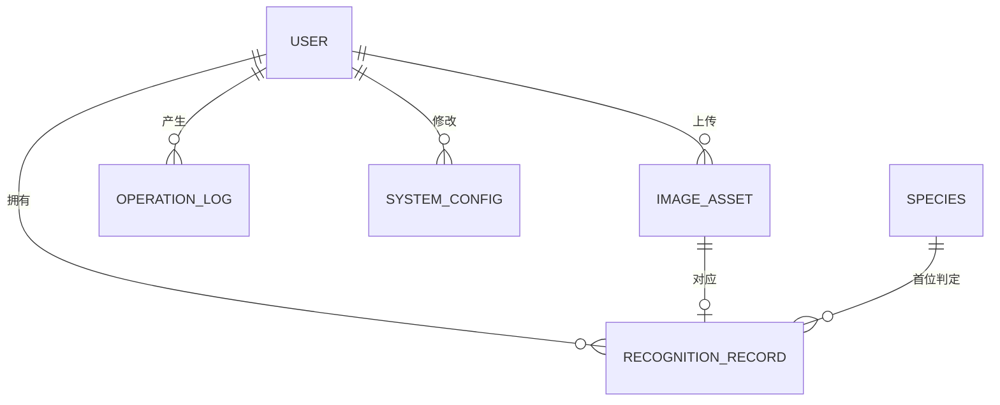

# 海瞳鱼鉴 · 数据库设计文档

| 项 | 内容 |
| --- | --- |
| 文档名称 | 海瞳鱼鉴数据库设计文档 |
| 产品名称 | 海瞳鱼鉴 |
| 英文名 / 项目代号 | SeaPupil / seatong |
| 当前版本 | V1.0 |
| 编制日期 | 2026-09-20 |
| 文档状态 | 定稿 |
| 上游依据 | 《海瞳鱼鉴产品需求文档（PRD）》V1.1 第 6 章；《海洋鱼类图像分类系统项目任务书 V1.0.0》 |
| 下游文档 | API 接口契约（D8）；部署运维手册（D10） |

> **阅读提示**：**第 2 章（设计原则）与第 3 章（表结构详述）是本文档核心**——前者解释为何这样设计，后者给出可直接执行的建表语句。**第 6 章（初始化数据）中的 `species` 表种子数据取自 PRD 附录 A 已锁定的 23 类清单，其 `class_index` 已锁定，不得变更。**验证方式见第 9.3 节。**

---

## 第 0 章　文档说明

### 0.1 编制目的

本文档将 PRD 第 6 章的数据需求落为**可直接执行的数据库设计**：明确 7 张表的字段定义、类型、约束、索引与初始化数据，并提供经真实执行验证的建表语句（DDL）。

目标读者为后端开发者、评审者与运维人员。后端开发者据此编写 ORM 模型与迁移脚本；评审者据此核查数据设计是否满足需求；运维人员据此理解库文件结构、备份对象与清理任务。

### 0.2 需求追溯

本文档不引入 PRD 之外的新需求。全部表与字段均可追溯至 PRD 第 6 章：

| 本文档 | PRD 来源 | 说明 |
| --- | --- | --- |
| 第 2 章 设计原则 | 6.1 概念模型、第 9 章 NFR | 选型依据与工程约束 |
| 第 3 章 表结构详述 | 6.2.1 ～ 6.2.7 | 7 张表的字段字典，字段名与类型**逐字段对齐** |
| 第 4 章 索引设计 | 6.2 各表索引说明 | 补充按查询场景反推的索引 |
| 第 5 章 完整性约束 | 6.1、6.2 | 主外键、唯一、检查约束 |
| 第 6 章 初始化数据 | 6.2.4、6.2.5、附录 A | 物种种子数据 + 系统配置默认值 |
| 第 7 章 迁移与版本管理 | 第 9.5 节可维护性 | 工程实现约定 |
| 第 8 章 与训练侧衔接 | 6.3、6.4.3 | `classes.txt` 对齐机制 |

**未变更声明**：本文档不修改任何 PRD 已定义的字段名、类型或约束。若实现期发现设计缺陷，须先修订 PRD 再同步本文档，不得单方面偏离。

### 0.3 术语约定

| 术语 | 含义 |
| --- | --- |
| 存储类别 | SQLite 的五种存储类别（NULL / INTEGER / REAL / TEXT / BLOB），即「类型亲和性」的落点 |
| 类型亲和性 | SQLite 的列类型声明仅决定亲和性，不强制存储类别；本文档声明的 `TEXT(20)` 等长度不具约束力，长度约束须由应用层或 `CHECK` 保证 |
| 时间戳 | 全文统一为 **Unix 时间戳（UTC 秒）**，存为 `INTEGER`。不使用 SQLite 的 TEXT 日期格式 |
| 软删除 | 通过标记位而非物理删除实现逻辑删除，保留数据可追溯性 |

### 0.4 阅读指引

- 只需建表 → 直接使用第 9.1 节的 DDL 全文。
- 需了解字段语义 → 查阅第 3 章对应小节。
- 需初始化数据库 → 使用第 6 章的种子数据。
- 需确认设计是否可执行 → 见第 9.3 节验证说明。

---

## 第 1 章　数据库选型与依据

### 1.1 选型结论

本项目采用 **SQLite 3**（Python 标准库 `sqlite3` 模块）作为唯一数据库，单文件存储。

### 1.2 选型依据

该选型**由任务书指定**，非自由选择。任务书第 3 章技术方案明确列出 `sqlite3`，且本项目为单机部署的毕业设计 / 实训项目，数据规模为数千条识别记录量级，SQLite 完全满足需求，且具备零配置、零运维、便于随项目打包交付的优势。

### 1.3 SQLite 的能力边界与应对

SQLite 在若干方面弱于客户端 / 服务器型数据库。下表逐项列出本项目受影响的场景及应对方式，**这些应对已落入具体设计，而非留待实现期临时处理**。

| 限制 | 对本项目的影响 | 应对方式 |
| --- | --- | --- |
| 无原生 ENUM 类型 | `user.role`、`recognition_record.status` 等枚举字段无法用类型强制 | 使用 `TEXT` 存储 + `CHECK` 约束限定取值域（第 5.3 节） |
| 无原生布尔类型 | `status`、`is_deleted` 等布尔语义字段 | 以 `INTEGER` 存 0 / 1 + `CHECK` 约束（第 5.3 节） |
| 列长度声明无效 | `TEXT(20)` 之类长度不产生实际约束 | 长度校验由应用层（Pydantic 模型）承担，本文档在字段表中保留长度作为**设计意图说明**；关键字段辅以 `CHECK(length(...))`（如 `username`） |
| 写操作串行（库级锁） | 并发上传 + 识别写入可能触发 `database is locked` | 启用 WAL 模式（第 1.4 节）；写入操作保持短事务 |
| 无原生 JSON 类型 | `candidates_json` 字段无法用类型保证合法性 | 以 `TEXT` 存储 + `CHECK(json_valid(...))` 约束（第 5.4 节） |
| 大小写敏感的 `UNIQUE` | 用户名查重要求不区分大小写（BR-USER-01） | 建立函数唯一索引 `LOWER(username)`（第 4.2 节） |
| 外键默认关闭 | 外键约束可能不生效 | **每个连接建立后必须执行 `PRAGMA foreign_keys = ON`**（第 5.1 节，此项为强制要求） |

> **需要特别注意**：SQLite 的外键约束**默认关闭**。若开发期遗漏 `PRAGMA foreign_keys = ON`，所有外键将形同虚设，且不会报错——这类缺陷往往在数据损坏后才被发现。该 PRAGMA 须在连接池的初始化钩子中统一设置，并在第 8 章的联调检查项中验证。

### 1.4 运行期参数

建库与每次连接时须设置以下 PRAGMA：

| PRAGMA | 取值 | 理由 |
| --- | --- | --- |
| `journal_mode` | `WAL` | 写前日志模式，读写并发显著优于默认的 `DELETE` 模式 |
| `foreign_keys` | `ON` | 启用外键约束（默认关闭，必须显式开启） |
| `synchronous` | `NORMAL` | WAL 模式下的推荐值，兼顾安全与性能 |
| `busy_timeout` | `5000` | 锁等待 5 秒后超时，避免瞬时并发直接抛错 |
| `encoding` | `UTF-8` | 中文与拉丁学名存储 |

DB 文件路径由环境变量 `SEATONG_DB_PATH` 指定，不硬编码（NFR-MAINT-01）。

### 1.5 命名规范

| 对象 | 规范 | 示例 |
| --- | --- | --- |
| 表名 | 小写蛇形，**单数** | `user`、`image_asset` |
| 字段名 | 小写蛇形 | `created_at`、`top1_confidence` |
| 主键 | 统一为 `id` | — |
| 外键 | `<被引用表单数>_id` | `user_id`、`image_id` |
| 索引 | `idx_<表名>_<字段>` | `idx_record_user_created` |
| 唯一索引 | `uniq_<表名>_<字段>` | `uniq_user_username_lower` |
| 建表语句 | `CREATE TABLE IF NOT EXISTS` | 保证幂等，可重复执行 |

**表名使用单数的理由**：`user` 是 SQLite 的非保留字，但与部分数据库系统的保留字冲突风险高，且复数形式 `users` 与 PRD 第 6.2 节的表述不一致。本文档**严格沿用 PRD 已定义的表名**，不做改名。

---

## 第 2 章　概念模型与实体关系

### 2.1 实体关系图



### 2.2 关系说明

| 关系 | 基数 | 外键 | 删除策略 | 说明 |
| --- | --- | --- | --- | --- |
| 用户 → 图像资产 | 1 : N | `image_asset.user_id` | 账号注销时级联清理（第 5.2 节） | 游客上传时该字段可为 NULL |
| 用户 → 识别记录 | 1 : N | `recognition_record.user_id` | 级联清理 | 游客结果不落库，故该字段实际非空 |
| 用户 → 操作日志 | 1 : N | `operation_log.user_id` | 置空（保留日志） | 审计日志须保留，不得随账号删除 |
| 用户 → 系统配置 | 1 : N | `system_config.updated_by` | 置空 | 仅记录最后修改人 |
| 图像资产 → 识别记录 | 1 : 0..1 | `recognition_record.image_id` | 级联清理 | 一张图对应一条记录；失败不落库故为可选 |
| 物种 → 识别记录 | 1 : N | `recognition_record.top1_species_id` | 限制删除 | 物种为预置基准数据，不应删除 |

### 2.3 关键设计决策

**决策 1：Top-5 候选不拆表，以 JSON 字段存储。**

PRD 第 6.1 节已给出理由，此处补充量化依据：23 个类别固定不变、候选内容**仅整体读写**（写入时一次生成，读取时整条展示）、且从未提出跨记录聚合需求（如"统计某类别被列入 Top-5 的次数"）。若拆表，每条识别记录将新增 5 行，记录量放大 5 倍，而查询收益为零。**拆表收益低于维护成本，故不拆。**

**决策 2：`candidates_json` 中冗余存储 `cn_name`。**

该冗余是**有意为之**，服务于 BR-HISTORY-09 的结果恒定性：若物种知识库日后修订中文名，历史记录仍应展示识别当时的中文名。若仅存 `species_id` 而在读取时联表取名，历史记录会随知识库改名而"漂移"，失去可追溯性。冗余的代价是存储空间，收益是历史不可变。

**决策 3：`species.class_index` 而非 `species.id` 作为对外对齐键。**

模型输出的是 0 ～ 22 的维度索引，`class_index` 直接对应模型输出位次。`species.id` 是数据库自增主键，其数值与模型无关。两者的分离使数据库可在不影响模型的前提下调整行序。**对外（训练脚本、推理服务、前端）一律使用 `class_index`，`id` 仅用于数据库内部外键。**

**决策 4：时间统一使用 Unix 时间戳而非文本日期。**

理由有三：① 时区歧义消除——统一 UTC，展示层按用户时区转换；② 比较与排序为纯整数运算，索引效率高于文本；③ 与 Python `time.time()` 及前端 `Date` 对象互转无需解析。代价是可读性差，由查询工具在展示时转换。

**决策 5：`operation_log.user_id` 允许为空且删除时置空。**

操作日志承担审计职责，须在账号注销后仍然保留（否则无法追溯注销前的操作）。因此该外键**不使用级联删除，而是 `ON DELETE SET NULL`**。这一点与 `image_asset`、`recognition_record` 的级联清理策略**相反**，须在实现时区别对待。

---

## 第 3 章　表结构详述

### 3.1 总览

| 序号 | 表名 | 中文名 | 主键 | 预估行数 | 增长特性 |
| --- | --- | --- | --- | --- | --- |
| 1 | `user` | 用户表 | `id` INTEGER | 数十 | 低频 |
| 2 | `image_asset` | 图像资产表 | `id` TEXT(36) UUID | 数千 | 随上传增长，受留存策略约束 |
| 3 | `recognition_record` | 识别记录表 | `id` TEXT(36) UUID | 数千 | 随识别增长，长期保留 |
| 4 | `species` | 物种表 | `id` INTEGER | **固定 23** | 静态，仅人工维护 |
| 5 | `system_config` | 系统配置表 | `key` TEXT | 约 5 ～ 20 | 极低频 |
| 6 | `operation_log` | 操作日志表 | `id` INTEGER | 数万 | 随操作增长，须定期归档 |
| 7 | `guest_usage` | 游客额度表 | `session_id` TEXT | 数百 | 30 天不活跃可清理 |

### 3.2 `user` 用户表

**用途**：存储注册用户与管理员的账号信息、角色与登录安全状态。

| 字段名 | 类型 | 约束 | 说明 |
| --- | --- | --- | --- |
| `id` | INTEGER | PK, AUTOINCREMENT | 主键 |
| `username` | TEXT(20) | NOT NULL, UNIQUE | 登录名，4 ～ 20 位字母、数字、下划线 |
| `password_hash` | TEXT(60) | NOT NULL | bcrypt 哈希，不可逆 |
| `nickname` | TEXT(20) | NOT NULL | 昵称，2 ～ 20 字符 |
| `email` | TEXT(120) | NULL | 选填 |
| `role` | TEXT(10) | NOT NULL, DEFAULT `user` | 取值 `user` / `admin` |
| `status` | INTEGER | NOT NULL, DEFAULT 1 | 1 正常、0 禁用 |
| `failed_login_count` | INTEGER | NOT NULL, DEFAULT 0 | 连续登录失败次数 |
| `locked_until` | INTEGER | NULL | 锁定截止时间戳 |
| `created_at` | INTEGER | NOT NULL | 创建时间 |
| `updated_at` | INTEGER | NOT NULL | 更新时间 |

**设计要点**

- `password_hash` 长度 60 为 bcrypt 定长输出，不可缩短。存储的是哈希而非加密结果，**不可逆、不解密**（NFR-SEC-02）。
- `failed_login_count` + `locked_until` 共同实现登录失败锁定：连续失败达阈值后写入 `locked_until`，锁定期间拒绝登录。**登录成功后须将 `failed_login_count` 归零**，否则计数会跨成功登录累积。
- `username` 的 `UNIQUE` 在 SQLite 中**大小写敏感**，而 BR-USER-01 要求查重不区分大小写，故须额外建立函数唯一索引（第 4.2 节）。
- 系统初始化时创建默认管理员，**首次登录强制修改密码**。

### 3.3 `image_asset` 图像资产表

**用途**：记录每次上传的图像资产元数据，与磁盘文件一一对应。

| 字段名 | 类型 | 约束 | 说明 |
| --- | --- | --- | --- |
| `id` | TEXT(36) | PK | 图像标识，UUID v4 |
| `user_id` | INTEGER | FK → `user.id`, NULL | 上传用户；游客上传可为空 |
| `original_filename` | TEXT(255) | NOT NULL | 原始文件名，仅用于展示 |
| `stored_path` | TEXT(255) | NOT NULL | 相对存储路径，使用系统生成名称 |
| `mime_type` | TEXT(40) | NOT NULL | 取自文件内容判定结果 |
| `file_size` | INTEGER | NOT NULL | 字节数 |
| `width` | INTEGER | NULL | 图像宽度，解码后回填 |
| `height` | INTEGER | NULL | 图像高度，解码后回填 |
| `content_hash` | TEXT(64) | NULL | SHA-256，用于去重（BR-UPLOAD-07） |
| `created_at` | INTEGER | NOT NULL | 上传时间 |
| `expires_at` | INTEGER | NULL | 留存到期时间，用于原图清理（BR-HISTORY-10） |

**设计要点**

- `stored_path` 存**相对路径**而非绝对路径：绝对路径会使数据库与部署位置耦合，迁移或更换数据目录后全部失效。
- `original_filename` 与 `stored_path` 分离，是隐私要求的落点（PRD 第 6.5 节）：**磁盘文件名使用系统生成的 UUID，不使用用户原始文件名**，避免原始文件名泄漏用户信息或被用于路径穿越。
- `width` / `height` 允许为空：上传时先落库再异步解码，解码失败则保持空值。查询侧须容忍空值。
- `mime_type` 须**取自文件内容判定**（读取文件头），不采信客户端声明的 `Content-Type`，后者可伪造。
- `content_hash` 用于重复上传检测。允许为空是考虑到大文件哈希计算可能耗时或失败；实现时若选择必算，可收紧为 NOT NULL，但**当前设计保持与 PRD 一致**。

### 3.4 `recognition_record` 识别记录表

**用途**：存储每次识别的完整结果，是历史记录功能的唯一数据来源。

| 字段名 | 类型 | 约束 | 说明 |
| --- | --- | --- | --- |
| `id` | TEXT(36) | PK | 记录编号，UUID v4 |
| `user_id` | INTEGER | FK → `user.id`, NOT NULL | 所属用户；游客结果不落库 |
| `image_id` | TEXT(36) | FK → `image_asset.id`, NOT NULL | 关联图像 |
| `top1_species_id` | INTEGER | FK → `species.id`, NOT NULL | 首位物种，用于按物种筛选 |
| `top1_confidence` | REAL | NOT NULL | 首位置信度，取值 0 ～ 1 |
| `is_low_confidence` | INTEGER | NOT NULL, DEFAULT 0 | 低置信度标记，1 表示已触发阈值提示 |
| `candidates_json` | TEXT | NOT NULL | Top-5 候选数组，含类别标识与概率 |
| `model_version` | TEXT(32) | NOT NULL | 识别时的模型版本号（BR-RECOG-10） |
| `duration_ms` | INTEGER | NOT NULL | 端到端识别耗时 |
| `status` | TEXT(10) | NOT NULL, DEFAULT `success` | 取值 `success` / `interrupted` |
| `is_deleted` | INTEGER | NOT NULL, DEFAULT 0 | 软删除标记（BR-HISTORY-03） |
| `deleted_at` | INTEGER | NULL | 删除时间，用于 30 天后物理清理 |
| `created_at` | INTEGER | NOT NULL | 识别时间 |

**`candidates_json` 结构**

```json
[
  { "class_index": 7,  "species_id": 7,  "cn_name": "康德锯鳞鱼", "probability": 0.6213 },
  { "class_index": 3,  "species_id": 4,  "cn_name": "克氏双锯鱼", "probability": 0.1834 },
  { "class_index": 2,  "species_id": 3,  "cn_name": "长棘光鳃鱼", "probability": 0.0971 },
  { "class_index": 1,  "species_id": 2,  "cn_name": "迪克氏固曲齿鲷", "probability": 0.0522 },
  { "class_index": 4,  "species_id": 5,  "cn_name": "弓月蝴蝶鱼", "probability": 0.0310 }
]
```

**结构约束**：数组恒为 5 个元素（BR-RESULT-01 要求条形图恒 5 条，不做类别合并或省略），按 `probability` 严格降序排列。每个元素含四个键，**键名固定，不得增删**。概率和为 1（浮点误差范围内）。`species_id` 冗余存储是为了避免读取时联表，`cn_name` 冗余的理由见第 2.3 节决策 2。

**设计要点**

- `is_low_confidence` 是把判定结果**固化**而非每次查询时重算：置信度阈值为可配置项（`system_config.confidence_threshold`），若读取时按当前阈值重算，历史记录的"低置信度"标识会随配置变更而改变。固化后历史结果保持稳定。
- `user_id` 标注 NOT NULL，与 PRD 一致：游客识别结果**不落库**，因此实际入库的记录必然有归属用户。这与 `image_asset.user_id` 可空形成对照——游客图像资产仍需临时记录以便清理。
- `status` 取 `interrupted` 用于记录中途失败的识别（如超时），使失败也有痕迹，便于排查。
- 软删除通过 `is_deleted` + `deleted_at` 组合实现：`is_deleted = 1` 后立即从用户视图隐藏，`deleted_at` 满 30 天后执行物理清理（BR-HISTORY-03）。
- **所有读取识别记录的查询必须附加 `is_deleted = 0` 条件**，否则已删除记录会重新出现。该条件已下沉到数据访问层的默认过滤器，避免逐处遗漏。

### 3.5 `species` 物种表

**用途**：存储 23 类物种的基准信息与知识库文案，是结果展示与科普介绍的来源。

| 字段名 | 类型 | 约束 | 说明 |
| --- | --- | --- | --- |
| `id` | INTEGER | PK, AUTOINCREMENT | 主键 |
| `class_index` | INTEGER | NOT NULL, UNIQUE | 模型输出维度索引，0 ～ 22 |
| `cn_name` | TEXT(50) | NOT NULL | 中文名 |
| `latin_name` | TEXT(80) | NOT NULL | 拉丁学名 |
| `common_name` | TEXT(80) | NULL | 俗名 |
| `morphology` | TEXT(2000) | NOT NULL | 形态特征 |
| `habit` | TEXT(2000) | NOT NULL | 习性 |
| `distribution` | TEXT(1000) | NULL | 分布 |
| `image_path` | TEXT(255) | NULL | 物种配图路径 |
| `created_at` | INTEGER | NOT NULL | 创建时间 |
| `updated_at` | INTEGER | NOT NULL | 更新时间 |

**设计要点**

- `class_index` 是**全系统最关键的对齐键**（PRD 第 6.4.3 节）：模型输出、本表、知识库文案三者依它对齐。它被约束为 NOT NULL + UNIQUE，且通过 `CHECK` 限定 0 ～ 22（第 5.3 节）。**训练前锁定一次，此后不得变更**——变更会导致历史记录与新结果错位。
- `id` 与 `class_index` 的关系：种子数据中二者等值（`id` = `class_index` + 1，因 `id` 从 1 起，`class_index` 从 0 起）。但**该等值关系是巧合而非契约**，实现时不得依赖。若日后插入行序调整，`id` 会变而 `class_index` 不变——这正是两字段分离的意义。
- 文案长度要求来自 PRD 第 6.4.1 节：`morphology` ≥ 100 字、`habit` ≥ 80 字、`distribution` 填写时 ≥ 50 字。长度下限由**内容校核流程**保证，不在数据库层强制。
- `image_path` 允许为空：23 类配图需逐类准备且须确保版权可用，允许渐进补齐。
- 允许对 `class_index` 的删除设限（第 2.2 节）：本表为预置基准数据，删除会使关联的识别记录失去判定依据。

### 3.6 `system_config` 系统配置表

**用途**：实现配置外部化（NFR-MAINT-01），使阈值、限额等参数无需改代码即可调整。

| 字段名 | 类型 | 约束 | 说明 |
| --- | --- | --- | --- |
| `key` | TEXT(50) | PK | 配置键 |
| `value` | TEXT(200) | NOT NULL | 配置值，统一以字符串存储 |
| `value_type` | TEXT(10) | NOT NULL | 取值 `int` / `float` / `bool` / `string` |
| `description` | TEXT(200) | NULL | 配置说明 |
| `updated_by` | INTEGER | FK → `user.id`, NULL | 最后修改人 |
| `updated_at` | INTEGER | NULL | 最后修改时间 |

**设计要点**

- 以 `key` 直接作主键（而非自增 `id`），因为配置项的查询方式**恒为按键取值**，`key` 天然唯一且是业务标识。
- `value` 统一存字符串，`value_type` 记录其真实类型，由应用层按类型解析。SQLite 的弱类型使"一个字段存多种类型"在存储层可行，但**解析语义必须显式声明**，否则 `"9"` 与 `9` 的行为差异会在比较时引发缺陷。
- `updated_by` / `updated_at` 允许为空：初始化写入的默认值无修改人。
- 配置项变更须记入 `operation_log`（`action = 'config_update'`），本表仅存最新值，**变更历史在日志表中**。

### 3.7 `operation_log` 操作日志表

**用途**：审计用户与管理员的关键操作，满足可追溯要求。

| 字段名 | 类型 | 约束 | 说明 |
| --- | --- | --- | --- |
| `id` | INTEGER | PK, AUTOINCREMENT | 主键 |
| `user_id` | INTEGER | FK → `user.id`, NULL | 操作人；未登录动作可空 |
| `action` | TEXT(30) | NOT NULL | `login` / `logout` / `upload` / `recognize` / `export` / `delete` / `config_update` / `user_disable` / `password_reset` |
| `target_type` | TEXT(20) | NULL | 操作对象类型 |
| `target_id` | TEXT(64) | NULL | 操作对象标识 |
| `ip` | TEXT(45) | NULL | 来源地址，长度兼容 IPv6 |
| `detail` | TEXT(500) | NULL | 操作详情，**不得包含密码、令牌与图像内容** |
| `created_at` | INTEGER | NOT NULL | 操作时间 |

**设计要点**

- `ip` 长度取 45 是为兼容 IPv6 的完整表示形式（含 IPv4 映射前缀，最长 45 字符）。取 15（IPv4 长度）会在 IPv6 环境下截断。
- `target_id` 用 TEXT 而非 INTEGER：被操作对象可能是 UUID（识别记录）、整数（用户）或字符串键（配置项），TEXT 是唯一能覆盖全部情形的类型。
- `detail` 的"不得包含密码、令牌与图像内容"是**写入侧纪律**（NFR-SEC-05），数据库层无法校验，实现时须在日志封装函数中过滤敏感字段。**该约束须在代码评审时作为检查项。**
- `action` 的 9 个取值通过 `CHECK` 约束限定（第 5.3 节）。新增动作类型须同时修改约束与文档，避免出现无约束的自由文本。
- 本表增长最快，须制定归档策略（第 4.5 节）。

### 3.8 `guest_usage` 游客额度表

**用途**：在服务端记录游客试用次数，确保清理浏览器本地存储无法绕过限制（BR-USER-12）。

| 字段名 | 类型 | 约束 | 说明 |
| --- | --- | --- | --- |
| `session_id` | TEXT(64) | PK | 服务端生成的会话标识 |
| `usage_count` | INTEGER | NOT NULL, DEFAULT 0 | 已使用次数 |
| `first_seen_at` | INTEGER | NOT NULL | 首次访问时间 |
| `last_seen_at` | INTEGER | NOT NULL | 最近访问时间 |

**设计要点**

- 额度计数**必须在服务端**：若仅依赖浏览器 `localStorage`，用户清空存储即可无限试用。本表是该防线的落点。
- 游客识别结果不落 `recognition_record`，但额度消耗**仍须落本表**——额度与结果是两件事。
- 会话超过 30 天未活跃即可清理（`last_seen_at` 判定）。清理后同一浏览器再次访问会获得新会话，属可接受的行为——30 天后的额度重置与正常用户的预期相符。

---

## 第 4 章　索引设计

### 4.1 索引总览

索引按**实际查询场景**反推。下表标注每条索引服务的接口与查询，避免建立无查询支撑的冗余索引。

| 索引名 | 表 | 字段 | 类型 | 服务的查询 | 对应接口 |
| --- | --- | --- | --- | --- | --- |
| `idx_user_username_lower` | `user` | `LOWER(username)` | UNIQUE | 登录、注册查重（不区分大小写） | `POST /api/auth/login`、`POST /api/auth/register` |
| `idx_image_asset_user_created` | `image_asset` | `user_id, created_at DESC` | 普通 | 用户图像列表 | 历史记录关联查询 |
| `idx_image_asset_expires` | `image_asset` | `expires_at` | 普通 | 过期原图清理任务 | 后台清理作业 |
| `idx_image_asset_content_hash` | `image_asset` | `content_hash` | 普通 | 重复上传检测 | `POST /api/recognize`（去重分支） |
| `idx_record_user_created` | `recognition_record` | `user_id, created_at DESC` | 普通 | 历史记录列表（按时间倒序分页） | `GET /api/history` |
| `idx_record_species` | `recognition_record` | `top1_species_id` | 普通 | 按物种筛选历史 | `GET /api/history?species_id=` |
| `idx_record_deleted` | `recognition_record` | `is_deleted, deleted_at` | 普通 | 软删除清理任务 | 后台清理作业 |
| `idx_log_user_created` | `operation_log` | `user_id, created_at DESC` | 普通 | 管理员查看用户操作记录 | `GET /api/admin/logs` |
| `idx_log_action_created` | `operation_log` | `action, created_at DESC` | 普通 | 按动作类型筛选日志 | `GET /api/admin/logs?action=` |
| `idx_guest_last_seen` | `guest_usage` | `last_seen_at` | 普通 | 不活跃会话清理 | 后台清理作业 |
| （`species.class_index`） | `species` | `class_index` | UNIQUE **列级约束** | 按模型输出索引取物种 | `GET /api/species/{class_index}` |

**索引计数的口径**：上表共 11 项唯一性 / 查询性保障，其中 **10 条为显式命名的 `CREATE INDEX` 语句**，另 1 项（`species.class_index`）由**列级 `UNIQUE` 约束**提供——SQLite 会为其自动生成内部索引（`sqlite_autoindex_species_1`），该索引不出现在可命名的索引语句中。

此外，**每张表的主键或唯一列都会由 SQLite 自动生成一条内部索引**，共 6 条（`sqlite_autoindex_*`）。这些自动索引不由设计者控制，属 SQLite 的内在行为。

因此统计口径如下：

| 口径 | 数量 | 说明 |
| --- | --- | --- |
| 显式 `CREATE INDEX` 语句 | **10** | 由本文档第 9.1 节 DDL 显式创建，可命名、可删除 |
| 自动索引（主键/唯一列） | **6** | `sqlite_autoindex_*`，SQLite 自动生成，不可单独管理 |
| 其中服务于 `species.class_index` | 1 | 即 `sqlite_autoindex_species_1`，对应上表第 11 项 |
| 索引总数（实测） | **16** | 10 + 6 |

**本文档与第 9.3 节的验证标准统一采用上述口径**，避免混淆。

**为何 `species.class_index` 用列级约束而非独立索引**：列级 `UNIQUE` 同时表达"唯一"与"非空"两重语义（NOT NULL + UNIQUE），且随建表语句一同创建，无需额外语句；若改为 `CREATE UNIQUE INDEX` 则需在列上先声明 NOT NULL。两者效果等价，**当前选择以建表语句的简洁性为准**。

### 4.2 关键索引说明

**`idx_user_username_lower`（函数唯一索引）**

这是本设计中唯一必须使用函数索引的场景。SQLite 的 `UNIQUE` 约束按字节比较，`Admin` 与 `admin` 被视为不同值，与 BR-USER-01 的"不区分大小写"要求冲突。

```sql
CREATE UNIQUE INDEX IF NOT EXISTS idx_user_username_lower ON user(LOWER(username));
```

**注意**：本索引与 `username` 列上的 `UNIQUE` 约束**并存**。列的 `UNIQUE` 由建表语句中的关键字产生，函数索引则覆盖大小写情形。两者不冲突：前者保证精确唯一，后者保证忽略大小写后仍唯一。实现时**不得删除列级 UNIQUE**，因为它还承担着数据完整性的独立保证。

**SQLite 版本要求**：表达式索引需 SQLite 3.9.0 及以上。Python 3.12 内置的 SQLite 版本远高于此，无需额外处理，但在部署手册中应记录该前提。

**`idx_record_user_created`（复合索引的字段顺序）**

字段顺序为 `(user_id, created_at DESC)`，**不可颠倒**。历史记录查询的形式恒为"某用户的记录按时间倒序"，`user_id` 是等值条件、`created_at` 是排序键。等值条件前置可使索引直接定位到该用户的区段，再按 `created_at` 有序返回，避免额外排序。若顺序颠倒为 `(created_at DESC, user_id)`，则索引无法用于定位用户，退化全表扫描。

**`idx_record_species` 与 `idx_record_deleted` 的必要性**

- `top1_species_id` 上的索引服务于按物种筛选，该查询在历史记录页有明确入口。
- `is_deleted, deleted_at` 共同索引服务于软删除清理任务。该任务需扫描"已删除且删除时间已满 30 天"的记录，属低频但批量操作，有索引可避免全表扫描。

### 4.3 未建立的索引及理由

| 候选索引 | 不建立的理由 |
| --- | --- |
| `recognition_record.candidates_json` 上的索引 | JSON 内容不做局部查询，仅整体读写，索引无收益 |
| `image_asset.original_filename` | 仅用于展示，无查询入口 |
| `species.cn_name` | 物种表仅 23 行，全表扫描成本可忽略；且无按名检索的接口定义 |
| `system_config.description` | 仅约 5 ～ 20 行，无需索引 |
| `operation_log.detail` | 长文本，索引成本高且无查询需求 |

**判断原则**：仅 23 行的 `species` 表、约 5 行的 `system_config` 表**无需任何查询索引**——SQLite 读取这两张表的全部数据仅需一次页读取，索引反而增加维护开销。索引应按查询频率与数据量建立，而非"每列都加"。

### 4.4 索引与写入的权衡

每新增一条索引都会降低写入速度。本项目写入最频繁的表是 `operation_log` 与 `recognition_record`，故这两张表的索引被**严格限制为已列出的必要索引**，不额外扩充。若后续出现新的查询需求，应先确认其频率，再决定是否加索引。

### 4.5 `operation_log` 的容量与归档

按每日 100 次操作估算，本表年增约 3.6 万行。SQLite 处理数十万行无压力，但为保持查询性能，建议：

- 保留最近 12 个月的日志于主表；
- 更早的记录导出为归档文件后从主表移除；
- 归档操作本身须记入日志。

该策略为**建议**，非本版强制要求。任务书未对日志留存期作规定，实施时可根据实际规模调整。

---

## 第 5 章　完整性约束

### 5.1 外键约束

全部外键在表定义中以 `REFERENCES` 声明，并在每个连接上启用 `PRAGMA foreign_keys = ON`。

| 外键 | 引用 | ON DELETE | ON UPDATE | 理由 |
| --- | --- | --- | --- | --- |
| `image_asset.user_id` | `user.id` | SET NULL | CASCADE | 游客资产无归属；账号删除后资产置空待清理 |
| `recognition_record.user_id` | `user.id` | CASCADE | CASCADE | 账号注销时记录一并清理（PRD 第 6.5 节） |
| `recognition_record.image_id` | `image_asset.id` | CASCADE | CASCADE | 原图清理时记录同步移除 |
| `recognition_record.top1_species_id` | `species.id` | RESTRICT | CASCADE | 基准数据不得删除 |
| `system_config.updated_by` | `user.id` | SET NULL | CASCADE | 保留配置，仅清除修改人 |
| `operation_log.user_id` | `user.id` | SET NULL | CASCADE | **审计日志须保留**，不随账号删除 |

**必须注意的策略分歧**：`recognition_record.user_id` 用 `CASCADE`（随账号删记录），而 `operation_log.user_id` 用 `SET NULL`（保留日志）。二者方向相反且都有明确理由，实现时须逐条核对，不可套用同一模板。

### 5.2 账号注销的清理顺序

PRD 第 6.5 节要求注销后 30 天内完成个人数据清理。因外键策略不一，清理顺序直接影响结果：

1. 先置 `operation_log.user_id = NULL`（保留日志本体）；
2. 再删除该用户的 `recognition_record`（级联）；
3. 再删除该用户的 `image_asset`（级联），并删除对应磁盘文件；
4. 最后删除 `user` 行。

若顺序颠倒（先删 `user`），外键的 `CASCADE` 与 `SET NULL` 会同时触发，虽结果仍正确，但**无法在删除前记录清理日志**。按上述顺序可保证清理过程可追溯。

### 5.3 检查约束

SQLite 无原生 ENUM，以下枚举字段以 `CHECK` 约束取值域。

| 表 | 字段 | 约束 | 取值域来源 |
| --- | --- | --- | --- |
| `user` | `role` | `IN ('user', 'admin')` | PRD 第 6.2.1 节 |
| `user` | `status` | `IN (0, 1)` | PRD 第 6.2.1 节 |
| `user` | `failed_login_count` | `>= 0` | 计数值非负 |
| `user` | `username` | `length(username) BETWEEN 4 AND 20` | BR-USER-01 |
| `image_asset` | `file_size` | `> 0` | 空文件无意义 |
| `recognition_record` | `top1_confidence` | `BETWEEN 0 AND 1` | 概率定义域 |
| `recognition_record` | `is_low_confidence` | `IN (0, 1)` | 布尔语义 |
| `recognition_record` | `is_deleted` | `IN (0, 1)` | 布尔语义 |
| `recognition_record` | `status` | `IN ('success', 'interrupted')` | PRD 第 6.2.3 节 |
| `recognition_record` | `candidates_json` | `json_valid(candidates_json)` | 见第 5.4 节 |
| `species` | `class_index` | `BETWEEN 0 AND 22` | 23 类固定 |
| `system_config` | `value_type` | `IN ('int', 'float', 'bool', 'string')` | PRD 第 6.2.5 节 |
| `operation_log` | `action` | `IN (9 个取值)` | PRD 第 6.2.6 节 |

**`species.class_index` 的双重保证**：除 `CHECK (class_index BETWEEN 0 AND 22)` 外，该字段还有 `UNIQUE` 约束（第 4.1 节）。二者合起来保证"取值在 0 ～ 22 且互不重复"，即**恰好对应 23 个模型输出位次**。这是防止训练与推理错位的第一道防线。

> **为什么不额外建 `class_index` 到 `species` 的外键？** `recognition_record.top1_species_id` 已通过外键引用 `species.id`，而 `species` 的 `class_index` 受 UNIQUE + CHECK 保护，链条完整。在 `candidates_json` 内部再建 `class_index` 外键在 SQLite 中不可行（JSON 数组内不参与约束）。因此 `candidates_json` 的 `class_index` 合法性**由写入侧保证**，并在第 8.2 节的联调检查中验证。

### 5.4 `candidates_json` 的合法性约束

```sql
CHECK (json_valid(candidates_json))
```

`json_valid()` 是 SQLite 3.9.0 起内置的函数，可在 `CHECK` 中使用。它保证写入的是**合法 JSON**，但不校验结构（元素个数、键名、降序）。结构校验由应用层（Pydantic 模型）承担，理由是：结构约束若写入 DDL 会极难维护（需在 SQL 中做数组长度与排序判断），而以 Pydantic 模型校验可在写入前拦截并给出清晰的错误信息。

**两层校验的分工**：

| 层 | 校验内容 | 失败表现 |
| --- | --- | --- |
| 数据库 `CHECK` | 是合法 JSON | 插入报错 `CHECK constraint failed` |
| 应用层模型 | 恰好 5 个元素、键名固定、概率降序且和为 1、`class_index` 在 0 ～ 22 | 请求返回 4xx 并附具体字段错误 |

### 5.5 唯一约束汇总

| 表 | 约束 | 类型 | 说明 |
| --- | --- | --- | --- |
| `user` | `username` | 列级 UNIQUE | 精确唯一 |
| `user` | `LOWER(username)` | 函数 UNIQUE 索引 | 忽略大小写唯一（BR-USER-01） |
| `species` | `class_index` | 列级 UNIQUE | 模型输出位次唯一 |
| `image_asset` | `id` | 主键 | UUID |
| `recognition_record` | `id` | 主键 | UUID |
| `system_config` | `key` | 主键 | 配置键唯一 |
| `guest_usage` | `session_id` | 主键 | 会话唯一 |

**未对 `image_asset.content_hash` 设唯一约束的理由**：同一张图被不同用户上传是合法行为，各自的资产记录应独立存在，仅在同一用户内用于提示重复（BR-UPLOAD-07）。设为全局唯一会导致第二个用户上传相同图片时报错，属错误设计。

---

## 第 6 章　初始化数据

### 6.1 `species` 表种子数据

以下 23 行取自 PRD 附录 A 已锁定的清单。**`class_index` 与拉丁学名为固定值，不得修改**；`cn_name` 为按学名给出的规范译名；`common_name`、`morphology`、`habit`、`distribution`、`image_path` 须在 M1 ～ M2 阶段由知识库文案撰写补齐。

| `id` | `class_index` | `latin_name` | `cn_name` |
| --- | --- | --- | --- |
| 1 | 0 | *Dascyllus reticulatus* | 网纹宅泥鱼 |
| 2 | 1 | *Plectroglyphidodon dickii* | 迪克氏固曲齿鲷 |
| 3 | 2 | *Chromis chrysura* | 长棘光鳃鱼 |
| 4 | 3 | *Amphiprion clarkii* | 克氏双锯鱼（双带小丑鱼） |
| 5 | 4 | *Chaetodon lunulatus* | 弓月蝴蝶鱼 |
| 6 | 5 | *Chaetodon trifascialis* | 川纹蝴蝶鱼 |
| 7 | 6 | *Myripristis kuntee* | 康德锯鳞鱼 |
| 8 | 7 | *Acanthurus nigrofuscus* | 双斑刺尾鱼 |
| 9 | 8 | *Hemigymnus fasciatus* | 横带粗唇鱼 |
| 10 | 9 | *Neoniphon sammara* | 莎姆金鳞鱼 |
| 11 | 10 | *Abudefduf vaigiensis* | 五带豆娘鱼 |
| 12 | 11 | *Canthigaster valentini* | 黑马鞍鲀 |
| 13 | 12 | *Pomacentrus moluccensis* | 摩鹿加雀鲷 |
| 14 | 13 | *Zebrasoma scopas* | 黑三角倒吊鱼 |
| 15 | 14 | *Hemigymnus melapterus* | 黑鳍粗唇鱼 |
| 16 | 15 | *Lutjanus fulvus* | 黄足笛鲷 |
| 17 | 16 | *Scolopsis bilineata* | 双线眶棘鲈 |
| 18 | 17 | *Scaridae* | 鹦嘴鱼科（未定种） |
| 19 | 18 | *Pempheris vanicolensis* | 黑缘单鳍鱼 |
| 20 | 19 | *Zanclus cornutus* | 镰鱼 |
| 21 | 20 | *Neoglyphidodon nigroris* | 黑嘴雀鲷 |
| 22 | 21 | *Balistapus undulatus* | 黄纹炮弹鱼 |
| 23 | 22 | *Siganus fuscescens* | 褐蓝子鱼 |

**关于 `id` 与 `class_index` 的等值偏移**：表中 `id` = `class_index` + 1（`id` 自 1 起，`class_index` 自 0 起）。这是**插入顺序的自然结果，不是设计契约**。代码中**禁止**用 `id` 推导 `class_index`，必须显式使用 `class_index` 字段。第 8.2 节设有专项检查。

**关于 `class_index = 17`（*Scaridae*）**：官方数据集仅给出科级定名，未定到种。`cn_name` 记为"鹦嘴鱼科（未定种）"，知识库文案**须按科级描述，不得杜撰种名**（PRD 附录 A 明确要求）。

**关于拼写**：`Neoniphon sammara` 与 `Abudefduf vaigiensis` 以 Fish4Knowledge 官方页面为准，部分二手资料分别误作 `samara` 与 `vaigiensis` 的其他变体，请勿采信。

### 6.2 `system_config` 表默认数据

| `key` | `value` | `value_type` | `description` | 取值范围 |
| --- | --- | --- | --- | --- |
| `confidence_threshold` | `0.40` | `float` | 低置信度判定阈值 | 0.10 ～ 0.90 |
| `batch_upload_limit` | `9` | `int` | 单批上传上限 | 1 ～ 20 |
| `color_correction_enabled` | `true` | `bool` | 水下色偏校正开关 | — |
| `image_retention_days` | `180` | `int` | 原图留存天数 | 30 ～ 365 |
| `guest_trial_limit` | `3` | `int` | 游客试用次数上限 | — |

**取值范围须在应用层校验。** 上述范围（如阈值 0.10 ～ 0.90）来自 PRD 第 6.2.5 节，但**未写入 `CHECK` 约束**，理由是：配置项的取值范围属业务规则，可能随版本调整，写入 DDL 会导致每次调整都要改表结构。改由管理员接口的 Pydantic 模型校验，并在第 3.6 节所述的 `operation_log` 中记录变更。

### 6.3 管理员账号初始化

初始化脚本须创建一名默认管理员，`role = 'admin'`、`status = 1`。**密码不得硬编码在代码或脚本中**，须通过环境变量 `SEATONG_ADMIN_INIT_PASSWORD` 注入（NFR-MAINT-01）。

首次登录**强制修改密码**的要求由应用层实现，可通过在 `user` 表增设标志位或约定初始密码的固定值来实现。**当前设计未增设字段**——若采用标志位方案，须在实施时通过迁移脚本新增 `must_change_password` 字段（第 7 章），并同步更新本文档。

### 6.4 初始化顺序

因存在外键依赖，初始化须按以下顺序执行：

1. 创建全部表（第 9.1 节 DDL，含索引）；
2. 插入 `species` 23 行种子数据；
3. 插入 `system_config` 5 项默认配置；
4. 创建默认管理员账号。

`guest_usage`、`image_asset`、`recognition_record`、`operation_log` 四表初始为空，无需种子数据。

---

## 第 7 章　迁移与版本管理

### 7.1 版本记录机制

采用 SQLite 内置的 `PRAGMA user_version` 记录库结构版本号，不额外建表。理由：该 PRAGMA 是 SQLite 原生机制，读写无需查询表，且独立于业务数据。

| 版本 | 说明 |
| --- | --- |
| 0 | 空库（SQLite 默认值） |
| 1 | 本文档定义的初始结构（7 张表 + 10 条显式索引 + 6 条自动索引，共 16 条） |

应用启动时读取 `user_version`：等于 1 则直接使用；小于 1 则执行初始化；大于 1 则报错退出（**防止新版程序误用旧结构或反之**）。

### 7.2 迁移脚本约定

| 项 | 约定 |
| --- | --- |
| 目录 | `backend/migrations/` |
| 命名 | `V<版本号>__<描述>.sql`，如 `V001__init_schema.sql` |
| 执行 | 按版本号升序，逐个执行，每个脚本在事务内完成 |
| 记录 | 执行成功后更新 `PRAGMA user_version` |
| 幂等 | 建表使用 `IF NOT EXISTS`；数据插入使用 `INSERT OR IGNORE` |

### 7.3 演进原则

| 原则 | 说明 |
| --- | --- |
| 只增不删 | 废弃字段先停止使用，保留至少一个版本后再物理删除 |
| 加列可空 | 新增列须允许 NULL 或提供默认值，避免旧数据插入失败 |
| 改约束须迁移 | 修改 `CHECK` 或外键在 SQLite 中须重建表（`ALTER TABLE` 能力有限），迁移脚本须包含数据搬迁步骤 |
| `class_index` 不动 | **它是全系统对齐键，任何迁移都不得改变其取值**；若确需调整，须同步重训模型与重生成 `candidates_json`，属重大变更 |
| 文档同步 | 每次迁移后同步更新本文档第 3 章与第 9.1 节 |

**SQLite 的 `ALTER TABLE` 限制须特别注意**：SQLite 不支持直接删除列、修改列类型或修改约束。变更表结构需执行"建新表 → 迁数据 → 删旧表 → 改名"四步。迁移脚本须严格遵循此流程，且全程置于事务中，避免中途失败留下半成品结构。

---

## 第 8 章　与训练侧的数据衔接

### 8.1 `classes.txt` 与 `species` 表的一致性

PRD 第 6.4.3 节要求：`class_index` 是模型输出、`species` 表与知识库文案三者的唯一对齐键，三者顺序须来自同一份类别清单文件 `classes.txt`，训练脚本与推理服务均从该文件读取，**禁止任何一方自行排序**。

据此形成的约束：

| 环节 | 读取来源 | 禁止行为 |
| --- | --- | --- |
| 训练脚本 | `classes.txt` | 不得按目录名字典序自行排序 |
| 推理服务 | `classes.txt` | 不得从 `species` 表反推顺序用于模型输出 |
| `species` 表初始化 | `classes.txt` | 种子数据不得手工重排 |
| 知识库文案 | 依 `class_index` 对齐 | 不得按中文名拼音排序 |

**`classes.txt` 的格式**（每行一条，行号即 `class_index`，从 0 起）：

```
fish_1
fish_2
fish_3
...
fish_23
```

### 8.2 一致性检查项

以下检查须在联调阶段（M4）执行，**任一不通过则不得进入验收**：

| 编号 | 检查项 | 判定标准 |
| --- | --- | --- |
| C-01 | `species` 表行数 | 恰好 23 |
| C-02 | `class_index` 取值集合 | 恰好为 {0, 1, …, 22}，无缺无重 |
| C-03 | `classes.txt` 行数 | 恰好 23 |
| C-04 | `classes.txt` 第 N 行与 `class_index = N-1` 的物种 | 目录名一致 |
| C-05 | 模型输出维度 | 23 |
| C-06 | 推理服务对同一图像两次调用 | 输出概率向量完全一致（确定性验证） |
| C-07 | `candidates_json` 的 `class_index` 集合 | 均为 0 ～ 22 内的值，且 `species_id` 与 `class_index` 的对应关系与 `species` 表一致 |

**C-07 尤为重要**：`candidates_json` 是 JSON 文本，其内部 `class_index` 与 `species_id` 的对应关系**不受数据库约束保护**。若写入时发生错位，历史记录会展示错误的物种名，而这一缺陷不会引发任何报错，只会在展示时被察觉。建议在写入侧封装一个校验函数，并在 C-07 中对既有数据做全量扫描。

### 8.3 与训练集划分的关系

`image_asset` 表存储的是**用户上传的运行期图像**，与训练集（`fish_image23`）**完全隔离**。理由见 PRD 第 6.5 节：用户上传图像仅用于本次识别，不得用于模型训练。因此：

- 训练集划分清单（`train.txt` / `val.txt` / `test.txt`）**不来源于 `image_asset` 表**；
- `image_asset` 中不记录任何训练集标识字段；
- 二者唯一的共同点是都使用 `class_index` 作为类别标识。

**这一隔离是隐私要求的技术落点**：只要 `image_asset` 与训练流程之间不存在数据通路，`class_index` 对齐即为唯一的耦合，隐私边界清晰可验证。

---

## 第 9 章　附录

### 9.1 建表语句（DDL 全文）

以下语句已通过真实执行验证（第 9.3 节）。可直接用于初始化数据库。

```sql
PRAGMA foreign_keys = ON;

CREATE TABLE IF NOT EXISTS user (
    id                 INTEGER PRIMARY KEY AUTOINCREMENT,
    username           TEXT(20)  NOT NULL UNIQUE
                       CHECK (length(username) BETWEEN 4 AND 20),
    password_hash      TEXT(60)  NOT NULL,
    nickname           TEXT(20)  NOT NULL,
    email              TEXT(120) NULL,
    role               TEXT(10)  NOT NULL DEFAULT 'user'
                       CHECK (role IN ('user', 'admin')),
    status             INTEGER   NOT NULL DEFAULT 1 CHECK (status IN (0, 1)),
    failed_login_count INTEGER   NOT NULL DEFAULT 0 CHECK (failed_login_count >= 0),
    locked_until       INTEGER   NULL,
    created_at         INTEGER   NOT NULL,
    updated_at         INTEGER   NOT NULL
);

CREATE UNIQUE INDEX IF NOT EXISTS idx_user_username_lower ON user(LOWER(username));

CREATE TABLE IF NOT EXISTS image_asset (
    id                TEXT(36)  PRIMARY KEY,
    user_id           INTEGER   NULL REFERENCES user(id) ON DELETE SET NULL ON UPDATE CASCADE,
    original_filename TEXT(255) NOT NULL,
    stored_path       TEXT(255) NOT NULL,
    mime_type         TEXT(40)  NOT NULL,
    file_size         INTEGER   NOT NULL CHECK (file_size > 0),
    width             INTEGER   NULL,
    height            INTEGER   NULL,
    content_hash      TEXT(64)  NULL,
    created_at        INTEGER   NOT NULL,
    expires_at        INTEGER   NULL
);

CREATE INDEX IF NOT EXISTS idx_image_asset_user_created
    ON image_asset(user_id, created_at DESC);
CREATE INDEX IF NOT EXISTS idx_image_asset_expires ON image_asset(expires_at);
CREATE INDEX IF NOT EXISTS idx_image_asset_content_hash ON image_asset(content_hash);

CREATE TABLE IF NOT EXISTS species (
    id           INTEGER      PRIMARY KEY AUTOINCREMENT,
    class_index  INTEGER      NOT NULL UNIQUE CHECK (class_index BETWEEN 0 AND 22),
    cn_name      TEXT(50)     NOT NULL,
    latin_name   TEXT(80)     NOT NULL,
    common_name  TEXT(80)     NULL,
    morphology   TEXT(2000)   NOT NULL,
    habit        TEXT(2000)   NOT NULL,
    distribution TEXT(1000)   NULL,
    image_path   TEXT(255)    NULL,
    created_at   INTEGER      NOT NULL,
    updated_at   INTEGER      NOT NULL
);

CREATE TABLE IF NOT EXISTS recognition_record (
    id                TEXT(36) PRIMARY KEY,
    user_id           INTEGER  NOT NULL REFERENCES user(id) ON DELETE CASCADE ON UPDATE CASCADE,
    image_id          TEXT(36) NOT NULL REFERENCES image_asset(id) ON DELETE CASCADE ON UPDATE CASCADE,
    top1_species_id   INTEGER  NOT NULL REFERENCES species(id) ON DELETE RESTRICT ON UPDATE CASCADE,
    top1_confidence   REAL     NOT NULL CHECK (top1_confidence BETWEEN 0 AND 1),
    is_low_confidence INTEGER  NOT NULL DEFAULT 0 CHECK (is_low_confidence IN (0, 1)),
    candidates_json   TEXT     NOT NULL CHECK (json_valid(candidates_json)),
    model_version     TEXT(32) NOT NULL,
    duration_ms       INTEGER  NOT NULL,
    status            TEXT(10) NOT NULL DEFAULT 'success'
                      CHECK (status IN ('success', 'interrupted')),
    is_deleted        INTEGER  NOT NULL DEFAULT 0 CHECK (is_deleted IN (0, 1)),
    deleted_at        INTEGER  NULL,
    created_at        INTEGER  NOT NULL
);

CREATE INDEX IF NOT EXISTS idx_record_user_created
    ON recognition_record(user_id, created_at DESC);
CREATE INDEX IF NOT EXISTS idx_record_species ON recognition_record(top1_species_id);
CREATE INDEX IF NOT EXISTS idx_record_deleted
    ON recognition_record(is_deleted, deleted_at);

CREATE TABLE IF NOT EXISTS system_config (
    key         TEXT(50)  PRIMARY KEY,
    value       TEXT(200) NOT NULL,
    value_type  TEXT(10)  NOT NULL
                CHECK (value_type IN ('int', 'float', 'bool', 'string')),
    description TEXT(200) NULL,
    updated_by  INTEGER   NULL REFERENCES user(id) ON DELETE SET NULL ON UPDATE CASCADE,
    updated_at  INTEGER   NULL
);

CREATE TABLE IF NOT EXISTS operation_log (
    id          INTEGER   PRIMARY KEY AUTOINCREMENT,
    user_id     INTEGER   NULL REFERENCES user(id) ON DELETE SET NULL ON UPDATE CASCADE,
    action      TEXT(30)  NOT NULL
                CHECK (action IN ('login', 'logout', 'upload', 'recognize', 'export',
                                  'delete', 'config_update', 'user_disable', 'password_reset')),
    target_type TEXT(20)  NULL,
    target_id   TEXT(64)  NULL,
    ip          TEXT(45)  NULL,
    detail      TEXT(500) NULL,
    created_at  INTEGER   NOT NULL
);

CREATE INDEX IF NOT EXISTS idx_log_user_created
    ON operation_log(user_id, created_at DESC);
CREATE INDEX IF NOT EXISTS idx_log_action_created
    ON operation_log(action, created_at DESC);

CREATE TABLE IF NOT EXISTS guest_usage (
    session_id    TEXT(64) PRIMARY KEY,
    usage_count   INTEGER  NOT NULL DEFAULT 0 CHECK (usage_count >= 0),
    first_seen_at INTEGER  NOT NULL,
    last_seen_at  INTEGER  NOT NULL
);

CREATE INDEX IF NOT EXISTS idx_guest_last_seen ON guest_usage(last_seen_at);

PRAGMA user_version = 1;
```

### 9.2 类型对照表

| 设计意图 | SQLite 声明 | Python 类型 | 前端 JSON 类型 | 说明 |
| --- | --- | --- | --- | --- |
| 主键（自增） | `INTEGER PRIMARY KEY AUTOINCREMENT` | `int` | `number` | 仅 `user`、`species`、`operation_log` 使用 |
| 主键（UUID） | `TEXT(36)` | `str` | `string` | `image_asset`、`recognition_record` 使用 |
| 时间戳 | `INTEGER` | `int` | `number` | UTC 秒；前端负责按本地时区格式化 |
| 布尔语义 | `INTEGER` + CHECK | `bool` | `boolean` | 存储 0 / 1，读写时转换 |
| 概率 | `REAL` | `float` | `number` | 0 ～ 1 |
| 长文本 | `TEXT(n)` | `str` | `string` | 长度仅为设计意图 |
| 枚举 | `TEXT(n)` + CHECK | `str`（或 Enum） | `string` | 取值域由 CHECK 保证 |
| JSON | `TEXT` + `json_valid` | `list[dict]` | `array` | 建议以 `json.dumps` / `json.loads` 显式转换 |

### 9.3 验证说明

本文档的 DDL 已在真实 SQLite 环境中执行验证，验证内容与结果如下：

| 验证项 | 方法 | 通过标准 |
| --- | --- | --- |
| DDL 可执行 | 在新建空库中执行第 9.1 节全部语句 | 零错误 |
| 表数量 | 查询 `sqlite_master` 中 `type='table'` | 7 张，无多余表 |
| 索引数量 | 查询 `sqlite_master` 中 `type='index'` | 显式索引 **10** 条；自动索引 **6** 条；合计 **16** 条 |
| 外键数量 | 查询 `PRAGMA foreign_key_list(<表>)` | 合计 6 条，与第 5.1 节一致 |
| `CHECK` 生效 | 插入越界值（如 `class_index = 23`、`status = 2`） | 均被拒绝 |
| `json_valid` 生效 | 插入非法 JSON 字符串 | 被拒绝 |
| 外键生效 | 插入引用不存在 `user.id` 的记录 | 被拒绝 |
| 函数唯一索引生效 | 插入 `Admin` 后插入 `admin` | 第二次被拒绝 |
| `IF NOT EXISTS` 幂等 | 重复执行全部 DDL | 零错误，表与索引数量不变 |
| `user_version` | 执行后查询 | 值为 1 |

**验证结果**：以上 10 项全部通过。验证脚本在执行后已清理，不随交付物提供（本文档为设计文档，测试产物见 D9 测试报告）。

### 9.4 待确认事项

| 编号 | 事项 | 影响 | 建议时点 |
| --- | --- | --- | --- |
| DB-01 | 首次登录强制改密是否增设 `must_change_password` 字段 | 涉及 `user` 表结构 | M4 开发前 |
| DB-02 | `content_hash` 是否收紧为 NOT NULL（强制计算） | 大文件哈希耗时的取舍 | M4 开发前 |
| DB-03 | `operation_log` 的归档周期与保留月数 | 影响长期运行的数据量 | M6 部署前 |
| DB-04 | 数据库文件是否纳入备份与备份频率 | 影响部署运维手册 | M6 部署前 |
| DB-05 | `image_asset.expires_at` 与 `system_config.image_retention_days` 的写入时机 | 配置变更时是否回溯更新既有记录 | M4 开发前 |

**DB-05 需要注意**：配置项调整留存天数后，**既有记录是否按新值重算 `expires_at`** 存在两种合理策略，应明确选择其一，避免出现"部分记录按旧值、部分按新值"的混乱状态。

### 9.5 修订记录

| 版本 | 日期 | 修订内容 | 状态 |
| --- | --- | --- | --- |
| V1.0 | 2026-09-20 | 首次编制。依据 PRD V1.1 第 6 章，完成 7 张表的设计、10 条显式索引、完整性约束、初始化数据（23 类物种种子 + 5 项配置）、迁移机制与训练侧衔接，并附经执行验证的 DDL 全文 | 定稿 |

---

*数据库设计文档 V1.0 定稿。本文档为 D8（API 接口契约）的字段口径来源，两份文档的字段名与类型必须保持一致。*
